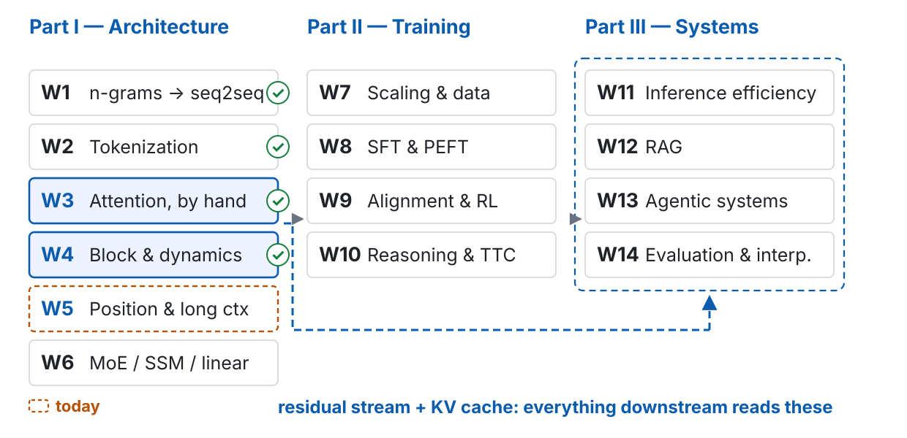
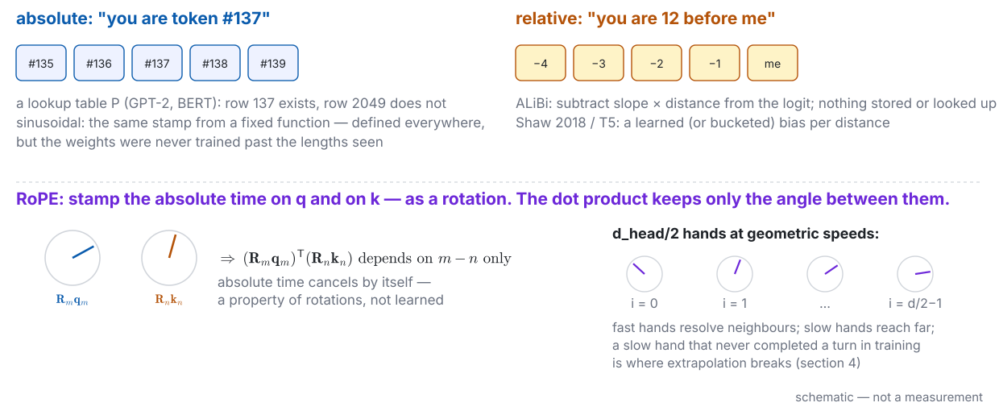
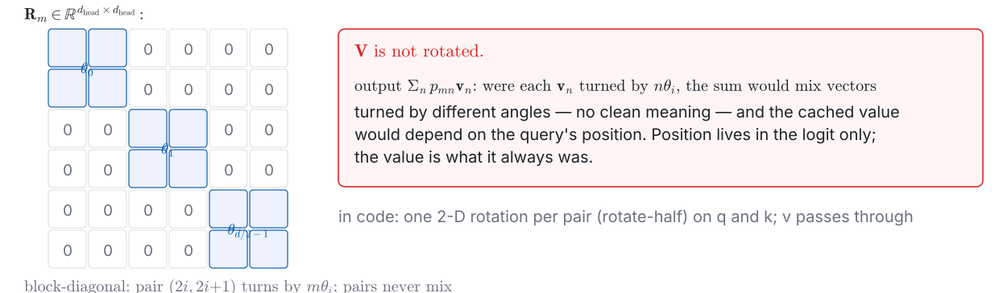
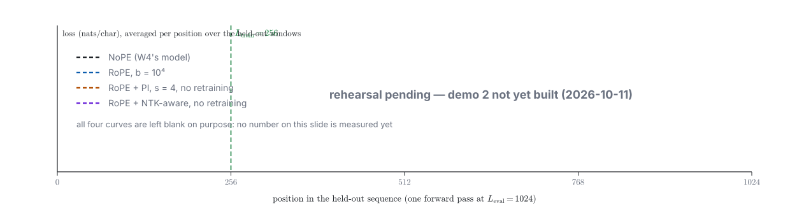
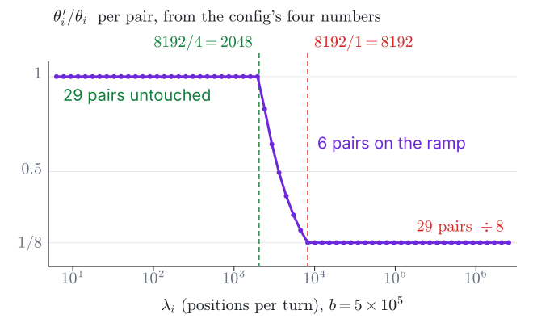

<!-- 此檔由 bin/publish_slides.py 從投影片正本產生（中文講稿區塊已剝除），請勿直接編輯。正本在 private repo 的 <course>/slides/。 -->

# The hole W3 left open {.section-title}

## Where we are: week 5 of 14

{width="100%"}

## Last week, in one picture



::: {.claim}
**Week 4's block has nothing positional in it, and it learned order anyway — from the mask.** So the question is not "how does the model know the order"; it is what writing the position down *buys*.
:::

::: {.footer}
W4 p9–p11 · W4 demo 1 rehearsal 2026-10-06 (W4 p22) · W3 p42 · right half: schematic
:::

## The problem this week handles, in one picture



::: {.claim}
Three claims hide inside "a 128k context window": the architecture **allows** it, the model **uses** it, and you can **afford** it. Today measures all three — separately.
:::

::: {.footer}
Outline W5 · on the board: p15–16, p21, p33 · replayed: p24, p29, p39
:::

## What you should be able to do by the end of today

1. Restate W3 p42 and **compare five ways to write the position** — learned absolute, sinusoidal, ALiBi, RoPE, NoPE — saying how each breaks at a length it never saw
2. **Derive RoPE's relativity** from $\mathbf{R}_m^\top\mathbf{R}_n = \mathbf{R}_{n-m}$; state that it lives in $\mathbf{q}^\top\mathbf{k}$ alone, so the KV cache holds (W3 p15) and MLA's absorption does not commute with it (W3 p29)
3. Explain extrapolation failure with the wavelength $\lambda_i$; say what **PI, NTK-aware and YaRN** each repair and cost; **read Llama 3.1's `rope_scaling`** and name which one it ships
4. Explain the **attention sink** as softmax's doing, and why **StreamingLLM** stays stable — and why that is not long-context ability
5. State the **lost-in-the-middle** design; say why NIAH is a lower bound and what RULER and NoLiMa add
6. Fill the ledger's long-context row for a real `config.json`: which term is $\propto L$, which $\propto L^2$, where they cross; state the **budget view of sparse attention**

## W3 p42, restated — and the question for today

- **No mask**: $\mathrm{Attn}(\mathbf{P}\mathbf{X}) = \mathbf{P}\,\mathrm{Attn}(\mathbf{X})$ for any permutation $\mathbf{P}$ — attention addresses by content and has no idea where anything is
- **Causal mask**: row $t$ sees exactly $t$ keys. The symmetry is broken and the count leaks position; a causal LM with **no positional term learns to use it** (Haviv et al. 2022) — W4's tiny GPT is the specimen on p4
- So "without positional encoding the model cannot tell order" is **false** for a causal LM. It was true of the un-masked encoder; that is where the sentence comes from

::: {.ask}
If the mask already lets the model learn its position, what does an **explicit** position buy? Write one sentence. Keep it: we come back to it at p42.
:::

::: {.footer}
W3 p42 · Haviv et al., Findings of EMNLP 2022 · Misconception 1: "no positions, no order"
:::

# Five ways to write the position {.section-title}

## The timestamp: absolute, relative, and a rotation

{width="100%"}

::: {.footer}
the week's metaphor · it fails at NoPE (no stamp, still a position) and at the sink (p38)
:::

## Learned absolute and sinusoidal: the stamp is added to $\mathbf{x}$

| | the stamp | where | past the table |
|:---|:---|:---|:---|
| **learned absolute** | $\mathbf{x}_m \leftarrow \mathbf{x}_m + \mathbf{p}_m$, $\mathbf{P} \in \mathbb{R}^{L_{\max} \times d}$ a lookup table | GPT-2, BERT | $m \geq L_{\max}$: **undefined** — not worse, absent |
| **sinusoidal** | $\mathbf{p}_m[2i, 2i{+}1] = \sin(m\theta_i), \cos(m\theta_i)$, $\theta_i = b^{-2i/d}$ | Vaswani 2017 | defined everywhere; extrapolates in principle, not in practice (Press et al.'s control) |

: {tbl-colwidths="[18,46,14,22]"}

$$\text{after adding: } (\mathbf{x}_m + \mathbf{p}_m)^\top \mathbf{W}^Q \mathbf{W}^{K\top} (\mathbf{x}_n + \mathbf{p}_n) = \underbrace{\mathbf{x}_m^\top(\cdot)\mathbf{x}_n}_{\text{content}} + \underbrace{\mathbf{x}_m^\top(\cdot)\mathbf{p}_n + \mathbf{p}_m^\top(\cdot)\mathbf{x}_n}_{\text{content} \times \text{position}} + \underbrace{\mathbf{p}_m^\top(\cdot)\mathbf{p}_n}_{\text{position}}$$

::: {.claim}
Sinusoidal and RoPE use the **same frequencies** $\theta_i$. The difference is the verb: one *adds* the stamp to $\mathbf{x}$, the other *multiplies* it into $\mathbf{q}, \mathbf{k}$ — and addition leaves cross terms that carry absolute position.
:::

::: {.footer}
Vaswani et al. 2017 §3.5 · JM3 ch 7 · RAS ch 2 (the GPT-2 table, by hand) · $(\cdot) = \mathbf{W}^Q\mathbf{W}^{K\top}$
:::

## Relative bias: Shaw → T5 → ALiBi — the stamp is a penalty

- **Shaw et al. 2018**: a learned embedding per relative distance, added inside the attention score; **T5**: the same, bucketed, one scalar bias per head — both learned, both capped at a maximum distance
- **ALiBi** (Press et al. 2021): no embedding at all. For a causal head $h$, with $m \geq n$,
  $$s_{mn} \leftarrow s_{mn} - \mu_h\,(m - n)$$
  $\mu_h$ is a **fixed geometric sequence across heads, not learned** — each head penalises distance at its own rate

- **buys**: the only one of the five that extrapolates "from the factory" — trained at 1024, it matches sinusoidal at 2048 (abstract)
- **gives up**: position can only be a **monotone decay** — "look exactly $k$ back", or any non-monotone dependence, is not expressible

::: {.footer}
Shaw et al., NAACL 2018 · Raffel et al. 2020 (T5) · Press et al., arXiv:2108.12409 — slopes: §3
:::

## RoPE: the stamp is a rotation of $\mathbf{q}$ and $\mathbf{k}$

$$\mathbf{q}_m \leftarrow \mathbf{R}_m \mathbf{q}_m, \qquad \mathbf{k}_n \leftarrow \mathbf{R}_n \mathbf{k}_n, \qquad \mathbf{R}_m = \mathrm{diag}\big(\mathbf{R}(m\theta_0), \dots, \mathbf{R}(m\theta_{d_{\text{head}}/2 - 1})\big)$$

$$\mathbf{R}(\alpha) = \begin{pmatrix}\cos\alpha & -\sin\alpha\\ \sin\alpha & \cos\alpha\end{pmatrix}$$

- $\theta_i = b^{-2i/d_{\text{head}}}$, $i = 0, \dots, d_{\text{head}}/2 - 1$: the **same frequencies as sinusoidal**, now acting per head, on pairs of coordinates
- the base: $b = 10^4$ in RoFormer; $5 \times 10^5$ in the Llama 3 family (p26 says why it moved)
- in code there is no matrix: the pair $(x_{2i}, x_{2i+1})$ becomes $(x_{2i}\cos m\theta_i - x_{2i+1}\sin m\theta_i,\ x_{2i}\sin m\theta_i + x_{2i+1}\cos m\theta_i)$ — "rotate-half"
- **$\mathbf{V}$ is not rotated.** Position enters the logit and nowhere else

::: {.claim}
A stamp of *absolute* position that the dot product turns into a *relative* one. The next section proves that sentence in three lines.
:::

::: {.footer}
Su et al., RoFormer, arXiv:2104.09864 §3 · notation as in outline W5 §Key math 1
:::

## NoPE, and the five side by side

::: {.prose}
| scheme | what is written | at a length never seen |
|:---|:---|:---|
| **learned absolute** | a row of a table, added to $\mathbf{x}$ | undefined — the row does not exist |
| **sinusoidal** | a fixed function of $m$, added to $\mathbf{x}$ | defined; the weights never saw it; perplexity rises (Press et al.'s control) |
| **ALiBi** | a penalty $\mu_h (m-n)$ on the logit, not learned | the most robust of the five; the least expressive |
| **RoPE** | a rotation of $\mathbf{q}, \mathbf{k}$ by $m\theta_i, n\theta_i$ | low-frequency pairs enter unseen phases — unusable without repair (section 4) |
| **NoPE** | nothing; position inferred from the mask | on small synthetic reasoning tasks, extrapolates as well as or better (Kazemnejad et al. 2023); **no pure-NoPE LM above 7B exists** — Llama 4 interleaves a few NoPE layers (iRoPE; a Meta blog post, not a paper) |

: {tbl-colwidths="[16,36,48]"}
:::

::: {.footer}
Kazemnejad et al., NeurIPS 2023 · Meta AI blog, 2025-04 · Misconception 2: "NoPE is best"
:::

# RoPE on the board {.section-title}

## $d_{\text{head}} = 2$: one rotation, one line

$$(\mathbf{R}_m\mathbf{q})^\top(\mathbf{R}_n\mathbf{k}) = \mathbf{q}^\top\,\mathbf{R}_m^\top\mathbf{R}_n\,\mathbf{k}, \qquad \mathbf{R}_m = \mathbf{R}(m\theta) = \begin{pmatrix}\cos m\theta & -\sin m\theta\\ \sin m\theta & \cos m\theta\end{pmatrix}$$

::: {.fragment fragment-index=1}
$$\mathbf{R}_m^\top\mathbf{R}_n = \mathbf{R}(-m\theta)\,\mathbf{R}(n\theta) = \mathbf{R}_{n-m}
\ \Longrightarrow\ \mathbf{q}^\top\mathbf{R}_{n-m}\mathbf{k} = \|\mathbf{q}\|\|\mathbf{k}\|\cos\big(\phi_{qk} + (n-m)\theta\big)$$
:::



::: {.fragment fragment-index=2}
::: {.small}
Checked numerically (`w05-data.json`, float64): $m - n$ fixed, $m$ shifted over ten values — the RoPE score moves by $1.5 \times 10^{-15}$; the *additive* sinusoidal stamp, same shift, moves by $9.6$ (the cross terms of p10).
:::
:::

::: {.footer}
outline W5 §Key math 2 · the key step: $\mathbf{R}_m^\top\mathbf{R}_n = \mathbf{R}_{n-m}$ · demo 1 checks it (p18)
:::

## Any $d_{\text{head}}$: pairs never mix, and $\mathbf{V}$ stays put

$$\langle \mathbf{R}_m\mathbf{q}_m,\ \mathbf{R}_n\mathbf{k}_n \rangle = \mathrm{Re}\!\left(\sum_{i=0}^{d_{\text{head}}/2-1} q_{m,i}\,\overline{k_{n,i}}\; e^{\mathrm{i}(m-n)\theta_i}\right), \qquad q_{m,i} = q_{m,2i} + \mathrm{i}\,q_{m,2i+1}$$

{width="100%"}

::: {.ask}
Fill in the two gaps yourselves: why does block-diagonality make the pairs independent? And why can $\mathbf{V}$ **not** be rotated the same way?
:::

::: {.footer}
RoFormer §3.2–3.3 · Misconception 3: "RoPE makes attention depend only on relative position"
:::

## Two consequences, both promised in W3

::: {.columns}
::: {.column width="50%"}
**(a) The KV cache holds — W3 p15**

$\mathbf{R}_n\mathbf{k}_n$ depends on $n$ alone. Rotate the key once, when token $n$ arrives, and store it: later queries at any $m$ get $m - n$ for free.

- the cached key is the *rotated* key: a stamped key cannot be re-stamped; the query's position is never needed at cache time
:::
::: {.column width="50%"}
**(b) MLA's absorption breaks — W3 p29**

MLA caches a latent $\mathbf{c}_t$ and folds $\mathbf{W}^{UK}$ into the query. With RoPE:

$$\mathbf{q}_m^\top\,\mathbf{R}_m^\top\,\mathbf{R}_n\,\mathbf{W}^{UK}\mathbf{c}_n$$

$\mathbf{R}_n$ sits between $\mathbf{W}^{UK}$ and $\mathbf{c}_n$ and changes with $n$ — no single matrix absorbs it. The rotation acts on head-dimension pairs; $\mathbf{c}_t$ is not that space.

- DeepSeek-V2's answer: a small *decoupled* key carrying position, cached beside $\mathbf{c}_t$
:::
:::

::: {.claim}
Same three lines: **the cache is correct**; **MLA needs a second key**.
:::

::: {.footer}
W3 p15 · W3 p29 · DeepSeek-AI, arXiv:2405.04434 §2.1
:::

## Live: demo 1 — RoPE's relativity, checked to float64

::: {.columns}
::: {.column width="50%"}
**Write, in this order**

1. `rope_angles(d_head, base)` → $\theta_i$, $i = 0, \dots, d_{\text{head}}/2 - 1$
2. `rotate(x, m, theta)` — the pairwise rotation by $m\theta_i$
3. `score(q, k, m, n, theta)` — $(\mathbf{R}_m\mathbf{q})^\top(\mathbf{R}_n\mathbf{k})$

Pure `torch`, **pinned to CPU in float64** (Metal has no double — W3 demo 1's reason). `rope_final.py` is the fallback.
:::
::: {.column width="50%"}
**Tests — predict each before it runs**

- **(a)** fix $m - n$, shift $m$ over ten values: max difference of the score → $10^{-15}$?
- **(b)** control: the *additive* sinusoidal stamp under the same shift → the score **moves**
- **(c)** rotate $\mathbf{v}$ as well: the attention output changes with $m$ — the counter-example to "rotate everything"
- then the picture on the next slide: $d_{\text{head}}/2$ wavelengths against $L_{\text{train}}$
:::
:::

::: {.footer}
Demo 1 · live coding, `torch` on CPU, float64 · `w05_d1_rope_check/` · not yet rehearsed (2026-10-12)
:::

## The wavelengths: $d_{\text{head}}/2$ hands, from $2\pi$ to $2\pi b$



::: {.claim}
**A pair whose $\lambda_i = 2\pi/\theta_i$ exceeds $L_{\text{train}}$ never saw a full turn** — section 4 is about that set.
:::

::: {.footer}
arithmetic from $\theta_i = b^{-2i/d_{\text{head}}}$ · Barbero et al. 2024 (Gemma 7B, abstract)
:::

# Past the training length {.section-title}

## The phase argument: which pairs break, and why



::: {.claim}
$r_i = L_{\text{train}}/\lambda_i$: **turns completed in training**. $r_i \geq 1$, every phase seen; $r_i < 1$, an arc — past $L_{\text{train}}$ the pair lands where the weights have never been.
:::

::: {.footer}
outline W5 §Key math 3 · Chen et al. 2023 · Misconception 4: "RoPE extrapolates for free"
:::

## Three repairs, one figure: what each one does to $\theta_i$



::: {.footer}
Chen et al. 2306.15595 · bloc97, r/LocalLLaMA 2023-06 (a forum post) · Peng et al. 2309.00071
:::

## Each repair, formally — and its bill

| repair | what moves ($s = L_{\text{target}}/L_{\text{train}}$) | what it buys | what it costs |
|:---|:---|:---|:---|
| **PI** | $\theta_i \leftarrow \theta_i/s$, every $i$ ($\equiv m \leftarrow m/s$) | every phase back in range | local resolution $\div s$; needs fine-tuning ("minimal", abstract) |
| **NTK-aware** | $b \leftarrow b\,s^{\,d_{\text{head}}/(d_{\text{head}}-2)}$ | high frequencies untouched; no fine-tuning (the post's claim) | the long end still drifts: perplexity rises past the target |
| **YaRN** | $r_i > \beta$ untouched · $r_i < \alpha$: $\theta_i/s$ · ramp between · logits $\times(0.1\ln s + 1)$ | abstract: $10\times$ fewer tokens, $2.5\times$ fewer steps than before | short context must be **re-measured** (Qwen2.5-1M's abstract: "no degradation") |

: {tbl-colwidths="[13,35,24,28]"}

::: {.small}
Why that exponent: the slowest pair is $\theta_{d_{\text{head}}/2-1} = b^{-(d_{\text{head}}-2)/d_{\text{head}}}$, so $b \leftarrow b\,s^{d_{\text{head}}/(d_{\text{head}}-2)}$ multiplies it by $s^{-1}$ exactly, while $\theta_0 = b^0 = 1$ does not move.
:::

::: {.claim}
None of the three touches a trained weight. All three change what the model *sees*; the bill is paid in resolution, in drift, or in a second round of evaluation.
:::

::: {.footer}
Chen et al. 2023 · bloc97 2023 (forum post) · Peng et al. 2023, v3 2026-02 · Ding et al. 2024
:::

## Replay: demo 2 — NoPE vs. RoPE, then PI and NTK-aware without retraining

{width="100%"}

| | NoPE (W4) | RoPE | RoPE + PI ($s = 4$) | RoPE + NTK-aware |
|:---|:---|:---|:---|:---|
| loss at positions $< 256$ | | | | |
| loss at positions $256$–$1024$ | | | | |

: {tbl-colwidths="[28,18,18,18,18]"}

::: {.footer}
Demo 2 · replay · `w05_d2_extrapolation/` · W4 demo 1's setup · not yet built (2026-10-11)
:::

## Live: Llama 3.1's `rope_scaling`, as shipped

::: {.columns}
::: {.column width="46%"}
From W3 demo 2's `config.json`:

```{.json code-line-numbers="false"}
"max_position_embeddings": 131072,
"rope_scaling": {
  "rope_type": "llama3",
  "factor": 8.0,
  "low_freq_factor": 1.0,
  "high_freq_factor": 4.0,
  "original_max_position_embeddings":
      8192
}
```

Three bands on $\lambda_i$: below $8192/4$ untouched; above $8192/1$ divided by 8; between, a linear blend in $8192/\lambda_i$.
:::
::: {.column width="54%"}
{width="100%"}

- YaRN's bands, parameterised by wavelength instead of turns; no temperature
- $8 \times 8192 = 65{,}536 \neq 131{,}072$: this block is not the whole story — the herd paper's §3.4 (staged extension), not derived here
:::
:::

::: {.footer}
Grattafiori et al., arXiv:2407.21783 §3.4 (body) · `transformers` llama3 rope · values: W3 demo 2
:::

## The base has a floor; and $b$ is why Llama 3 moved from $10^4$ to $5 \times 10^5$

- **Men et al. 2024**: the base $b$ bounds the reachable context length from below — too small a $b$ and the "long-context ability" is superficial: perplexity looks fine, retrieval does not (abstract). "Raise $b$" is therefore not a free knob
- **Llama 3** ships $b = 5 \times 10^5$ (herd paper §3.4, in the body): more pairs never complete a turn at 8k — p19's 29 vs. 14 — which is the point: those pairs are the slow hands that reach 128k
- **Xiong et al. 2023** (Llama 2 long-context continued pre-training): the change to the RoPE base is in the body; the abstract only says it "discusses the limitation"
- the three repairs plus a larger base are **the toolbox every 2024–2026 long-context release draws from**; the `rope_scaling` block is where to look first

::: {.claim}
Every repair has a bill, and the base has a floor. "Extended to 128k" is a sentence about $\theta_i$, not about what the model can do at 128k — that is the next section.
:::

::: {.footer}
Men et al. 2405.14591 · Liu et al. 2310.05209 (ICLR 2024) · Xiong et al. 2309.16039
:::

# Nominal vs. effective length {.section-title}

## Lost in the middle: the design, before the result



::: {.footer}
Liu et al., Lost in the Middle, TACL 12 (2024) §2, §4 · this week's reading, in full
:::

## Replay + live: demo 3 — key-value retrieval, answer at five positions

::: {.columns}
::: {.column width="50%"}
**The task** (Liu et al. §4): $K$ random UUID key–value pairs as JSON; ask for one key's value. The answer pair sits at position $1, \lfloor K/4 \rfloor, \lfloor K/2 \rfloor, \lfloor 3K/4 \rfloor, K$; $Q$ questions each; exact match.

**Model**: Llama 3.1 8B Instruct, 4-bit MLX — the one W3 demo 2 measured. Two context sizes, about 4k and 16k tokens.

**Live**: three questions — answer at the beginning, the middle, the end — watch the reply.
:::
::: {.column width="50%"}
| answer position | $\approx 4\text{k}$ | $\approx 16\text{k}$ |
|:---|:---:|:---:|
| $1$ | | |
| $\lfloor K/4 \rfloor$ | | |
| $\lfloor K/2 \rfloor$ | | |
| $\lfloor 3K/4 \rfloor$ | | |
| $K$ | | |

: {tbl-colwidths="[40,30,30]"}

*exact-match accuracy over $Q$ questions; rehearsed, replayed*
:::
:::

::: {.footer}
Demo 3 · `w05_d3_lost_in_middle/` · MLX, as W3 demo 2 · not yet built (2026-10-11)
:::

## NIAH is a lower bound: what each evaluation takes away

| | source | the needle | what it removes; what the abstract reports |
|:---|:---|:---|:---|
| **NIAH** | Kamradt, GitHub 2023-11 — a repository, not a paper | one exact string, no distractors, the question overlaps it verbatim | nothing — this *is* the easy setting |
| **RULER** | COLM 2024 | several needles; multi-hop tracing; aggregation | single needle, single hop · most models degrade sharply with length; about half hold at 32k |
| **NoLiMa** | ICML 2025 | needle and question share almost no words; the model must associate | literal matching · 13 models drop sharply; chain-of-thought does not close the gap |
| **HELMET** | ICLR 2025 | seven application-centric categories, to 128k | across 59 models, **NIAH scores do not predict downstream performance** |
| **Context Rot** | Chroma, 2025-07 — a company report, not peer-reviewed | 18 models; longer input, less reliable output | — |

: {tbl-colwidths="[11,21,30,38]"}

::: {.footer}
Hsieh et al. 2404.06654 · Modarressi et al. 2502.05167 · Yen et al. 2410.02694 · Misconception 5
:::

## Reading a long-context score: three questions, and the needle's design

::: {.columns}
::: {.column width="50%"}
**"A 128k context window" splits into three claims**

- (a) **nominal** length — what the architecture allows: `max_position_embeddings`, the `rope_scaling` block (section 4)
- (b) **effective** length — what the model can use: lost-in-the-middle, RULER, NoLiMa (this section)
- (c) **cost** — $M_{\text{KV}} \propto L$, prefill $\propto L^2$ (next section)

Marketing speaks almost only of (a).
:::
::: {.column width="50%"}
**Before trusting a long-context number, ask**

1. Does the needle share words with the question? Then it is a copy test
2. Where was the needle placed — mid-paragraph, or at a boundary? (the U is a position effect)
3. "$k$ tokens" of which tokenizer? (W2: the same text is not the same length twice)
4. Single fact, or aggregation / tracing / association?
:::
:::

::: {.claim}
A long-context score is only readable **together with its needle**. That is the third question this course asks of a paper, applied to a benchmark.
:::

::: {.footer}
Misconception 6: "longer context is better" — the week's central correction · W2 p12 · W14
:::

# What it costs to take them in {.section-title}

## Three terms, three powers of $L$

The ledger's two formulas (W1 p16, W3 p51, W4 p41), with $b_{\text{elem}}$ for bytes per element — $b$ is the base this week:

$$C_{\text{pre}} \approx 2NL + 2\,n_{\text{layer}}L^2 d, \qquad C_{\text{dec}} \approx 2N + 4\,n_{\text{layer}}Ld \ \text{ per token}$$

$$M_{\text{KV}} = 2\,n_{\text{layer}}\,n_{\text{kv}}\,d_{\text{head}}\,L\,b_{\text{elem}}$$

| cost | the term that grows with $L$ | power | overtakes the weight side at |
|:---|:---|:---:|:---|
| **KV cache** | $M_{\text{KV}} \propto L$ | $L^1$ | 4-bit 8B: the cache passes the weights near 32k (W3 demo 2) |
| **decode**, per token | $4\,n_{\text{layer}}Ld$ | $L^1$ | $= 2N$ at $L = N/(2\,n_{\text{layer}}d) \approx 6d$ |
| **prefill**, per request | $2\,n_{\text{layer}}L^2 d$ | $L^2$ | $= 2NL$ at $L = N/(n_{\text{layer}}d) \approx 12d$ — **128k is past it** for $d = 4096$ |

: {tbl-colwidths="[18,30,10,42]"}

::: {.ask}
Treat $L$ as the variable. Which of the three is the first to hurt a *server*, and which the first to hurt a *single user*? Answer before the next slide.
:::

::: {.footer}
outline W5 §Key math 4 · $12d$: W3 p34 · decode's roofline point does not move: W3 p31
:::

## Llama 3.1 8B by the formula — and what W3 already measured



::: {.footer}
$N$: W4 demo 1 · config, timings: W3 demo 2 · Misconception 7: "the bottleneck is $O(L^2)$ compute"
:::

## The ledger, week 5: the long-context row

| Where the cost falls | Formula | What binds it | Filled in |
|:---|:---|:---|:---|
| **Training**, one run | $C_{\text{train}} \approx 6ND$ FLOPs | compute | W1 · W4 · W7 |
| **Optimizer state** (Adam) | $\approx 2N$ values: 8 bytes/param (fp32); 16 with weights, grads, master → 8B: 128 GB | memory | W4 · W8 |
| **Prefill**, once per request | $C_{\text{pre}} \approx 2NL_{\text{in}} + 2\,n_{\text{layer}}L_{\text{in}}^2 d$ FLOPs | compute | W3 · **today** · W11 |
| **Decode**, per generated token | $C_{\text{dec}} \approx 2N + 4\,n_{\text{layer}}Ld$ FLOPs; $t_{\text{step}} \geq (Nb_{\text{elem}} + M_{\text{KV}})/\text{BW}$ | memory bandwidth | W3 · **today** · W11 |
| **KV cache**, state carried | $M_{\text{KV}} = 2\,n_{\text{layer}}\,n_{\text{kv}}\,d_{\text{head}}\,L\,b_{\text{elem}}$ = 128 KiB / token (GQA-8) | capacity, then bandwidth | W3 · **today** · W11 |
| **Long context**, as $L$ grows | **KV $\propto L$ · decode's attention side $\propto L$ · prefill's $\propto L^2$, the main term past $L \approx 12d$ (8B at 128k: $2.1\times$ the weight side)** | all three, in that order | **today** · W6 · W11 |
| **MoE** | memory $\propto N_{\text{total}}$, FLOPs $\propto N_{\text{active}}$ | both, separately | W6 |

: {tbl-colwidths="[20,52,15,13]"}

::: {.footer}
Same master as W1 p16, W3 p51, W4 p41 · one row added this week · bytes: $b_{\text{elem}}$
:::

## Sparse attention, the budget view

If each query reads only $k$ keys: the attention side per layer per token goes from $4Ld$ to $4kd$; the KV read per step from $M_{\text{KV}}$ to $(k/L)\,M_{\text{KV}}$ — **if** only the selected keys are read.

| how the $k$ are chosen | examples | what it cannot do |
|:---|:---|:---|
| **fixed pattern** — no choice to make | sliding window; StreamingLLM's sinks + window (p38) | see anything outside the pattern |
| **eviction** at inference — scored, then dropped | H₂O: keep the "heavy hitters" by accumulated attention (NeurIPS 2023) | be seen in training: an approximation the model never learned to live with |
| **trainable selection** — part of the model | **NSA** (ACL 2025 best paper): compress + select + window, end-to-end · **DSA** (DeepSeek-V3.2): shipped · **MoBA**: block selection (preprint) | nothing by construction; the cost moves into the selector's quality and hardware alignment |

: {tbl-colwidths="[26,44,30]"}

::: {.claim}
Never "can we save" — **which $k$, chosen how, and is the choice trained?** Mechanisms: W6, W11.
:::

::: {.footer}
Yuan et al. 2502.11089 · DeepSeek-AI 2512.02556 · Lu et al. 2502.13189 · Zhang et al. 2306.14048
:::

# What softmax forces, put to use {.section-title}

## Sink → StreamingLLM: keep the first few, slide the rest



::: {.footer}
Xiao et al., ICLR 2024 §3 · Gu et al., ICLR 2025 · W3 p40–41 · Misconception 8: "the sink is a bug"
:::

## Replay (if time): demo 4 — a sliding window with and without the sink

::: {.columns}
::: {.column width="50%"}
**Setup**: a text longer than the window (W1's tinyshakespeare opening, or W2's long Chinese text); per-token perplexity under three caches:

1. full cache
2. sliding window $W = 512$, no sink
3. sliding window $W = 512$ + the first $n_{\text{sink}}$ tokens kept

MLX; `mlx-lm`'s `RotatingKVCache` has a `keep` argument — **its re-indexing must be checked against §3 in the source**, else a minimal eviction loop is written by hand.
:::
::: {.column width="50%"}
| cache | perplexity, tokens $< W$ | perplexity, tokens $> W$ |
|:---|:---:|:---:|
| full | | |
| window, no sink | | |
| window + sink | | |

: {tbl-colwidths="[40,30,30]"}

*rehearsed, replayed; all three rows pending*
:::
:::

::: {.footer}
Demo 4 · `w05_d4_sink_window/` · if time · not yet built (2026-10-11)
:::

## Stable is not informed: what StreamingLLM solves, and what it does not

::: {.columns}
::: {.column width="50%"}
**What it solves**

- an **unbounded stream** without the perplexity collapse at $L > W$
- memory **bounded**: $n_{\text{sink}} + W$ tokens of KV, whatever the stream length
- no retraining; the sink is already there
:::
::: {.column width="50%"}
**What it does not**

- **effective length**: anything that left the window is gone — a question about the first chapter gets no better answer than it would from the last $W$ tokens
- the three repairs of section 4 are about *seeing* far positions; this is about *not seeing* them gracefully
- late 2023's common misreading: "infinite context" — it is infinite *input*, finite *memory*
:::
:::

::: {.claim}
Two axes, not one: **does it crash** and **can it use**. StreamingLLM moves the first to "no" and the second not at all. That is a feature, as long as it is read as one.
:::

::: {.footer}
Xiao et al., ICLR 2024 · Misconception 9: "StreamingLLM solved long context"
:::

# Where this goes {.section-title}

## The opening question, answered

::: {.ask}
p7 asked: if the mask already lets the model learn position, what does an **explicit** position buy?
:::

- **Not order.** W4's model had order from the mask alone (p4)
- **Extrapolation you can reason about**: with RoPE the failure has a mechanism — $r_i < 1$ pairs enter unseen phases (p21) — and therefore repairs that act on $\theta_i$ alone (p22–p25). A model that infers position from the mask has no knob to turn
- **Resolution at long range**: $d_{\text{head}}/2$ frequencies from $2\pi$ to $2\pi b$ give every distance scale its own channel (p19); the base is a design decision with a floor (p26)
- **And a bill, independent of the encoding**: $M_{\text{KV}} \propto L$, decode $\propto L$, prefill $\propto L^2$ — the ledger's new row (p35), the reason W6 replaces what produces the KV
- **And a gap the encoding cannot close**: nominal $\neq$ effective (p31); the needle's design decides what a score means

::: {.footer}
compare with your sentence from p7 · Misconception 10: "with 1M context, RAG is over" — W12
:::

## Ten things this week said no to (1 of 2)

::: {.prose}
| The belief | What is true | Returns |
|---|---|---|
| **1** · no positional encoding, no order | a causal LM infers position from the mask; W4's model is the specimen | — |
| **2** · NoPE extrapolates best, so positional encoding is redundant | true on small synthetic tasks; no pure-NoPE LM above 7B; Llama 4 interleaves a few NoPE layers | W6 |
| **3** · RoPE makes attention depend only on relative position | only the $\mathbf{q}^\top\mathbf{k}$ term; $\mathbf{V}$, the mask and the sink all use absolute position | W11 |
| **4** · RoPE extrapolates for free | $r_i < 1$ pairs enter unseen phases; every repair has a bill; `rope_scaling` is the shipped evidence | — |
| **5** · NIAH at 100% means the long context works | one exact string, no distractors, literal overlap — a lower bound; RULER, NoLiMa, HELMET each remove one concession | W14 |

: {tbl-colwidths="[34,54,12]"}
:::

## Ten things this week said no to (2 of 2)

::: {.prose}
| The belief | What is true | Returns |
|---|---|---|
| **6** · a longer context window is better | three claims — nominal, effective, cost — measured three ways; marketing states the first | W12 |
| **7** · the long-context bottleneck is attention's $O(L^2)$ compute | prefill's $L^2$ term leads only past $12d$; decode is bound by KV bandwidth, linear in $L$, at a roofline point that does not move | W11 |
| **8** · the attention sink is a bug | softmax's normalisation; sigmoid attention shows none ($\leq 1$B) | — |
| **9** · StreamingLLM solved long context | an unbounded stream without collapse; whatever left the window is gone | W11 |
| **10** · with 1M tokens of context, RAG is over | cost, attribution and updates do not go away; the evidence says hybrid | W12 |

: {tbl-colwidths="[34,54,12]"}
:::

## Next week: when the KV itself is too expensive

- Today's row: $M_{\text{KV}} \propto L$, decode's attention side $\propto L$ — **at 128k the cache is close to four times the 4-bit weights** (W3 demo 2). Sparse attention changes *which* keys are read; next week changes *what produces them*
- **W6, three routes**: MoE (FLOPs $\propto N_{\text{active}}$, memory $\propto N_{\text{total}}$), SSMs (a fixed-size state — the "notebook" that never stamps a time), linear attention; where each breaks
- position returns in a new form: an SSM carries order in its recurrence, with no $\theta_i$ to extrapolate

::: {.ask}
Before then: **RoFormer §3** (the derivation you saw on the board), **Liu et al., Lost in the Middle** (the whole paper), and **YaRN §3** (the bands and the temperature; read the 2026 v3).
:::

::: {.claim}
Five weeks in: the unit (W2), what it may attend to (W3), what carries the result (W4), **where** each token is and what many of them cost (W5) — next week, whether a growing cache is the only way.
:::

## Sources (1 of 2)

::: {.cite}
**Textbooks** · Jurafsky & Martin, *Speech and Language Processing*, 3rd ed., **2026-08-19 draft release** — ch 7, the positional-encoding section · Raschka, *Build a Large Language Model (From Scratch)* — ch 2, closing section (GPT-2's learned absolute positions, by hand) · Prince, *Understanding Deep Learning* — ch 12, positional encoding

**Positional encodings** · Su et al., *RoFormer: Enhanced Transformer with Rotary Position Embedding*, arXiv:2104.09864 (2021; v5 2023) · Shaw, Uszkoreit & Vaswani, *Self-Attention with Relative Position Representations*, NAACL 2018 (arXiv:1803.02155) · Press, Smith & Lewis, *Train Short, Test Long*, arXiv:2108.12409 (2021; v2 2022) — ALiBi · Haviv et al., *Transformer Language Models without Positional Encodings Still Learn Positional Information*, Findings of EMNLP 2022 · Kazemnejad et al., *The Impact of Positional Encoding on Length Generalization in Transformers*, NeurIPS 2023 (arXiv:2305.19466) · Barbero et al., *Round and Round We Go! What makes Rotary Positional Encodings useful?*, arXiv:2410.06205 (2024; v3 2025) · Meta AI, *The Llama 4 herd*, April 2025 — **a blog post, not a paper** (iRoPE)

**Extrapolation** · Chen et al., *Extending Context Window of Large Language Models via Positional Interpolation*, arXiv:2306.15595 · bloc97, *NTK-Aware Scaled RoPE allows LLaMA models to have extended (8k+) context size without any fine-tuning*, r/LocalLLaMA, June 2023 — **a forum post, not a paper** · Peng et al., *YaRN: Efficient Context Window Extension of Large Language Models*, arXiv:2309.00071 (2023; **v3 February 2026**) · Men et al., *Base of RoPE Bounds Context Length*, arXiv:2405.14591 · Liu et al., *Scaling Laws of RoPE-based Extrapolation*, ICLR 2024 (arXiv:2310.05209) · Grattafiori et al., *The Llama 3 Herd of Models*, arXiv:2407.21783 — §3.4, body not abstract · Xiong et al., *Effective Long-Context Scaling of Foundation Models*, arXiv:2309.16039 — the base change is in the body · Ding et al., *LongRoPE*, arXiv:2402.13753
:::

## Sources (2 of 2)

::: {.cite}
**Effective length and evaluation** · Liu et al., *Lost in the Middle: How Language Models Use Long Contexts*, TACL 12 (2024), 157–173 (arXiv:2307.03172) · Kamradt, *Needle In A Haystack — pressure testing LLMs*, GitHub `gkamradt/LLMTest_NeedleInAHaystack`, November 2023 — **a code repository, not a paper** · Hsieh et al., *RULER*, COLM 2024 (arXiv:2404.06654) · Modarressi et al., *NoLiMa: Long-Context Evaluation Beyond Literal Matching*, ICML 2025 (PMLR 267; arXiv:2502.05167) · Yen et al., *HELMET*, ICLR 2025 (arXiv:2410.02694) · Hong, Troynikov & Huber, *Context Rot*, Chroma technical report, July 2025 — **a company technical report, not peer-reviewed** · Zhang et al., *∞Bench*, arXiv:2402.13718 · Bai et al., *LongBench v2*, arXiv:2412.15204 · Li et al., *Retrieval Augmented Generation or Long-Context LLMs? A Comprehensive Study and Hybrid Approach*, EMNLP 2024 industry track (arXiv:2407.16833)

**Sinks, streaming, sparse** · Xiao et al., *Efficient Streaming Language Models with Attention Sinks*, ICLR 2024 (arXiv:2309.17453) · Gu et al., *When Attention Sink Emerges in Language Models: An Empirical View*, ICLR 2025 Spotlight (arXiv:2410.10781) · Yuan et al., *Native Sparse Attention*, ACL 2025 best paper (arXiv:2502.11089) · DeepSeek-AI, *DeepSeek-V3.2*, arXiv:2512.02556 · Lu et al., *MoBA*, arXiv:2502.13189 (preprint) · Zhang et al., *H₂O: Heavy-Hitter Oracle*, NeurIPS 2023 (arXiv:2306.14048)

**Data and figures** · Every number on these slides is arithmetic on the definitions ($\theta_i$, $\lambda_i$, the three repairs, the two ledger formulas), or read from two earlier rehearsal records: W3 demo 2's `curve.json` (Llama 3.1 8B's `config.json` fields, KV bytes, prefill timings, 2026-09-29) and W4 demo 1's `tests.json`/`train.json` ($N$ to the parameter; the tiny GPT's 2.18 bits/char, 2026-10-06). The U-curve, the stamps, the phase circles and the cache rows are schematics. **No W5 demo has been run**: the tables on p24, p29 and p39 are blank on purpose.

**Search terms, not citations** · *Qwen2.5-1M technical report dual chunk attention* · *DeepSeek-V4 million-token context* — examples of nominal length; no scores quoted
:::
