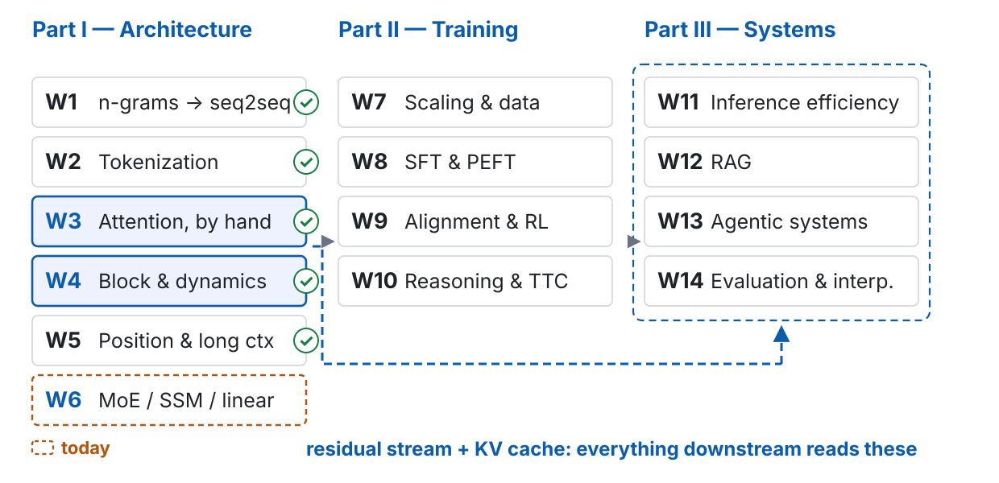
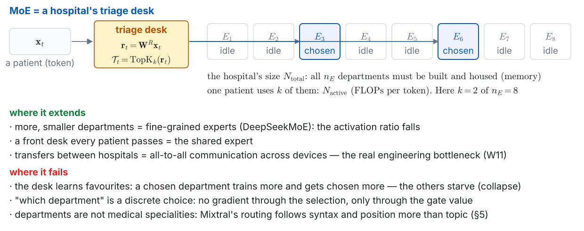
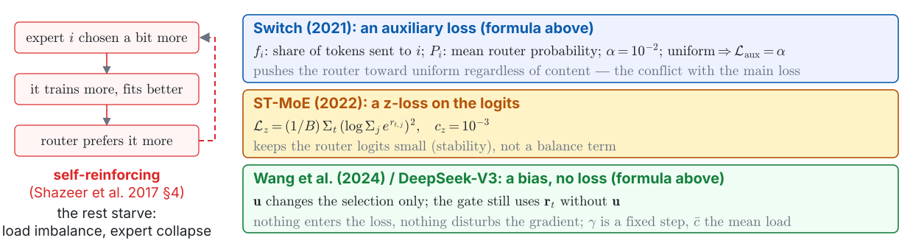
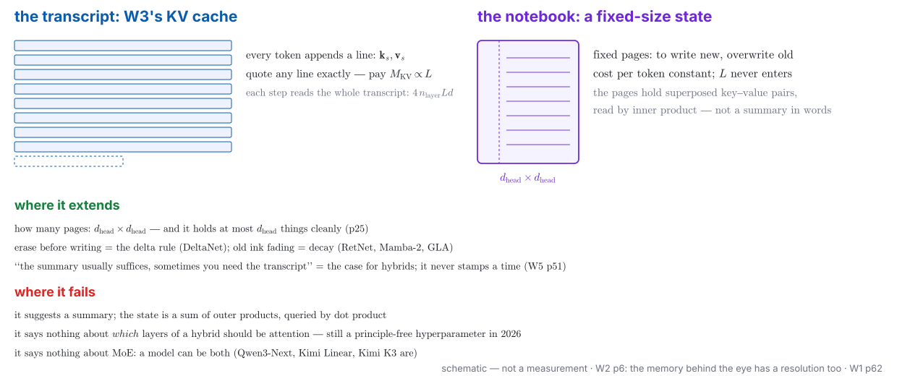
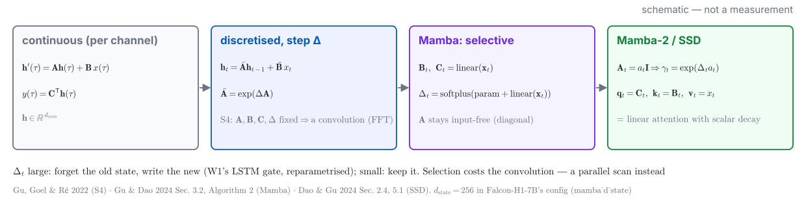
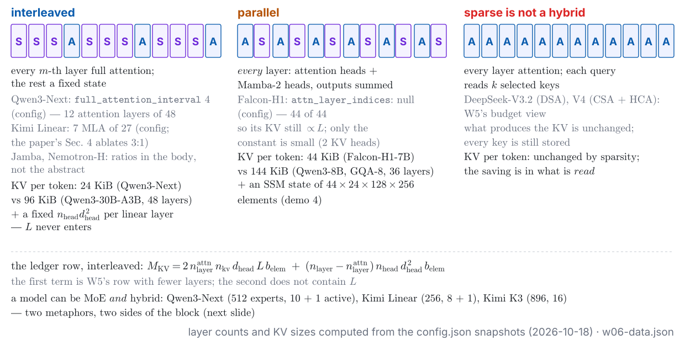

<!-- 此檔由 bin/publish_slides.py 從投影片正本產生（中文講稿區塊已剝除），請勿直接編輯。正本在 private repo 的 <course>/slides/。 -->

# Two ledger rows nobody has touched {.section-title}

## Where we are: week 6 of 14

{width="100%"}

## Last week, in one picture



::: {.claim}
**Every repair so far kept the mechanism and shrank a constant.** GQA and MLA shrank $n_{\text{kv}}$; sparse attention chose which keys to read; the window forgot. The KV was still produced, for every token, in every layer.
:::

::: {.footer}
W5 p38 · W5 p43 · W3 demo 2 rehearsal 2026-09-29 (16 GiB at 128k) · w05-data.json
:::

## The problem this week handles, in one picture



::: {.claim}
Two replacements, two bills — and in 2026 **no route has won**: hybrid-linear, sparse, and full attention ship side by side. The comparison conditions of a paper nearly decide its conclusion.
:::

::: {.footer}
Outline W6 · on the board: p13, p21–22, p25, p29, p31 · live: p11, p24 · replayed: p17, p37
:::

## What you should be able to do by the end of today

1. From an MoE `config.json`, **compute $N_{\text{total}}$ and $N_{\text{active}}$** with W4's accounting, define $\rho = N_{\text{active}}/N_{\text{total}}$, say where MoE moves the cost, and state the 2024–2026 trend of $\rho$ and the design direction behind it
2. Write **top-$k$ routing** and $\mathcal{L}_{\text{aux}} = \alpha\,n_E\sum_i f_i P_i$; explain why it conflicts with the main loss, why experts collapse without it, and what the **auxiliary-loss-free bias** solves
3. **Derive associativity** on the board: $O(L^2 d_{\text{head}})$ vs $O(L\,d_{\text{head}}^2)$, the causal recurrence, the fixed $d_{\text{head}} \times d_{\text{head}}$ state — and **compute its capacity**: at most $d_{\text{head}}$ pairs stored cleanly
4. Write the recurrence family as $\mathbf{S}_t = \mathbf{G}_t\mathbf{S}_{t-1} + \mathbf{k}_t\mathbf{v}_t^\top$ and fill the table (RetNet, Mamba-2, GLA, DeltaNet, Gated DeltaNet, KDA); state what Mamba's selection changes vs. S4; give the skeleton of **SSD**: matmul for training, recurrence for inference
5. Say what each of the **three 2026 routes** attacks and pays — hybrid-linear, sparse, full attention — and that they have not converged
6. **Diagnose a comparison**: iso-FLOPs, iso-params, iso-latency, iso-tokens; say how a conclusion flips, and what Kimi Linear's "fair comparison" fixed

## Two questions for today — answer both before we start

::: {.ask}
**(a)** A model is advertised as **671B / 37B**. To *serve* it, how much memory do you need — the 37B's worth, or the 671B's?
:::

::: {.ask}
**(b)** W5 said the KV cache is $\propto L$. Can a model carry its context in something that does **not** grow with $L$ at all — and if so, what would it have to give up?
:::

- Write one line for each. Keep them: p45 comes back to both.
- (a) is the ledger's $2N$ row: **W1 p16 wrote "MoE: memory $\propto N_{\text{total}}$, FLOPs $\propto N_{\text{active}}$"** and left the numbers blank — today fills them
- (b) is the ledger's KV row: W3 p26 said "W6 the mechanism"

::: {.footer}
W1 p16 · W3 p26 · W5 p38 · Misconception 1: "MoE is model compression"
:::

# Route 1: MoE — splitting $N$ {.section-title}

## The triage desk: one metaphor for the weight side

{width="100%"}

::: {.footer}
the week's first metaphor · fails at Mixtral §5 · Misconception 2: "experts are domain experts"
:::

## Before Demo 1: the activation ratio, from `config.json`

::: {.prose}
| | |
|:---|:-----------------|
| **Why** | The ledger's MoE row has said "memory $\propto N_{\text{total}}$, FLOPs $\propto N_{\text{active}}$" since W1 without a number. The numbers live in a `config.json` — and reading one is the ticket to reading any 2026 open-weight model. W4's `count_params.py` gets an MoE branch. |
| **What runs** | An editor and a terminal; pure standard library, no model loaded. The script prints every key whose name contains `expert`, we decide what each means, then it computes $N_{\text{total}}$, $N_{\text{active}}$, $\rho$ for the MoE on this machine (Gemma 4 26B-A4B, W1 demo 1) and for three configs fetched without weights: Qwen3-30B-A3B, Qwen3-Next-80B-A3B, Kimi Linear 48B-A3B. |
| **Watch for** | The key names are **not standardised** — Qwen, DeepSeek, Kimi and Google each name the shared expert, the top-$k$ and the expert width differently; that is part of the lesson. Then: how far is each $\rho$ above the ratio of experts chosen to experts present, $k/n_E$? |
:::

::: {.footer}
Demo 1 · `demos/w06_d1_activation_ratio` · standard library only · rehearsed 2026-10-18
:::

## Live: demo 1 — $N_{\text{total}}$, $N_{\text{active}}$, $\rho$ from the config

| model | source | $n_E$ / $k$ / $n_S$ | $N_{\text{total}}$ | $N_{\text{active}}$ | $\rho$ |
|:---|:---|:---|:---|:---|:---|
| Gemma 4 26B-A4B (this machine) | config, read live | | | | |
| Qwen3-30B-A3B | config | 128 / 8 / 0 | | | |
| Qwen3-Next-80B-A3B | config | 512 / 10 / 1 | | | |
| Kimi Linear 48B-A3B | config | 256 / 8 / 1 | | | |
| DeepSeek-V2 → V3 | abstracts | — | 236B → 671B | 21B → 37B | 8.9% → 5.5% |
| MiniMax-M2 · Kimi K3 · DeepSeek-V4-Pro | abstracts | — / 896 / — | 229.9B · 2.8T · 1.6T | 9.8B · 104B · 49B | 4.3% · 3.7% · 3.1% |

: {tbl-colwidths="[30,14,14,14,14,14]"}

::: {.ask}
Before the script runs: for Qwen3-30B-A3B, $k/n_E = 8/128 = 6.25\%$. Will $\rho$ come out **above or below** that — and why?
:::

::: {.footer}
Demo 1 · live · `w06_d1_activation_ratio/` · rehearsed 2026-10-18 · flagship rows: abstracts
:::

## The MoE layer, formally: W4's FFN slot with a desk in front



$$\mathbf{r}_t = \mathbf{W}^R\mathbf{x}_t \in \mathbb{R}^{n_E},$$

$$g_i = \mathrm{softmax}(\mathbf{r}_t)_i \ \text{(Switch, Mixtral, Qwen3)}\ \text{ or }\ \sigma(r_{t,i}) \text{ renormalised over } \mathcal{T}_t \ \text{(DeepSeek-V3)}$$

::: {.fragment fragment-index=2}
$$\mathbf{y}_t = \sum_{i \in \mathcal{T}_t} g_i(\mathbf{x}_t)\,E_i(\mathbf{x}_t) + \sum_{j=1}^{n_S} E^{\text{s}}_j(\mathbf{x}_t), \qquad \mathcal{T}_t = \mathrm{TopK}_k(\mathbf{r}_t)$$
:::

::: {.footer}
outline W6 §Key math 1 · Shazeer et al. 2017 · Fedus et al. 2022 · DeepSeek-V3 §2.1.2 · W4 p9, p19
:::

## The accounting: $N_{\text{total}}$, $N_{\text{active}}$, and why $\rho$ has a floor

$$N_{\text{total}} \approx n_{\text{layer}}\big(N_{\text{attn}} + (n_E + n_S)\,3\,d\,d_E + n_E d\big) + 2Vd$$

$$N_{\text{active}} \approx n_{\text{layer}}\big(N_{\text{attn}} + (k + n_S)\,3\,d\,d_E + n_E d\big) + 2Vd \qquad (n_E + n_S \to k + n_S)$$

::: {.fragment fragment-index=1}
$$\rho = \frac{N_{\text{active}}}{N_{\text{total}}} \;>\; \frac{n_{\text{layer}}N_{\text{attn}} + 2Vd}{N_{\text{total}}} \qquad\text{the floor: attention and embeddings are paid either way}$$
:::

::: {.fragment fragment-index=2}
- **Three costs, three different $N$**: $C_{\text{train}} \approx 6\,N_{\text{active}}D$ · decode $2\,N_{\text{active}}$ per token · memory $N_{\text{total}}\,b$ — the ledger's row, now with its formulas
- the expert side alone has ratio $(k + n_S)/(n_E + n_S)$; **fine-grained experts** raise $n_E$ and shrink $d_E$ at fixed $N_{\text{total}}$, pushing that ratio down (DeepSeekMoE) — the floor stays
- W4's $12\,n_{\text{layer}}d^2$ was a dense special case; for an MoE the first question is *which* $N$ a scaling law means (W7)
:::

::: {.footer}
outline W6 §Key math 2 · W4 p19–p20 · Dai et al., ACL 2024 (DeepSeekMoE)
:::

## The trend: five abstracts, one direction



::: {.claim}
**Lower $\rho$ is not "better"; it is a relocation.** FLOPs per token fall; memory, all-to-all traffic and router quality absorb the difference — and Abnar et al. find an *optimal* sparsity at fixed compute, not "sparser is better".
:::

::: {.footer}
five abstracts · Abnar et al., ICML 2025 · Misconception 3: "lower activation ratio is better"
:::

## Load balancing: why experts collapse, three ways to stop it

$$\mathcal{L}_{\text{aux}} = \alpha\,n_E\sum_{i=1}^{n_E} f_i\,P_i \qquad\qquad \mathcal{T}_t = \mathrm{TopK}_k(\mathbf{r}_t + \mathbf{u}),\quad u_i \leftarrow u_i + \gamma\,\mathrm{sign}(\bar{c} - c_i)$$

{width="100%"}

::: {.claim}
The auxiliary loss **conflicts with the main loss** — it pushes the router toward uniform regardless of content. The bias touches the selection only: nothing enters the loss, so nothing disturbs the gradient.
:::

::: {.footer}
Shazeer 2017 §4 · Fedus 2022 §2.2 · Zoph 2022 §3.3 · Wang 2024 §3 · DeepSeek-V3 §2.1.2
:::

## Before Demo 2: three balancing methods, one tiny GPT

::: {.prose}
| | |
|:---|:-----------------|
| **Why** | p15 said what collapse is and what each fix does to it. Watch it happen on a model small enough to train three times: W4's tiny GPT with its FFN replaced by an MoE layer ($n_E = 8$, $k = 2$), same corpus, same seed. |
| **What runs** | Recorded before class, replayed here. Three runs: (i) no balancing term; (ii) Switch's $\mathcal{L}_{\text{aux}}$ with $\alpha = 10^{-2}$; (iii) the auxiliary-loss-free bias. Every 25 steps: held-out loss, and the per-expert load $f_i$ — the largest load against $1/n_E$, and how many experts fall below 1%. |
| **Watch for** | Draw the three load curves first. Does (i) collapse, how fast, to how many experts? Does (ii) pay for its balance in loss? Does (iii) get both? At this scale they may not separate — that is a result too. |
:::

::: {.footer}
Demo 2 · `demos/w06_d2_moe_balance` · torch on MPS · W4 demo 1's `GPT` · rehearsed 2026-10-18
:::

## Replay: demo 2 — expert load and loss, three balancing rules



::: {.fragment fragment-index=4}
| | (i) none | (ii) Switch $\mathcal{L}_{\text{aux}}$ | (iii) loss-free bias |
|:---|:---|:---|:---|
| largest expert load, final (ideal $1/8 = 0.125$; max $1/k = 0.5$) | $0.397$ (worst layer $0.500$) | $0.151$ ($0.159$) | $0.147$ ($0.163$) |
| experts below 1% of slots, final (per layer) | $2.5$ (worst $6$ of $8$) | $0$ | $0$ |
| held-out loss (nats/char) | $1.392$ | $1.447$ | $1.421$ |

: {tbl-colwidths="[40,20,20,20]"}
:::

::: {.footer}
Demo 2 · replay · `w06_d2_moe_balance/` · rehearsed 2026-10-18 · 3000 steps each · mean over 6 layers (worst layer)
:::

## Where MoE moves the cost — and two sources of nondeterminism

::: {.prose}
| the FLOPs went down; the bill went to | what it looks like |
|:---|:---|
| **memory capacity** $\propto N_{\text{total}}$ | 671B/37B needs the 671B resident: 64 GB cannot hold it at 4 bits; 26B/4B (W1 p9) and 30B/3B are what fits (p7) |
| **all-to-all communication** between devices holding different experts | the bottleneck of expert parallelism, independent of FLOPs (W11) |
| **router quality** | collapse without balancing; with it, a pull toward uniform; **token dropping** past the capacity factor (Switch/GShard) |
:::

- **Nondeterminism, two mechanisms, in order**: first, kernels that lack **batch invariance** — reduction order changes with batch size (Thinking Machines, 2025-09, a company blog post, not a paper; W11). Second, the capacity factor: a token dropped in one batch and kept in another — **only where a capacity limit exists**; mlx-lm's top-$k$ router is per-token and has none (source, 2026-10-18)

::: {.footer}
Fedus §2.2 · Thinking Machines blog 2025-09 · Misconception 4: "nondeterminism is the router"
:::

# Route 2: a fixed-size state {.section-title}

## The transcript and the notebook: one metaphor for the attention side

{width="100%"}

::: {.footer}
the week's second metaphor · W2 p6 · W1 p62 · fails at "summary" and at "which layers"
:::

## Softmax blocks the bracket; drop it and the bracket moves

$$\underbrace{\big(\phi(\mathbf{Q})\,\phi(\mathbf{K})^\top\big)\,\mathbf{V}}_{O(L^2 d_{\text{head}})\ \text{— W3's only route}} \;=\; \underbrace{\phi(\mathbf{Q})\,\big(\phi(\mathbf{K})^\top\mathbf{V}\big)}_{O(L\,d_{\text{head}}^2)\ \text{— once } \exp \to \phi}$$



::: {.footer}
outline W6 §Key math 3 · Katharopoulos et al., ICML 2020 §3.2 Eq. (7): $\phi = \mathrm{elu} + 1$ · W3 p23
:::

## Causal: the sum becomes a recurrence, and the notebook

$$\mathbf{o}_t^\top = \phi(\mathbf{q}_t)^\top \sum_{s \leq t}\phi(\mathbf{k}_s)\mathbf{v}_s^\top \quad\Rightarrow\quad \mathbf{S}_t = \mathbf{S}_{t-1} + \phi(\mathbf{k}_t)\mathbf{v}_t^\top, \qquad \mathbf{z}_t = \mathbf{z}_{t-1} + \phi(\mathbf{k}_t)$$

::: {.fragment fragment-index=1}
$$\mathbf{o}_t = \frac{\mathbf{S}_t^\top\phi(\mathbf{q}_t)}{\mathbf{z}_t^\top\phi(\mathbf{q}_t)}$$
:::



::: {.footer}
outline W6 §Key math 3 · Katharopoulos et al. 2020 §3.3–3.4 · $\mathbf{o}_t = \mathbf{S}_t^\top\phi(\mathbf{q}_t)$ as in W3
:::

## Before Demo 3: the two algorithms, written live

::: {.prose}
| | |
|:---|:-----------------|
| **Why** | p21–p22 proved that the two orderings are equal in mathematics and different in computation, and that the causal version is a recurrence with a fixed state. Written as code, each claim becomes a number: a difference, a crossover, a recall error. |
| **What runs** | An editor and a terminal; plain `torch`, pinned to the CPU in float64 — W3 demo 1's reason. Four pieces written live, a test after each; after two minutes, `linear_final.py` takes over. (a) both orderings on random inputs; (b) timing at $d_{\text{head}} = 128$ for $L \in \{32, \dots, 8192\}$; (c) the recurrence against the one-shot cumulative sum; (d) write $m$ pairs into $\mathbf{S}$ and read them back. |
| **Expect / watch for** | (a) and (c): equal to float64 rounding, or something is wrong. (b): where do the two timing lines cross — near $L = d_{\text{head}}$? (d): **predict the recall-error curve against $m$ before it runs**, for orthogonal keys and for random keys. |
:::

::: {.footer}
Demo 3 · `demos/w06_d3_linear_scratch` · plain torch, CPU, float64 · rehearsed 2026-10-19
:::

## Live: demo 3 — equal to float64, a crossover, a notebook filling up

::: {.columns}
::: {.column width="50%"}
**Write, in this order**

1. `attn_quadratic(Q, K, V)` and `attn_linear(Q, K, V)`, $\phi = \mathrm{elu} + 1$
2. `step(S, z, k, v, q)` — one token of the causal recurrence
3. `store(keys, vals)` / `recall(S, k)` — the notebook, additive; then `delta_write(S, k, v)`, one line
:::
::: {.column width="50%"}
**Tests — predict each before it runs**

- **(a)** max difference of the two orderings → $10^{-15}$?
- **(b)** timing, $d_{\text{head}} = 128$: seconds per call, $L \in \{32, 128, 512, 2048, 8192\}$ — where do the lines cross?
- **(c)** the recurrence vs. `cumsum` → float64 rounding?
- **(d)** relative recall error vs. $m$, $m$ from $d_{\text{head}}/4$ to $4\,d_{\text{head}}$ — orthogonal keys, random keys, random keys with the delta rule
:::
:::

| $L$ | 32 | 128 | 512 | 2048 | 8192 |
|:---|:---|:---|:---|:---|:---|
| quadratic, s | $4.4 \times 10^{-5}$ | $1.3 \times 10^{-4}$ | $6.1 \times 10^{-4}$ | $5.6 \times 10^{-3}$ | $8.6 \times 10^{-2}$ |
| linear, s | $4.6 \times 10^{-5}$ | $1.3 \times 10^{-4}$ | $3.8 \times 10^{-4}$ | $7.0 \times 10^{-4}$ | $3.0 \times 10^{-3}$ |

: {tbl-colwidths="[25,15,15,15,15,15]"}

::: {.footer}
Demo 3 · live · `w06_d3_linear_scratch/` · rehearsed 2026-10-19 · table: rehearsal values, M5 Max CPU, 6 threads
:::

## The notebook's capacity: at most $d_{\text{head}}$ pairs, cleanly

$$\mathbf{S}_t = \sum_{r \leq t}\phi(\mathbf{k}_r)\mathbf{v}_r^\top \qquad \text{query it with the key of pair } s\text{:}$$

::: {.fragment fragment-index=1}
$$\mathbf{S}_t^\top\phi(\mathbf{k}_s) \;=\; \underbrace{\mathbf{v}_s\,\|\phi(\mathbf{k}_s)\|^2}_{\text{what was stored}} \;+\; \underbrace{\sum_{r \neq s}\mathbf{v}_r\,\langle\phi(\mathbf{k}_r), \phi(\mathbf{k}_s)\rangle}_{\text{interference}}$$
:::

::: {.fragment fragment-index=2}
- the second term vanishes **only if** every other $\phi(\mathbf{k}_r)$ is orthogonal to $\phi(\mathbf{k}_s)$ — and $\mathbb{R}^{d_{\text{head}}}$ holds at most $d_{\text{head}}$ mutually orthogonal vectors
- so a $d_{\text{head}} \times d_{\text{head}}$ notebook stores **at most $d_{\text{head}}$ pairs without error**; the $(d_{\text{head}} + 1)$-th overwrites. Random keys are never orthogonal: interference from the first pair, growing like $\sqrt{(m-1)/d_{\text{head}}}$
- the **transcript** has no such bound: every $\mathbf{k}_s, \mathbf{v}_s$ is kept and softmax can pick one out exactly
:::

::: {.footer}
outline W6 §Key math 3 · the root shared by Jelassi et al., Zoology and BASED · W1 p62
:::

## The same curve in Python — and what "cheaper, worse" gets wrong



::: {.footer}
w06-data.json capacity · Misconception 5: "linear attention is a cheaper, worse attention"
:::

# One recurrence, six gates {.section-title}

## One equation for 2023–2025: $\mathbf{S}_t = \mathbf{G}_t\,\mathbf{S}_{t-1} + \mathbf{k}_t\mathbf{v}_t^\top$

| read-out $\mathbf{o}_t = \mathbf{S}_t^\top\mathbf{q}_t$ | $\mathbf{G}_t$ (what fades, and how) | the write term | one line |
|:---|:---|:---|:---|
| **linear attention** (2020) | $\mathbf{I}$ | $\phi(\mathbf{k}_t)\mathbf{v}_t^\top$ | nothing fades; the notebook fills |
| **RetNet** (2023) | $\gamma\,\mathbf{I}$, $\gamma$ fixed, one per head | $\mathbf{k}_t\mathbf{v}_t^\top$ | old ink fades at a constant rate |
| **Mamba-2 / SSD** (2024) | $\gamma_t\,\mathbf{I}$, $\gamma_t = \exp(\Delta_t a)$: $a < 0$ fixed per head, $\Delta_t$ from the input | $\mathbf{k}_t\mathbf{v}_t^\top$ | the input decides how fast to forget |
| **GLA** (2024) | $\mathrm{diag}(\boldsymbol{\gamma}_t)$, one rate per dimension | $\mathbf{k}_t\mathbf{v}_t^\top$ | some rows fade faster than others |
| **DeltaNet** (2024) | $\mathbf{I} - \beta_t\mathbf{k}_t\mathbf{k}_t^\top$ | $\beta_t\,\mathbf{k}_t\mathbf{v}_t^\top$ | erase along $\mathbf{k}_t$ before writing (p29) |
| **Gated DeltaNet** (2025) | $\gamma_t(\mathbf{I} - \beta_t\mathbf{k}_t\mathbf{k}_t^\top)$ | $\beta_t\,\mathbf{k}_t\mathbf{v}_t^\top$ | both; what Qwen3-Next ships |
| **KDA** (Kimi Linear, 2025) | $(\mathbf{I} - \beta_t\mathbf{k}_t\mathbf{k}_t^\top)\,\mathrm{diag}(\boldsymbol{\gamma}_t)$ | $\beta_t\,\mathbf{k}_t\mathbf{v}_t^\top$ | per-dimension decay, then erase; a DPLR special case |

: {tbl-colwidths="[21,33,14,32]"}

::: {.footer}
RetNet §2.1 · Dao & Gu §2.4 · GLA §4.1 · DeltaNet §3.1 · GDN §3.1 · Kimi Linear §3 Eq. (1)
:::

## The delta rule is one step of gradient descent on a recall loss

$$\text{recall loss for pair } t\text{: } \ \mathcal{L}_t(\mathbf{S}) = \tfrac{1}{2}\big\|\mathbf{S}^\top\mathbf{k}_t - \mathbf{v}_t\big\|^2, \qquad \nabla_{\mathbf{S}}\mathcal{L}_t = \mathbf{k}_t\big(\mathbf{S}^\top\mathbf{k}_t - \mathbf{v}_t\big)^\top$$

::: {.fragment fragment-index=1}
$$\mathbf{S}_t = \mathbf{S}_{t-1} - \beta_t\,\mathbf{k}_t\big(\mathbf{S}_{t-1}^\top\mathbf{k}_t - \mathbf{v}_t\big)^\top = \big(\mathbf{I} - \beta_t\mathbf{k}_t\mathbf{k}_t^\top\big)\mathbf{S}_{t-1} + \beta_t\,\mathbf{k}_t\mathbf{v}_t^\top$$
:::

::: {.fragment fragment-index=2}
- **read the first factor**: $(\mathbf{I} - \beta_t\mathbf{k}_t\mathbf{k}_t^\top)$ removes a fraction $\beta_t$ of the old state's component along $\mathbf{k}_t$ — *erase before writing*. A key that reappears **overwrites** instead of piling up: exactly the interference term of p25, cleared on that one direction
- add decay and you have Gated DeltaNet; make the decay per-dimension and you have KDA; let the state be a small network and the step be any self-supervised loss and you have **TTT** (Sun et al., ICML 2025) — the delta rule generalised
- the price: $\mathbf{G}_t$ is no longer diagonal, so the chunked algorithm needs the WY / DPLR representation — DeltaNet's and Kimi Linear's actual contribution
:::

::: {.footer}
outline W6 §Key math 4 · Yang et al., NeurIPS 2024 §2.2 · GDN, ICLR 2025 · TTT, ICML 2025
:::

## S4 → Mamba: selection is W1's gate, and it costs the convolution

$$\mathbf{h}' = \mathbf{A}\mathbf{h} + \mathbf{B}\,x,\ \ y = \mathbf{C}^\top\mathbf{h} \quad\xrightarrow{\ \text{step } \Delta\ }\quad \mathbf{h}_t = \bar{\mathbf{A}}\mathbf{h}_{t-1} + \bar{\mathbf{B}}\,x_t,\ \ \bar{\mathbf{A}} = \exp(\Delta\mathbf{A})$$

::: {.fragment fragment-index=1}
$$\text{Mamba: }\ \mathbf{B}_t,\ \mathbf{C}_t = \mathrm{Linear}(\mathbf{x}_t), \quad \Delta_t = \mathrm{softplus}\big(\mathrm{Linear}(\mathbf{x}_t) + \text{param}\big), \quad \mathbf{A} \text{ input-free}$$
:::

::: {.fragment fragment-index=2}
$$\text{Mamba-2: }\ \mathbf{A} = a\mathbf{I},\ a < 0 \;\Rightarrow\; \bar{\mathbf{A}}_t = \exp(\Delta_t a)\,\mathbf{I} = \gamma_t\mathbf{I}, \qquad \mathbf{q}_t = \mathbf{C}_t,\ \mathbf{k}_t = \mathbf{B}_t,\ \mathbf{v}_t = x_t$$
:::

{width="100%"}

::: {.claim}
"Mamba is the RNN's comeback" is half right. What is new is **selection** (in-context choice, which S4 cannot do) and **parallel training** (next two slides) — the second is what killed the RNN in W1, and it is gone.
:::

::: {.footer}
Gu, Goel & Ré 2022 · Gu & Dao 2024 §3.2 Alg. 2 · Misconception 6: "Mamba is the RNN revived"
:::

## SSD: unrolled, the recurrence is a semiseparable mask

$$\mathbf{S}_t = \gamma_t\mathbf{S}_{t-1} + \mathbf{k}_t\mathbf{v}_t^\top \;\Rightarrow\; \mathbf{S}_t = \sum_{s \leq t}\Lambda_{ts}\,\mathbf{k}_s\mathbf{v}_s^\top, \qquad \Lambda_{ts} = \prod_{r=s+1}^{t}\gamma_r \ (t \geq s),\ 0 \text{ above the diagonal}$$

$$\mathbf{o}_t^\top = \sum_{s \leq t}\Lambda_{ts}\,(\mathbf{q}_t^\top\mathbf{k}_s)\,\mathbf{v}_s^\top \quad\Longleftrightarrow\quad \mathbf{O} = \big(\boldsymbol{\Lambda} \circ \mathbf{Q}\mathbf{K}^\top\big)\mathbf{V}$$



::: {.footer}
outline W6 §Key math 5 · Dao & Gu 2024: Def. 3.1, §5.1, §6 (**assigned**) · mlx-lm `ssm.py`
:::

## Why this recurrence trains in parallel, and where position went

- **W1 p62**: the RNN lost on *parallelism along the sequence*, not on quality; its fixed state was always an asset at inference. In 2024 the training half got solved — minimal LSTMs and GRUs that train in parallel (Feng et al. 2024, a preprint), and SSD: one operation, two algorithms
- the mechanism is p31: the recurrence unrolls into a matmul with a **semiseparable** mask, so a chunk of tokens is one matrix product. What made the LSTM sequential was a *nonlinearity inside the recurrence*; the family of p28 keeps the state update **linear in $\mathbf{S}$**, and that is the whole trick
- **position**: no $\theta_i$, no $\mathbf{R}_m$, no stamp (W5). Order lives in the recurrence — *what was written first has faded most* — plus a short causal convolution (`short_conv_kernel_size: 4` in Kimi Linear's and Qwen3-Next's configs) for local order
- so there is nothing to extrapolate and nothing to repair: no PI, no NTK-aware, no YaRN. Length generalisation rides on decay and locality — **a different inductive bias, not an absence of one**

::: {.footer}
W1 p62 · W5 p49 · Misconception 7: "a fixed state has no position information"
:::

# The ledger: KV cache vs. a fixed state {.section-title}

## Per layer: the KV line and the flat line cross at $L^\star$



::: {.fragment fragment-index=1}
$$2\,n_{\text{kv}}\,d_{\text{head}}\,L^\star = n_{\text{head}}\,d_{\text{head}}^2 \;\Rightarrow\; L^\star = \frac{n_{\text{head}}\,d_{\text{head}}}{2\,n_{\text{kv}}} = 64 \text{ (MHA)},\ 256 \text{ (GQA-8, } 32 \times 128 / 16)$$
:::

::: {.footer}
outline W6 §Key math 6 · W3 demo 2's config · GLA: $n_{\text{head}}d_kd_v$ · Mamba-2: $n_{\text{head}}d_{\text{head}}d_{\text{state}}$
:::

## Three ways to combine them — and one that is not

{width="100%"}

::: {.footer}
outline W6 §formal (hybrid) · configs read 2026-10-18 · Zuo et al. 2025 (abstract: *parallel hybrid*)
:::

## Before Demo 4: a parallel hybrid against full attention

::: {.prose}
| | |
|:---|:-----------------|
| **Why** | p34 computed where the flat line and the KV line cross; p35 said a parallel hybrid still pays KV, with a smaller constant plus a fixed state. Measure both on real models of comparable size: Falcon-H1-7B-Instruct (parallel hybrid) against Qwen3-8B (full attention), both 4-bit MLX. |
| **What runs** | Recorded before class; two or three questions live. (a) W3 demo 2's method: prompts from 1k to 32k tokens, the cache's bytes and the prefill time, one line per model, the formula lines of p35 underneath. (b) W5 demo 3's key–value retrieval, the same questions and the same $K$ ($81$ and $326$ pairs), five positions, twenty questions each, per model. |
| **Watch for** | (a) **The hybrid's line will not be flat** — it has attention in every layer. Predict its slope relative to Qwen3-8B's, and whether it starts above zero. (b) Falcon-H1 has attention heads too: does it lose recall, and if so, where? Either answer is a lesson. |
:::

::: {.footer}
Demo 4 · `demos/w06_d4_hybrid_vs_full` · mlx-lm, two 4-bit models · rehearsed 2026-10-19
:::

## Replay + live: demo 4 — cache against $L$, and recall



::: {.fragment fragment-index=2}
| exact match / 20 · $K = 81$ (≈ 5.6k tok) · $K = 326$ (≈ 22k tok) | first | ⌊K/4⌋ | ⌊K/2⌋ | ⌊3K/4⌋ | last |
|:---|:---|:---|:---|:---|:---|
| Qwen3-8B (full attention) | 15 · 16 | 16 · 5 | 17 · 3 | 17 · 3 | 20 · 19 |
| Falcon-H1-7B (parallel hybrid) — no reply was a UUID | 0 · 0 | 0 · 0 | 0 · 0 | 0 · 0 | 0 · 0 |

: {tbl-colwidths="[40,12,12,12,12,12]"}
:::

::: {.footer}
Demo 4 · replay + live · `w06_d4_hybrid_vs_full/` · rehearsed 2026-10-19 · (a) cache tensors after prefill · (b) same 200 questions as W5 demo 3
:::

## The ledger, week 6: MoE filled in, fixed state added

| Where the cost falls | Formula | What binds it | Filled in |
|:---|:---|:---|:---|
| **Training**, one run | $C_{\text{train}} \approx 6ND$ FLOPs | compute | W1 · W4 · W7 |
| **Optimizer state** (Adam) | $\approx 2N$ values; 16 bytes/param all in → 8B: 128 GB | memory | W4 · W8 |
| **Prefill**, once per request | $C_{\text{pre}} \approx 2NL_{\text{in}} + 2\,n_{\text{layer}}L_{\text{in}}^2 d$ FLOPs | compute | W3 · W5 · W11 |
| **Decode**, per token | $C_{\text{dec}} \approx 2N + 4\,n_{\text{layer}}Ld$; $t_{\text{step}} \geq (Nb + M_{\text{KV}})/\text{BW}$ | bandwidth | W3 · W5 · W11 |
| **KV cache**, state carried | $M_{\text{KV}} = 2\,n_{\text{layer}}\,n_{\text{kv}}\,d_{\text{head}}\,L\,b$ = 128 KiB/token (GQA-8) | capacity, bandwidth | W3 · W5 · W11 |
| **Long context**, as $L$ grows | KV $\propto L$ · decode $\propto L$ · prefill $\propto L^2$ past $12d$ | all three | W5 · **today** · W11 |
| **MoE** | **$6N_{\text{active}}D$ · $2N_{\text{active}}$/token · $N_{\text{total}}b$ · $\rho$: 8.9% → 3.1%, floored** | both; all-to-all | **today** · W7 · W11 |
| **Fixed state**, per layer | **$n_{\text{head}}d_{\text{head}}^2\,b$, no $L$; smaller than KV past $L^\star = n_{\text{head}}d_{\text{head}}/2n_{\text{kv}}$; $\leq d_{\text{head}}$ pairs** | state capacity | **today** · W11 |

: {tbl-colwidths="[17,53,12,18]"}

::: {.footer}
Same master as W1 p16, W3 p55, W4 p44, W5 p38 · one row filled, one row added · bytes: $b$
:::

# 2026: three routes, none has won {.section-title}

## The three routes, with the source of every claim

| route | what it attacks | what it pays | who ships it (source level) |
|:---|:---|:---|:---|
| **hybrid-linear** | the KV row: most layers a fixed state, a few layers full attention for recall | capacity $\leq d_{\text{head}}$ in the linear layers; a layer ratio with no principle; immature kernels | Qwen3-Next 3:1 (**model card + config**; no report) · Kimi Linear 20:7 (**body §4 + config**) · Falcon-H1, parallel (**abstract**) · Kimi K3's KDA (**abstract**) · Waleffe et al.: 7% attention beats the 8B Transformer at 3.5T tokens (**abstract**) |
| **sparse** | the *reading* of the KV row: each query reads $k$ keys; the KV itself unchanged (W5) | selector quality; hardware alignment of the selection | DeepSeek-V3.2 DSA · V4 CSA + HCA (**abstracts**) |
| **back to full attention** | nothing — declines both bets | the whole KV row, as in W5 | MiniMax-M2 (**a team post, 2025-10-29, not a paper**; the paper's abstract says nothing about attention) |

: {tbl-colwidths="[15,27,24,34]"}

::: {.footer}
outline W6 §LO 5 · Du et al. 2510.26692 · Waleffe et al. 2406.07887 · DeepSeek-AI 2512.02556
:::

## Open weights are not open methods; why one team went back

- **Two absences to say out loud**: Qwen3-Next has **no technical report** — a blog post and a model card, yet it is a baseline in 2026 papers; **Llama 4 has none either** (W5 p13). Their designs can only be cited from model cards, and these slides say so every time
- **MiniMax-M2's team post, 2025-10-29** (on behalf of the pre-training lead), three reasons for returning to full attention — a **company post, not peer-reviewed**:
  1. evaluation cannot see the gap: hybrids matched full attention on early benchmarks; the deficits showed in multi-hop reasoning later — "the real bottleneck is the limitations of evaluation"
  2. linear attention is "far more sensitive to numerical precision" — the state is a long running sum (p22)
  3. "the infrastructure for linear and sparse attention is much less mature"
- Kimi Linear, the same month, claims the opposite under a fair comparison. **Both are 2025 evidence. Neither settles it.** The layer ratio is still a hyperparameter without a principle; no one ships a pure SSM flagship (Jelassi, Zoology), and no one has shown the hybrid ratio *should* be 3:1

::: {.footer}
MiniMax team post 2025-10-29 · Misconception 8: "SSMs replace Transformers / hybrids won"
:::

## Reading an architecture paper: what does the row hold fixed?

| the comparison | who tends to win | why the conclusion flips |
|:---|:---|:---|
| **iso-FLOPs** (same compute per token) | MoE over dense | more parameters for the same FLOPs: knowledge bought with memory, which this row does not charge for |
| **iso-parameters** (same $N_{\text{total}}$) | dense over MoE | dense uses all of $N$ every token; the MoE uses $\rho N$ |
| **iso-latency / iso-throughput** | depends on the serving stack | all-to-all, batch size, kernel maturity: two engines can swap the ranking |
| **iso-tokens, same tokenizer** | the control everyone forgets (W2 p62) | a tokenizer changes the token count and the per-token loss at once |
| **recall tasks vs. perplexity** | full attention on recall; hybrids on throughput | the hybrid ratio decides recall (p25); perplexity hides it (Zoology) |

: {tbl-colwidths="[26,24,50]"}

::: {.claim}
First question for any table: **what did this row hold fixed?** Second: was the baseline tuned (W4 p53)? Only then: who won.
:::

::: {.footer}
Clark 2022 · Abnar 2025 · W2 p62 · W4 p53 · Misconception 9: "results compare directly"
:::

## Two tables taken apart: Kimi Linear, DeepSeek-V3 §2

::: {.columns}
::: {.column width="50%"}
**Kimi Linear (arXiv:2510.26692), "beats full MLA under a fair comparison"**

- fixed (§5.4): **same architecture, parameter count, training setup** — 48B/3B, 1.4T tokens, a 4k pre-training window; iso-*active* and iso-*total* at once
- varied: the attention layer type (KDA hybrid · all-MLA · GDN hybrid)
- throughput at *which* $L$? the abstract's 6× decode is at 1M; training saw 4k
- the ratio (§5.2): 0:1 … 15:1 judged by **perplexity**; 0:1 "performed poorly" — on perplexity, which hides recall (p42)
:::
::: {.column width="50%"}
**DeepSeek-V3 (arXiv:2412.19437) §2.1.2, aux-loss-free vs. auxiliary loss**

- fixed: model, data, steps — the balancing rule varies
- ask: is the comparison at **equal balance** (then loss decides) or at equal loss (then balance decides)? The two are different claims
- ask: how much of the main loss does the auxiliary term cost — that is the "conflict" of p15 made measurable
- not in the abstract: the size of the complementary sequence-wise loss V3 still keeps
:::
:::

::: {.ask}
For each: write the one control you would add before believing the headline.
:::

::: {.footer}
**assigned reading: Kimi Linear** · DeepSeek-V3 §2 self-study · the four reading questions
:::

# Where this goes {.section-title}

## The opening questions, answered

::: {.ask}
p7 asked: (a) 671B/37B — how much memory? (b) Can the state stop growing with $L$, and what does it give up?
:::

- **(a) The 671B's worth.** MoE adds parameters and removes FLOPs: memory $\propto N_{\text{total}}$, FLOPs $\propto N_{\text{active}}$, and the bill moves to capacity, all-to-all and the router (p13, p18). $\rho$ fell from 8.9% to 3.1% in two years and has a floor (p14)
- **(b) Yes — a $d_{\text{head}} \times d_{\text{head}}$ state, once softmax is gone** (p21–p22). It gives up **exact recall beyond $d_{\text{head}}$ pairs** (p25) — so 2026 keeps a few attention layers, or chooses which keys to read, or keeps all of them (p40)
- the same recurrence, six gates (p28); one operation, two algorithms (p31) — which is why this recurrence trains in parallel and W1's did not (p32)
- **and a method**: before "who won", ask what the row held fixed (p42)

::: {.footer}
compare with your two lines from p7 · W7: which $N$ does a scaling law mean for an MoE?
:::

## Nine things this week said no to (1 of 2)

::: {.prose}
| The belief | What is true | Returns |
|---|---|---|
| **1** · MoE is model compression | the opposite: more parameters, more memory; only FLOPs per token fall | W8 |
| **2** · experts are domain experts | the router follows the representation; Mixtral §5: syntax and position, not topic | W14 |
| **3** · a lower activation ratio is better | FLOPs fall; memory, all-to-all and the router absorb it; $\rho$ has a floor; Abnar et al.: an optimum | W7, W11 |
| **4** · temperature $= 0$ is nondeterministic mainly because of the router | kernels without batch invariance first; capacity-factor dropping second, absent in mlx-lm | W11 |
| **5** · linear attention is a cheaper, worse attention | a different capacity ($\leq d_{\text{head}}$ pairs) for an $L$-free cost; 2025's evidence disagrees with itself | W11 |

: {tbl-colwidths="[34,54,12]"}
:::

## Nine things this week said no to (2 of 2)

::: {.prose}
| The belief | What is true | Returns |
|---|---|---|
| **6** · Mamba is the RNN revived | half: new are selection (in-context choice) and parallel training — what killed the RNN in W1 | — |
| **7** · a fixed state has no position information | order lives in the recurrence (first written, most faded) plus a short convolution; nothing to extrapolate or repair | — |
| **8** · SSMs replace Transformers / hybrids are the 2026 default | three routes ship at once; no pure-SSM flagship; the ratio has no principle; MiniMax-M2 went back | W11, W14 |
| **9** · architecture results compare directly | iso-FLOPs, -params, -latency, -tokens give different winners; ask what the row held fixed, then whether the baseline was tuned | W7, W14 |

: {tbl-colwidths="[34,54,12]"}
:::

## Next week: scaling laws — and which $N$ they mean

- Today's row: FLOPs $\propto N_{\text{active}}$, memory $\propto N_{\text{total}}$. Next week asks how $N$ and $D$ should be traded at a fixed compute budget — and for an MoE, **which $N$** the law is about (Clark et al.; Abnar et al.)
- **W7**: $C \approx 6ND$ becomes a design rule — Chinchilla's $N \propto D$; what "optimal" assumes and what it ignores (inference, data quality); pre-training data curation, the half of the recipe that papers describe least
- the fixed state returns in W11 (the roofline, where a state that never grows is a bandwidth story) and the recall bound in W12 (why retrieval still has a job)

::: {.ask}
Before then: **Kimi Linear** (the whole paper — read §4 and §5.2 with p42 in hand), **Dao & Gu §6** (the SSD algorithm, the picture of p31), and **DeepSeek-V3 §2** (self-study; the MoE section we took apart).
:::

::: {.claim}
Part I is done: the unit (W2), what it may attend to (W3), what carries the result (W4), where each token is (W5), and today **whether a growing cache and a dense $N$ are the only way** — next, how to train the thing.
:::

## Sources (1 of 2)

::: {.cite}
**Textbooks** · none covers this week: Jurafsky & Martin, *Speech and Language Processing*, 3rd ed., **2026-08-19 draft release**, ch 7 treats the dense Transformer only (MoE appears once, in passing, in §7.8; no section on SSMs or linear attention — table of contents checked 2026-10-18) · the reading stands in: Sun et al., *Speed Always Wins: A Survey on Efficient Architectures for Large Language Models*, arXiv:2508.09834 (2025; still v1 as of October 2026)

**Mixture of Experts** · Shazeer et al., *Outrageously Large Neural Networks: The Sparsely-Gated Mixture-of-Experts Layer*, arXiv:1701.06538 (2017) · Lepikhin et al., *GShard*, arXiv:2006.16668 (2020) · Fedus, Zoph & Shazeer, *Switch Transformers*, JMLR 23(120), 2022 (arXiv:2101.03961) · Zoph et al., *ST-MoE*, arXiv:2202.08906 (2022) · Jiang et al., *Mixtral of Experts*, arXiv:2401.04088 (2024) — §5 routing analysis · Dai et al., *DeepSeekMoE*, ACL 2024 (arXiv:2401.06066) · Wang et al., *Auxiliary-Loss-Free Load Balancing Strategy for Mixture-of-Experts*, arXiv:2408.15664 (2024) · DeepSeek-AI, *DeepSeek-V3 Technical Report*, arXiv:2412.19437 — §2.1.2 · Clark et al., *Unified Scaling Laws for Routed Language Models*, ICML 2022 (PMLR 162; arXiv:2202.01169) · Ludziejewski et al., *Scaling Laws for Fine-Grained Mixture of Experts*, ICML 2024 (PMLR 235; arXiv:2402.07871, Krajewski first on arXiv) · Abnar et al., *Parameters vs FLOPs: Scaling Laws for Optimal Sparsity for Mixture-of-Experts Language Models*, ICML 2025 (PMLR 267; arXiv:2501.12370)

**Linear attention and the recurrence family** · Katharopoulos et al., *Transformers are RNNs*, ICML 2020 (PMLR 119; arXiv:2006.16236) · Sun et al., *Retentive Network*, arXiv:2307.08621 (2023) — **a preprint, not peer-reviewed** · Yang et al., *Gated Linear Attention Transformers with Hardware-Efficient Training*, ICML 2024 (PMLR 235; arXiv:2312.06635) · Yang et al., *Parallelizing Linear Transformers with the Delta Rule over Sequence Length*, NeurIPS 2024 (arXiv:2406.06484) · Yang, Kautz & Hatamizadeh, *Gated Delta Networks*, ICLR 2025 (arXiv:2412.06464) · Sun et al., *Learning to (Learn at Test Time)*, ICML 2025 (PMLR 267; arXiv:2407.04620) · Arora et al., *Simple linear attention language models balance the recall-throughput tradeoff* (BASED), ICML 2024 (PMLR 235; arXiv:2402.18668) · Arora et al., *Zoology*, ICLR 2024 (arXiv:2312.04927) · Jelassi et al., *Repeat After Me*, ICML 2024 (PMLR 235; arXiv:2402.01032)
:::

## Sources (2 of 2)

::: {.cite}
**State-space models** · Gu, Goel & Ré, *Efficiently Modeling Long Sequences with Structured State Spaces* (S4), ICLR 2022, Outstanding Paper Honorable Mention (arXiv:2111.00396) · Gu & Dao, *Mamba*, COLM 2024 (arXiv:2312.00752) — §3.2 Algorithm 2 · Dao & Gu, *Transformers are SSMs* (Mamba-2, SSD), ICML 2024 (PMLR 235; arXiv:2405.21060) — Def. 3.1, §5.1, §6 · Feng et al., *Were RNNs All We Needed?*, arXiv:2410.01201 (2024) — **a preprint, not peer-reviewed**

**Hybrids and the three routes** · Lieber et al., *Jamba*, arXiv:2403.19887 (2024) · Waleffe et al., *An Empirical Study of Mamba-based Language Models*, arXiv:2406.07887 (2024) · NVIDIA, *Nemotron-H*, arXiv:2504.03624 (2025) · Zuo et al., *Falcon-H1*, arXiv:2507.22448 (2025) · Du et al., *Kimi Linear: An Expressive, Efficient Attention Architecture*, arXiv:2510.26692 (2025; v2 Nov. 2025) — **assigned reading** · Kimi Team, *Kimi K3: Open Frontier Intelligence*, arXiv:2607.24653 (2026) — CC BY-NC-ND 4.0 · Qwen Team, *Qwen3-Next-80B-A3B* model card and blog post, September 2025 — **a model card and a blog post, not a paper; no technical report exists** · Wu et al., *MiniMax-01*, arXiv:2501.08313 (2025) · Chen et al., *The MiniMax-M2 Series*, arXiv:2605.26494 (2026) — the abstract says nothing about the form of attention · MiniMax, *Why Did M2 End Up as a Full Attention Model?*, team post, 2025-10-29 — **a company post, not a paper** · DeepSeek-AI, *DeepSeek-V2* arXiv:2405.04434 · *DeepSeek-V3.2* arXiv:2512.02556 · *DeepSeek-V4* arXiv:2606.19348 · He et al., *Defeating Nondeterminism in LLM Inference*, Thinking Machines Lab blog, September 2025 — **a company blog post, not a paper** · Meta AI, *The Llama 4 herd*, April 2025 — **a blog post, not a paper**

**Data and figures** · Every number on these slides is one of: arithmetic on a `config.json` (snapshots of 2026-10-18 under `assets/w06/configs/`, read by `make_demo_w06.py`), a total/active count copied from an abstract (five flagships), pure-Python arithmetic on the definitions (FLOP counts, the capacity curves at $d_{\text{head}} = 32$), or a number from an earlier week's rehearsal (W3 demo 2's `curve.json`, W5's `w05-data.json`). The triage desk, the notebook, the MoE layer, the collapse loop, the SSM boxes and the $\boldsymbol{\Lambda}$ matrix are schematics. **None of the four demos has been built or rehearsed (2026-10-18)**: the tables on p11, p17, p24, p37 and the axes on p17 and p37 are blank on purpose.
:::
