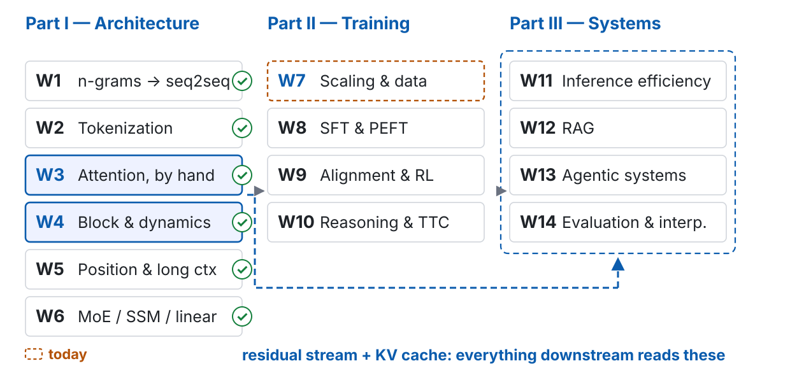
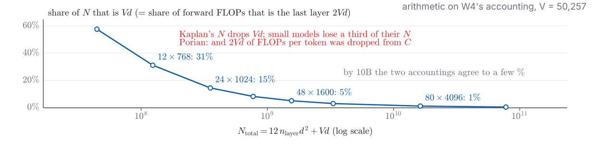
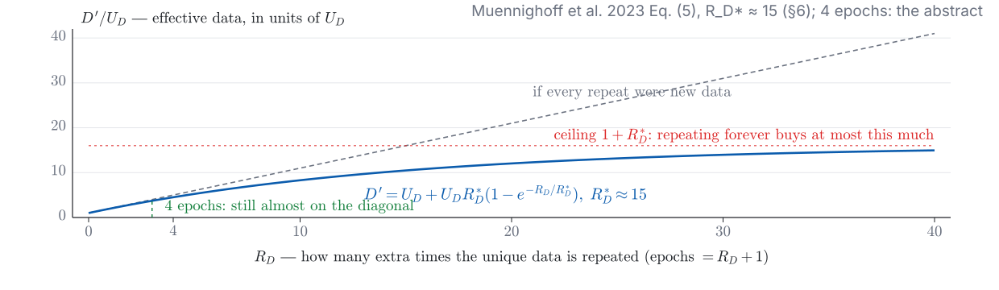
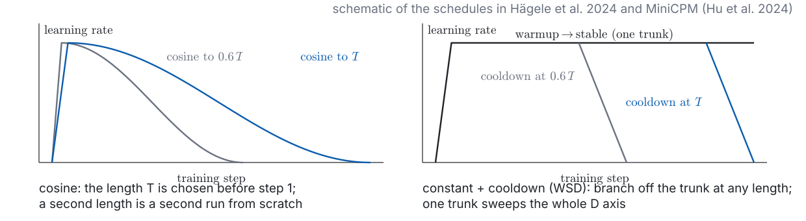
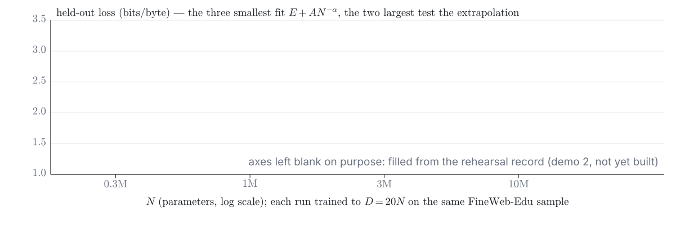
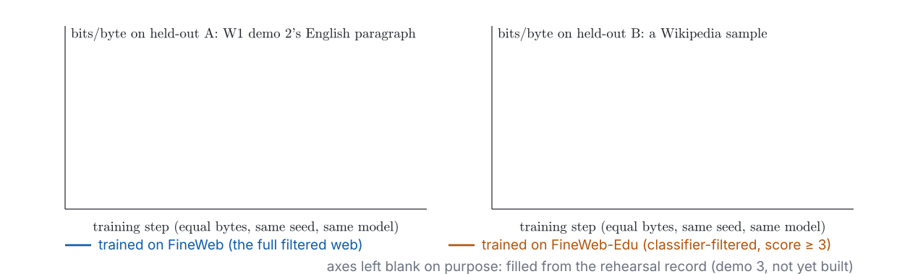

---
# 此檔由 bin/publish_slides.py 從投影片正本產生（中文講稿區塊已剝除），請勿直接編輯。正本在 private repo 的 <course>/slides/。
title: "Pre-training: Scaling Laws and Data Curation"
subtitle: "NLP & Large Language Models · Week 7"
author: "Hung-Shin Lee"
lang: en
format:
  revealjs:
    theme: [default, theme.scss]
    slide-number: c/t
    show-slide-number: all
    # 目標顯示尺寸：1280×800（16:10），與 W1–W6 相同。
    width: 1280
    height: 800
    margin: 0.04
    center: false
    progress: true
    transition: none
    navigation-mode: linear
    incremental: false
    # inline SVG 的 fragment：?print-pdf 時整張印在一頁
    pdf-separate-fragments: false
    chalkboard:
      buttons: true
    html-math-method:
      method: katex
      url: "https://cdn.jsdelivr.net/npm/katex@0.18.7/dist/"
    # 講稿（notes 區塊）裡的數學只輸出 MathML（照 w01.qmd，2026-09-16 起）。
    include-after-body:
      - text: |
          
---

# Who said 20? Part II opens on the ledger's first row {.section-title}

## Where we are: week 7 of 14

{width="100%"}

## Last week, in one picture



::: {.claim}
**Six weeks of the same first row** — $N$ ever more precise, never asked how big it should be or how many tokens it deserves.
:::

::: {.footer}
W6 p47, p57 · W1 p16, p18 · w07-data.json lastweek — no new numbers
:::

## The problem this week handles, in one picture



::: {.footer}
Outline W7 · board: p14–p15, p21, p44–p45 · live: p9, p22, p42, p47 · replay: p33, p42
:::

## What you should be able to do by the end of today

1. **Derive the first-order condition** from $\mathcal{L}(N, D) = E + AN^{-\alpha} + BD^{-\beta}$ and $6ND = C$ on the board; say what the optimum means, why $N^{*} \propto C^{\beta/(\alpha+\beta)}$, and why $D/N \approx 20$ is a fitted constant while the exponent is the structure; say what each of Chinchilla's three methods holds fixed
2. **Explain the Kaplan–Chinchilla gap** ($C^{0.73}$ vs $C^{0.50}$): which $N$, the last layer's compute, warmup, re-tuning — and Besiroglu's three charges; say what "not overturned, rewritten" means
3. **Write each 2024–2026 correction as one added cost term** and re-derive: inference ($6ND + 2ND_{\text{inf}}$), $T^{2}$'s $k$, precision ($N_{\text{eff}}$), data ($D_{\text{eff}}$); for an MoE say which $N$; for $V$ recall W2
4. **List five reasons a fit goes wrong**, one paper each, and point to the one happening in demo 2
5. **Describe a public pre-training pipeline stage by stage**, with a failure mode and a public reference per stage; write MinHash's one line and what LSH's $(b, r)$ tunes
6. **State how mixtures and order are chosen in 2026**: small proxies and their open transferability; the cooldown as the place for the best data; stability as the precondition for any fit
7. **Give the known limits of synthetic data**, separate collapse-by-replacement from accumulation — and, the first time MMLU is mentioned, say contamination and 6.49% in the same breath

## Two questions for today — one line each, before we start

::: {.ask}
**(a)** W1 p18 had you compute a 7B model at $D = 20N$. **Who decided 20** — and from what?
:::

::: {.ask}
**(b)** Llama 3 8B was trained on 15T tokens: $D/N \approx 1900$, almost a hundred times "20". **Did Meta not do the arithmetic?**
:::

- Keep your two lines: p57 comes back to both
- (a) is the ledger's first row (W1 p16): six weeks of $6ND$ and no rule for splitting $C$ between $N$ and $D$
- (b) is where today's second section ends: a cost the rule never counted

::: {.footer}
W1 p16, p18 · Llama 3's 15T: the paper's body · Misconception 1: "Chinchilla says 20"
:::

## Before Demo 1: compute-optimal, from five constants

::: {.prose}
| | |
|:---|:-----------------|
| **Why** | Every number in the first half comes from one fitted equation. Before deriving it, see what it *says*: run the closed form for $N^{*}(C)$, $D^{*}(C)$ and put three real models on it — W1's 7B / 140B, Chinchilla's own 70B / 1.4T, Llama 3's 8B / 15T. |
| **What runs** | A terminal; pure standard library. `demo_config.toml` holds Hoffmann et al.'s Approach 3 fit (Eq. 10): $E = 1.69$, $A = 406.4$, $B = 410.7$, $\alpha = 0.34$, $\beta = 0.28$. The script prints $N^{*}$, $D^{*}$, $D^{*}/N^{*}$ and $\mathcal{L}^{*}$ for $C = 10^{18} \ldots 10^{26}$, then the three points with their distance from the optimum. |
| **Watch for** | Does $D^{*}/N^{*}$ stay at 20 as $C$ grows? Is W1's 7B / 140B on the valley floor — and if not, how much loss does the gap cost? Where does Chinchilla's own 70B land under its own Approach 3 constants? |
:::

::: {.footer}
Demo 1 · `demos/w07_d1_compute_optimal` · standard library only · not yet built (2026-10-26)
:::

## Live: demo 1 (a) — $N^{*}$, $D^{*}$ against $C$; three real models

| $C$ (FLOPs) | $N^{*}$ | $D^{*}$ | $D^{*}/N^{*}$ | $\mathcal{L}^{*}$ |
|:---|:---|:---|:---|:---|
| $10^{18}$ | | | | |
| $10^{20}$ | | | | |
| $10^{22}$ | | | | |
| $10^{24}$ | | | | |
| $10^{26}$ | | | | |

: {tbl-colwidths="[20,20,20,20,20]"}

| model | $N$ | $D$ | $D/N$ | $C = 6ND$ | $(N^{*}, D^{*})$ at that $C$ | $\mathcal{L} - \mathcal{L}^{*}$ |
|:---|:---|:---|:---|:---|:---|:---|
| W1 p18 | 7B | 140B | 20 | $5.9 \times 10^{21}$ | | |
| Chinchilla | 70B | 1.4T | 20 | $5.9 \times 10^{23}$ | | |
| Llama 3 8B | 8B | 15T | 1875 | $7.2 \times 10^{23}$ | | |

: {tbl-colwidths="[14,8,8,8,16,26,20]"}

::: {.footer}
Demo 1 (a) · live · `w07_d1_compute_optimal/` · Hoffmann Eq. (10) · not yet built (2026-10-26)
:::

# One fitted equation, one constraint: where does 20 come from? {.section-title}

## The fuel-efficiency curve: one metaphor for the first half

::: {.prose}
| | |
|:---|:-----------------|
| **The picture** | A scaling law is an engine's **fuel-efficiency curve**: one tank ($C$) tells you how far you get (how low the loss), and how to split the tank between engine displacement ($N$) and mileage ($D$). It does not tell you where to drive. |
| **Where it extends** | Every 2024–2026 correction adds a cost beyond fuel: the car is driven for years (inference; Roberts even counts how many times each trip is re-run), the fuel has impurities (precision), the pump runs dry (data). **Add a cost axis and the optimum moves** — W10 adds test-time compute, W11 deployment. |
| **Where it fails** | (a) It says the goal is distance (low loss); the goal is downstream ability, and the two are not on one curve (p31). (b) It treats fuel as homogeneous; *which* tokens matter more than how many (the second half). (c) An MoE has two displacements, $N_{\text{total}}$ and $N_{\text{active}}$ — one curve is not enough (p26). (d) The curve is **fitted** in a range; ten tanks out it is belief, not measurement (p28). |
:::

::: {.footer}
Outline W7 · the metaphor is this course's, not a paper's · it carries to W10 and W11
:::

## At a glance: Chinchilla (Hoffmann et al. 2022)

::: {.prose}
| | |
|:---|:-----------------|
| **Name** | *Training Compute-Optimal Large Language Models*, Hoffmann et al., NeurIPS 2022 (arXiv:2203.15556; published as *An empirical analysis of compute-optimal large language model training*). The 70B model trained in it is **Chinchilla**, and the paper is called by its name. |
| **The question** | Given a fixed FLOPs budget, how should model size $N$ and the number of training tokens $D$ be traded off? |
| **The idea** | Train 400+ models, 70M–16B, on 5B–500B tokens; find the optimum three ways — fix $N$, sweep $D$; fix $C$, sweep $N$; fit $\mathcal{L}(N, D) = E + AN^{-\alpha} + BD^{-\beta}$ and solve. |
| **What it added** | **$N$ and $D$ should be scaled equally**: double the model, double the tokens. The 70B Chinchilla on 4$\times$ the data beats the 280B Gopher at the same compute — the abstract's claim, and the origin of "20 tokens per parameter". |
| **What it leaves open** | What the three methods disagree about (p16–p17); why Kaplan said $C^{0.73}$ (p18); whether the Approach 3 fit holds (p19); what the budget did not count (p20 on). |
:::

::: {.footer}
Hoffmann et al. 2022, abstract and §3 · assigned reading: §3 · mechanism: p13–p16
:::

## Three terms: what $E$, $AN^{-\alpha}$ and $BD^{-\beta}$ each pay for

$$\mathcal{L}(N, D) \;=\; \underbrace{E}_{\text{the data's own entropy}} \;+\; \underbrace{\frac{A}{N^{\alpha}}}_{\text{a finite model}} \;+\; \underbrace{\frac{B}{D^{\beta}}}_{\text{finite data}}$$

| term | survives when | what it is | W1's name for it |
|:---|:---|:---|:---|
| $E$ | $N \to \infty$ **and** $D \to \infty$ | the irreducible loss: natural text is random | $H(p)$, the entropy rate (W1 p23) |
| $AN^{-\alpha}$ | $D \to \infty$ | the cost of a model with only $N$ parameters | approximation error |
| $BD^{-\beta}$ | $N \to \infty$ | the cost of having seen only $D$ tokens | estimation error |

: {tbl-colwidths="[14,28,36,22]"}

::: {.claim}
Two power laws and a floor. The **constraint** $C = 6ND$ (W1 p17: $2$ forward $+\,4$ backward) is what turns a description into a decision.
:::

::: {.footer}
Hoffmann et al. 2022 Eq. (2); constants fitted in Eq. (10) · Misconception 1, continued on p15
:::

## Substitute, differentiate: two marginal returns, made equal

::: {.fragment fragment-index=1}
$$D = \frac{C}{6N} \quad\Longrightarrow\quad \mathcal{L}(N) = E + A N^{-\alpha} + B\Big(\frac{6}{C}\Big)^{\beta} N^{\beta}$$
:::

::: {.fragment fragment-index=2}
$$\frac{\mathrm{d}\mathcal{L}}{\mathrm{d}N} = -\alpha A N^{-\alpha-1} + \beta B\Big(\frac{6}{C}\Big)^{\beta} N^{\beta-1} = 0$$
:::

::: {.fragment fragment-index=3}
$$\boxed{\;\alpha\, A N^{-\alpha} \;=\; \beta\, B D^{-\beta}\;}$$
:::

::: {.fragment fragment-index=4}
::: {.claim}
**Read the box, not the algebra.** At the optimum, the $N$-term times its exponent equals the $D$-term times its exponent: one more FLOP spent on $N$ lowers the loss exactly as much as one more FLOP spent on $D$. Lagrange gives the same line: $\nabla\mathcal{L} = \lambda\,\nabla(6ND)$, divide the two components.
:::
:::

::: {.footer}
Outline W7, key math 2 · on the board (with $\log N$ as the variable; same result)
:::

## Solve: the exponent is the structure, 20 is a constant



::: {.fragment fragment-index=3}
$$N^{*} = G\Big(\tfrac{C}{6}\Big)^{a}, \qquad D^{*} = \tfrac{C}{6N^{*}} = G^{-1}\Big(\tfrac{C}{6}\Big)^{b}, \qquad a = \tfrac{\beta}{\alpha+\beta},\; b = \tfrac{\alpha}{\alpha+\beta},\; G = \Big(\tfrac{\alpha A}{\beta B}\Big)^{\frac{1}{\alpha+\beta}}$$
:::

::: {.fragment fragment-index=4}
$$\frac{D^{*}}{N^{*}} = G^{-2}\Big(\tfrac{C}{6}\Big)^{\frac{\alpha-\beta}{\alpha+\beta}} \qquad\text{a constant only if } \alpha = \beta \text{ — and then it is } G^{-2}\text{, set by } A, B, \alpha, \beta$$
:::

::: {.footer}
Hoffmann Eq. (4), computed from Eq. (10): $a = 0.452$, $G = 1.345$, $G^{-2} = 0.55$ · Misconception 1
:::

## Three approaches, three things held fixed — and what each gave

| approach | holds fixed | reads off | $a$ ($N^{*} \propto C^{a}$) | $b$ |
|:---|:---|:---|:---|:---|
| **1** · minimum over training curves | $N$; sweep $D$ | the lowest loss at each $C$ (the envelope) | 0.50 | 0.50 |
| **2** · IsoFLOP profiles | $C$; sweep $N$ | the valley floor of each curve (p15) | 0.49 | 0.51 |
| **3** · parametric fit | nothing: fit $E, A, B, \alpha, \beta$ | p15's closed form with Eq. (10)'s constants | **0.46** (0.454, 0.455) | 0.54 |
| Kaplan et al. 2020 | $N_{\text{nv}}$, non-embedding | separate power laws in $N$ and $D$ | **0.73** | 0.27 |

: {tbl-colwidths="[28,22,30,12,8]"}

::: {.claim}
Table 3 (Approach 1), 10B: **205.1B tokens — that is the 20.** Table A3 (Approach 3), 10B: 410.1B. The quoted number: methods 1–2; the fitted constants: method 3.
:::

::: {.footer}
Hoffmann et al. 2022 Table 2, Table 3, Table A3 · read from the arXiv PDF 2026-10-26
:::

## What demo 1 (a) showed: 20 or 59 — and a valley 0.007 nats deep

| | $N$ | $D$ | $D/N$ | $\mathcal{L}$ under Eq. (10) |
|:---|:---|:---|:---|:---|
| W1 p18's model | 7B | 140B | 20 | 2.1835 |
| Eq. (10)'s optimum at the same $C$ | 4.1B | 241B | 59 | 2.1767 |
| the gap | | | | **0.0068 nats** |

: {tbl-colwidths="[40,12,12,12,24]"}

- The first-order condition finds the **floor** of a valley; it says nothing about how **steep** the walls are. Here they are not: trading $N$ down by 40% and $D$ up by 70% buys 0.007 nats.
- So two very different $D/N$ can be "almost optimal" — which is why 20, 41 and 59 can coexist in one paper, and why **the exponent, not the ratio, is what the three methods agree on**
- The flatness is also what the second section exploits: a cost the budget never counted can push the choice far along the floor for little loss

::: {.footer}
w07-data.json chinchilla.points · arithmetic on Eq. (10), not a measurement · Misconception 1
:::

## Kaplan's 0.73 vs. Chinchilla's 0.50: two accountings

{width="100%"}

| cause (Porian et al.; Pearce & Song) | what Kaplan did | why it tilts the slope |
|:---|:---|:---|
| **which $N$** | counted $N_{\text{nv}}$, non-embedding only (§2.1) | small models lose a third of $N$, large ones a few %: the log-log line steepens (W4 p20) |
| **the last layer's compute** | dropped $2Vd$ per token from $C$ | same shape: a cost that matters most at small scale |
| **warmup; no per-size re-tuning** | one schedule for all sizes | small runs under-tuned, their loss too high — muP (W4 p55) is one answer |

: {tbl-colwidths="[28,30,42]"}

::: {.footer}
Porian 2024 · Pearce & Song 2024 · W4 p20 · Misconception 2: "one of them botched it"
:::

## Besiroglu's three charges — why "overturned" is wrong

::: {.prose}
| charge (abstract) | what it means | already seen today |
|:---|:---|:---|
| **1** · **inconsistent with the other two methods** | Eq. (10)'s constants imply a different optimum than Table 3 | Chinchilla's own 70B / 1.4T is off Eq. (10)'s valley floor (p9, p16) |
| **2** · it **fails to fit the extracted data** | the points re-digitised from the paper's figure miss the published curve; their own re-fit is **compatible with methods 1–2** | — |
| **3** · **implausibly narrow confidence intervals** | 0.454–0.455 would need about 600,000 runs; the paper had under 500 | Table 2's interval (p16); the mechanism is p29 |

: {tbl-colwidths="[36,36,28]"}
:::

::: {.claim}
**Not overturned**: the direction and the exponent near $0.5$ survive; one set of constants fell. Every correction since **adds an axis**.
:::

::: {.footer}
Besiroglu et al. 2024 (abstract) · assigned reading · Misconception 3: "Chinchilla was overturned"
:::

# "Optimal" counted training FLOPs once. What else is on the bill? {.section-title}

## Inference: $6ND + 2ND_{\text{inf}}$ — the tax falls on $N$

::: {.fragment fragment-index=1}
$$C_{\text{total}}(N, D) = \underbrace{6ND}_{\text{train once}} + \underbrace{2N\,D_{\text{inf}}}_{\text{serve } D_{\text{inf}} \text{ tokens over the model's life}} \qquad\text{minimise at a fixed loss } \mathcal{L}(N, D) = \ell$$
:::

::: {.fragment fragment-index=2}
$$\frac{\partial C_{\text{total}}/\partial N}{\partial C_{\text{total}}/\partial D} = \frac{\partial\mathcal{L}/\partial N}{\partial\mathcal{L}/\partial D} \quad\Longrightarrow\quad \frac{6D + 2D_{\text{inf}}}{6N} = \frac{\alpha A N^{-\alpha-1}}{\beta B D^{-\beta-1}}$$
:::

::: {.fragment fragment-index=3}
::: {.claim}
**Read the numerator.** $D_{\text{inf}} = 0$ gives p14 back. $D_{\text{inf}} > 0$ raises the marginal cost of $N$ and leaves $D$'s alone — so the same loss is reached with a **smaller $N$ and more $D$**. The inference term overtakes training when $2ND_{\text{inf}} > 6ND$, i.e. $D_{\text{inf}} > 3D$: for a model served for years, the normal case.
:::
:::

::: {.footer}
Sardana et al., ICML 2024 ("smaller and longer") · $2N$ per token: the decode row (W1 p16)
:::

## Live: demo 1 (b) — pay for inference, watch the optimum move

| $D_{\text{inf}}$ | $N^{*}$ | $D^{*}$ | $D^{*}/N^{*}$ | total cost vs. keeping the Chinchilla shape |
|:---|:---|:---|:---|:---|
| $0$ | | | | — |
| $10^{12}$ | | | | |
| $10^{13}$ — **guess this row first** | | | | |
| $10^{14}$ | | | | |

: {tbl-colwidths="[30,16,16,14,24]"}



::: {.footer}
Demo 1 (b) · live · at the loss of W1's 7B / 140B · not yet built (2026-10-26) · then (c)
:::

## At a glance: the $T^{2}$ scaling law (Roberts et al. 2026)

::: {.prose}
| | |
|:---|:-----------------|
| **Name** | *Test-Time Scaling Makes Overtraining Compute-Optimal*, Roberts et al., COLM 2026 (arXiv:2604.01411). $T^{2}$ stands for **Train-to-Test**. |
| **The question** | If a deployed model answers by drawing $k$ samples (W10's test-time compute), the inference term becomes $2N\,k\,D_{\text{inf}}$. Under one end-to-end budget, how should $N$, $D$ **and $k$** be chosen together? |
| **The idea** | Fit the task accuracy — pass@$k$, not the loss — as a function of $(N, D, k)$, and optimise all three under the total cost. |
| **What it added** | The optimum moves "radically" into the **overtraining** regime, outside the range of standard scaling suites — and the conclusion survives post-training. |
| **What it leaves open** | The objective is a task metric, so everything p31 says about loss vs. ability applies; and $k$ is one way to spend test-time compute among several (W10). Kinetics (Sadhukhan et al. 2025) adds that under test-time scaling the cost is memory access and attention, not parameters (W11). |
:::

::: {.footer}
Roberts et al. 2026 · Sadhukhan et al. 2025 (abstracts) · W10, W11
:::

## Precision: $N_{\text{eff}} = N\,g(P)$ — overtraining vs. quantization

$$\mathcal{L}(N, D, P) = E + \frac{A}{\big(N\,g(P)\big)^{\alpha}} + \frac{B}{D^{\beta}}, \qquad g \text{ increasing in the training precision } P \text{ (bits)}$$

- **Training precision becomes a third variable**: at the same compute, a bigger $N$ in fewer bits or a smaller $N$ in more — there is an optimum, and it moves with $P$
- **Post-training quantization (W11) gets worse with more data**: the degradation **increases with the amount of training data**, until more pre-training data becomes *harmful* to the quantized model (abstract)
- Intuition (ours): overtraining packs information into the weights' low-order bits; quantization throws exactly those away

::: {.claim}
Two 2026 habits collide here: **train long** (the inference axis) and **ship in 4 bits** (W11). Each is optimal on its own axis.
:::

::: {.footer}
Kumar et al., ICLR 2025 Oral (abstract) · $g(P)$'s form is in the body, not quoted · W11
:::

## Data: $D_{\text{eff}}$ saturates with epochs; four are nearly free

{width="100%"}

- Put $D^{\prime}$ for $D$ in p14's loss and re-derive: once unique data run out, extra compute buys **$N$ or more epochs** — and past ~4 epochs the value of added compute decays toward zero (abstract)
- The same form holds for $N$ (Eq. 6), with $R^{*}_{N} < R^{*}_{D}$ · this is why 15T-token runs make the ceiling real, and why synthetic data (p54) is taken seriously

::: {.footer}
Muennighoff et al. 2023 · Eq. (5)–(6) §3.1 · $R^{*}_{D} \approx 15$ §6 · "4 epochs": abstract
:::

## Two $N$'s and a $V$: the debts from W6 and W2

::: {.prose}
| debt | the facts | what the law should read |
|:---|:---|:---|
| **W6 p57: a scaling law is written in $N$ — for an MoE, which?** | $C \approx 6N_{\text{active}}D$; memory and capacity follow $N_{\text{total}}$; W4's $12\,n_{\text{layer}}d^{2}$ is the dense case; W6's $\rho$ has a floor | **Neither.** Clark et al.: loss as a function of parameters *and* expert count, collapsed into an **effective parameter count**. Abnar et al.: under a fixed parameter or compute budget there **is** an optimal sparsity — two axes |
| **W2 p42–p44: vocabulary is in the budget** | $N = N_{\text{nv}} + N_{\text{v}}$; $D$ in tokens depends on $V$ (W2 p47) | Tao et al.: the first-order condition W2 derived — a fourth variable. Limisiewicz 2026: scale $N$ with data in **bytes** — one preprint, unreplicated |

: {tbl-colwidths="[26,30,44]"}
:::

::: {.footer}
Clark 2022 · Abnar 2025 · Tao 2024 · W6 p57 · W2 p44 · Misconception 4: "MoE's $N$ is the total"
:::

# Every axis is a small-scale fit, extrapolated. Can the fit be trusted? {.section-title}

## Five ways a scaling-law fit goes wrong — one paper each

| # | what goes wrong | the paper | what to ask of a paper's fit |
|:---|:---|:---|:---|
| **1** | too few points, too close, extrapolated too far | (Mis)Fitting, ICLR 2025: 45 of 50+ papers fit a power law; most under-report | how many runs, over how many decades of $C$? raw points released? |
| **2** | a **collinear design**: every run on one ray $D = kN$ | Kricheli et al. 2026 (p29) | is $D/N$ varied at a fixed $N$? |
| **3** | hyperparameters **not re-tuned** per size | Porian et al. 2024 (p18); muP (W4 p55) | swept per size, or transferred? |
| **4** | the schedule **ties the run to one length** | Hägele et al. 2024; MiniCPM (p30) | cosine to a fixed $T$, or constant + cooldown? |
| **5** | loss and ability are **not one curve** | Gadre et al. 2025 vs. Schaeffer et al. 2023 (p31) | is the $y$-axis a loss, an average, or a thresholded metric? |

: {tbl-colwidths="[5,30,35,30]"}

::: {.claim}
Demo 2 (p33) is built to trip on **1** and **2**: five points, one ray, three used for the fit.
:::

::: {.footer}
Li, Kudugunta & Zettlemoyer 2025 (abstract) · Misconception 5: "a scaling law is a measurement"
:::

## The collinear design: one ray cannot identify $A$ and $B$



::: {.claim}
Chinchilla-style suites fix tokens-per-parameter; when $\alpha \approx \beta$ the two power laws share one shape along the ray, the fit is ill-conditioned, and the **narrow intervals are an artefact**. Non-collinear designs win 97.3% of held-out comparisons.
:::

::: {.footer}
Kricheli et al., NeurIPS 2026 (abstract) · TPP = tokens per parameter · explains p19's charge 3
:::

## Re-tune at every size; a schedule that does not tie the length

{width="100%"}

| reason | the fix | why it matters for a fit |
|:---|:---|:---|
| **3** · one learning rate for all sizes | sweep per size, or **muP** (W4 p55): tune small, transfer wide | an under-tuned small run puts its point too high and tilts the line (p18) |
| **4** · cosine to a fixed $T$ | **constant + cooldown** (Hägele; MiniCPM's **WSD**: warmup–stable–decay): one trunk, branch off at any length | one run gives every $D$ on the axis — and the cooldown is where today's second half puts its best data (p52) |

: {tbl-colwidths="[30,38,32]"}

::: {.footer}
Hägele et al. 2024 · Hu et al., MiniCPM 2024 (abstracts) · W4 p55
:::

## Loss is the $y$-axis, not the goal: Gadre and Schaeffer



| | Gadre et al. 2025 | Schaeffer et al. 2023 |
|:---|:---|:---|
| measures | perplexity → **average** downstream error, 104 models | one task at a time, the **metric** varied |
| finds | a power law; 32$\times$ over-trained and compute-optimal runs predicted from 300$\times$ less compute | nonlinear or discontinuous metrics manufacture "emergence"; continuous ones are smooth |
| so | the average is predictable | a thresholded task need not be; Wei et al.'s definition is partly the metric's |

: {tbl-colwidths="[12,40,48]"}

::: {.footer}
Gadre 2025 · Schaeffer 2023 · Wei 2022 · Misconception 6: "lower loss is more capable"
:::

## Before Demo 2: five sizes along the ray — fit three, test two

::: {.prose}
| | |
|:---|:-----------------|
| **Why** | Methodology reasons 1 and 2, on purpose: five byte-level GPTs (W4's `GPT`, $V = 256$) on the same FineWeb-Edu sample, each trained to $D = 20N$ — one ray, few points. Fit $\mathcal{L}(N) = E + AN^{-\alpha}$ to the three smallest; extrapolate to the two largest; report the error. |
| **What runs** | Recorded before class, replayed here. Sizes from about 0.3M to 10M parameters (fixed at rehearsal by the time budget, about 3 hours in total); same corpus, same seed; learning rate scaled by width as muP prescribes (W4); held-out loss in bits/byte every 50 steps. Then the five-point fit for comparison. |
| **Watch for** | Three points, three parameters: expect the fit to be perfect and the extrapolation not to be — how far off, and in which direction? If the error is small, that is a result too: within two decades a power law does hold. Each run also keeps its whole loss-vs-tokens curve, so the replay can cut Approach 1's envelope. |
:::

::: {.footer}
Demo 2 · `demos/w07_d2_scaling_fit` · torch on MPS · not yet built (2026-10-26)
:::

## Replay: demo 2 — five points, one ray, the extrapolation error

{width="100%"}

::: {.fragment fragment-index=1}
| fit | $E$ | $A$ | $\alpha$ | predicted at $N_{4}$ / measured | predicted at $N_{5}$ / measured |
|:---|:---|:---|:---|:---|:---|
| three smallest points | | | | | |
| all five points | | | | — | — |

: {tbl-colwidths="[26,10,10,10,22,22]"}
:::

::: {.footer}
Demo 2 · replay · `w07_d2_scaling_fit/` · not yet built (2026-10-26) · Misconception 5
:::

## The other half of the recipe: a run that spikes cannot be fitted

::: {.prose}
| what W4 left here | what this week adds | the shipped example |
|:---|:---|:---|
| **a spike is not dirty data** (W4 p53): the same batch at another step does not spike; the logit statistics move first (W4 p48–p50) | "stability" is **the precondition of a scaling law**: every size in the suite must train to the end at its tuned learning rate, or there is no point to fit | OLMo 2 §3: reordered norm, QK-norm, z-loss (W4 p51); repeated-$n$-gram removal, initialization, AdamW's $\epsilon$, no weight decay on embeddings |
| **muP** (W4 p55): tune small, transfer wide | how reason 3 (p30) is met without re-sweeping | Kimi K2: MuonClip on Muon (W4 p56) — **15.5T tokens, zero loss spikes** |

: {tbl-colwidths="[30,34,36]"}
:::

::: {.claim}
Two halves of one recipe: **what to train on** (the second half of today) and **a run that reaches the end** (W4). A scaling law assumes the second.
:::

::: {.footer}
Team OLMo 2025 §3 · Kimi Team 2025 · Misconception 7: "loss spikes come from dirty data"
:::

# Compute bought the tokens. Which tokens — who decides, and how? {.section-title}

## The water-treatment plant: one metaphor for the second half



::: {.footer}
Outline W7 · W1's compressor eats what it is fed · commoncrawl.org (a website)
:::

## At a glance: FineWeb and FineWeb-Edu (Penedo et al. 2024)

::: {.prose}
| | |
|:---|:-----------------|
| **Name** | *The FineWeb Datasets: Decanting the Web for the Finest Text Data at Scale*, Penedo et al., NeurIPS 2024 Datasets & Benchmarks (arXiv:2406.17557). Data, pipeline code and ablations are public. |
| **The question** | Which processing decisions, applied to Common Crawl, actually improve a model trained on the result — measured, not assumed? |
| **The idea** | Build the pipeline stage by stage, ablating each with small models: 96 snapshots → 15T tokens (FineWeb). Then Llama-3-70B-Instruct scores 460k pages for "educational value" (0–5); a small classifier learns the scores; keep $\geq 3$: 1.3T tokens (FineWeb-Edu). |
| **What it added** | The first **public, reproducible, ablated** pipeline; FineWeb-Edu "dramatically" better on MMLU and ARC — **MMLU's first appearance here, so in the same breath: 6.49% of its questions are wrong, and its contamination is detectable only above a floor (p48)**; **per-snapshot deduplication beats global**. |
| **What it leaves open** | "Educational" is one judge's taste (p40, demo 3); English only — FineWeb2 extends it to 1000+ languages (p39); every number is small-model, extrapolated. |
:::

::: {.footer}
Penedo et al. 2024, abstract, §3.4, §4 (read 2026-10-26) · the corpus of demos 2–4 · ODC-By
:::

## Raw water and the sieve: Common Crawl, extraction, language ID

| stage | what it does | what it removes — and where it fails |
|:---|:---|:---|
| **Common Crawl** | a non-profit's crawl: 300B+ pages over 15 years, 3–5B new a month; snapshots named by date (latest CC-MAIN-2026-43) | nothing yet: the web as it is, including what it says about people |
| **extraction** | HTML → text (FineWeb: trafilatura) | menus, ads, boilerplate — and, as a side effect, code indentation and math layout |
| **language ID** | one classifier per page (fastText; FineWeb2: GlotLID) decides the language **and the script** | pages below a confidence threshold — and **whole varieties the classifier does not distinguish** (next slide) |

: {tbl-colwidths="[18,42,40]"}

::: {.claim}
The sieve runs **before** quality, deduplication and mixing: whatever it drops, no later stage can recover.
:::

::: {.footer}
commoncrawl.org (a website, not a paper) · FineWeb §3.1, §3.3 · FineWeb2 (arXiv preprint)
:::

## Where W2's gap is decided: FineWeb2's language table

| FineWeb2 config (dataset card, read 2026-10-26) | what it holds |
|:---|:---|
| `cmn_Hani` | **2.42 TB — Traditional and Simplified in one bucket**: GlotLID identifies the script (Han), not the variety |
| `yue_Hani` (Cantonese) | about 315k documents |
| `hak_Hani` (Hakka) | **74 documents** |
| `nan_Latn` (Taiwanese, romanised) | **2,891 documents** |

: {tbl-colwidths="[40,60]"}

::: {.claim}
W2 p67 said "Traditional Chinese has too little data" is the wrong diagnosis. Here is the right one: **it has no subset of its own** — not a quality decision, a decision made at the sieve. Hakka and Taiwanese are the other case: the sieve has a slot, and the raw water is nearly empty.
:::

::: {.footer}
`fineweb-2` dataset card (not a paper) · W2 p67 · Misconception 8 begins: "more data is better"
:::

## Quality: rules, then a classifier — and what "quality" means

| filter | how it decides | public reference | where it fails |
|:---|:---|:---|:---|
| **rules** | thresholds: repetition, symbol ratio, length, stop-words, punctuation | C4's heuristics; MassiveText's (Gopher's) repetition filters — FineWeb uses both, minus C4's punctuation rule (§3.5) | every rule has a victim: C4's punctuation rule alone removes ~30% of tokens |
| **classifier, LLM-labelled** | an LLM scores pages; a small model learns the scores | FineWeb-Edu: Llama-3-70B-Instruct, 460k pages, 0–5, keep $\geq 3$ (§4) | "educational" is **one judge's taste** — demo 3 |
| **classifier, reference-labelled** | positives = text you want more of; negatives = random web | DCLM-Baseline: fastText, OpenHermes 2.5 + r/ExplainLikeImFive vs. random web, top 10% (§4.4); 7B / 2.6T → 64% MMLU | the target defines quality; RegMix: web text correlates with downstream more than Wikipedia |
| **filter less** | ensemble classifiers; rephrase instead of discard | Nemotron-CC: 6.3T tokens, DCLM's MMLU with **4$\times$ the unique real tokens** | a filter is a parameter with a cost (p49) |

: {tbl-colwidths="[18,24,36,22]"}

::: {.footer}
FineWeb §3.3–3.5, §4 · DCLM §4.4 · Nemotron-CC · RegMix (abstracts) · Misconception 8
:::

## Before Demo 3: equal bytes, two corpora, two held-outs

::: {.prose}
| | |
|:---|:-----------------|
| **Why** | p40 said "educational" is one judge's taste and that quality is relative to a target. See both: first with your own eyes and the classifier's score, then in bits/byte. |
| **What runs** | **Live**: three pages sampled from FineWeb and three from FineWeb-Edu (fixed seed), shuffled — you guess which is which; then the FineWeb-Edu classifier (`HuggingFaceFW/fineweb-edu-classifier`, a regression head on a 110M embedding model) scores the same six pages 0–5. **Recorded**: one of demo 2's sizes trained twice on **equal bytes** of each corpus (same steps, same seed), evaluated on **two** held-outs: W1 demo 2's English paragraph, and a Wikipedia sample — reported separately. |
| **Watch for** | Which pages fool you, and which the classifier scores low that you would keep. In the curves: does the FineWeb-Edu model win on both held-outs, or only on the one that looks like its training data? "Quality" is defined relative to the held-out — splitting the report is how you see that. |
:::

::: {.footer}
Demo 3 · `demos/w07_d3_quality_filter` · torch on MPS · not yet built (2026-10-26)
:::

## Live + replay: demo 3 — guess the source, score it, two curves

::: {.fragment fragment-index=1}
| page | 1 | 2 | 3 | 4 | 5 | 6 |
|:---|:---|:---|:---|:---|:---|:---|
| your guess | | | | | | |
| classifier score (0–5) | | | | | | |
| actually from | | | | | | |

: {tbl-colwidths="[28,12,12,12,12,12,12]"}
:::

::: {.fragment fragment-index=2}
{width="100%"}
:::

::: {.footer}
Demo 3 · live + replay · `w07_d3_quality_filter/` · not yet built (2026-10-26) · blank on purpose
:::

## Deduplication: why — one sentence, 60,000 times

| source | finding (abstract) | what it means for the model |
|:---|:---|:---|
| Lee et al., ACL 2022 | one 61-word English sentence appears **over 60,000 times** in C4 | a duplicate is a token predicted 60,000 times: the model **memorises instead of generalising** |
| Lee et al. | **over 1%** of unprompted output is copied verbatim from training data; deduplication cuts it **tenfold** | W1 p7's $n = 8$ — "not generation, recall" — happens in a Transformer too; the threshold is the repeat count, not $n$ |
| Lee et al. | train–test overlap affects **over 4%** of standard validation sets | the next stage: decontamination (p48) |
| Carlini et al., ICLR 2023 | memorisation grows **log-linearly** with capacity, with **how often an example is duplicated**, and with prompt length | the second factor is what deduplication controls; the first says bigger models make it worse |

: {tbl-colwidths="[16,42,42]"}

::: {.claim}
W1's $n = 8$ closes here — and near-duplicates also lie to the scaling law: $D$ up, $D_{\text{eff}}$ not (p25).
:::

::: {.footer}
Lee et al. 2022 · Carlini et al. 2023 (abstracts) · W1 p7, p41 · W1's $n = 8$ closes here
:::

## MinHash: one hash's collision probability is the Jaccard



::: {.fragment fragment-index=2}
$$J(A, B) = \frac{|A \cap B|}{|A \cup B|}, \qquad \Pr_{\pi}\big[\min \pi(A) = \min \pi(B)\big] = J(A, B)$$
$$\widehat{J} = \frac{1}{k_h}\sum_{i=1}^{k_h} \mathbf{1}\big[\min \pi_i(A) = \min \pi_i(B)\big], \qquad \operatorname{sd}(\widehat{J}) = \sqrt{J(1-J)/k_h}$$
:::

::: {.footer}
Broder 1997; Broder et al. 1998 · $A, B$: sets of word $n$-grams (shingles) · demo 4 writes this
:::

## LSH: bands and rows set the threshold



::: {.claim}
Cut the $k_h$ signatures into $b$ bands of $r$ rows; a **candidate pair** is any pair with one band equal: $\Pr = 1 - (1 - J^{r})^{b}$. $(b, r)$ set the threshold and its steepness — "how similar counts as duplicate" is a parameter, and so is the effective $D$.
:::

::: {.footer}
LSH = locality-sensitive hashing · FineWeb §3.4: 112 hashes, 14 × 8, per snapshot · demo 4
:::

## Before Demo 4: three functions live, then a 13-gram scan

::: {.prose}
| | |
|:---|:-----------------|
| **Why** | p44–p45 on the board become thirty lines that run on demo 2's corpus — and the two stages that W1's $n = 8$ and MMLU's first mention need are the same code with a different threshold. |
| **What runs** | **(a) Live**, standard library, CPU: `shingles(text, n=5)`, `minhash(shingles, k_h=128)`, `lsh_candidates(sigs, b=16, r=8)`; run on documents from **two different Common Crawl dumps** (FineWeb deduplicated per dump, so cross-dump near-duplicates should survive); report candidate pairs, the $\widehat{J}$ distribution, two pairs side by side; change $(b, r)$ once. `tests.py`: identical documents give $\widehat{J} = 1$; a known-$J$ pair is within $\pm 2/\sqrt{k_h}$; all $J > 0.9$ pairs are candidates. **(b) Live**: MMLU's test questions (`cais/mmlu`) scanned for 13-gram overlap with the same corpus. |
| **Watch for** | How many cross-dump near-duplicates survive in 200 MB; what the pairs look like (boilerplate, mirrors, real copies?); how the count moves with $(b, r)$. For (b): a 200 MB sample catches almost nothing — the point of p48. |
:::

::: {.footer}
Demo 4 · `demos/w07_d4_dedup_decontam` · standard library · `cais/mmlu` · not yet built (2026-10-26)
:::

## Live: demo 4 — near-duplicates across dumps; MMLU vs. the corpus

| | value |
|:---|:---|
| documents scanned (two dumps) | |
| candidate pairs, $(b, r) = (16, 8)$ | |
| candidate pairs after changing $(b, r)$ to | |
| pairs with $\widehat{J} \geq 0.9$ | |
| what the near-duplicates are | |
| **MMLU test questions with a 13-gram hit in the corpus** | |

: {tbl-colwidths="[60,40]"}

::: {.ask}
Before (b) runs: 14,042 questions against 200 MB of FineWeb-Edu. How many hits — zero, a handful, hundreds?
:::

::: {.footer}
Demo 4 · live · `w07_d4_dedup_decontam/` · not yet built (2026-10-26) · table blank on purpose
:::

## Decontamination — and what p37 promised about MMLU

::: {.prose}
| | |
|:---|:-----------------|
| **the rule** | a test example is "contaminated" if it shares a **13-gram** with anything in the pre-training set — GPT-3's convention (Brown et al. 2020 §4; details in Appendix C). Deduplication's code, another threshold, another target. |
| **why 200 MB finds nothing** | contamination lives in the full corpus. Oren et al. (ICLR 2024 Oral) *detect* it without the data — every ordering of an exchangeable benchmark should be equally likely — but only for test sets seen **a few times or more**. Detection has a floor; a clean sample proves little. |
| **MMLU, as promised on p37** | **6.49%** of its questions contain errors (Virology: 57%) — Gema et al., NAACL 2025, MMLU-Redux. A benchmark is a dataset: a pipeline, an error rate, a contamination history. W14. |

: {tbl-colwidths="[22,78]"}
:::

::: {.claim}
Rule for this course: the first time MMLU is mentioned, **contamination and the error rate come in the same breath.** p37 did; this slide is the breath.
:::

::: {.footer}
Brown et al. 2020 §4 · Oren 2024 · Gema 2025 · Misconception 9: "high MMLU = capable" · W14
:::

## Every stage removes good water too: three audits

::: {.prose}
| audit | what went out with the bad | the lesson |
|:---|:---|:---|
| **Dodge et al. 2021**, the first audit of C4 | the blocklist **disproportionately removed text from and about minority individuals** — while patents, military sites, machine translation and benchmark items stayed | a "bad words" list is a policy with a measurable victim |
| **FineWeb §3.4**, deduplication | **global** MinHash over 96 snapshots kept ~4T tokens — **little improvement over no deduplication**; what stayed was *worse* than the 90% removed. Per-snapshot kept ~20T | the long tail leaves with the duplicates; granularity is a hyperparameter |
| **Nemotron-CC**, heuristic filters | relying less on rules recovered **4$\times$ the unique real tokens** at DCLM's MMLU | the strictest filter is not the best |

: {tbl-colwidths="[22,50,28]"}
:::

::: {.claim}
Filtering is where the designer decides what the model will never see. Misconception 8's second half: **more filtering is not better either.**
:::

::: {.footer}
Dodge et al. 2021 · FineWeb §3.4 · Nemotron-CC (abstracts) · Misconception 8, closed
:::

# The water is clean. How much of each, and in what order? {.section-title}

## Mixtures from small proxies: four methods, one open question

| method | the proxy | what it predicts | the scale of the claim (abstract) |
|:---|:---|:---|:---|
| **DoReMi**, NeurIPS 2023 | a 280M model, Group DRO over domains | domain weights for an 8B model (30$\times$) | one proxy → one target |
| **RegMix**, ICLR 2025 | 512 models of 1M parameters, 1B tokens each | a regression from mixture to downstream; web beats Wikipedia as a predictor | many tiny proxies → a regression |
| **DataDecide**, ICML 2025 | 25 corpora × sizes to 1B × 3 seeds | the ranking at 150M predicts the best at 1B about **80%** of the time | the honest number: not 100% |
| **Shukor et al.**, NeurIPS 2025 | a few small runs | the domain-weight vector enters the law; extrapolates to larger sizes and unseen mixtures | mixture as a variable of the law |

: {tbl-colwidths="[22,26,34,18]"}

::: {.claim}
All four replace intuition with a measured proxy. **Whether the proxy transfers** — to 7B, another tokenizer, another target — is the open question.
:::

::: {.footer}
Xie · Liu · Magnusson · Shukor et al. (abstracts) · Misconception 10: "mixtures by intuition"
:::

## The last 10–20% is the most expensive data: mid-training



::: {.claim}
p30's schedule, second job: in the **cooldown** the learning rate is small and every step is written in, so the same tokens are worth more there. OLMo 2 calls it *mid-training*; Blakeney measures the window; the mechanism is our reading.
:::

::: {.footer}
Team OLMo 2025 §2.3 · Blakeney et al. 2024 (abstract; a workshop paper) · p30 · W8
:::

# The good water runs out. Make more? {.section-title}

## Rephrasing → BeyondWeb → 2026: one author, two answers

| | **Rephrasing the Web**, ACL 2024 | **BeyondWeb**, 2025 (company-lab preprint) | **Niklaus et al.**, COLM 2026 |
|:---|:---|:---|:---|
| setting | C4; an LLM rephrases pages into cleaner styles | trillion-token scale; what makes synthetic data work | 1T+ tokens of controlled runs: prompt, generator size, source |
| result (abstract) | pre-training about **3$\times$ faster**; perplexity 10%+ better at equal compute | "**there's no silver bullet**"; a 3B on 180B tokens beats an 8B at the same budget on Cosmopedia | structured formats beat web baselines; **a generator above 1B adds nothing**; the source data matters substantially |
| read as | the optimistic half | the same first author, two years and three decades of scale later: a negative result | the ceiling is the source |

: {tbl-colwidths="[13,27,31,29]"}

::: {.claim}
Taught **side by side** on purpose. Shipped practice is the middle road: Nemotron-CC *rephrases* low-scoring pages instead of discarding them — a filter that keeps, not a well that fills.
:::

::: {.footer}
Maini · DatologyAI · Niklaus · Su et al. (abstracts) · Misconception 11: "synthetic data has no limit"
:::

## Model collapse: replacement collapses, accumulation does not



::: {.claim}
Shumailov et al.: each generation trains **only** on the last one's output → the tails vanish. Gerstgrasser et al.: **accumulate** → no collapse, a finite bound. "Always collapses" reads an assumption as a law.
:::

::: {.footer}
Shumailov · Gerstgrasser · Dohmatob 2024 (abstracts) · Misconception 12: "it always collapses"
:::

# Where this goes {.section-title}

## The opening questions, answered

::: {.ask}
p7 asked: (a) who decided 20, from what? (b) Llama 3 8B at $D/N \approx 1900$ — did Meta not do the arithmetic?
:::

- **(a) Nobody decided it; it is read off Hoffmann et al.'s Table 3** — Approach 1's 10B row, 205B tokens. Behind it is a first-order condition (p14) whose answer is an **exponent**, $N^{*} \propto C^{\beta/(\alpha+\beta)} \approx C^{0.5}$; $D/N$ is a constant only if $\alpha = \beta$, and the paper's own Approach 3 constants give 41 and drifting (p15–p16). The valley is flat: 20 or 59 costs 0.007 nats (p17)
- **(b) They did a different sum.** Add inference to the bill and the tax falls on $N$ alone (p21–p22): a model served for years is cheapest small and long. Add test-time samples (p23), precision (p24), a data ceiling (p25), two $N$'s and a $V$ (p26) — every axis moves the optimum, none overturns it (p19)
- and the method that made the first half possible also limits it: a scaling law is a **fit** — points, design, tuning, schedule, metric (p28–p31), and runs that reach the end (p34)
- **and $D$ is not a count of the web; it is the output of a plant** (p36): language ID decided W2's gap (p38), one judge decided "quality" (p40), two integers decide what is a duplicate (p45), a 13-gram decides what is contaminated (p48), and the last 10–20% is placed by hand (p52)

::: {.footer}
compare with your two lines from p7 · W8: the compressor becomes an assistant
:::

## The ledger, week 7: the training-budget row

| Where the cost falls | Formula | What binds it | Filled in |
|:---|:---|:---|:---|
| **Training**, one run | $C_{\text{train}} \approx 6ND$ FLOPs | compute | W1 · W4 · **today** |
| **Training budget**, the split | **$N^{*} \propto C^{\beta/(\alpha+\beta)}$, $D^{*} \propto C^{\alpha/(\alpha+\beta)}$ (a fit); $+\,2ND_{\text{inf}}$: smaller $N$, larger $D$; $D \to D_{\text{eff}}$** | the loss surface, and the bill | **today** · W10 · W11 |
| **Optimizer state** (Adam) | $\approx 2N$ values; 16 bytes/param all in → 8B: 128 GB | memory | W4 · W8 |
| **Prefill**, once per request | $C_{\text{pre}} \approx 2NL_{\text{in}} + 2\,n_{\text{layer}}L_{\text{in}}^2 d$ FLOPs | compute | W3 · W5 · W11 |
| **Decode**, per token | $C_{\text{dec}} \approx 2N + 4\,n_{\text{layer}}Ld$; $t_{\text{step}} \geq (Nb + M_{\text{KV}})/\text{BW}$ | bandwidth | W3 · W5 · W11 |
| **KV cache**, state carried | $M_{\text{KV}} = 2\,n_{\text{layer}}\,n_{\text{kv}}\,d_{\text{head}}\,L\,b$ = 128 KiB/token (GQA-8) | capacity, bandwidth | W3 · W5 · W11 |
| **Long context**, as $L$ grows | KV $\propto L$ · decode $\propto L$ · prefill $\propto L^2$ past $12d$ | all three | W5 · W6 · W11 |
| **MoE** · **Fixed state** | $6N_{\text{active}}D$, $N_{\text{total}}b$, $\rho$ floored · $n_{\text{head}}d_{\text{head}}^2\,b$, no $L$ | both; all-to-all · state capacity | W6 · **today** (which $N$) · W11 |

: {tbl-colwidths="[17,53,13,17]"}

::: {.footer}
Same master as W1 p16, W3 p58, W4 p46, W5 p45, W6 p47 · one row added · bytes: $b$
:::

## Twelve things this week said no to (1 of 2)

::: {.prose}
| The belief | What is true | Returns |
|---|---|---|
| **1** · Chinchilla says $D/N = 20$, so train at 20 | 20 is one method's table entry; the structure is the exponent; the valley is flat; add inference and the optimum moves far | W10, W11 |
| **2** · Kaplan and Chinchilla contradict; one botched it | same runs, two accountings: which $N$, the last layer, warmup, per-size tuning | — |
| **3** · Chinchilla has been overturned | one set of constants fell; the direction and the exponent near 0.5 survive | — |
| **4** · for an MoE, $N$ in the law means the total | neither: compute follows active, capacity total; two axes (Clark; Abnar) | W11 |
| **5** · a scaling law is a measurement | a fit: points, collinear design, tuning, schedule, metric — demo 2 tripped on the first two | W14 |
| **6** · lower loss = more capable; emergence is a phase transition | the average is predictable (Gadre); a thresholded metric need not be (Schaeffer) | W10, W14 |

: {tbl-colwidths="[36,52,12]"}
:::

## Twelve things this week said no to (2 of 2)

::: {.prose}
| The belief | What is true | Returns |
|---|---|---|
| **7** · loss spikes come from dirty data | the logit statistics move first; stability is the precondition of a fit (OLMo 2 §3; MuonClip) | — |
| **8** · more data is better / more filtering is better | quality beats volume, but "quality" is one judge's target and every filter removes good water | W14 |
| **9** · a high MMLU score means a capable model | 6.49% of its questions are wrong; contamination is detectable only above a floor | W14 |
| **10** · mixtures are tuned by intuition | four measured proxies; whether they transfer is open (DataDecide: 80%) | — |
| **11** · synthetic data extends pre-training without limit | the same author: 3$\times$ faster (2024), "no silver bullet" (2025); the source is the ceiling (2026) | W9 |
| **12** · synthetic data inevitably collapses | replacement collapses; accumulation does not, with a finite bound | W9 |

: {tbl-colwidths="[36,52,12]"}
:::

## Next week: from a compressor to an assistant

- Seven weeks in, the supervision axis (W1 p19) still has **one entry**: the pre-training distribution. Everything today — the fit, the plant, the cooldown — decides what that distribution is. Next week opens the second entry: **supervised fine-tuning**, instruction data, and what happens to a 15T-token compressor when you show it 100k conversations
- **W8**: SFT and PEFT; LoRA as a bypass on W4's residual stream (not compression); catastrophic forgetting as the price of the second entry; the optimizer row of the ledger in bytes, again
- the training-budget row returns in W10 (test-time compute is the next axis — Roberts already counted it) and W11 (precision and deployment); MMLU returns in W14 with its contamination history

::: {.ask}
Before then: **Hoffmann et al. §3** (the three estimation methods, with p16 in hand), **Besiroglu et al.** (the whole paper — read it as a methods review, with p29 in hand), and **FineWeb §3** (self-study; the pipeline we walked).
:::

::: {.claim}
Part II has begun: this week decided **how much** and **which**; the next three weeks decide **what for** — instructions, preferences, reasoning.
:::

## Sources (1 of 2)

::: {.cite}
**Textbooks** · none covers this week's first half: Jurafsky & Martin, *Speech and Language Processing*, 3rd ed., **2026-08-19 draft release**, ch 7 §7.7 *Pretraining Transformer LLMs* covers the training objective and perplexity and has **no section or paragraph on scaling laws, Chinchilla, compute-optimal training, filtering or deduplication** (table of contents and §7.7 checked 2026-10-26) · LLMBook's data-preparation and pre-training chapters and XZ's pre-training chapter are the Chinese companions (chapter numbers not checked this week)

**Scaling laws** · Kaplan et al., arXiv:2001.08361 (2020) — a preprint · Hoffmann et al., *Training Compute-Optimal Large Language Models*, NeurIPS 2022 (arXiv:2203.15556; published as *An empirical analysis of compute-optimal large language model training*) — Eq. (2), (4), (10), Tables 2, 3, A3 · Besiroglu et al., *Chinchilla Scaling: A replication attempt*, arXiv:2404.10102 (2024) — a preprint · Porian et al., NeurIPS 2024 Spotlight (arXiv:2406.19146) · Pearce & Song, TMLR 2024 (arXiv:2406.12907) · Li, Kudugunta & Zettlemoyer, *(Mis)Fitting Scaling Laws*, ICLR 2025 (arXiv:2502.18969) · Kricheli et al., *Tokens-per-Parameter Coverage Is Critical for Robust LLM Scaling Law Extrapolation*, NeurIPS 2026 (arXiv:2605.08541) · Gadre et al., ICLR 2025 (arXiv:2403.08540) · Schaeffer, Miranda & Koyejo, NeurIPS 2023 Outstanding Paper (arXiv:2304.15004) · Wei et al., TMLR 2022 (arXiv:2206.07682)

**The correction axes** · Sardana et al., ICML 2024 (PMLR 235; arXiv:2401.00448) · Roberts et al., *Test-Time Scaling Makes Overtraining Compute-Optimal*, COLM 2026 (arXiv:2604.01411) · Kumar et al., *Scaling Laws for Precision*, ICLR 2025 Oral (arXiv:2411.04330) · Muennighoff et al., *Scaling Data-Constrained Language Models*, NeurIPS 2023 Oral (arXiv:2305.16264) — Eq. (5)–(6), §6 · Sadhukhan et al., *Kinetics*, NeurIPS 2025 (arXiv:2506.05333) · Clark et al., ICML 2022 (PMLR 162; arXiv:2202.01169) · Abnar et al., ICML 2025 (PMLR 267; arXiv:2501.12370) · Tao et al., NeurIPS 2024 (arXiv:2407.13623) · Limisiewicz et al., *Compute Optimal Tokenization*, arXiv:2605.01188 (2026) — a single preprint · Hägele et al., NeurIPS 2024 Spotlight (arXiv:2405.18392) · Hu et al., *MiniCPM*, COLM 2024 (arXiv:2404.06395)
:::

## Sources (2 of 2)

::: {.cite}
**Data curation** · Penedo et al., *The FineWeb Datasets*, NeurIPS 2024 D&B (arXiv:2406.17557) — §3.3–3.5, §4 · Penedo et al., *FineWeb2*, arXiv:2506.20920 (2025) — a preprint · Li et al., *DataComp-LM*, NeurIPS 2024 D&B (arXiv:2406.11794) — §4.3, §4.4 · Soldaini et al., *Dolma*, ACL 2024 Best Resource Paper (arXiv:2402.00159) · Su et al., *Nemotron-CC*, ACL 2025 (arXiv:2412.02595) · Wang et al., *Ultra-FineWeb*, arXiv:2505.05427 (2025) — a preprint · Lee et al., *Deduplicating Training Data Makes Language Models Better*, ACL 2022 (arXiv:2107.06499) · Carlini et al., *Quantifying Memorization*, ICLR 2023 (arXiv:2202.07646) · Dodge et al., *Documenting Large Webtext Corpora*, EMNLP 2021 (arXiv:2104.08758) · Broder, SEQUENCES 1997 (DOI 10.1109/sequen.1997.666900); Broder, Charikar, Frieze & Mitzenmacher, STOC 1998 / JCSS 60(3) 2000 · Gao et al., *The Pile*, arXiv:2101.00027 — a preprint · Albalak et al., survey, arXiv:2402.16827 — a preprint · Common Crawl, commoncrawl.org (retrieved 2026-10-26) — **a foundation's website, not a paper** · Hugging Face, `fineweb` / `fineweb-edu` / `fineweb-2` dataset cards (read 2026-10-26) — **dataset cards, not papers** · Brown et al., GPT-3, arXiv:2005.14165 — §4, Appendix C

**Mixtures, order, stability** · Team OLMo, *2 OLMo 2 Furious*, arXiv:2501.00656 (COLM 2025 short version) — §2.3, §3 · Team OLMo, *Olmo 3*, arXiv:2512.13961 — no numbers quoted · Xie et al., *DoReMi*, NeurIPS 2023 Spotlight (arXiv:2305.10429) · Liu et al., *RegMix*, ICLR 2025 (arXiv:2407.01492) · Magnusson et al., *DataDecide*, ICML 2025 (PMLR 267; arXiv:2504.11393) · Shukor et al., NeurIPS 2025 (arXiv:2507.09404) · Blakeney et al., arXiv:2406.03476 — **ICML 2024 ES-FoMo II workshop, not the main conference** · Kimi Team, *Kimi K2*, arXiv:2507.20534

**Synthetic data, collapse, MMLU** · Maini et al., *Rephrasing the Web*, ACL 2024 (arXiv:2401.16380) · DatologyAI, *BeyondWeb*, arXiv:2508.10975 — **a company lab's preprint** · Qin et al., COLM 2025 (arXiv:2503.19551) · Niklaus et al., COLM 2026 (arXiv:2604.13977) · Gunasekar et al., *Textbooks Are All You Need*, arXiv:2306.11644 — a preprint · Shumailov et al., Nature 631, 755–759 (2024) · Gerstgrasser et al., COLM 2024 (arXiv:2404.01413) · Dohmatob, Feng & Kempe, NeurIPS 2024 (arXiv:2402.07712) · Gema et al., *Are We Done with MMLU?*, NAACL 2025 (arXiv:2406.04127) · Oren et al., ICLR 2024 Oral (arXiv:2310.17623)

**Data and figures** · Every number on these slides is one of: arithmetic on Hoffmann et al.'s Eq. (10) constants and Eq. (4) (`make_demo_w07.py`, p9, p15–p17, p22), arithmetic on W4's parameter accounting (p18), a curve drawn from a paper's stated equation and constant (p25, p45), a toy formula labelled as such (p31), a number copied from an abstract or a cited section (all others), or a number from an earlier week's rehearsal (W4 demo 1's tiny GPT). The plant, the ray, the two schedules, the shingles and the two collapse loops are schematics. **None of the four demos has been built (2026-10-26)**; the tables on p9, p22, p33, p42, p47 and the axes on p33 and p42 are blank on purpose.
:::

## Acronyms in this deck, A–F

| | |
|:----|:----------------|
| ARC | AI2 Reasoning Challenge: a benchmark named with MMLU in FineWeb-Edu's abstract (p37) |
| BPE | byte pair encoding (W2); GPT-2's tokenizer on p18 |
| C4 | Colossal Clean Crawled Corpus: the T5 corpus audited by Dodge et al. (p40, p49) |
| CC | Common Crawl (p36); CC-MAIN-2026-43 is a snapshot name (p38) |
| CPU, GPU | central / graphics processing unit (W1) |
| D&B | the Datasets & Benchmarks track of NeurIPS (p37) |
| DCLM | DataComp for Language Models, Li et al. 2024 (p40) |
| DRO | distributionally robust optimization, as in DoReMi's Group DRO (p51) |
| ELI5 | r/ExplainLikeImFive: a subreddit used as positives by DCLM's classifier (p40) |
| FAQ | frequently asked questions: one of Niklaus et al.'s structured formats (p54) |
| FLOPs | floating-point operations (W1) |

## Acronyms in this deck, G–N

| | |
|:----|:----------------|
| GQA | grouped-query attention (W3) |
| HTML | HyperText Markup Language: what extraction strips (p36) |
| ID | identification, as in language ID (p36) |
| KV | key–value (cache) (W3) |
| LLM, LM | large language model (W1); language model |
| LO | learning objective: the seven of p6 |
| LR | learning rate (W4) |
| LSH | locality-sensitive hashing (p45) |
| MLX | Apple's array framework; not used this week (W3) |
| MMLU | Massive Multitask Language Understanding: first mentioned on p37 (with its error rate), taken apart on p48 |
| MoE | mixture of experts (W6) |
| MPS | Metal Performance Shaders: PyTorch's backend for the Apple GPU (W4 demos) |
| muP | maximal update parametrization (W4) |

## Acronyms in this deck, O–Z

| | |
|:----|:----------------|
| ODC-By | Open Data Commons Attribution License: FineWeb's licence (p37) |
| OH-2.5 | OpenHermes 2.5: an instruction dataset used as positives by DCLM's classifier (p40) |
| PEFT | parameter-efficient fine-tuning (W8, previewed on p61) |
| PII | personally identifiable information: the last filtering stage (p36) |
| QK-norm | normalization of queries and keys before the dot product (W4) |
| SFT | supervised fine-tuning (W8, previewed on p61) |
| SWA | stochastic weight averaging: Hägele et al.'s free addition to the cooldown (p30, notes) |
| TPP | tokens per parameter: Kricheli et al.'s term for $D/N$ (p29) |
| $T^{2}$ | Train-to-Test: Roberts et al.'s scaling law (p23) |
| WSD | Warmup-Stable-Decay: MiniCPM's name for constant + cooldown (p30) |
