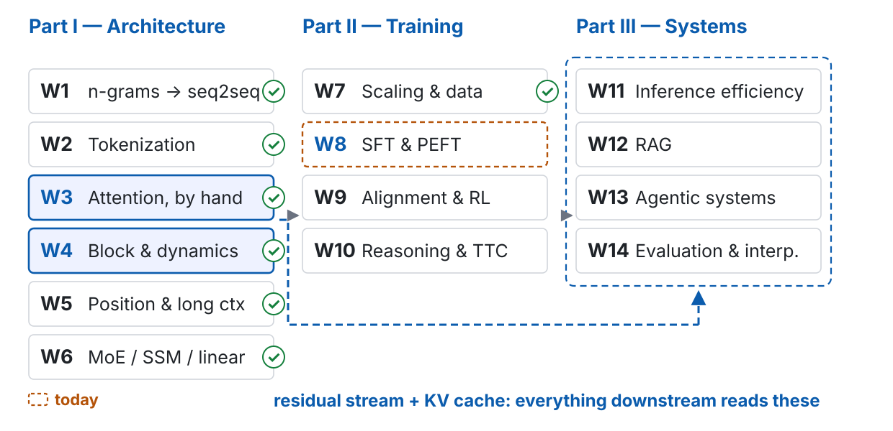
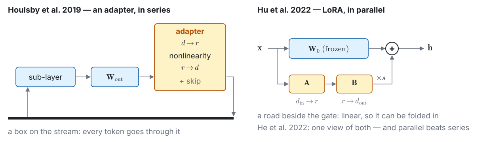
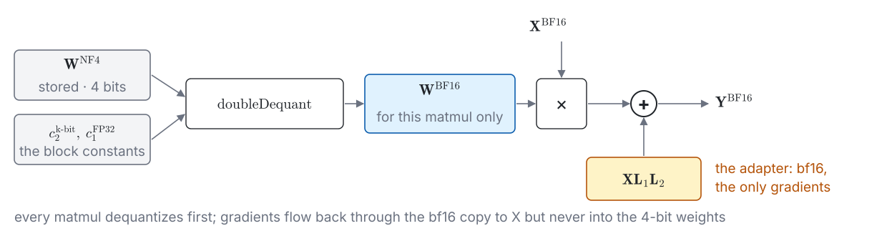

---
# 此檔由 bin/publish_slides.py 從投影片正本產生（中文講稿區塊已剝除），請勿直接編輯。正本在 private repo 的 <course>/slides/。
title: "Post-training I: SFT, PEFT, and Forgetting"
subtitle: "NLP & Large Language Models · Week 8"
author: "Hung-Shin Lee"
lang: en
format:
  revealjs:
    theme: [default, theme.scss]
    slide-number: c/t
    show-slide-number: all
    # 目標顯示尺寸：1280×800（16:10），與 W1–W7 相同。
    width: 1280
    height: 800
    margin: 0.04
    center: false
    progress: true
    transition: none
    navigation-mode: linear
    incremental: false
    # inline SVG 的 fragment：?print-pdf 時整張印在一頁
    pdf-separate-fragments: false
    chalkboard:
      buttons: true
    html-math-method:
      method: katex
      url: "https://cdn.jsdelivr.net/npm/katex@0.18.7/dist/"
    # 講稿（notes 區塊）裡的數學只輸出 MathML（照 w01.qmd，2026-09-16 起）。
    include-after-body:
      - text: |
          <script>
          (function () {
            var items = [];
            document.querySelectorAll('aside.notes .math').forEach(function (el) {
              items.push({ el: el, tex: el.textContent, display: el.classList.contains('display') });
              el.classList.remove('math');
              el.classList.add('notes-math');
            });
            document.addEventListener('DOMContentLoaded', function () {
              items.forEach(function (it) {
                katex.render(it.tex, it.el, { displayMode: it.display, output: 'mathml', throwOnError: false });
              });
            });
          })();
          </script>
---

# A thousand written answers: what does the compressor learn, and where does it fit? {.section-title}

## Where we are: week 8 of 14

{width="100%"}

## Last week, in one picture



::: {.footer}
W1 p20 · W4 p45 · W7 p58, p61 · w08-data.json lastweek — no new numbers
:::

## The problem this week handles, in one picture



::: {.footer}
board: p13, p24–p27, p37, p44 · live: p9, p33, p42, p55 · replay: p15, p41, p49, p58
:::

## What you should be able to do by the end of today

1. **Write a conversation as tokens** under a chat template; mark where $\mathcal{L}_{\text{SFT}}$ counts, why the end token is learned, why packing must be separated — and when a loss on the prompt does better
2. **Say what SFT mainly changes** (a format, a sub-distribution) and what teaching new facts through it costs; point to it in demo 1
3. **Write LoRA** $\mathbf{h} = \mathbf{W}_0\mathbf{x} + s\,\mathbf{B}\mathbf{A}\mathbf{x}$, count $r(d_{\text{in}} + d_{\text{out}})$, split W4's 16 bytes into **14 saved and 2 kept**; compute full / LoRA / QLoRA for an 8B model; FLOPs $6N \to \approx 4N$
4. **Explain $\mathbf{B} = \mathbf{0}$**, why "the same learning rate" differs across three ways of writing $s$, and LoRA as the course's third low-rank factorization
5. **Explain QLoRA's three parts** — stored in 4 bits, computed in bf16 — and what "QLoRA" is on the demo machine
6. **Weigh the evidence that LoRA ≠ full fine-tuning** (intruder dimensions; learns less, forgets less; tune the learning rate first) — and say how strong each source is
7. **Measure forgetting** with W1's ruler; separate three readings of it; give the two explanations of why RL forgets less
8. **Write task arithmetic, TIES and DARE**, their shared precondition, and when they fail

::: {.footer}
Outline W8 · Learning objectives 1–8
:::

## Two questions for today — one line each, before we start

::: {.ask}
**(a)** You have an 8B **base** model, a thousand written answers and one 16 GB GPU. **What do you do?**
:::

::: {.ask}
**(b)** Show the base model a question, with no instructions. **What does it write?**
:::

- Keep your two lines: p67 comes back to both
- **(a)** is the ledger's optimizer row (W4 p45): $16 \times 8 \times 10^9$ bytes, before a single activation
- **(b)** is demo 1, two slides from now

::: {.footer}
W4 p45 · W1 p20 · Misconception 2 (p17): "SFT teaches the model new knowledge"
:::

## Before Demo 1: the same three questions, base and fine-tuned

::: {.prose}
| | |
|:---|:-----------------|
| **Why** | Question (b) has an answer you can watch. Before any definition, see what a thousand written answers change: the same model before and after supervised fine-tuning (SFT), the same three questions. |
| **What runs** | `Qwen/Qwen3-1.7B-Base` (pre-trained only) and the same model with a LoRA (low-rank adaptation) adapter trained on 1,000 human-written English instruction–answer pairs. Three questions: a fact, an instruction, one in Traditional Chinese. Base: the raw text; fine-tuned: the chat template. Each output in full (≤ 200 tokens), then: did it stop by itself, on which token? |
| **Watch for** | Does the base model answer, or continue a document? Does it stop by itself? What changes after fine-tuning — the facts, or the shape of the reply? And the Chinese question: the training answers were English. |
:::

::: {.footer}
Demo 1 · `demos/w08_d1_sft_base_to_assistant` · mlx-lm 872ae88 · rehearsed 2026-11-08
:::

## Live: demo 1 (a) — base vs. fine-tuned, three questions

| question | base model: what it writes | after SFT: what it writes | stopped by itself? (base / SFT) |
|:---|:---|:---|:---|
| a fact | | | |
| an instruction | | | |
| in Traditional Chinese | | | |

: {tbl-colwidths="[18,34,34,14]"}

::: {.claim}
Same weights underneath; one thousand answers on top. **What changed: the facts, or the shape?**
:::

::: {.footer}
Demo 1 (a) · live, adapter C rehearsed 2026-11-08 · `w08_d1_sft_base_to_assistant/`
:::

# Shown a thousand answers, what does the compressor learn? {.section-title}

## The library and one shelf: a metaphor for the first half

- Pre-training: the model has read **the whole library** — forum threads, textbooks, exam papers, chat logs — and learned the distribution of every kind of document in it (W1: a compressor; W7: it compresses what it is fed)
- Supervised fine-tuning (SFT) adds no books. It **fixes where sampling starts** — on the shelf "an assistant answering a user" — and teaches that shelf's **layout**: who speaks, when to stop
- It explains three things today: why a thousand examples are enough (p16); why teaching new facts this way backfires (p17); why other shelves get worse (p58)
- **Where it breaks**: the weights *do* change, and some of what SFT teaches was never on any shelf (a new control token); "superficial" is a hypothesis, not a law (p16); and the person pointing stands outside the library — the answers were written by someone else (W9)

::: {.claim}
SFT does not add books. It **points at a shelf the library already has** and teaches that shelf's layout.
:::

::: {.footer}
W1 (the compressor) · W7 (what it is fed) · Zhou et al. 2023 §2
:::

## A conversation is a token sequence: the chat template



::: {.claim}
$x$ is conditioned on; $y$ — **with its end token** — is what is predicted.
:::

::: {.footer}
W2 p22 · Qwen's template, simplified · demo 1 (b) prints the real one
:::

## The loss, written out: one sum, one mask, two hidden choices

$$\mathcal{L}_{\text{SFT}}(\boldsymbol{\theta}) = -\frac{1}{|\mathcal{R}|}\sum_{(x,y)}\;\sum_{t=1}^{|y|}\log P_{\boldsymbol{\theta}}(y_t \mid x, y_{<t})$$

- W1's cross-entropy with two changes: **conditioned on $x$**, and **summed only over $\mathcal{R}$** — every response position in the batch
- hidden choice 1 — **what you divide by**: all response tokens in the batch (mlx-lm's `default_loss`: long answers weigh more), or each sequence first, then the batch
- hidden choice 2 — **whether the prompt counts**: a small non-zero weight helps on short-answer data (Huerta-Enochian & Ko); a loss on the instruction too helps when instructions are long and outputs short (Shi et al.)
- and mlx-lm's `--mask-prompt` is **off** by default: unless you ask, the loss covers the prompt

::: {.footer}
Misconception 1: "only the assistant's tokens should carry the loss" · mlx-lm 872ae88
:::

## Packing: three examples in one row — then keep them apart



::: {.footer}
Krell et al. (a preprint) · Kundu et al. (a preprint) · mlx-lm 872ae88 `iterate_batches`
:::

## Live + replay: demo 1 (b) and (c) — the mask, printed; two adapters

- **(b), live**: one training example, token by token, with the positions that carry the loss marked; and the logit the base model gives `<|im_start|>` — was it ever trained?
- **(c), replay**: three adapters, same data, seed, steps and learning rate: A with `--mask-prompt`, B without (mlx-lm's default), C = A plus LoRA on the **embedding rows** (the LM head is tied to them)

| adapter | loss on the prompt? | reaches the embedding? | held-out response loss | stops by itself? |
|:---|:---|:---|:---|:---|
| A · `--mask-prompt` | no | no | | |
| B · default | yes | no | | |
| C · A + embedding rows | no | yes | | |

: {tbl-colwidths="[26,18,20,20,16]"}

::: {.ask}
Predict before the numbers: which adapter is lower on held-out answers — and which of the three stops by itself?
:::

::: {.footer}
Demo 1 (b) live, (c) replay · `w08_d1_sft_base_to_assistant/` · rehearsed 2026-11-08
:::

## What SFT changes: a format, and which shelf to sample from

- **LIMA**, *Less Is More for Alignment* (Zhou et al., NeurIPS 2023): a 65B LLaMa fine-tuned on **1,000** curated prompts and responses. §2 names the *superficial alignment hypothesis*: knowledge and capabilities are learnt almost entirely in pre-training; alignment teaches **which subdistribution of formats** to use
- **URIAL**, *Untuned LLMs with Restyled In-context ALignment* (Lin et al., ICLR 2024): let the base model rank the aligned model's every token. Llama-2-7b → chat: at **77.7%** of positions it is the base's own top-1; at **7.8%** it falls outside the base's top 3 — mostly **stylistic** tokens. Mistral-7b → instruct: 82.2% and 5.2%
- and three stylistic examples plus a system prompt align a base model **in context**, with no training at all
- it is a **hypothesis**: LIMA's evidence is human preference at 65B; for small models, or for reasoning, more data still helps (W10)

::: {.claim}
The words that change are mostly the ones that say **how**, not **what**.
:::

::: {.footer}
Zhou et al. 2023 abstract, §2 · Lin et al. 2024 abstract, Fig. 3 · demo 1 (a)
:::

## What SFT does badly: new facts

- **Gekhman et al.** (EMNLP 2024): fine-tuning examples that carry knowledge the model did not have are learned **significantly more slowly** — and once learned, they **linearly** increase its tendency to hallucinate
- **Pletenev et al.** (Findings of NAACL 2025): packing new facts into a LoRA adapter works best mixed with known ones — yet external QA still drops, and the model grows **more confident**
- in the library: pointing at a shelf that is not there teaches the model to use the format for things it does not know
- new knowledge comes from pre-training (W7) or retrieval (W12)

::: {.ask}
Next week says the same of preference training: it reshapes which answers are preferred; it is not a channel for new facts.
:::

::: {.footer}
Misconception 2: "SFT teaches the model new knowledge" · W7 · W9 · W12
:::

# Sixteen bytes a parameter, a 64 GB machine: what can be left out? {.section-title}

## A side road beside every gate: a metaphor for the second half

- W4's **residual stream** is a bus: every block reads from it and adds back to it. Each read ($\mathbf{W}^Q, \mathbf{W}^K, \mathbf{W}^V$, gate, up) and each write ($\mathbf{W}^O$, down) passes a matrix — **a gate**
- LoRA: beside each gate, a **narrow side road** — squeeze to $r$ dimensions, widen back — whose output is added to the gate's. The gates themselves are **frozen**
- it explains: the trunk does not get smaller (p31); the road exists in training and can vanish in use (p30); one trunk, many roads (p30, p64); the roads join a **shared** bus, so corrections from different tasks live in one coordinate system (p65)
- **Where it breaks**: roads do interfere (p52, p64); "narrow" is rank, not size — the update can be large; and a road is a weight, shared by every token that passes

::: {.claim}
Freeze the trunk. Learn only **a narrow road beside each gate**.
:::

::: {.footer}
W4 (the residual stream, as a bus) · Appendix E 3: "W8: a low-rank bypass" · He et al. 2022
:::

## At a glance: LoRA (Hu et al. 2022)

::: {.prose}
| | |
|:---|:-----------------|
| **Name** | *LoRA: Low-Rank Adaptation of Large Language Models*, Hu et al., ICLR 2022 (arXiv:2106.09685). |
| **The question** | How do you adapt a very large pre-trained model to a task without training — and storing — a full copy of its weights for every task? |
| **The idea** | Freeze $\mathbf{W}_0$. Learn a correction $\Delta\mathbf{W} = s\,\mathbf{B}\mathbf{A}$ of rank $r$ beside it, starting from $\mathbf{B} = \mathbf{0}$. After training, fold it into $\mathbf{W}_0$. |
| **What it added** | On GPT-3 175B: **$10{,}000\times$** fewer trainable parameters, **$3\times$** less GPU memory, **no additional inference latency** (the abstract). Its main experiments adapted only $\mathbf{W}_q$ and $\mathbf{W}_v$. |
| **What it leaves open** | Where the roads go (p22–p23); what is saved and what is not (p25–p26); what "the same learning rate" means (p27); whether the result is the same model (p44 on). |
:::

::: {.footer}
Hu et al. 2022, abstract, §4.1, §5.1 · mechanism: p21–p27 · JM3 §8.2
:::

## LoRA, with the edges labelled



$$\mathbf{h} = \mathbf{W}_0\mathbf{x} + s\,\mathbf{B}\mathbf{A}\mathbf{x}, \qquad \mathbf{W}_0 \in \mathbb{R}^{d_{\text{out}} \times d_{\text{in}}},\; \mathbf{A} \in \mathbb{R}^{r \times d_{\text{in}}},\; \mathbf{B} \in \mathbb{R}^{d_{\text{out}} \times r}$$

::: {.footer}
Hu et al. §4.1 · column vectors, $\mathbf{h} = \mathbf{W}\mathbf{x}$ as in W3–W4 · mlx-lm stores $\mathbf{A}^\top$, $\mathbf{B}^\top$ (notes)
:::

## Where the side roads go in a block: seven gates



::: {.footer}
Hu §5.1: $\mathbf{W}_q$, $\mathbf{W}_v$ only · mlx-lm: all Linears, last 16 blocks; not the embedding
:::

## Series or parallel: an adapter is a box, LoRA is a road

{width="100%"}

::: {.claim}
An adapter **sits on** the stream; LoRA **runs beside** a gate — and because it is linear, it can be folded into the gate.
:::

::: {.footer}
Houlsby et al., ICML 2019 · He et al., ICLR 2022 Spotlight
:::

## $\mathbf{B} = \mathbf{0}$: start at the base model — and who moves first

- at step 0, $\Delta\mathbf{W} = s\,\mathbf{B}\mathbf{A} = \mathbf{0}$: the model **is** the base model, not a perturbed copy

$$\frac{\partial\mathcal{L}}{\partial\mathbf{B}} = s\,\frac{\partial\mathcal{L}}{\partial\mathbf{h}}\,(\mathbf{A}\mathbf{x})^\top, \qquad \frac{\partial\mathcal{L}}{\partial\mathbf{A}} = s\,\mathbf{B}^\top\,\frac{\partial\mathcal{L}}{\partial\mathbf{h}}\,\mathbf{x}^\top$$

::: {.fragment fragment-index=1}
- substitute $\mathbf{B} = \mathbf{0}$: $\;\partial\mathcal{L}/\partial\mathbf{A} = \mathbf{0}$, $\;\partial\mathcal{L}/\partial\mathbf{B} \neq \mathbf{0}$ — **only $\mathbf{B}$ moves on the first step**; $\mathbf{A}$ starts learning once $\mathbf{B}$ has left zero
:::

::: {.ask}
Work it out: what if **both** start at zero? What if **both** start random?
:::

::: {.fragment fragment-index=2}
- both zero: both gradients are zero, forever — a saddle the model never leaves
- both random: the start is no longer the base model — step 0 already carries the noise $s\,\mathbf{B}\mathbf{A}$
:::

::: {.footer}
Hu et al. §4.1 · mlx-lm: `lora_a` uniform $\pm 1/\sqrt{d_{\text{in}}}$, `lora_b` zero · Outline W8 key maths 3
:::

## The 16 bytes, re-counted: 14 gone, 2 kept — and the activations kept too



::: {.footer}
Misconception 3: "LoRA saves the weights' memory" · W4 p45 (its "12" corrected to 14)
:::

## The three walks, re-counted: about $4N$ per token, not $2N$



::: {.footer}
W4 p41 (corrected) · W1 p17 · the blog: "slightly more than ⅔" · Hu §4.2: "a 25% speedup"
:::

## $s$ and $\eta$ are tangled: three ways to write the scale

- Adam moves each entry of $\mathbf{B}$ by about $\eta$ per step, so $\Delta\mathbf{W} = s\,\mathbf{B}\mathbf{A}$ moves by about $s\,\eta$ — **early in training, doubling $s$ ≈ doubling $\eta$** (our derivation; idealised)

| who | the scale $s$ | mlx-lm's default ($r = 8$), written their way |
|:---|:---|:---|
| Hu et al. | $\alpha / r$ — "set $\alpha$ to the first $r$ we try" | $\alpha = 160$ |
| rsLoRA, rank-stabilized (a preprint) | $\alpha / \sqrt{r}$ — $\alpha/r$ collapses the gradient at large rank | $\alpha \approx 57$ |
| mlx-lm | `scale`, used as $s$ itself; no `alpha` key | `scale = 20` |

: {tbl-colwidths="[18,50,32]"}

::: {.claim}
"LR $= 10^{-5}$" is **not the same step** in three frameworks. Learning rates do not transfer — between papers, or between tools.
:::

::: {.footer}
Kalajdzievski 2023 (no venue found) · mlx-lm 872ae88 `lora_parameters` · LoRA+, ICML 2024
:::

## Why a narrow road is enough — mostly

- **intrinsic dimension**: train only inside a random low-dimensional slice of the weights and see how far it gets (Li et al., ICLR 2018). Aghajanyan et al. (ACL 2021): RoBERTa on MRPC (Microsoft Research Paraphrase Corpus) reaches 90% of full fine-tuning with **200** parameters, projected back; larger and longer-pre-trained models have **lower** intrinsic dimension
- an **empirical observation, not a theorem** — and full fine-tuning learns perturbations of **10–100× higher rank** than typical LoRA settings (Biderman et al.): low rank is a **constraint**, not free
- theory, in one setting: LoRA training converges to a low-rank, small-norm global minimum — or **fails loudly** at a high-rank, large-norm one; zero initialisation and weight decay favour the first (Kim et al., ICML 2025 Oral)

::: {.claim}
The update a task needs usually lives in a small subspace. **When it does not** — new code, new mathematics, a new language — the road is too narrow (p53, p59).
:::

::: {.footer}
Li et al. 2018 · Aghajanyan et al. 2021 · Biderman et al., TMLR 2024 · Kim et al. 2025
:::

## Low rank, the third time: one factorization, three jobs



::: {.claim}
SGNS: low rank **training produced**. MLA: low rank to shrink **a state**. LoRA: low rank to shrink **an update**.
:::

::: {.footer}
W1 p47 · W3 p32 (*used as a design*), p34 · GaLore, ICML 2024 Oral — named only
:::

## Training and using are two different pictures



::: {.footer}
Hu et al. abstract: "no additional inference latency" · `mlx_lm.fuse`
:::

## Not compression, twice: MoE (W6) and LoRA, side by side

::: {.prose}
| | **MoE** (W6) | **LoRA** (today) |
|:---|:---|:---|
| total parameters | **more** than the dense model it replaces | merged: **exactly** the base's; unmerged: more |
| what gets smaller | FLOPs per token: $6N_{\text{active}}D$ | training memory: 14 of 16 bytes per frozen parameter |
| what does not | memory: all of $N_{\text{total}}$ must be held | the weights' $2N$; the activations; the model at inference |
| the slip | "a 30B-A3B model is a 3B model" | "a LoRA model is a small model" |
:::

::: {.claim}
Both get called "smaller". They make **different things** smaller — and neither makes the model smaller.
:::

::: {.footer}
Misconception 4: "LoRA is model compression" · W6 p59, Misconception 1, returns here · W11
:::

## Before Demo 2: three numbers from one `config.json`

::: {.prose}
| | |
|:---|:-----------------|
| **Why** | The ledger's 128 GB was a nominal 8B at 16 bytes. Put a real model's shape into p25's formulas: full fine-tuning, LoRA and QLoRA (LoRA over a 4-bit copy, p35), against this machine's 64 GB and the project's 16 GB. |
| **What runs** | A terminal; pure standard library. It reads `Qwen/Qwen3-8B`'s `config.json`, counts $N$ matrix by matrix, counts $N_{\text{LoRA}}$ for $r = 16$ on all seven gates of every block, and prints $M_{\text{full}}$, $M_{\text{LoRA}}$, $M_{\text{QLoRA}}$ (two ways of storing 4 bits) and the FLOPs per token, $6N$ against $\approx 4N$. Part (b), after the next section, is the measured peak (p41). |
| **Watch for** | Before the Enter key: does a bf16 LoRA of an 8B model fit in 16 GB? Which term of $M_{\text{LoRA}}$ is the big one — the frozen weights or the adapter? |
:::

::: {.footer}
Demo 2 · `demos/w08_d2_memory_ledger` · (a) standard library only · rehearsed 2026-11-10
:::

## Live: demo 2 (a) — Qwen3-8B: full, LoRA, QLoRA, against 64 GB and 16 GB

| | bytes per parameter | GB | fits 64 GB? | fits 16 GB? |
|:---|:---|:---|:---|:---|
| full fine-tuning | $16$ | | | |
| LoRA, $r = 16$, bf16 base | $2 + 16N_{\text{LoRA}}/N$ | | | |
| QLoRA, NF4 + double quantization | $b_{\text{q}} + 16N_{\text{LoRA}}/N$ | | | |
| QLoRA, mlx's 4-bit | $b_{\text{q}} + 16N_{\text{LoRA}}/N$ | | | |

: {tbl-colwidths="[32,26,14,14,14]"}

- $N =$ __________ $\quad N_{\text{LoRA}} =$ __________ $\quad$ FLOPs per token: $6N$ against __________
- all bytes before a single activation; $b_{\text{q}}$: the bytes per parameter of the 4-bit copy (p37, p39)

::: {.footer}
Demo 2 (a) · live · `w08_d2_memory_ledger/` · GB = $10^9$ bytes
:::

# The frozen copy is 16 GB. Can it be stored in 4 bits? {.section-title}

## At a glance: QLoRA (Dettmers et al. 2023)

::: {.prose}
| | |
|:---|:-----------------|
| **Name** | *QLoRA: Efficient Finetuning of Quantized LLMs*, Dettmers et al., NeurIPS 2023 Oral (arXiv:2305.14314). |
| **The question** | The frozen weights are only ever read, never updated. Can they be stored in 4 bits, with the adapters trained on top? |
| **The idea** | Three parts: a 4-bit type built for normally distributed weights (4-bit NormalFloat, **NF4**); quantizing the quantization constants too (**double quantization**); and **paged optimizers** for memory spikes. Every matmul dequantizes to bf16 first; only the adapters get gradients. |
| **What it added** | A **65B** model fine-tuned on **a single 48 GB GPU** (the abstract) — the reason fine-tuning moved onto one card. |
| **What it leaves open** | What 4 bits per weight look like (p36–p37); what precision the arithmetic is in (p38); what "QLoRA" means on a Mac (p39). |
:::

::: {.footer}
Dettmers et al. 2023, abstract, §3 · HOLLM ch 12 · JM3 ch 8 has no QLoRA section
:::

## NF4: sixteen levels on the normal's quantiles, not sixteen equal steps



$$q_i = \tfrac{1}{2}\Big(Q_X\big(\tfrac{i}{2^k + 1}\big) + Q_X\big(\tfrac{i + 1}{2^k + 1}\big)\Big), \qquad k = 4$$

::: {.footer}
Dettmers et al. Eq. (4) · levels: bitsandbytes · histogram and bars: a toy (notes)
:::

## Double quantization: the constants are quantized too

- NF4 needs one **absmax** per block of 64 weights, kept in fp32: $32/64 = 0.5$ bit per parameter — an eighth of the 4 bits again

$$\underbrace{\frac{32}{64}}_{0.5\ \text{bit}} \;\longrightarrow\; \underbrace{\frac{8}{64} + \frac{32}{64 \cdot 256}}_{\approx\, 0.127\ \text{bit}}$$

- quantize those constants with **8-bit floats**, one fp32 constant per 256 of them: $0.373$ bit saved per parameter — about **3 GB** on a 65B model
- NF4 + double quantization: about $4.127$ bits, $b_{\text{q}} \approx 0.52$ bytes per parameter
- mlx's affine 4-bit, for comparison: a 16-bit **scale** and a 16-bit **bias** per group of 64 — $(4 + 32/64)/8 \approx 0.56$ bytes

::: {.footer}
Dettmers et al. §3 · mlx affine, group 64 (mlx-community/Qwen3-8B-4bit)
:::

## Stored in 4 bits, computed in bf16

{width="100%"}

$$\mathbf{Y}^{\text{BF16}} = \mathbf{X}^{\text{BF16}}\,\mathrm{doubleDequant}\big(c_1^{\text{FP32}}, c_2^{\text{k-bit}}, \mathbf{W}^{\text{NF4}}\big) + \mathbf{X}^{\text{BF16}}\mathbf{L}_1^{\text{BF16}}\mathbf{L}_2^{\text{BF16}}$$

::: {.claim}
Nothing is computed in 4 bits. The gradient reaches $\mathbf{X}$ through the dequantized copy — and stops at the adapter.
:::

::: {.footer}
Misconception 5: "QLoRA trains in 4 bits" · Dettmers et al. Eq. (5), row vectors
:::

## Paged optimizers — and what "QLoRA" means on this machine

- **paged optimizers**, QLoRA's third part: NVIDIA's unified memory pages optimizer state to CPU RAM when the GPU runs short, and back for the update — it absorbs memory **spikes**
- on the M5 Max, CPU and GPU share **one** 64 GB pool: there is nowhere else to page to (our reading); MPS has no CPU offload either — what does not fit, does not fit
- mlx-lm's "QLoRA" is `--model` pointing at an already-quantized model: **affine** 4-bit (a scale and a bias per 64), **not NF4**; the adapters in float32
- hence demo 2's two rows: NF4 + DQ with the embedding and LM head kept in bf16, **6.8 GB**; mlx's 4-bit, everything quantized, **5.3 GB**

::: {.claim}
Same name, different format, same idea. Before comparing two "QLoRA" numbers, check **which 4 bits**.
:::

::: {.footer}
Dettmers et al. §3 · Appendix C (MLX, MPS, no offload) · mlx-lm 872ae88
:::

## DoRA: weight-decomposed — magnitude and direction, learned separately

$$\mathbf{W}' = \mathbf{m}\;\frac{\mathbf{W}_0 + \mathbf{B}\mathbf{A}}{\Vert \mathbf{W}_0 + \mathbf{B}\mathbf{A} \Vert_c}$$

- $\Vert\cdot\Vert_c$: the norm of each **column**; $\mathbf{m} \in \mathbb{R}^{1 \times d_{\text{in}}}$: one trainable magnitude per column, starting at $\Vert\mathbf{W}_0\Vert_c$
- the **direction** is updated by LoRA; the **magnitude** by $\mathbf{m}$ — two things full fine-tuning changes together
- in mlx-lm: `--fine-tune-type dora`
- one of the nine variants in Lee et al.: once each has its own tuned learning rate, within 1–2% of plain LoRA (p45)

::: {.footer}
Liu et al., *DoRA: Weight-Decomposed Low-Rank Adaptation*, ICML 2024 Oral, Eq. (5)
:::

## Replay: demo 2 (b) — the measured peak, against two ledgers

| run | ledger, 16 bytes | as mlx stores it | peak, 256 tokens | peak, 1,024 tokens | 1,024, checkpointed |
|:---|:---|:---|:---|:---|:---|
| LoRA, $r = 16$ · Qwen3-8B, bf16 | 17.1 GB | 17.1 GB | 20.1 GB | 30.3 GB | 19.8 GB |
| QLoRA, $r = 16$ · Qwen3-8B, mlx 4-bit | 5.3 GB | 5.3 GB | 8.3 GB | 17.9 GB | 7.4 GB |
| full fine-tuning · Qwen3-1.7B-Base | 27.5 GB | 11.9 GB | 13.4 GB | 17.4 GB | 13.9 GB |
| full fine-tuning · Qwen3-8B | 131 GB | 58.1 GB | not run | | |

: {tbl-colwidths="[34,13,14,13,13,13]"}

- both ledgers: bytes before a single activation · mlx keeps Adam's two moments in the weight's dtype and **no fp32 master copy**: a trainable bf16 weight is $2 + 2 + 2 + 2 = 8$ bytes; a LoRA factor is float32, $4 \times 4 = 16$

::: {.ask}
Predict: by how much does each peak exceed what mlx stores — and which column grows with the sequence length?
:::

::: {.footer}
Demo 2 (b) · replay · `w08_d2_memory_ledger/` · mlx 0.32.2, mlx-lm 872ae88 (software) · rehearsed 2026-11-10 (`peaks.json`)
:::

## Live: demo 1 (d) — twenty slides in one line, a dozen steps

```bash
mlx_lm.lora -c lora_embed.yaml --model Qwen/Qwen3-1.7B-Base \
  --train --data data/ \
  --fine-tune-type lora --num-layers -1 \
  --mask-prompt --iters 12 --steps-per-report 4
```

| step | train loss | peak memory (GB) |
|:---|:---|:---|
| 4 | | |
| 8 | | |
| 12 | | |

: {tbl-colwidths="[20,40,40]"}

::: {.claim}
`lora`: a side road. `-1`: beside every gate of every block. `-c`: $r = 16$, and the embedding rows. `--mask-prompt`: loss on $y$ only. The machine prints the bill.
:::

::: {.footer}
Demo 1 (d) · live · mlx-lm 872ae88 · rehearsed 2026-11-08 · peak memory from the training callback
:::

# A tenth of the memory: is it the same model? {.section-title}

## Comparing two methods: was the learning rate tuned for each?



::: {.claim}
At one $\eta$, comparing $\mathcal{L}_{\text{LoRA}}(\eta)$ with $\mathcal{L}_{\text{full}}(\eta)$ measures **whose best learning rate is closer to $\eta$**.
:::

::: {.footer}
W1 p21, question 1: "Was the baseline actually tuned?" · the two curves: a sketch
:::

## Lee et al. 2026: nine variants, one vanilla, every learning rate tuned

- **the question**: do the LoRA variants of 2023–2025 — PiSSA, DoRA and seven others — beat plain LoRA?
- **the method**: each variant and vanilla LoRA swept over learning rate, batch size, rank and training length
- **the result**: once each has its own best learning rate, the peaks are **within 1–2%** of one another (the abstract); the different best ranges trace to the largest eigenvalue of the Hessian
- **its own limits**: all nine only on **Qwen3-0.6B**; larger models, four variants; across ranks (Gemma-3-1B, Fig. 4) the largest gap is 2.15%
- **its standing**: posters at two **ICML 2026 workshops** (CoLoRAI, HiLD) — **not a main-conference paper**

::: {.claim}
Tune the learning rate for each, and most of the gaps the variants reported **vanish** — on this paper's evidence.
:::

::: {.footer}
Misconception 6: "LoRA variants improve year on year" · arXiv:2602.04998 v2 · assigned
:::

## *LoRA Without Regret*: specific, checkable — and a blog post

- by John Schulman with others at Thinking Machines, *Connectionism*, 2025-09-29 — **a blog post, not peer-reviewed**
- LoRA's best learning rate is **consistently about $10\times$** full fine-tuning's (about $15\times$ for very short runs)
- apply it to **every layer, the MLP above all**: on Llama-3.1-8B, attention-only at rank 256 does worse than MLP-only at rank 128, at about the same parameter count
- **less tolerant of large batches** than full fine-tuning — and more rank does not fix it
- in reinforcement learning (**RL**), **even rank 1** matches full fine-tuning (W9)
- a forward plus backward pass: slightly more than ⅔ of full fine-tuning's FLOPs (p26)

::: {.claim}
Influential and specific — and a blog. Its weight here comes from **agreeing with sources that are not**.
:::

::: {.footer}
Schulman & Thinking Machines, DOI 10.64434/tml.20250929 · read 2026-11-08
:::

## Three sources, one direction: how strong is "tune the learning rate first"?

::: {.prose}
| source | kind | shows | limit |
|:---|:---|:---|:---|
| **Lee et al.** 2026 | workshop posters | nine variants within 1–2%, each tuned | all nine on one 0.6B model |
| **the blog** 2025 | a blog post | LoRA's best LR $\approx 10\times$ full fine-tuning's | not peer-reviewed |
| **Biderman et al.** 2024 | TMLR | LoRA's best LR an order of magnitude higher | two domains |

: {tbl-colwidths="[22,18,36,24]"}
:::

::: {.claim}
Three separate experiments pointing one way: **medium** evidence — enough to change how you compare, not yet a settled fact.
:::

::: {.footer}
Biderman et al. §4.7, App. B · the blog cites Biderman's Fig. S1 · W1 p21
:::

## Before Demo 3: two learning-rate sweeps, LoRA and full fine-tuning

::: {.prose}
| | |
|:---|:-----------------|
| **Why** | p44's two curves were drawn by hand. Make them: one model, one dataset, LoRA and full fine-tuning, each swept over its own learning rates. |
| **What runs** | Rehearsed in advance and replayed: `Qwen/Qwen3-1.7B-Base`, demo 1's data. LoRA with $r = 16$ on every gate of every block, and full fine-tuning; five learning rates each, $2 \times 10^{-6}$–$7 \times 10^{-5}$ for full and $10^{-6}$–$3.5 \times 10^{-5}$ for LoRA (mlx units); same seed, steps, batch and mask; validation loss every 25 steps, held-out loss at the end. |
| **Watch for** | Where is each curve's minimum, and what is their ratio — in the blog's units ($\alpha = 2r$), against its $10\times$? Then run both at full fine-tuning's best: how much worse does LoRA *look*? |
:::

::: {.footer}
Demo 3 · `demos/w08_d3_lr_sweep` · rehearsed 2026-11-08 (two rounds), replayed
:::

## Replay: demo 3 — two U-shaped curves, and the fixed-learning-rate comparison



| | full fine-tuning | LoRA, $r = 16$ | ratio |
|:---|:---|:---|:---|
| best learning rate (mlx units) | $5 \times 10^{-6}$ | $2.4 \times 10^{-6}$ | $0.48\times$ ($\alpha = 2r$: $4.8\times$) |
| loss, each at its own best | 1.934 | 1.924 | $-0.010$ |
| loss, both at full fine-tuning's best | 1.934 | 1.928 | $-0.006$ |
| loss, LoRA at full's $\eta$ *copied in $\alpha = 2r$ units* | 1.934 | 1.980 | $+0.046$ |

: {tbl-colwidths="[40,20,20,20]"}

::: {.footer}
Demo 3 · replay · one model, one dataset, one seed: **not a replication** · base 2.717 · rehearsed 2026-11-08
:::

## Where LoRA still goes wrong: which gates, how wide, how big a batch

- **attention only**: worse even at matched parameter count (the blog); at larger budgets the FFN uses capacity better (He et al.) — yet the original LoRA adapted only $\mathbf{W}_q$, $\mathbf{W}_v$ (p20)
- **rank**: it saturates, depending on the task; a large rank with $s = \alpha/r$ collapses the gradient (rsLoRA, a preprint)
- **batch**: in some settings LoRA tolerates large batches worse than full fine-tuning, and more rank does not help (the blog)
- the counter-intuitive one: in **RL, rank 1** is enough — an episode brings back one scalar reward (W9)

::: {.claim}
Configuring LoRA is three choices, not one: **which gates**, **how wide** — and the learning rate that goes with both.
:::

::: {.footer}
Misconception 7: "attention-only is enough" · Misconception 8: "the larger the rank, the better"
:::

## At a glance: intruder dimensions (Shuttleworth et al. 2025)

::: {.prose}
| | |
|:---|:-----------------|
| **Name** | *LoRA vs Full Fine-tuning: An Illusion of Equivalence*, Shuttleworth et al., NeurIPS 2025 (arXiv:2410.21228, v3, October 2025). |
| **The question** | When LoRA and full fine-tuning reach the same score, are the resulting **weights** the same? |
| **The idea** | Compare the singular vectors of each fine-tuned matrix with those of the pre-trained one. Full fine-tuning's top directions stay close to old ones; LoRA's include **new, high-ranking directions** — *intruder dimensions*. |
| **What it added** | (v3 abstract) LoRA has them, full fine-tuning does not; **forgetting is concentrated on them** — scale them down and the pre-training distribution comes back while the task barely drops; in continual learning they **accumulate**. |
| **What it leaves open** | How to count them (p52, demo 4); why LoRA forgets less (p53); what "forgetting" means at all (p57 on). |
:::

::: {.footer}
assigned reading: Def. 3.1, Alg. 1, Fig. 4, and the section that scales them down
:::

## Definition 3.1: unlike every old direction, not just one



- singular value decomposition (SVD), $\mathbf{W} = \mathbf{U}\boldsymbol{\Sigma}\mathbf{V}^\top$; $\mathbf{u}_{0,i}$: left singular vectors of $\mathbf{W}_0$; $\mathbf{u}'_j$: of the fine-tuned $\mathbf{W}'$, top $k$ by singular value

::: {.footer}
Shuttleworth et al. Def. 3.1, Fig. 4 ($k = 10$) · the matrices: a sketch · $\mathbf{V}$: not attention's
:::

## Learns less, forgets less — and where the forgetting lives

- **Biderman et al.** (TMLR 2024, Featured Certification): on programming and mathematics, standard low-rank settings **substantially underperform** full fine-tuning — but **better keep** the base model's performance outside the target domain
- **Shuttleworth et al.**: LoRA's weights are a **different solution**, and its forgetting **sits in** the intruder dimensions; with $\alpha = 2r$ there are fewer of them, with $\alpha$ fixed at 8 every rank has them
- side by side: one says *not the same*; the other says *not the same is sometimes the point* — and "forgets less" may be the first paper's mechanism, **kept small** (our reading)

::: {.claim}
Equal scores can hide **different weights** — and different weights keep different things.
:::

::: {.footer}
Misconception 9: "LoRA and full fine-tuning are equivalent" · Biderman et al. · W14
:::

## Before Demo 4: ten lines of SVD, written live

::: {.prose}
| | |
|:---|:-----------------|
| **Why** | Definition 3.1 is a few lines of linear algebra. Count intruders on our own runs: the base model and demo 3's two runs, each at its own best learning rate. |
| **What runs** | CPU, `numpy`, float64, straight from demo 3's weight files. For block 14's $\mathbf{W}^Q$ and down (every block was scanned; none differs), fold the LoRA run into $\mathbf{W}_0$; SVD of $\mathbf{W}_0$ and of each fine-tuned $\mathbf{W}'$; for the top $k = 10$ left singular vectors of $\mathbf{W}'$, the largest $|\cos|$ against every left singular vector of $\mathbf{W}_0$; count those under $\epsilon$. Five lines, written in front of you. |
| **Watch for** | Does LoRA have intruders and full fine-tuning not? Our scale — 1.7B, a thousand or two examples, a few hundred steps — is far below the paper's: what would *none at all* mean? |
:::

::: {.footer}
Demo 4 · `demos/w08_d4_intruders_forgetting` · (a) live, (b) replay (p58) · rehearsed 2026-11-08
:::

## Live: demo 4 (a) — count the intruders

| matrix | run | intruders, $\epsilon = 0.3$ | $\epsilon = 0.5$ | $\epsilon = 0.7$ |
|:---|:---|:---|:---|:---|
| block 14's $\mathbf{W}^Q$ | full fine-tuning | | | |
| | LoRA, $r = 16$ | | | |
| block 14's down | full fine-tuning | | | |
| | LoRA, $r = 16$ | | | |

: {tbl-colwidths="[24,24,18,17,17]"}

```python
U0, _, _ = np.linalg.svd(W0)
U1, S1, _ = np.linalg.svd(W1)
cos = np.abs(U1[:, :10].T @ U0)
best = cos.max(axis=1)
n_intruders = (best < eps).sum()
```

::: {.footer}
Demo 4 (a) · live · $k = 10$ · rehearsed 2026-11-08: every cell was 0 — the table below says why
:::

# It forgets less. Forgets what — and measured how? {.section-title}

## Catastrophic interference: where the word comes from

- **McCloskey & Cohen** (1989): train a connectionist network on one task, then on another, and the second **overwrites** the first — *catastrophic interference*. The term starts here
- **EWC**, elastic weight consolidation (Kirkpatrick et al., PNAS 2017): estimate how much each weight mattered to the old task (its Fisher information) and make the important ones expensive to move — the classic remedy
- in LLMs: from 1B to 7B, continual fine-tuning forgets across the board, and in that range more for larger models; general instruction tuning softens it (Luo et al., IEEE TASLP 2025)
- in the library: sampling from one shelf, every other shelf gets less of the probability

::: {.claim}
Forgetting is the price of the second entry. Before arguing about it, **measure it**.
:::

::: {.footer}
McCloskey & Cohen 1989 · Kirkpatrick et al. 2017 · Luo et al. 2025 · W2 p67
:::

## Replay: demo 4 (b) — W1's ruler, a third time

| held-out text | base | after LoRA | after full fine-tuning |
|:---|:---|:---|:---|
| W1's English paragraph (753 B, one window) | 0.848 | 0.844 (−0.004) | 0.845 (−0.003) |
| W1's **Traditional Chinese** paragraph (627 B, one window) | 1.050 | 1.051 (+0.001) | 1.052 (+0.002) |
| a Wikipedia sample (W7 demo 3; 1.06 MB) | 0.805 | 0.812 (+0.007) | 0.812 (+0.007) |
| FineWeb-Edu's own tail (W7 demo 3; 1.05 MB) | 0.715 | 0.721 (+0.005) | 0.720 (+0.005) |

: {tbl-colwidths="[40,20,20,20]"}

- bits per byte, lower is better; the fine-tuning data were **English** instructions and answers; the SFT target itself (demo 3, nats per response token): 2.717 → 1.924 → 1.934
- the same ruler as W1 demo 2 and W7 demo 3: it does not care about the tokenizer

::: {.ask}
Predict: which row rises most after fine-tuning — and which of the two runs rises more?
:::

::: {.footer}
Demo 4 (b) · replay · W1 demo 2 · W7 demo 3 · rehearsed 2026-11-08 (`runs/rehearsal/forgetting.json`)
:::

## A new language needs new rows: W2's debt, paid here

- W2 p67's route back for a short-changed language: **extend the vocabulary, then keep pre-training** — Breeze-7B added 29,873 tokens to Mistral's vocabulary
- every new token brings a **new embedding row that starts from nothing**; continued pre-training has to fill it — and the old abilities pay
- **the side roads do not reach it**: mlx-lm's LoRA wraps the Linears inside the blocks; the embedding and the LM head sit outside (p22)
- the baseline remedy (Ibrahim et al., TMLR 2024): **re-warm** the learning rate, **re-decay** it, and **replay** some old data — enough to match re-training from scratch, at 405M and 10B
- Taiwan LLM (Lin & Chen, a technical report): from Llama 2, continued pre-training → SFT → feedback SFT, for Traditional Chinese (Taiwan)

::: {.claim}
A new language needs new rows in the embedding table — and **LoRA's side roads do not reach them**.
:::

::: {.footer}
W2 p72, Misconception 9, returns here · Breeze-7B §2.1 · Ibrahim et al. 2024
:::

## "Forgot" has three readings — measure them separately

::: {.prose}
| reading | what happened | measured by |
|:---|:---|:---|
| **overwritten** | the knowledge is gone (McCloskey & Cohen) | old-distribution text, in bits per byte (p58) |
| **pushed aside** | still there; the model no longer infers the task — Kotha et al.'s *conjugate prompting*, Zheng et al.'s *spurious forgetting* | ask differently: does it come back? |
| **drift** | behaviour degrades systematically (CapTrack, up to 80B) | a battery of behaviours, not one score |

: {tbl-colwidths="[20,52,28]"}
:::

::: {.claim}
Three numbers, not one: **the text, the task, and whether asking differently brings it back**.
:::

::: {.footer}
Misconception 10: "forgetting means erasing" · Kotha 2024 · Zheng 2025 · CapTrack 2026
:::

## Paying less: a smaller learning rate — and the cost no ruler shows

- **Lin et al.** (ICLR 2026): in domain-specific SFT, a **smaller learning rate** substantially reduces the loss of general ability — the learning rate, for the second time today — though no method removes the trade-off entirely
- a cost bits per byte does not see: **calibration** — whether the model's confidence matches how often it is right
- GPT-4's technical report, Fig. 8 — **a technical report, not peer-reviewed**: the pre-trained model is well calibrated (expected calibration error 0.007); after post-training, much less so (0.074)
- calibration returns when we deploy (W11) and evaluate (W14)

::: {.claim}
The learning rate is the cheapest knob against forgetting. **Confidence** is the cost no bits-per-byte shows.
:::

::: {.footer}
Lin et al., ICLR 2026 · OpenAI, GPT-4 Technical Report, Fig. 8 · W11 · W14
:::

## Why RL forgets less: two explanations, one bridge to W9

- RL-style post-training forgets **less** than SFT — not *never*
- **KL**: forgetting is determined by how far the fine-tuned model moved from the base on the new task, in Kullback–Leibler (KL) divergence; on-policy RL is implicitly biased toward the solution that moves least (Shenfeld et al., *RL's Razor*, ICLR 2026)
- **on-policy data**: the cause is the mode-seeking that comes from learning on the model's **own samples** — not the KL term (Chen et al., ICML 2026)
- the bridge: **SDFT**, self-distillation fine-tuning — the model, shown the demonstration, acts as its own teacher: learning from demonstrations, but on-policy; it beats SFT and forgets much less (Shenfeld et al., ICML 2026 Spotlight)
- a multimodal case (Lai et al., ICML 2026); and RL does not replace SFT: a model that cannot follow instructions does not learn from RL at all (Chu et al., ICML 2025)

::: {.claim}
Both explanations say the same thing about SFT: **the demonstrations were not the model's own writing**.
:::

::: {.footer}
Misconception 11: "SFT forgets, RL does not" · W9 · the library's third limit (p11)
:::

# One side road per task: can the roads be added up? {.section-title}

## Task vectors: soups, arithmetic, TIES and DARE



$$\boldsymbol{\tau}_j = \boldsymbol{\theta}_j - \boldsymbol{\theta}_{\text{pre}}, \qquad \boldsymbol{\theta}_{\text{merged}} = \boldsymbol{\theta}_{\text{pre}} + \sum_j \lambda_j\,\boldsymbol{\tau}_j$$

- **TIES**: TrIm, Elect Sign & Merge (Yadav et al.) · **DARE**: Drop And REscale (Yu et al.)

::: {.footer}
Wortsman 2022 · Ilharco 2023 · Yadav 2023 · Yu 2024 · the eight values: made up
:::

## The precondition is a shared start — and where merging breaks

- a task vector is a **small** move from **one** $\boldsymbol{\theta}_{\text{pre}}$; two of them are written in the **same coordinates** — and that coordinate system is W4's residual stream, the bus every layer shares
- different bases share no coordinates: there is nothing to add
- **where it breaks**: sign conflicts (what TIES repairs); gains that shrink roughly as $1/k$ with $k$ experts merged (Wang et al., ICML 2026); weaker bases merge worse, and in-domain merging still trails multi-task training (MergeBench, NeurIPS 2025 D&B); and DARE's own caveat — after continued pre-training the deltas reach about 0.03, and it may fail
- the same trick inside pre-training: averaging checkpoints from a constant learning rate gains, and predicts the annealed model (Li et al., NeurIPS 2025) — W7's warmup–stable–decay

::: {.claim}
Merging works because fine-tuning moves **little**, from a **shared** start. Take away either, and it breaks.
:::

::: {.footer}
Misconception 12: "merging is weight averaging" · W4 p61, Misconception 1, returns here
:::

# Where this goes {.section-title}

## The opening questions, answered

::: {.ask}
p7 asked: (a) an 8B base model, a thousand answers, one 16 GB GPU — what do you do? (b) Shown a question, what does a base model write?
:::

- **(a) Not full fine-tuning**: 131 GB for Qwen3-8B (p33). Not a bf16 LoRA either: the frozen weights alone pass 16 GB (p25). **QLoRA**: 5–7 GB before activations (p39) — and then tune the learning rate *for LoRA*; do not borrow full fine-tuning's (p44–p49)
- **(b) Demo 1 answered it** (p9): compare your line with that table. What SFT changes is mostly the format and which shelf to sample from (p16); new facts are what it does badly (p17)
- and the cheap model is **not the same model**: different weights (p52), less learned and less forgotten (p53) — and "forgotten" means three things, measured with W1's ruler (p58, p60)

::: {.footer}
compare with your two lines from p7 · W9: from demonstrations to preferences
:::

## Three axes, week 8

::: {.prose}
| Axis | This week |
|:---|:---|
| **Representation** | the chat template adds a unit above the token — the **turn**, marked by control tokens (W2 p22); and LoRA represents an **update** as two thin matrices |
| **Compute** | all of it training compute — and the bottleneck is **memory capacity**, not FLOPs: LoRA removes 14 of 16 bytes per frozen parameter but only a third of the FLOPs |
| **Supervision** | the **second entry** is ticked: human demonstrations. The third, human preference, is next week |
:::

::: {.claim}
The model trained this week is next week's **$\pi_{\text{ref}}$**.
:::

::: {.footer}
W1 p19–p20 · W2 p22 · the ledger, next slide
:::

## The ledger, week 8: the optimizer row, rewritten

| Where the cost falls | Formula | What binds it | Filled in |
|:---|:---|:---|:---|
| **Training**, one run | $C_{\text{train}} \approx 6ND$; **LoRA $\approx 4ND$** | compute | W1 · W4 · W7 · **today** |
| **Training budget**, the split | $N^{*} \propto C^{\beta/(\alpha+\beta)}$, $D^{*} \propto C^{\alpha/(\alpha+\beta)}$ (a fit); $+\,2ND_{\text{inf}}$; $D \to D_{\text{eff}}$ | the loss surface, and the bill | W7 · W10 · W11 |
| **Optimizer state**, bytes/param | **full 16 → LoRA $2 + 16N_{\text{LoRA}}/N$ → QLoRA $b_{\text{q}} + 16N_{\text{LoRA}}/N$** | capacity | W4 · **today** · W9 |
| **Prefill**, once per request | $C_{\text{pre}} \approx 2NL_{\text{in}} + 2\,n_{\text{layer}}L_{\text{in}}^2 d$ FLOPs | compute | W3 · W5 · W11 |
| **Decode**, per token | $C_{\text{dec}} \approx 2N + 4\,n_{\text{layer}}Ld$; $t_{\text{step}} \geq (Nb + M_{\text{KV}})/\text{BW}$ | bandwidth | W3 · W5 · W11 |
| **KV cache**, state carried | $M_{\text{KV}} = 2\,n_{\text{layer}}\,n_{\text{kv}}\,d_{\text{head}}\,L\,b$ = 128 KiB/token (GQA-8) | capacity, bandwidth | W3 · W5 · W11 |
| **Long context**, as $L$ grows | KV $\propto L$ · decode $\propto L$ · prefill $\propto L^2$ past $12d$ | all three | W5 · W6 · W11 |
| **MoE** · **Fixed state** | $6N_{\text{active}}D$, $N_{\text{total}}b$, $\rho$ floored · $n_{\text{head}}d_{\text{head}}^2\,b$, no $L$ | both · state capacity | W6 · W7 · W11 |

: {tbl-colwidths="[17,53,13,17]"}

::: {.footer}
Same master as W7 p58 (W1 p16, W3–W6) · one row rewritten · bytes: $b$, $b_{\text{q}}$
:::

## Twelve things this week said no to (1 of 2)

::: {.prose}
| The belief | What is true | Returns |
|---|---|---|
| **1** · only the assistant's tokens should carry the loss | the default, not a law: a small prompt weight helps short answers — report it; mlx-lm's default is to not mask | — |
| **2** · SFT teaches the model new knowledge | it mainly sets the format and the shelf; new facts are learned slowly and raise hallucination | W9, W12 |
| **3** · LoRA saves the weights' memory; LoRA is much faster | it saves 14 bytes of each frozen parameter — not the weights' 2, not the activations; FLOPs fall by a third | — |
| **4** · LoRA is model compression | merged, it has exactly the base's parameters; it shrinks training memory as MoE shrinks FLOPs | W11 |
| **5** · QLoRA trains in 4 bits | stored in 4 bits, computed in bf16; on a Mac, not even NF4 | W11 |
| **6** · LoRA variants improve year on year | tune the learning rate for each and nine come within 1–2% — medium evidence | W14 |

: {tbl-colwidths="[34,54,12]"}
:::

## Twelve things this week said no to (2 of 2)

::: {.prose}
| The belief | What is true | Returns |
|---|---|---|
| **7** · attention-only is enough | the MLP matters more — yet the original LoRA paper adapted only $\mathbf{W}_q, \mathbf{W}_v$ | — |
| **8** · the larger the rank, the better | it saturates; $\alpha/r$ collapses the gradient at large rank; in RL, rank 1 suffices | W9 |
| **9** · LoRA and full fine-tuning are equivalent | different weights (intruder dimensions); learns less, forgets less | W14 |
| **10** · forgetting means the knowledge was erased | sometimes; often the task was pushed aside, or behaviour drifted — measure three things | — |
| **11** · SFT forgets, RL does not | RL forgets less, not never — and cannot replace SFT | W9 |
| **12** · merging is weight averaging; any two models will do | only from a shared start, with small corrections — W4's bus; conflicts, $1/k$, weak bases | — |

: {tbl-colwidths="[34,54,12]"}
:::

## Next week: from demonstrations to preferences

- the supervision axis now has **two entries**. A demonstration says *answer like this*; it never says *this answer is better than that one*. W9 opens the third: **human preference** — and the model trained this week is its $\pi_{\text{ref}}$
- three things to have ready: a response's log-probability is a **sum over its tokens** (today's $\mathcal{L}_{\text{SFT}}$); the **sigmoid** and logistic regression (W1's SGNS); the **KL divergence**, W1's cross-entropy minus the entropy (p62)
- the optimizer row returns in W9 (two models in memory); quantization and calibration in W11; retrieval as the channel for new facts in W12

::: {.ask}
Before then: **Lee et al.**, in full — read it as a methods review, with p44 and p47 in hand; and **Shuttleworth et al.**: Definition 3.1, Algorithm 1, Figure 4 and the section that scales intruders down.
:::

::: {.claim}
Two entries ticked. Next week the model is told not what to write, but **which of two to prefer**.
:::

## Sources (1 of 2)

::: {.cite}
**Textbooks** · Jurafsky & Martin, *Speech and Language Processing*, 3rd ed., **2026-08-19 draft release**, ch 8 *Post-training*: §8.1 Instruction Tuning, §8.2 Parameter Efficient Fine Tuning (LoRA) are this week; §8.3–8.4 are W9; no section on QLoRA, chat templates, forgetting or merging (table of contents checked 2026-11-08) · Raschka, *Build a Large Language Model (From Scratch)*, ch 7, Appendix E · Alammar & Grootendorst, *Hands-On Large Language Models*, ch 12

**SFT** · Ouyang et al., NeurIPS 2022 (arXiv:2203.02155) · Wei et al., FLAN, ICLR 2022 (arXiv:2109.01652) · Zhou et al., *LIMA*, NeurIPS 2023 (arXiv:2305.11206) — §2 · Lin et al., *URIAL*, ICLR 2024 (arXiv:2312.01552) — Fig. 3 · Gekhman et al., EMNLP 2024 (arXiv:2405.05904) · Lambert et al., *Tülu 3*, COLM 2025 (arXiv:2411.15124) — Table 7 · Huerta-Enochian & Ko, EMNLP 2024 (arXiv:2401.13586) · Shi et al., NeurIPS 2024 (arXiv:2405.14394) · Krell et al., arXiv:2107.02027 — a preprint · Kundu et al., arXiv:2407.09105 — a preprint · Pletenev et al., Findings of NAACL 2025 (arXiv:2502.14502)

**PEFT, LoRA, QLoRA** · Houlsby et al., ICML 2019 (arXiv:1902.00751) · He et al., ICLR 2022 Spotlight (arXiv:2110.04366) · Hu et al., *LoRA*, ICLR 2022 (arXiv:2106.09685) — §4.1, §4.2, §5.1 · Li et al., ICLR 2018 (arXiv:1804.08838) · Aghajanyan et al., ACL 2021 (arXiv:2012.13255) · Kalajdzievski, *rsLoRA*, arXiv:2312.03732 — a preprint · Hayou et al., *LoRA+*, ICML 2024 (arXiv:2402.12354) · Meng et al., *PiSSA* (Principal Singular values and Singular vectors Adaptation), NeurIPS 2024 Spotlight (arXiv:2404.02948) · Zhao et al., *GaLore*, ICML 2024 Oral (arXiv:2403.03507) · Kim et al., ICML 2025 Oral (arXiv:2502.09376) · Dettmers et al., *QLoRA*, NeurIPS 2023 Oral (arXiv:2305.14314) — §3, Eq. (4)–(5) · Liu et al., *DoRA*, ICML 2024 Oral (arXiv:2402.09353) — Eq. (5) · Han et al., TMLR 2024 (arXiv:2403.14608) — a survey
:::

## Sources (2 of 2)

::: {.cite}
**LoRA against full fine-tuning** · Shuttleworth et al., NeurIPS 2025 (arXiv:2410.21228, v3) — Def. 3.1, Alg. 1, Fig. 4 · Biderman et al., TMLR 2024 (arXiv:2405.09673) — §4.7, App. B · Lee, Ko, Chen & Yeh, arXiv:2602.04998 v2 — **posters at two ICML 2026 workshops, not a main-conference paper** · Schulman & Thinking Machines Lab, *LoRA Without Regret*, 2025-09-29 (DOI 10.64434/tml.20250929) — **a blog post, not peer-reviewed**

**Forgetting** · McCloskey & Cohen 1989 (DOI 10.1016/S0079-7421(08)60536-8) · Kirkpatrick et al., PNAS 2017 · Luo et al., IEEE TASLP 2025 (arXiv:2308.08747) · Ibrahim et al., TMLR 2024 (arXiv:2403.08763) · Kotha et al., ICLR 2024 (arXiv:2309.10105) · Zheng et al., ICLR 2025 (arXiv:2501.13453) · Lin et al., ICLR 2026 (arXiv:2509.20758) · Thede et al., *CapTrack*, NeurIPS 2026 (arXiv:2603.06610) · OpenAI, GPT-4 Technical Report, arXiv:2303.08774 — **a technical report**, Fig. 8 · Shenfeld et al., ICLR 2026 (arXiv:2509.04259) · Chen et al., ICML 2026 (arXiv:2510.18874) · Shenfeld et al., *SDFT*, ICML 2026 Spotlight (arXiv:2601.19897) · Lai et al., ICML 2026 (arXiv:2507.05386) — multimodal only · Chu et al., ICML 2025 (arXiv:2501.17161) · Lin & Chen, *Taiwan LLM*, arXiv:2311.17487 — **a technical report** · Breeze-7B, arXiv:2403.02712 — §2.1 (cited in W2)

**Merging** · Wortsman et al., ICML 2022 (arXiv:2203.05482) · Ilharco et al., ICLR 2023 (arXiv:2212.04089) · Yadav et al., *TIES*, NeurIPS 2023 (arXiv:2306.01708) · Yu et al., *DARE*, ICML 2024 (arXiv:2311.03099) — §4.6 · He et al., *MergeBench*, NeurIPS 2025 D&B (arXiv:2505.10833) · Wang et al., ICML 2026 (arXiv:2509.24244) · Li et al., NeurIPS 2025 (arXiv:2505.12082) · Yang et al., ACM Computing Surveys 58(8), 2026 (arXiv:2408.07666) — a survey

**Software, data and figures** · mlx-lm at commit 872ae88 and bitsandbytes `functional.py` (main), both read 2026-11-08, and mlx 0.32.2 `optimizers.py`, read 2026-11-10 — **software, not papers** · the `config.json` of Qwen/Qwen3-8B and Qwen/Qwen3-1.7B-Base (2026-11-08). Every number on these slides is arithmetic on those two configs (p25–p26, p33, p39, p41), W4's ledger (p4, p25), the NF4 table and a labelled toy (p36), a paper's stated formula (p37, p64), or copied from an abstract or a cited section (all others). The curves on p44, the matrices on p52 and the eight values on p64 are sketches. **Demo 1 was rehearsed on 2026-11-08** (`demos/w08_d1_sft_base_to_assistant/runs/rehearsal/`: the outputs on p9, the losses and probes on p15, the twelve steps on p42); **Demo 3 was rehearsed on 2026-11-08** (`demos/w08_d3_lr_sweep/runs/rehearsal/curves.json`: the curves and the table on p49); **Demo 4 was rehearsed on 2026-11-08** (`demos/w08_d4_intruders_forgetting/runs/rehearsal/`: `scan.json` and `intruders.json` behind p55 — the table there is empty on purpose, it is filled live — and `forgetting.json` for the twelve values on p58); **Demo 2 was rehearsed on 2026-11-10** (`demos/w08_d2_memory_ledger/runs/rehearsal/`: `ledger.json` behind p33 — the table there is empty on purpose, it is filled live — and `peaks.json` for the nine measured peaks on p41).
:::

## Acronyms in this deck, A–K

| | |
|:----|:----------------|
| bf16, fp32 | bfloat16; IEEE single precision (W4) |
| CPU, GPU | central / graphics processing unit (W1) |
| D&B | the Datasets & Benchmarks track of NeurIPS (W7) |
| DARE | Drop And REscale, Yu et al. 2024 (p64) |
| DoRA | Weight-Decomposed Low-Rank Adaptation, Liu et al. 2024 (p40) |
| ECE | expected calibration error (p61) |
| EWC | elastic weight consolidation, Kirkpatrick et al. 2017 (p57) |
| FFN | feed-forward network: the MLP sub-layer (W4) |
| FLOPs | floating-point operations (W1) |
| GaLore | Gradient Low-Rank Projection, Zhao et al. 2024 (p29) |
| GPT | generative pre-trained Transformer (W4) |
| KL | Kullback–Leibler (divergence) (p62) |
| KV | key–value (cache) (W3) |

## Acronyms in this deck, L–P

| | |
|:----|:----------------|
| LIMA | *Less Is More for Alignment*, Zhou et al. 2023 (p16) |
| LLM, LM | large language model (W1); language model — *LM head*: the output layer (W4) |
| LoRA | low-rank adaptation, Hu et al. 2022 (p8) |
| MLA | multi-head latent attention (W3) |
| MLP | multilayer perceptron: the feed-forward sub-layer (W4) |
| MLX, mlx-lm | Apple's array framework and its language-model package (W3) |
| MoE | mixture of experts (W6) |
| MPS | Metal Performance Shaders: PyTorch's backend for the Apple GPU (W4 demos) |
| MRPC | Microsoft Research Paraphrase Corpus (p28) |
| NF4 | 4-bit NormalFloat, Dettmers et al. 2023 (p35) |
| PEFT | parameter-efficient fine-tuning (W4 p45; the title) |
| PiSSA | Principal Singular values and Singular vectors Adaptation (named p45; full name p73) |
| PMI | pointwise mutual information (W1) |

## Acronyms in this deck, Q–Z

| | |
|:----|:----------------|
| QLoRA | LoRA over a quantized (4-bit) base, Dettmers et al. 2023 (p32) |
| RL | reinforcement learning (p46) |
| RMSNorm | root-mean-square normalization (W4) |
| rsLoRA | rank-stabilized LoRA, Kalajdzievski 2023 (p27) |
| SDFT | Self-Distillation Fine-Tuning, Shenfeld et al. 2026 (p62) |
| SFT | supervised fine-tuning (p8) |
| SGNS | skip-gram with negative sampling (W1) |
| SiLU | sigmoid linear unit (W4) |
| SVD | singular value decomposition (p52) |
| TIES | TrIm, Elect Sign & Merge, Yadav et al. 2023 (p64) |
| URIAL | Untuned LLMs with Restyled In-context ALignment, Lin et al. 2024 (p16) |
| WSD | warmup–stable–decay (W7) |
| ZeRO | Zero Redundancy Optimizer (W4) |
