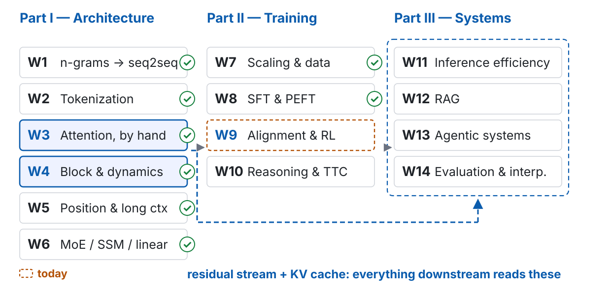

---
# 此檔由 bin/publish_slides.py 從投影片正本產生（中文講稿區塊已剝除），請勿直接編輯。正本在 private repo 的 <course>/slides/。
title: "Post-training II: Preference Alignment and Reinforcement Learning"
subtitle: "NLP & Large Language Models · Week 9"
author: "Hung-Shin Lee"
lang: en
format:
  revealjs:
    theme: [default, theme.scss]
    slide-number: c/t
    show-slide-number: all
    # 目標顯示尺寸：1280×800（16:10），與 W1–W8 相同。
    width: 1280
    height: 800
    margin: 0.04
    center: false
    progress: true
    transition: none
    navigation-mode: linear
    incremental: false
    # inline SVG 的 fragment：?print-pdf 時整張印在一頁
    pdf-separate-fragments: false
    chalkboard:
      buttons: true
    html-math-method:
      method: katex
      url: "https://cdn.jsdelivr.net/npm/katex@0.18.7/dist/"
    # 講稿（notes 區塊）裡的數學只輸出 MathML（照 w01.qmd，2026-09-16 起）。
    include-after-body:
      - text: |
          
---

# Two answers, and you prefer one. How does that sentence train a model? {.section-title}

## Where we are: week 9 of 14

{width="100%"}

## Last week, in one picture



::: {.footer}
W1 p20 · W8 p15, p18, p72, p76 · w09-data.json lastweek — no new numbers
:::

## The problem this week handles, in one picture



::: {.footer}
board: p12, p17, p19, p21, p26–p28, p30, p43 · live: p32, p49 · replay: p33, p50, p57
:::

## What you should be able to do by the end of today

1. **Derive Bradley–Terry** and the reward-model loss from "the log-odds are a difference of two scores"; say why reward values cannot be compared across reward models; name what each RLHF stage consumes and which networks vanish at inference
2. **Derive the policy gradient** in three lines, read it as SFT on your own samples weighted by reward, and prove a baseline changes nothing in expectation
3. **Write the KL-regularised objective** and its closed form $\pi^{*} \propto \pi_{\text{ref}}\,e^{r/\beta}$; find the gold-reward peak in Gao et al.'s form
4. **Derive DPO in full**, read its gradient, and state its three limits with the strength of evidence for each
5. **Write PPO's surrogate and GRPO's advantage**; derive the binary-reward identity and use it to fill in the table of variants
6. **Tell three examiners apart** by how each is fooled; read *Spurious Rewards* and Wu et al. as two explanations of one phenomenon
7. **Do the compute accounting**: sampling plus updating; how many networks at once; what "one score per episode" explains
8. **Place on-policy distillation** in a 2×2 — and attribute it correctly

::: {.footer}
Outline W9 · Learning objectives 1–8
:::

## Two questions for today — one line each, before we start

::: {.ask}
**(a)** One question; last week's model wrote **two answers**; you think A is better than B. **How do you use that sentence to train the model?**
:::

::: {.ask}
**(b)** For a maths problem a **program** can tell whether the answer is right. **Does training still need a person?**
:::

- Keep your two lines: p66 comes back to both
- **(a)** is parts 1–3: a comparison becomes a number, then a gradient — and then the number disappears
- **(b)** is parts 4–5: a program as the examiner, and what a program does not check

::: {.footer}
W8 p76 · parts 1–3 answer (a) · parts 4–5 answer (b)
:::

## Notation for today: one model, four names

::: {.prose}
| | |
|:---|:-----------------|
| $\pi_{\boldsymbol{\theta}}(y \mid x)$ | the **policy**: last week's $P_{\boldsymbol{\theta}}$, renamed. $\pi_{\boldsymbol{\theta}}(y \mid x) = \prod_t \pi_{\boldsymbol{\theta}}(y_t \mid x, y_{<t})$ — a whole answer's probability |
| $\pi_{\text{ref}}$ · $\pi_{\text{old}}$ · $\pi^{*}$ | **frozen all through training** (last week's model) · the snapshot that **wrote this batch** of answers · the optimum of an objective |
| $r(x, y)$ · $r_{\boldsymbol{\phi}}$ · $\hat{r}_{\boldsymbol{\theta}}$ | a **reward**: one scalar for a whole answer · a reward **model** · DPO's implicit reward |
| $(x, y_w, y_l)$ | one preference: $y_w$ **wins**, $y_l$ **loses** ($y_w \succ y_l$). Not *word*, not *length* |
| $\sigma(\cdot)$ · $\bar{r}$, $s_r$ | the **sigmoid**, and nothing else · a group's mean and standard deviation |
| $\beta$ · $Z(x)$ · $b(x)$ | the weight on the KL term · a normaliser that depends on $x$ alone · a baseline, also $x$ alone |
| $G$, $k$ · $\hat{A}_i$ · $\rho$ | answers per prompt, how many are correct · an advantage · a probability ratio $\pi_{\boldsymbol{\theta}}/\pi_{\text{old}}$ |
| $\mathcal{J}$ · $\mathcal{L}$ | an objective to **maximise** · a loss to **minimise** |
:::

::: {.footer}
most papers write $\sigma$ for the group's deviation and $r_{i,t}$ for the ratio; JM3 writes $o$ for $y$
:::

# "A is better than B" is not a number. How does it become one? {.section-title}

## Three examiners: a metaphor for the whole week

::: {.prose}
| The examiner | What it gives | What it costs | Where it is blind (part 5) |
|:---|:---|:---|:---|
| **A person**, comparing two answers on the spot | *which* is better — never a mark out of ten | the most; slow | what reads well; what agrees with them |
| **A learned examiner** — a network that has watched people compare (a *reward model*) | a mark for any answer, any number of times | cheap once trained | answers unlike any it has seen |
| **A program** that checks the answer (a *verifier*) | right or wrong | almost nothing | everything it does not check |
:::

- last week someone pointed at a shelf; **this week someone marks the paper**
- where the metaphor stops: it suggests **one correct answer** exists — for writing and conversation it does not, and people disagree; and at inference **the examiner is not in the room**

::: {.footer}
W8 p13: the library and one shelf · the metaphor returns at p20, p34, p39, p53 · W10, W13, W14
:::

## Preference data: one prompt, two answers, one choice

::: {.gen}
**prompt** $x$ — *Explain why the sky is blue to a ten-year-old.*

**answer A** — *Sunlight is made of many colours. Air scatters the blue part the most, so blue comes at you from every direction.*

**answer B** — *The phenomenon is attributable to Rayleigh scattering, whose cross-section scales as $\lambda^{-4}$.*

**the label** — A.  So $y_w$ = A, $y_l$ = B.
:::

- one record is $(x, y_w, y_l)$: **no score, no explanation, no correct answer** — one bit
- who chooses? Once, people. Since about 2024, often **a model**: Tülu 3's preference data are answers from a pool of models, judged by an LLM — some written by the very model being trained
- RLAIF (reinforcement learning from AI feedback; Lee et al., ICML 2024) compares the two kinds of label directly

::: {.footer}
the example is made up for this slide · Tülu 3 (COLM 2025), main text · JM3 §8.3.1
:::

## Bradley–Terry: the log-odds are a difference of two scores

**Assume** every answer has a scalar score $r(x, y)$, and the log-odds of "$y_w$ beats $y_l$" are the difference:

$$\log\frac{P(y_w \succ y_l \mid x)}{P(y_l \succ y_w \mid x)} = r(x, y_w) - r(x, y_l) \quad\Longrightarrow\quad P(y_w \succ y_l \mid x) = \sigma\big(r(x, y_w) - r(x, y_l)\big)$$

A **reward model** $r_{\boldsymbol{\phi}}$ is a network with one scalar output, trained on the negative log of that probability:

$$\mathcal{L}_{\text{RM}}(\boldsymbol{\phi}) = -\,\mathbb{E}_{(x,\,y_w,\,y_l)}\Big[\log\sigma\big(r_{\boldsymbol{\phi}}(x, y_w) - r_{\boldsymbol{\phi}}(x, y_l)\big)\Big]$$

- the same logistic loss as W1's skip-gram with negative sampling: a sigmoid of a score, a log, a sum over pairs
- it needs comparisons to be **consistent** — not annotators to agree on a mark out of ten

::: {.footer}
Bradley & Terry 1952 · JM3 §8.3.2–8.3.3 (writes $o$ for $y$) · W1 p45: SGNS
:::

## Only differences count — the first of three times

Replace $r(x, y)$ by $r(x, y) + c(x)$, for **any** function $c$ of the prompt alone:

$$\big(r(x, y_w) + c(x)\big) - \big(r(x, y_l) + c(x)\big) = r(x, y_w) - r(x, y_l)$$

- the loss $\mathcal{L}_{\text{RM}}$ does not change: $r$ and $r + c(x)$ are **the same reward model**
- so a reward value has no absolute meaning: compare two answers **to the same prompt**; never across prompts, never across reward models

::: {.claim}
[only differences count · 1 of 3]{.tag} Anything that depends on **$x$ alone** is invisible to a comparison. The same fact returns at **p19** (a baseline) and **p27** ($Z(x)$).
:::

::: {.footer}
Misconception 1: "a reward value has an absolute meaning" · p19 · p27 · p35 is its price
:::

## At a glance: RLHF (reinforcement learning from human feedback)

::: {.prose}
| | |
|:---|:-----------------|
| **Name** | No single paper. A reward learned from comparisons, then RL on it: Christiano et al. 2017. On a language model: Stiennon et al., NeurIPS 2020. The version everyone means: **InstructGPT**, Ouyang et al., NeurIPS 2022. |
| **The question** | People can compare answers but cannot write a loss function for "a good answer". How do you train on what they prefer? |
| **The idea** | Three stages: supervised fine-tuning (W8); a **reward model** trained on comparisons (p12); then let the model write, let the reward model score, and update on the score — with **PPO** (p22), held near the SFT model by a KL penalty (p20). |
| **What it added** | A way to train on a signal that is **not differentiable** and **not a demonstration**: the supervision axis's third entry. |
| **What it leaves open** | How a score becomes a gradient (p17–p19); what the KL penalty is for (p20–p21); what happens when the reward model is pushed too hard (p23); whether the reward model is needed at all (part 3). |
:::

::: {.footer}
Ouyang et al. 2022, §3 · Christiano et al. 2017 · Stiennon et al. 2020 · JM3 §8.4 (PPO: "TBD")
:::

## RLHF: three stages, four networks — and one at inference



::: {.footer}
Ouyang et al. 2022, §3.2, §3.5 · W8 p32: training and use differ (also W5, W6)
:::

# A score cannot be differentiated. How does the model follow it? {.section-title}

## Policy gradient in three lines

Maximise the expected score of the model's own answers: $\mathcal{J}(\boldsymbol{\theta}) = \mathbb{E}_{y \sim \pi_{\boldsymbol{\theta}}(\cdot \mid x)}\big[r(x, y)\big] = \sum_y \pi_{\boldsymbol{\theta}}(y \mid x)\,r(x, y)$

$$\begin{aligned}
\nabla_{\boldsymbol{\theta}}\mathcal{J} &= \sum_y r(x, y)\,\nabla_{\boldsymbol{\theta}}\pi_{\boldsymbol{\theta}}(y \mid x) \\
&= \sum_y \pi_{\boldsymbol{\theta}}(y \mid x)\;r(x, y)\,\nabla_{\boldsymbol{\theta}}\log\pi_{\boldsymbol{\theta}}(y \mid x) \\
&= \mathbb{E}_{y \sim \pi_{\boldsymbol{\theta}}}\Big[\,r(x, y)\,\nabla_{\boldsymbol{\theta}}\log\pi_{\boldsymbol{\theta}}(y \mid x)\,\Big]
\end{aligned}$$

- the step that matters is the middle one: $\nabla\pi = \pi\,\nabla\log\pi$ — the derivative of a log, used backwards
- it turns **a sum over every possible answer** (impossible) into **an average over sampled answers** (possible)
- and $r$ is never differentiated: it can be a person, another network, or a program

::: {.footer}
Williams 1992 (REINFORCE) · one prompt, one whole answer, one score: no discount
:::

## Read it as fine-tuning on your own answers, weighted by the score

$$\nabla_{\boldsymbol{\theta}}\log\pi_{\boldsymbol{\theta}}(y \mid x) = \sum_{t}\nabla_{\boldsymbol{\theta}}\log\pi_{\boldsymbol{\theta}}(y_t \mid x, y_{<t})$$

— last week's $\mathcal{L}_{\text{SFT}}$ gradient on this answer, with the sign flipped.

| Method | Whose answers? | Weight on each answer |
|:---|:---|:---|
| **SFT** (W8) | someone else's, fixed | $1$ |
| **REINFORCE** (this slide) | the model's own, re-sampled every step | $r(x, y) - b(x)$ |
| **DPO** (p30) | a fixed pile of pairs | $+w$ on $y_w$, $-w$ on $y_l$; $w$ = how wrong the model has the pair |
| **GRPO**, binary reward (p43) | the model's own, $G$ per prompt | $+$ on the correct, $-$ on the wrong; size $s_r$ |

: {tbl-colwidths="[24,30,46]"}

- where "weighted maximum likelihood" stops: a weight can be **negative** — maximum likelihood only ever pushes up; and the data **move with $\boldsymbol{\theta}$** — "an epoch", "overfitting the training set" mean something else here

::: {.footer}
DeepSeekMath §5.2.1, Table 10: a "gradient coefficient" per method · Tajwar et al., ICML 2024
:::

## A baseline changes nothing in expectation — the second time

Subtract from the score any $b(x)$ that depends on the prompt alone:

$$\mathbb{E}_{y \sim \pi_{\boldsymbol{\theta}}}\big[\,b(x)\,\nabla_{\boldsymbol{\theta}}\log\pi_{\boldsymbol{\theta}}(y \mid x)\,\big] = b(x)\,\nabla_{\boldsymbol{\theta}}\sum_y \pi_{\boldsymbol{\theta}}(y \mid x) = b(x)\,\nabla_{\boldsymbol{\theta}}1 = \mathbf{0}$$

$$\nabla_{\boldsymbol{\theta}}\mathcal{J} = \mathbb{E}_{y \sim \pi_{\boldsymbol{\theta}}}\Big[\big(r(x, y) - b(x)\big)\,\nabla_{\boldsymbol{\theta}}\log\pi_{\boldsymbol{\theta}}(y \mid x)\Big]$$

::: {.ask}
Scores run from 0 to 10 and nothing is subtracted. **What happens to an answer that scored 2?**
:::

::: {.claim}
[only differences count · 2 of 3]{.tag} Subtract anything that depends on **$x$ alone**: the expected gradient is unchanged, and its variance can fall a great deal. A **critic** predicts $b(x)$ with a network; GRPO takes it from the other answers to the same prompt.
:::

::: {.footer}
p13 · p27 · the critic: p22 · the group mean: p41
:::

## The examiner was learned from a sample: tie the model to $\pi_{\text{ref}}$

$$\max_{\pi}\;\; \mathbb{E}_{y \sim \pi(\cdot \mid x)}\big[r(x, y)\big] \;-\; \beta\,D_{\mathrm{KL}}\big(\pi(\cdot \mid x)\,\Vert\,\pi_{\text{ref}}(\cdot \mid x)\big)$$

- $D_{\mathrm{KL}}(\pi \,\Vert\, \pi_{\text{ref}})$: how far the answers $\pi$ writes have moved from the answers $\pi_{\text{ref}}$ writes — W1's cross-entropy minus the entropy; zero only when the two agree
- **a rope**: $\beta$ large, a short rope; $\beta$ small, a long one
- why: the reward model was trained on answers **like the ones $\pi_{\text{ref}}$ writes**. Far from them, its marks mean nothing — and the optimiser goes exactly where the marks are highest
- with a **program** as the examiner this reason disappears, and so, often, does the term (p46) — but the rope does a second job: last week, forgetting grew with the KL from the base model

::: {.footer}
Misconception 2: "the KL term is just a regulariser — optional" · W8 p66: Shenfeld et al.
:::

## The closed form, in one line: $\pi^{*} \propto \pi_{\text{ref}}\,e^{r/\beta}$

For a fixed $x$, push $r$ inside the log and one KL appears:

$$\mathbb{E}_{y \sim \pi}[r] - \beta\,D_{\mathrm{KL}}(\pi\,\Vert\,\pi_{\text{ref}}) = -\beta\,\mathbb{E}_{y \sim \pi}\!\left[\log\frac{\pi(y \mid x)}{\pi_{\text{ref}}(y \mid x)\,e^{r(x,y)/\beta}}\right] = -\beta\,D_{\mathrm{KL}}(\pi\,\Vert\,\pi^{*}) + \beta\log Z(x)$$

$$\pi^{*}(y \mid x) = \frac{1}{Z(x)}\,\pi_{\text{ref}}(y \mid x)\,e^{r(x,y)/\beta}, \qquad Z(x) = \sum_y \pi_{\text{ref}}(y \mid x)\,e^{r(x,y)/\beta}$$

- a KL is never negative and is zero only at equality: the maximum is at $\pi = \pi^{*}$
- $\beta \to \infty$: $\pi^{*} \to \pi_{\text{ref}}$ · $\beta \to 0$: all the mass on the best answer **that $\pi_{\text{ref}}$ can write**
- $Z(x)$ sums over every possible answer: **it cannot be computed**

::: {.claim}
The best policy is $\pi_{\text{ref}}$ **re-weighted**. An answer $\pi_{\text{ref}}$ gives probability zero stays at zero, whatever its reward.
:::

::: {.footer}
Misconception 3: "preference training teaches new knowledge" · W8 p19 · Kirk et al., ICLR 2024
:::

## PPO for a language model: a ratio, a clip, a critic

For answers sampled from $\pi_{\text{old}}$, with advantage $\hat{A} = r - b$:

$$\mathcal{J}_{\text{PPO}}(\boldsymbol{\theta}) = \mathbb{E}\Big[\min\big(\rho\,\hat{A},\;\; \operatorname{clip}(\rho,\,1-\epsilon,\,1+\epsilon)\,\hat{A}\big)\Big], \qquad \rho_{i,t} = \frac{\pi_{\boldsymbol{\theta}}(y_{i,t} \mid x, y_{i,<t})}{\pi_{\text{old}}(y_{i,t} \mid x, y_{i,<t})}$$

- **the ratio** $\rho$: the answers were written by $\pi_{\text{old}}$; after one update $\pi_{\boldsymbol{\theta}}$ is no longer that model. $\rho$ corrects for it
- **the clip**: hold $\rho$ inside $[1-\epsilon,\,1+\epsilon]$ so that one batch cannot drag the model far
- at $\boldsymbol{\theta} = \boldsymbol{\theta}_{\text{old}}$: $\rho = 1$, the clip does nothing, and the gradient is $\hat{A}\,\nabla\log\pi_{\boldsymbol{\theta}}$ — **the first step is REINFORCE with a baseline**. The clip matters only from the second step on the same batch
- **the critic**: one more network to train and to hold in memory

::: {.claim}
$\pi_{\text{ref}}$ never moves. $\pi_{\text{old}}$ is replaced every batch. They are **different models**.
:::

::: {.footer}
PPO = proximal policy optimization, Schulman et al. 2017 — a preprint · JM3 §8.4.1: "TBD"
:::

## Gao et al. 2023: the proxy keeps rising, the gold turns over



::: {.claim .warn}
A synthetic setup: a 6B reward model plays the human. The **shape** is the lesson; the coefficients do not transfer.
:::

::: {.footer}
Misconception 4: "reward going up is progress" · Gao et al., ICML 2023, §1, §3.6
:::

# The pipeline is heavy. Can the examiner be skipped? {.section-title}

## At a glance: DPO (direct preference optimization)

::: {.prose}
| | |
|:---|:-----------------|
| **Name** | *Direct Preference Optimization: Your Language Model is Secretly a Reward Model*, Rafailov et al., NeurIPS 2023 (arXiv:2305.18290). |
| **The question** | RLHF trains a reward model, then a critic, then samples. The preference data were there from the start — can the policy be trained on them **directly**? |
| **The idea** | The KL-regularised objective has a closed form (p21). Solve it for the reward; put that into Bradley–Terry (p12); $Z(x)$ cancels. What is left is a logistic loss in $\pi_{\boldsymbol{\theta}}$ and $\pi_{\text{ref}}$ only. |
| **What it added** | No reward model, no sampling, no critic: preference training with **an SFT training loop**. |
| **What it leaves open** | The derivation (p26–p28); what training looks like (p29); what the gradient does (p30); and three limits — the data are fixed (p34), only a difference is held (p35), it over-optimises anyway (p36). |
:::

::: {.footer}
Rafailov et al. 2023, §4 and the appendix · JM3 §8.4.2 · demo 1: p31–p33
:::

## DPO, steps 1 and 2: solve the closed form for the reward

**Step 1** — the optimum of the KL-regularised objective (p21):

$$\pi^{*}(y \mid x) = \frac{1}{Z(x)}\,\pi_{\text{ref}}(y \mid x)\,e^{r(x,y)/\beta}$$

**Step 2** — take the log and solve for $r$:

$$r(x, y) = \beta\log\frac{\pi^{*}(y \mid x)}{\pi_{\text{ref}}(y \mid x)} + \beta\log Z(x)$$

- read it right to left: **a policy and a reference determine a reward** — up to a term that depends on $x$ alone
- how much more likely the policy makes this answer than the reference did: that log-ratio *is* the answer's score
- and $Z(x)$ is still there, still impossible to compute

::: {.footer}
Rafailov et al. 2023, §4 · board, with p27–p28
:::

## Step 3: $Z(x)$ cancels — the third time

Put step 2 into Bradley–Terry, $P(y_w \succ y_l \mid x) = \sigma\big(r(x, y_w) - r(x, y_l)\big)$:

$$r(x, y_w) - r(x, y_l) = \beta\log\frac{\pi^{*}(y_w \mid x)}{\pi_{\text{ref}}(y_w \mid x)} + \beta\log Z(x) \;-\; \beta\log\frac{\pi^{*}(y_l \mid x)}{\pi_{\text{ref}}(y_l \mid x)} - \beta\log Z(x)$$

$$P(y_w \succ y_l \mid x) = \sigma\!\left(\beta\log\frac{\pi^{*}(y_w \mid x)}{\pi_{\text{ref}}(y_w \mid x)} - \beta\log\frac{\pi^{*}(y_l \mid x)}{\pi_{\text{ref}}(y_l \mid x)}\right)$$

::: {.claim}
[only differences count · 3 of 3]{.tag} $\beta\log Z(x)$ appears twice, once with each sign. It is not approximated away: it is **cancelled**, because it depends on $x$ alone and a comparison sees only differences (p13).
:::

::: {.footer}
p13: $r + c(x)$ · p19: $r - b(x)$ · here: $c(x) = \beta\log Z(x)$
:::

## Step 4: the loss — and the assumption inside it

Replace $\pi^{*}$ by the model being trained, and take the negative log-likelihood of the preference data:

$$\mathcal{L}_{\text{DPO}}(\boldsymbol{\theta}) = -\,\mathbb{E}_{(x,\,y_w,\,y_l)}\left[\log\sigma\!\left(\beta\log\frac{\pi_{\boldsymbol{\theta}}(y_w \mid x)}{\pi_{\text{ref}}(y_w \mid x)} - \beta\log\frac{\pi_{\boldsymbol{\theta}}(y_l \mid x)}{\pi_{\text{ref}}(y_l \mid x)}\right)\right]$$

- **the implicit reward**: $\hat{r}_{\boldsymbol{\theta}}(x, y) = \beta\log\dfrac{\pi_{\boldsymbol{\theta}}(y \mid x)}{\pi_{\text{ref}}(y \mid x)}$ — the model *is* the reward model
- **the hidden assumption**: the preferences were generated by Bradley–Terry under the reward this policy is optimal for. The reward model and the policy have been tied into **one network**
- the paper's default: $\beta = 0.1$

::: {.footer}
Rafailov et al. 2023, §4, appendix · the same shape as $\mathcal{L}_{\text{RM}}$ (p12)
:::

## DPO in training and in use: four log-probabilities, one gradient



::: {.footer}
Rafailov et al. 2023, §4 · TRL: `precompute_ref_log_probs` · compare p15, p63
:::

## Reading the gradient: a contrast, weighted by how wrong the pair is

$$\nabla_{\boldsymbol{\theta}}\mathcal{L}_{\text{DPO}} = -\beta\,\mathbb{E}\Big[\;\underbrace{\sigma\big(\hat{r}_{\boldsymbol{\theta}}(x, y_l) - \hat{r}_{\boldsymbol{\theta}}(x, y_w)\big)}_{\text{weight: how wrong is this pair?}}\;\underbrace{\big(\nabla_{\boldsymbol{\theta}}\log\pi_{\boldsymbol{\theta}}(y_w \mid x) - \nabla_{\boldsymbol{\theta}}\log\pi_{\boldsymbol{\theta}}(y_l \mid x)\big)}_{\text{contrast: push } y_w \text{ up, } y_l \text{ down}}\Big]$$

Four properties you can check in code:

1. $\pi_{\boldsymbol{\theta}} = \pi_{\text{ref}}$: the loss is $-\log\sigma(0) = \log 2$, and every pair has weight $\tfrac{1}{2}$
2. raise $\log\pi_{\boldsymbol{\theta}}(y_w \mid x)$: the loss falls
3. add **the same constant** to both log-probabilities: the loss does not change
4. $\beta \to 0$: loss $\to \log 2$, gradient $\to \mathbf{0}$ · $\beta$ large: a hard verdict — zero if the pair is ordered right, large if not

::: {.footer}
Rafailov et al. 2023, §4 · p18's table, third row · property 3 returns at p35
:::

## Before Demo 1: six lines of loss, four tests, one real run

::: {.prose}
| | |
|:---|:-----------------|
| **Why** | The derivation took four boards; the result is six lines of code. Before trusting it, check the four properties of p30 — and then watch what it does to a real model. |
| **What runs** | **(a) live**: `dpo_loss(logp_w, logp_l, ref_w, ref_l, beta)`, written from scratch; its inputs are four whole-answer log-probabilities. Four tests, plus a fifth against the PyTorch snippet in the DPO paper's appendix. **(b) replay**: last week's model ($\pi_{\text{ref}}$) writes several answers to each prompt; a **hard-coded rule** picks $y_w$ and $y_l$ (a shorter answer that ends properly wins); DPO with LoRA at three values of $\beta$. |
| **Expect** (a) | $\log 2$ at the start; lower when `logp_w` rises; unchanged when both shift together; the two limits of $\beta$. |
| **Watch for** (b) | The loss falls. Does $\log\pi_{\boldsymbol{\theta}}(y_w \mid x)$ rise? Look at the two log-probabilities **separately**, not at their difference. |
:::

::: {.footer}
Demo 1 · `demos/w09_d1_dpo_scratch` · built 2026-11-15, **not rehearsed**
:::

## Live: demo 1 (a) — `dpo_loss`, written and tested

| test | what it checks | expected | got |
|:---|:---|:---|:---|
| (i) | $\pi_{\boldsymbol{\theta}} = \pi_{\text{ref}}$ | $\log 2 \approx 0.693$; weight $\tfrac{1}{2}$ | |
| (ii) | raise `logp_w` | the loss falls | |
| (iii) | add $c$ to `logp_w` **and** `logp_l` | no change | |
| (iv) | $\beta \to 0$; $\beta$ large | $\log 2$; a hard verdict | |
| (v) | the DPO paper's appendix code, same inputs | equal to floating-point error | |

: {tbl-colwidths="[10,38,36,16]"}

::: {.claim}
Test (iii) passes. **Is that good news?**
:::

::: {.footer}
Demo 1 (a) · live · `w09_d1_dpo_scratch/` · built 2026-11-15, not rehearsed: the last column is filled in class
:::

## Replay: demo 1 (b) — the two log-probabilities, drawn separately

| $\beta$ | loss, start → end | $\log\pi_{\boldsymbol{\theta}}(y_w)$, start → end | $\log\pi_{\boldsymbol{\theta}}(y_l)$, start → end | answer length (the rule's gold) | bits per byte, W1's ruler |
|:---|:---|:---|:---|:---|:---|
| 0.05 | | | | | |
| 0.1 | | | | | |
| 0.5 | | | | | |

: {tbl-colwidths="[8,17,21,21,17,16]"}

- the pairs: last week's model wrote both answers; a fixed rule chose. **Not human preferences**
- what would count as likelihood displacement: the loss falls **and** the $y_w$ column falls

::: {.claim .warn}
Nothing here has been measured yet. Whatever the run shows is what this slide will say.
:::

::: {.footer}
Demo 1 (b) · replay · one model, one rule, one seed · built 2026-11-15, **not rehearsed**
:::

## Limit 1: the comparisons are a fixed pile

- DPO learns from **a fixed set of pairs**; PPO and GRPO learn from **what the current policy writes**. In RL terms: off-policy against on-policy
- the examiner metaphor: nobody is hired; the model studies **a pile of marked papers**. Whatever new answer it writes later, **no one marks it**
- **Xu et al.**, ICML 2024 (oral): DPO may have fundamental limitations; once the key factors of PPO are found, PPO beats it on every testbed they tried
- **Tajwar et al.**, ICML 2024: on-policy sampling, or a negative gradient, is what makes preference fine-tuning work
- in practice it is a trade of cost: Tülu 3 chose a length-normalised DPO for simplicity and efficiency — its pairs include answers **written by the model being trained**

::: {.claim}
"PPO lost to DPO" — **was PPO tuned?** The first of the four questions (W1 p21), in this week's form.
:::

::: {.footer}
Misconception 5: "DPO is an equivalent replacement for PPO" · both abstracts · Tülu 3
:::

## Limit 2: only the difference is held — both can fall

- the loss sees $\log\pi_{\boldsymbol{\theta}}(y_w) - \log\pi_{\boldsymbol{\theta}}(y_l)$ and nothing else (p30, property 3): **both can fall together**, the mass going to a third answer that is in no pair
- **Pal et al.** (a preprint): in theory the standard loss can lower the likelihood of the preferred answer, as long as the relative probability rises
- **Razin et al.**, ICLR 2025 — *likelihood displacement*: train a model to prefer `No` over `Never`, and the probability of **`Yes`** rises sharply
- used to train refusals, the same effect took Llama-3-8B-Instruct's refusal rate from **74.4%** to **33.4%**

::: {.claim .warn}
[only differences count · the price]{.tag} The invariance that cancelled $Z(x)$ is the same one that lets both answers sink.
:::

::: {.footer}
Misconception 6: "the DPO loss fell, so $y_w$ became more likely" · Razin et al., abstract · p32, p33
:::

## Limit 3: no reward model, and it still over-optimises

- p23's curve needed a reward model to be pushed too hard. DPO has none
- **Rafailov et al.**, NeurIPS 2024: DPO-style methods degrade in a similar way at larger KL budgets — often **before one epoch** over the data is finished
- why it is not a surprise: the implicit reward $\hat{r}_{\boldsymbol{\theta}} = \beta\log\dfrac{\pi_{\boldsymbol{\theta}}}{\pi_{\text{ref}}}$ **is** a reward model (p28), learned from the same finite pile

::: {.claim}
Removing the examiner from the pipeline does not remove the examiner's problem.
:::

::: {.footer}
Rafailov et al. 2024, abstract (the same first author as DPO) · p23
:::

## Variants in one table — and what a shipped recipe uses

::: {.prose}
| Method | What it changes | Venue |
|:---|:---|:---|
| **IPO** (Azar et al.) | drops Bradley–Terry's step from pairwise preferences to a pointwise reward | AISTATS 2024 |
| **KTO** (Kahneman–Tversky Optimization; Ethayarajh et al.) | needs no pairs: a "good" or "bad" label on single answers | ICML 2024 |
| **SimPO** (Simple Preference Optimization; Meng et al.) | the implicit reward is the **average** log-probability; no $\pi_{\text{ref}}$ | NeurIPS 2024 |
| **length-normalised DPO** | what Tülu 3 ships | COLM 2025 |
:::

- Azar et al.: RLHF rests on **two** approximations — pairwise preferences replaced by pointwise rewards; a reward model that generalises out of distribution. DPO bypasses the second and keeps the first
- a new variant says it beats DPO: **were both tuned, on the same budget?**

::: {.footer}
abstracts of the three papers · Tülu 3, main text · IPO: Azar et al.'s $\Psi$PO with $\Psi$ the identity
:::

# Some answers need no person: a program can check them {.section-title}

## A program as the examiner: RLVR

- for a maths problem or a piece of code the reward can be **a program**: $r(x, y) \in \{0, 1\}$ — the final number matches, the tests pass
- **RLVR**, reinforcement learning with verifiable rewards: the name is Tülu 3's — a reward only when the answer is verified correct. (Tülu 3's own RLVR stage used PPO with a value model.)
- nothing in p17 needs changing: the gradient passes through $\log\pi_{\boldsymbol{\theta}}$, never through $r$
- what changes is **who writes and who marks**: the model writes; nobody labels anything; the program cannot be charmed by good prose

::: {.columns}
::: {.column width="50%"}
::: {.claim}
**Parts 1–3**: the examiner is a person, or has learned from people. The signal is a **preference**.
:::
:::
::: {.column width="50%"}
::: {.claim}
**Parts 4–5**: the examiner is a program. The signal is **right or wrong** — the supervision axis's fourth entry.
:::
:::
:::

::: {.footer}
Lambert et al., *Tülu 3*, COLM 2025 · W1 p20: the fourth entry, "a verifiable reward"
:::

## At a glance: GRPO (group relative policy optimization)

::: {.prose}
| | |
|:---|:-----------------|
| **Name** | **Not a paper of its own.** It is §4.1 of *DeepSeekMath*, Shao et al., arXiv:2402.03300 (2024) — a preprint. What made it famous: *DeepSeek-R1*, *Nature* 645 (2025), which used it to elicit reasoning from a base model by RL alone. |
| **The question** | PPO needs a critic to supply the baseline — a second network to train and to hold. Can the baseline come from somewhere cheaper? |
| **The idea** | Answer the same prompt $G$ times. Each answer's advantage is its reward **relative to the group**: $\hat{A}_i = (r_i - \bar{r})/s_r$. The other $G-1$ answers are the baseline. |
| **What it added** | One network fewer (the abstract: *optimizing the memory usage of PPO*); and comparing within a group subtracts each prompt's difficulty for free. |
| **What it leaves open** | What the update really is (p43); three biases and the variants that fix them (p44–p46); how large $G$ should be (p44, p63). |
:::

::: {.footer}
Misconception 7: "which paper is GRPO?" · DeepSeekMath §4.1, Eq. (3) · DeepSeek-R1, abstract
:::

## GRPO: the critic, replaced by the other $G-1$ answers



::: {.footer}
a worked example, $G = 4$: arithmetic, not a measurement · $s_r$ divides by $G$, not $G-1$
:::

## The objective as DeepSeekMath wrote it

$$\mathcal{J}_{\text{GRPO}}(\boldsymbol{\theta}) = \mathbb{E}\left[\frac{1}{G}\sum_{i=1}^{G}\frac{1}{\lvert y_i \rvert}\sum_{t=1}^{\lvert y_i \rvert}\Big(\min\big(\rho_{i,t}\,\hat{A}_i,\;\operatorname{clip}(\rho_{i,t},\,1-\epsilon,\,1+\epsilon)\,\hat{A}_i\big) - \beta\,D_{\mathrm{KL}}(\pi_{\boldsymbol{\theta}}\,\Vert\,\pi_{\text{ref}})\Big)\right]$$

$$\hat{A}_i = \frac{r_i - \bar{r}}{s_r}$$

Five places where a choice was made — each is a switch on p46:

1. **$\div\, s_r$** in the advantage
2. **$1/\lvert y_i \rvert$**: each answer's tokens averaged over its own length
3. **$\rho_{i,t}$**: one ratio per token
4. **the clip**: symmetric, $1 \pm \epsilon$
5. **the KL** to $\pi_{\text{ref}}$ — and, not visible in the formula, **which groups are used**: all of them

Four methods of 2025 each flip one or two: **DAPO** (Decoupled Clip and Dynamic sAmpling Policy Optimization), **Dr. GRPO** (GRPO Done Right), **GSPO** (Group Sequence Policy Optimization), **SAPO** (Soft Adaptive Policy Optimization).

::: {.footer}
DeepSeekMath §4.1, Eq. (3); the KL is estimated by Eq. (4) · the paper writes $q$, $o_i$ for our $x$, $y_i$
:::

## Binary rewards: the update is $s_r$ times a contrast

One prompt, $G$ answers, $k$ correct ($0 < k < G$). Then $\bar{r} = \dfrac{k}{G}$ and $s_r = \dfrac{\sqrt{k\,(G-k)}}{G}$, so

$$\hat{A}_i = \frac{1 - k/G}{s_r}\ \ \text{(correct)}, \qquad \hat{A}_i = -\frac{k/G}{s_r}\ \ \text{(wrong)}$$

Let $\overline{\nabla}_{+}$ and $\overline{\nabla}_{-}$ be the mean of $\nabla_{\boldsymbol{\theta}}\log\pi_{\boldsymbol{\theta}}(y_i \mid x)$ over the correct and over the wrong answers. On the first step ($\rho = 1$, p22):

$$\frac{1}{G}\sum_{i=1}^{G}\hat{A}_i\,\nabla_{\boldsymbol{\theta}}\log\pi_{\boldsymbol{\theta}}(y_i \mid x) \;=\; \frac{1}{G\,s_r}\cdot\frac{k\,(G-k)}{G}\,\big(\overline{\nabla}_{+} - \overline{\nabla}_{-}\big) \;=\; s_r\,\big(\overline{\nabla}_{+} - \overline{\nabla}_{-}\big)$$

::: {.claim}
The step that matters: $k(G-k)/G^2$ **is** $s_r^2$. Divide by $s_r$ and one $s_r$ is left.
:::

::: {.footer}
three lines of algebra, done on the board · also Theorem 1 of Bay & Yearick 2026, a preprint
:::

## Three things to read off that line



- **a contrast**, as in DPO (p30): correct up, wrong down — but the program decides which is which, and the model wrote both a moment ago
- **divide by $s_r$ or not**: the dashed curve is what is left without it — the *question-level difficulty bias* of Liu et al.
- **$k = 0$ or $k = G$**: no update. A prompt answered correctly with probability $p$ is silent with probability $p^{G} + (1-p)^{G}$ — at $p = 0.3$: $0.58$ for $G = 2$, $0.25$ for $G = 4$, $0.06$ for $G = 8$

::: {.footer}
Misconception 8 (first half): "a larger $G$ is always better" · Liu et al., COLM 2025 · p63
:::

## Entropy collapse: exploration stops early

- **entropy**: how spread out the model's next-token distribution is. High: it still tries different things. Low: it writes the same answer every time
- **Cui et al.** 2025 (a preprint): in RL for reasoning models the policy's entropy **drops sharply early in training**, and performance saturates with it
- why it matters here: with $G$ identical answers, $k$ is $0$ or $G$ — **every group is silent** (p44), however large $G$ is. The update that sharpened the model is the one that ends its learning
- two switches on the next slide aim at this: DAPO's **clip-higher** ($\epsilon_{\text{high}} > \epsilon_{\text{low}}$: let unlikely tokens rise) — and a KL to $\pi_{\text{ref}}$ does it bluntly

::: {.footer}
Cui et al., arXiv:2505.22617 — a preprint · DAPO §3.1 · W1: entropy
:::

## One formula, a row of switches

| Switch | GRPO | Dr. GRPO | DAPO | GSPO | SAPO |
|:---|:---|:---|:---|:---|:---|
| divide by $s_r$ | yes | **no** | yes | yes | yes |
| token sum | $\div$ own $\lvert y_i \rvert$ | **$\div$ a constant** | **$\div$ the group's total tokens** | one value per answer | $\div$ own $\lvert y_i \rvert$ |
| ratio | token | token | token | **sequence** | token |
| clip | symmetric $\epsilon$ | symmetric | **$\epsilon_{\text{high}} > \epsilon_{\text{low}}$** (0.28, 0.2) | symmetric, per answer | **a smooth gate**, per token |
| which groups | all | all | **silent ones replaced** | all | all |
| KL to $\pi_{\text{ref}}$ | yes | none ($\beta = 0$) | **removed** | not in its equations | none |
| says it fixes | — | length bias, difficulty bias | entropy collapse, silent groups, long answers | noisy token ratios (MoE) | a hard clip discards gradient |

: {tbl-colwidths="[15,13,16,21,18,17]"}

- the first three rows are three arguments of TRL's `GRPOConfig`: `scale_rewards`, `loss_type`, `importance_sampling_level`

::: {.footer}
Misconception 9: "four algorithms" · DAPO, Dr. GRPO: published · GSPO, SAPO: preprints
:::

## Three independent reasons to call them switches

| The reason | What it is | How strong |
|:---|:---|:---|
| **the algebra** (p43) | with binary rewards the update is $s_r \times$ a contrast; dividing by $s_r$, dropping $s_r = 0$, re-weighting tokens all act on that one line | exact — for binary rewards, the first step, no clip, no KL |
| **the code** | TRL 1.13.0's `GRPOTrainer` covers them with three arguments; the default `loss_type` is already `"dapo"`, and the docs advise against `"grpo"` for its length bias | source code, not literature |
| **the measurement** | ScaleRL (ICLR 2026 oral; more than 400,000 GPU-hours): loss aggregation, normalisation, curriculum, off-policy algorithm mainly change **efficiency**; they barely move the asymptote | one large study's abstract |

: {tbl-colwidths="[20,56,24]"}

::: {.claim .warn}
"Converged" is this course's reading, not a result. Since March 2026 the area has kept producing variants — most of them preprints.
:::

::: {.footer}
Bay & Yearick 2026 states the identity as a theorem: a two-author preprint · ScaleRL: Khatri et al.
:::

## Before Demo 2: five lines of advantage, and how large $G$ should be

::: {.prose}
| | |
|:---|:-----------------|
| **Why** | p43 is three lines of algebra about gradients nobody has seen. Check it on real gradients; then find out how often a group is silent, and what each switch on p46 does to a small model. |
| **What runs** | The task: integer arithmetic **generated on the spot** (a few two- or three-digit numbers; difficulty set so that $\pi_{\text{ref}}$ is right three to five times in ten). Nothing can have been memorised. The verifier: the last number in the answer equals the result. **(a) live**: five lines for the advantage; the update computed two ways. **(b) replay**: a hand-written loop — sample, verify, advantage, **one** update per batch — at $G \in \{2, 4, 8, 16\}$ with the total number of rollouts per step held fixed; then each switch once; then LoRA rank 1 against rank 16. |
| **Expect** (a) | The two ways agree to floating-point error. `std` dividing by $G$ and by $G-1$ differ by $\sqrt{G/(G-1)}$. |
| **Watch for** (b) | How many groups are silent at each $G$ — and is it $p^{G} + (1-p)^{G}$? Which takes longer on this machine: sampling, or updating? |
:::

::: {.footer}
Demo 2 · `demos/w09_d2_grpo_scratch` · the loop is written by hand · built 2026-11-14, **not rehearsed yet**
:::

## Live: demo 2 (a) — the advantage, and the identity checked in numbers

| | value |
|:---|:---|
| $G$, $k$ for this prompt | |
| $\bar{r}$, $s_r$ (dividing by $G$) | |
| `std` dividing by $G-1$ | |
| update, way 1: $\frac{1}{G}\sum_i \hat{A}_i\,\nabla\log\pi_{\boldsymbol{\theta}}(y_i \mid x)$ — its norm | |
| update, way 2: $s_r\,(\overline{\nabla}_{+} - \overline{\nabla}_{-})$ — its norm | |
| norm of the difference | |

: {tbl-colwidths="[70,30]"}

::: {.ask}
Before the last row is printed: **what should it be?**
:::

::: {.footer}
Demo 2 (a) · live · `w09_d2_grpo_scratch/` · built 2026-11-14, not rehearsed yet
:::

## Replay: demo 2 (b) — the $G$ sweep, silent groups, three switches

| $G$ | prompts per step | silent groups, measured | $p^{G} + (1-p)^{G}$ at the measured $p$ | accuracy on fresh problems, start → end | time: sampling / update |
|:---|:---|:---|:---|:---|:---|
| 2 | | | | | |
| 4 | | | | | |
| 8 | | | | | |
| 16 | | | | | |

: {tbl-colwidths="[6,14,18,24,22,16]"}

| switch, at one $G$ | what to look at | off | on |
|:---|:---|:---|:---|
| divide by $s_r$ | accuracy | | |
| $\div$ own length vs. $\div$ a constant | length of **wrong** answers | | |
| drop silent groups | accuracy per rollout | | |
| LoRA rank 1 vs. 16 | accuracy | | |

: {tbl-colwidths="[30,34,18,18]"}

::: {.footer}
Demo 2 (b) · replay · **it cannot confirm or refute IsoCompute** · built 2026-11-14, not rehearsed yet
:::

## Outcome or process: two words to carry into W10

| | **Outcome** supervision | **Process** supervision |
|:---|:---|:---|
| what gets a mark | the final answer only | every step of the solution |
| the examiner | an outcome reward model (ORM), or a verifier | a process reward model (PRM) |
| the labels | a program, or the answer key | people (Lightman et al.: 800k step labels); or automatic: do completions of this step end up right? (Math-Shepherd) |
| evidence | everything in part 4 | Lightman et al.: process clearly beats outcome on MATH · Zhang et al.: the automatic labels are worse than an LLM judge or people |

: {tbl-colwidths="[16,34,50]"}

::: {.claim}
Everything today marks the **outcome**. What a process examiner can do **at answer time** is next week.
:::

::: {.footer}
Lightman et al., ICLR 2024 · Math-Shepherd, ACL 2024 · Zhang et al., Findings of ACL 2025
:::

# A program cannot be flattered. Can it be fooled? {.section-title}

## Every examiner has a blind spot

| The examiner | Its blind spot | What the model learns | Evidence, and its kind |
|:---|:---|:---|:---|
| **a person** | fluent, confident agreement | to agree with the user | Sharma et al., ICLR 2024 · one deployment post-mortem (a blog post) |
| **a learned examiner** | answers unlike any it has seen | to go where its marks are wrong | Gao et al., ICML 2023 (p23) — a synthetic setup |
| **a program** | everything it does not check | to satisfy the check, not the task | a workshop paper · EMNLP 2026 · ICLR 2026 · ICML 2026 (p55) |

: {tbl-colwidths="[18,24,26,32]"}

- the name for all three: **reward hacking** — the reward goes up and the thing you wanted does not
- none of it requires the model to "intend" anything: the optimiser goes where the marks are

::: {.footer}
p10's table, last column · Skalse et al. 2022: a definition · Wang et al. 2026: a survey, a preprint
:::

## People: a preference is itself a proxy

- **Sharma et al.**, ICLR 2024: an answer that matches the user's stated view is more likely to be preferred; and both people and preference models prefer **convincingly written agreement** over a correct answer a non-negligible fraction of the time
- **OpenAI's post-mortem of 2 May 2025** — a company blog post, not a paper: an update added a reward signal built on **thumbs-up / thumbs-down**; the model became noticeably more agreeable; it was rolled back within days
- **Kirk et al.**, ICLR 2024: RLHF generalises better than SFT to new inputs — and output **diversity** falls markedly
- and calibration gets worse after post-training (W8); Kalai et al. 2025 (a preprint) argue that the usual marking schemes reward **a guess** over "I don't know"

::: {.claim}
What you want is the person's considered judgement. What you can collect is which answer they picked.
:::

::: {.footer}
Misconception 10: "human preference is the gold standard" · W1 p39
:::

## Programs: a verifier checks only what it checks

| The study | The verifier checked | The model | Kind |
|:---|:---|:---|:---|
| **Helff et al.** | each example's label, not the rule | stopped inducing a rule; **enumerated** labels case by case — in RLVR-trained reasoning models, not in the others tested | a workshop paper, 2026 |
| **Countdown-Code** | tests, in a harness the model can **edit** | with **1%** cheating trajectories in the SFT data it learns to cheat; RL amplifies it, and it generalises | EMNLP 2026 |
| **ImpossibleBench** | test cases | a benchmark: how readily models exploit the tests | ICLR 2026 |
| **Yu et al.** | the final answer | accuracy rises; the reasoning's **causal importance** and **sufficiency** do not reliably rise | ICML 2026 |

: {tbl-colwidths="[17,23,44,16]"}

::: {.claim .warn}
An outcome reward going up is not evidence that the reasoning got better — W3's lesson about attention weights, again.
:::

::: {.footer}
Misconception 11: "a verifiable reward cannot be hacked" · the four abstracts · W3 p50 · W10
:::

## Before Demo 3: a verifier with a hole in it

::: {.prose}
| | |
|:---|:-----------------|
| **Why** | p23's two lines came from a learned examiner in a synthetic setup. Does the same picture appear with a **program** — on a task where nothing can have been memorised? |
| **What runs** | Demo 2's task and loop, with one change. The **leaky** verifier gives 1 if the correct number appears **anywhere** in the answer. The **strict** one (the last number equals the result) is never shown to the model; it is the gold. One run records both scores, the KL from $\pi_{\text{ref}}$, the answer's length, and how many numbers it contains. A second run: the verifier is **a coin flip**. |
| **Watch for** | The two scores against $\sqrt{\mathrm{KL}}$: do they separate? What do the answers look like after training? And under a random reward: does the gold score move at all? |
:::

::: {.claim}
One of the three failure-case high points of the course — and the failure is ours, built in on purpose.
:::

::: {.footer}
Demo 3 · `demos/w09_d3_leaky_reward` · after Helff et al., Moya et al. · built 2026-11-15, **not rehearsed**
:::

## Replay: demo 3 — proxy and gold against $\sqrt{\mathrm{KL}}$

| | start | end | what happened in between |
|:---|:---|:---|:---|
| **proxy** — the leaky verifier's score | | | |
| **gold** — the strict verifier's score | | | |
| $\sqrt{\mathrm{KL}}$ from $\pi_{\text{ref}}$ | | | |
| answer length; numbers per answer | | | |
| **random reward**, one update per batch — gold | | | |
| **random reward**, several updates per batch — gold | | | |

: {tbl-colwidths="[40,14,14,32]"}

::: {.gen}
**one answer before training** — *(filled in after rehearsal)*

**one answer after training** — *(filled in after rehearsal)*
:::

::: {.footer}
Demo 3 · replay · the program version of p23 · one model, one task · built 2026-11-15, not rehearsed yet
:::

## This week's reading: random rewards raise the score too

| | **Shao et al.**, ICML 2026 | **Wu et al.**, AAAI 2026 |
|:---|:---|:---|
| observed | GRPO with **random** rewards lifts Qwen2.5-Math-7B on MATH-500 by **21.4** points; the true reward gives **29.1** | such gains are reported mostly for **Qwen2.5**, on MATH-500, AMC, AIME — and seldom carry over to Llama |
| explained by | the **clip**: its bias amplifies behaviour the model already favoured — "reasoning in code without running it", 65% → over 90% | **contamination**: Qwen2.5 shows signs of having seen those benchmarks; results on them may be unreliable |
| its own test | other families (Llama3, OLMo2): no such gain | fresh arithmetic (RandomCalculation): only the **correct** reward gives steady improvement |

: {tbl-colwidths="[14,46,40]"}

::: {.claim}
One phenomenon, two explanations. They do not exclude each other — but they are **different mechanisms**.
:::

::: {.footer}
Misconception 12: "the benchmark rose after RL, so the reward works" · both abstracts
:::

## One phenomenon, two explanations: which experiment separates them?

::: {.ask}
If **the clip** is the cause, what should happen when you (i) take one update per batch, so the clip never acts? (ii) switch to problems the model cannot have seen? (iii) switch model family?  And if **contamination** is the cause?
:::

::: {.prose}
| The four questions (W1 p21) | Asked of this result |
|:---|:---|
| **1 · the baseline** | is there a run with **no reward at all** — and one with the reward shuffled? |
| **2 · the budget** | the same number of rollouts and updates for every arm? |
| **3 · what the metric rewards** | a benchmark the model may have memorised rewards recall, not reasoning |
| **4 · mechanism or correlation** | "code-style reasoning rose" and "the score rose" happened together; is one the cause? |
:::

::: {.footer}
Shao et al. in full; Wu et al. §4.1, §4.3 · demo 3's random-reward runs (p57)
:::

# What does it cost? {.section-title}

## RL compute is sampling plus updating — and sampling is inference

$$C_{\text{RL}}\ \text{per prompt} \;\approx\; \underbrace{2N\,(L_{\text{in}} + G\,L_{\text{out}})}_{\text{sampling: prefill once, then decode}} \;+\; \underbrace{6N\,G\,(L_{\text{in}} + L_{\text{out}})}_{\text{update: forward and backward}}$$

and $2N\,G\,(L_{\text{in}} + L_{\text{out}})$ more if a KL to $\pi_{\text{ref}}$ is computed.



::: {.footer}
this course's bookkeeping, not a paper's claim · W8 p28: LoRA $\approx 4N$ · W3 p36 · W11
:::

## One score per episode: three hooks from W8, closed

| W8 left open | This week's reading of it | Evidence, and its kind |
|:---|:---|:---|
| **rank 1** is enough under RL | SFT has a target on every token; RL brings back **one score per answer** — one bit, for right-or-wrong. There is little to store | Thinking Machines: two **blog posts** |
| RL changes **little** | only 5%–30% of the parameters are updated; training that subnetwork alone recovers the result | Mukherjee et al., NeurIPS 2025 |
| RL **forgets less** | two explanations stand (KL from the base; on-policy data). A third angle: the closed form (p21) is the policy **nearest** $\pi_{\text{ref}}$ with enough reward | Shenfeld et al., ICLR 2026 · Chen et al., ICML 2026 |

: {tbl-colwidths="[20,52,28]"}

::: {.claim}
A signal this thin cannot carry much — which is why it changes little, and forgets little.
:::

::: {.footer}
W8 Misconceptions 8 and 11 return here · W8 p66 · ISO (Zhu et al. 2026, a preprint)
:::

## How many networks at once — and how large should $G$ be?

| Method | In memory during training | At inference |
|:---|:---|:---|
| **RLHF with PPO** | policy · critic · reward model · $\pi_{\text{ref}}$ — **four** (p15) | the policy |
| **DPO** | policy · $\pi_{\text{ref}}$ — **two**. With LoRA, $\pi_{\text{ref}}$ is the same frozen weights without the side road; its log-probabilities can be stored in advance | the policy |
| **GRPO** | the policy — **one**; a second only for a KL to $\pi_{\text{ref}}$ (TRL's `beta` defaults to 0) | the policy |

: {tbl-colwidths="[18,66,16]"}

- **IsoCompute** (Cheng et al., ICML 2026): three resources — rollouts per prompt ($G$), prompts per batch, update steps. The compute-optimal $G$ **rises with the budget, then saturates**
- **ScaleRL** (ICLR 2026 oral): compute against performance is a **sigmoid**; a stable recipe extrapolates from small runs

::: {.footer}
Misconception 8 (second half): "a larger $G$ is always better" · both: abstracts
:::

## On-policy distillation — and who proposed it

::: {.prose}
| | **a signal on every token** | **one signal per answer** |
|:---|:---|:---|
| **someone else's** answers | SFT (W8) | — |
| **the model's own** answers | **on-policy distillation**: the student writes; a teacher scores every token — $D_{\mathrm{KL}}(\pi_{\boldsymbol{\theta}}\,\Vert\,\pi_{\text{teacher}})$ per token | RL (today) |

: {tbl-colwidths="[24,52,24]"}
:::

- where it comes from: **GKD** (Generalized Knowledge Distillation; Agarwal et al.) and **MiniLLM** (Gu et al.), both ICLR 2024; the Qwen3 technical report used it for shipped small models
- the account everyone has read is a **Thinking Machines blog post** of October 2025 — and that post **cites all three**. The 2×2 above is its table

::: {.claim .warn}
The blog did not drop the sources. The people who retold it did.
:::

::: {.footer}
Misconception 13: "on-policy distillation was proposed by Thinking Machines" · W11
:::

# Where this goes {.section-title}

## The opening questions, answered

::: {.ask}
p7 asked: (a) you think A is better than B — how does that sentence train a model? (b) a program can check the answer — does training still need a person?
:::

- **(a) Three ways, in order of how much machinery they need.** Train an examiner on such sentences and follow its marks (p12, p17). Or skip the examiner: push A up **and B down**, weighted by how wrong the model has the pair (p30). Either way the sentence says only which is better — never by how much, never why (p13)
- **(b) Not to mark the answers — and yes, for everything the program does not check.** One score times the gradient of the model's own answer is the whole method (p17, p43); the program sees the final number and nothing else (p41, p55)
- and whoever the examiner is: pushed hard enough, its score and the score you wanted **part company** (p23, p57) — and training shows you only the first

::: {.footer}
compare with your two lines from p7 · W10: spend the compute at answer time
:::

## Three axes, week 9

::: {.prose}
| Axis | This week |
|:---|:---|
| **Representation** | the unit grows: from the token to **a whole answer** (a reward is given to an answer), to **a group of answers** (GRPO's advantage exists only inside a group) |
| **Compute** | for the first time **training compute contains inference compute**: sampling is decoding, memory-bound |
| **Supervision** | the **third and fourth entries** are ticked: human preference, a verifiable reward — and the signal is **a single scalar** |
:::

::: {.claim}
Four entries ticked. The fifth and sixth — retrieved knowledge, compute at test time — are not in training at all.
:::

::: {.footer}
W1 p19–p20 · W8 p72 · the ledger, next slide
:::

## The ledger, week 9: one new row

| Where the cost falls | Formula | What binds it | Filled in |
|:---|:---|:---|:---|
| **Training**, one run | $C_{\text{train}} \approx 6ND$; LoRA $\approx 4ND$ | compute | W1 · W4 · W7 · W8 |
| **RL**, per prompt | **$2N(L_{\text{in}} + GL_{\text{out}}) + 6NG(L_{\text{in}} + L_{\text{out}})$** | all three | **today** · W10 · W11 |
| **Training budget**, the split | $N^{*} \propto C^{\beta/(\alpha+\beta)}$, $D^{*} \propto C^{\alpha/(\alpha+\beta)}$ (a fit); $+\,2ND_{\text{inf}}$; $D \to D_{\text{eff}}$ | the loss surface; the bill | W7 · W10 · W11 |
| **Optimizer state**, bytes/param | full 16 → LoRA $2 + 16N_{\text{LoRA}}/N$ → QLoRA $b_{\text{q}} + 16N_{\text{LoRA}}/N$ | capacity | W4 · W8 |
| **Prefill**, once per request | $C_{\text{pre}} \approx 2NL_{\text{in}} + 2\,n_{\text{layer}}L_{\text{in}}^2 d$ FLOPs | compute | W3 · W5 · W11 |
| **Decode**, per token | $C_{\text{dec}} \approx 2N + 4\,n_{\text{layer}}Ld$; $t_{\text{step}} \geq (Nb + M_{\text{KV}})/\text{BW}$ | bandwidth | W3 · W5 · W11 |
| **KV cache** · **Long context** | $M_{\text{KV}} = 2\,n_{\text{layer}}\,n_{\text{kv}}\,d_{\text{head}}\,L\,b$ = 128 KiB/token (GQA-8); prefill $\propto L^2$ past $12d$ | all three | W3 · W5 · W6 · W11 |
| **MoE** · **Fixed state** | $6N_{\text{active}}D$, $N_{\text{total}}b$, $\rho$ floored · $n_{\text{head}}d_{\text{head}}^2\,b$, no $L$ | both · state capacity | W6 · W7 · W11 |

: {tbl-colwidths="[17,50,16,17]"}

::: {.footer}
Same master as W8 p73 · one row added, two merged · $\alpha$, $\beta$ (W7), $\rho$ (W6) are not today's
:::

## Thirteen things this week said no to (1 of 2)

::: {.prose}
| The belief | What is true | Returns |
|---|---|---|
| **1** · a reward value has an absolute meaning | Bradley–Terry sees only differences: $r$ and $r + c(x)$ are the same reward model | — |
| **2** · the KL term is an optional regulariser | it marks where a learned examiner can be trusted; dropping it costs forgetting | — |
| **3** · preference training teaches new knowledge | the closed form re-weights $\pi_{\text{ref}}$; one score per episode carries little | W10 |
| **4** · reward going up is progress | proxy and gold part at large KL; training shows only the proxy | W14 |
| **5** · DPO is equivalent to PPO | same objective; fixed pairs against the policy's own samples. Was PPO tuned? | — |
| **6** · the DPO loss fell, so $y_w$ rose | the loss holds only a difference; both can fall | — |
| **7** · GRPO has a paper | it is §4.1 of DeepSeekMath, a preprint | — |

: {tbl-colwidths="[34,54,12]"}
:::

## Thirteen things this week said no to (2 of 2)

::: {.prose}
| The belief | What is true | Returns |
|---|---|---|
| **8** · a larger $G$ is always better; RL settings come only by trial | a small $G$ leaves many groups silent; the compute-optimal $G$ rises with the budget, then saturates | W10 |
| **9** · GRPO, DAPO, Dr. GRPO, GSPO are four algorithms | switches on one formula — by the algebra, by the code, by ScaleRL. "Converged" is our reading | — |
| **10** · human preference is the gold standard | people sometimes prefer convincing agreement to a correct answer; a preference is a proxy too | W14 |
| **11** · a verifiable reward cannot be hacked | a program checks only what it checks; accuracy can rise while the reasoning's role does not | W10 · W14 |
| **12** · the benchmark rose after RL, so the reward works | random rewards raised it too — a clipping bias, or contamination; ask the four questions | W10 · W14 |
| **13** · on-policy distillation is Thinking Machines' idea | GKD and MiniLLM (ICLR 2024), the Qwen3 report; the blog cites all three | W11 |

: {tbl-colwidths="[34,54,12]"}
:::

## Next week: spend the compute at answer time

- the supervision axis has **four entries** ticked. The sixth — extra compute at test time — is next: instead of changing the weights, let the model **think longer, or answer several times**
- three things to have ready: **pass@$k$** — sample $k$ answers; the prompt counts as solved if any one is right; today's **verifier** and **best-of-$n$** (p23) — next week they choose among answers instead of training on them; and **chain of thought** (CoT): the model writes its reasoning before its answer
- one question carried over, undecided: does RL push a model **beyond what its base model could already do**? Two papers, two answers — next week

::: {.ask}
Before then: **Shao et al., *Spurious Rewards***, in full (§2–§5; the derivation in Appendix B is titled a *Conjecture* — watch how the main text cites it), with **Wu et al., §4.1 and §4.3**. One sentence for each of the four questions (p59).
:::

::: {.claim}
This week the examiner trained the model. Next week the examiner sits in the exam room.
:::

## Sources (1 of 2)

::: {.cite}
**Textbooks** · Jurafsky & Martin, *Speech and Language Processing*, 3rd ed., **2026-08-19 draft release**, ch 8 *Post-training*: §8.3 *Learning from Preferences* and §8.4.2 *Direct Preference Optimization* cover Bradley–Terry, the reward-model loss and DPO (responses written $o$); §8.4.1 on PPO is marked "TBD"; no GRPO, no reward hacking — **from PPO onward this week has no textbook** (table of contents checked 2026-11-14) · Raschka, *Build a Reasoning Model (From Scratch)*, ch 6–7: GRPO from scratch (no DPO in that book)

**Preferences, reward models, RLHF** · Bradley & Terry, *Biometrika* 39 (1952) · Christiano et al., arXiv:1706.03741 (2017) · Stiennon et al., NeurIPS 2020 (arXiv:2009.01325) · Ouyang et al., *InstructGPT*, NeurIPS 2022 (arXiv:2203.02155) — §3.2, §3.5 · Gao, Schulman & Hilton, ICML 2023 (arXiv:2210.10760) — §1, §3.6, §4.2 · Sharma et al., ICLR 2024 (arXiv:2310.13548) · Kirk et al., ICLR 2024 (arXiv:2310.06452) · Lee et al., *RLAIF*, ICML 2024 (arXiv:2309.00267) · OpenAI, *Expanding on what we missed with sycophancy*, 2 May 2025 — **a company blog post, not a paper** · Kalai et al., arXiv:2509.04664 — a preprint

**Policy gradient, PPO** · Williams, *Machine Learning* 8 (1992) — REINFORCE · Schulman et al., arXiv:1707.06347 (2017) — a preprint · Peters & Schaal, ICML 2007; Peng et al., arXiv:1910.00177 — reward- and advantage-weighted regression

**DPO** · Rafailov et al., NeurIPS 2023 (arXiv:2305.18290) — §4, appendix · Azar et al., *IPO*, AISTATS 2024 (arXiv:2310.12036) · Ethayarajh et al., *KTO*, ICML 2024 (arXiv:2402.01306) · Meng, Xia & Chen, *SimPO*, NeurIPS 2024 (arXiv:2405.14734) · Razin et al., ICLR 2025 (arXiv:2410.08847) · Pal et al., arXiv:2402.13228 — a preprint · Xu et al., ICML 2024 Oral (arXiv:2404.10719) · Tajwar et al., ICML 2024 (arXiv:2404.14367) · Rafailov et al., NeurIPS 2024 (arXiv:2406.02900) · Lambert et al., *Tülu 3*, COLM 2025 (arXiv:2411.15124)
:::

## Sources (2 of 2)

::: {.cite}
**RLVR, GRPO and its variants** · Shao et al., *DeepSeekMath*, arXiv:2402.03300 — **GRPO is its §4.1**, Eq. (3)–(4); §5.2.1, Table 10; a preprint · DeepSeek-AI, *DeepSeek-R1*, *Nature* 645, 633–638 (2025; arXiv:2501.12948) · Yu et al., *DAPO*, NeurIPS 2025 (arXiv:2503.14476) — §2.3, §3.1–3.4, §4.1 · Liu et al., *Dr. GRPO*, COLM 2025 (arXiv:2503.20783) — §3 · Zheng et al., *GSPO*, arXiv:2507.18071 — Eq. (5)–(7); a preprint · Gao et al., *SAPO*, arXiv:2511.20347 — Eq. (2), (5), (6); a preprint · Bay & Yearick, arXiv:2607.00152 — Theorem 1; a two-author preprint · Wu et al., *It Takes Two*, arXiv:2510.00977 — a NeurIPS 2025 workshop paper · Cui et al., arXiv:2505.22617 — a preprint · Hugging Face `trl` v1.13.0, `trl/trainer/grpo_config.py` — **source code, not literature** · Lightman et al., ICLR 2024 (arXiv:2305.20050) · Wang et al., *Math-Shepherd*, ACL 2024 (arXiv:2312.08935) · Zhang et al., Findings of ACL 2025 (arXiv:2501.07301)

**Fooling the examiner** · Skalse et al., arXiv:2209.13085 (2022) · Shao et al., *Spurious Rewards*, ICML 2026 (arXiv:2506.10947) — **this week's reading** · Wu et al., AAAI 2026 (arXiv:2507.10532) — **this week's reading**, §4.1, §4.3 · Yu et al., ICML 2026 (arXiv:2604.22074) · Helff et al., arXiv:2604.15149 — a workshop paper · Khalifa et al., *Countdown-Code*, EMNLP 2026 (arXiv:2603.07084) · Zhong, Raghunathan & Carlini, *ImpossibleBench*, ICLR 2026 (arXiv:2510.20270) · Moya, Thornley & Lin, arXiv:2609.35677 — a preprint · Wang et al., arXiv:2604.13602 — a survey, a preprint

**What RL costs and changes** · Khatri et al., *ScaleRL*, ICLR 2026 Oral (arXiv:2510.13786) · Cheng et al., *IsoCompute*, ICML 2026 (arXiv:2603.12151) · Mukherjee et al., NeurIPS 2025 (arXiv:2505.11711) · Zhu et al., *ISO*, arXiv:2607.19331 — a preprint · Shenfeld, Pari & Agrawal, ICLR 2026 (arXiv:2509.04259) · Chen et al., ICML 2026 (arXiv:2510.18874) · Schulman & Thinking Machines Lab, *LoRA Without Regret*, 2025-09-29 — **a blog post**

**On-policy distillation** · Agarwal et al., *GKD*, ICLR 2024 (arXiv:2306.13649) · Gu et al., *MiniLLM*, ICLR 2024 (arXiv:2306.08543) · Yang et al., *Qwen3 Technical Report*, arXiv:2505.09388 · Lu & Thinking Machines Lab, *On-Policy Distillation*, 2025-10-27 — **a blog post**; it cites the three above · **next week** · Yue et al., NeurIPS 2025 Oral (arXiv:2504.13837)

**Numbers and demos** · every computed number is in `assets/w09/w09-data.json` (`scripts/make_demo_w09.py`); the curves on p23 are a schematic of Gao et al.'s functional form, not their data · **Demos 1–3 were built on 2026-11-14 and 11-15 and have not been rehearsed**: the tables on p32, p33, p49, p50, p57 are empty on purpose
:::

## Acronyms in this deck, A–L

| | |
|:----|:----------------|
| CoT | chain of thought (p71) |
| DAPO | Decoupled Clip and Dynamic sAmpling Policy Optimization, Yu et al. 2025 (p42) |
| DPO | direct preference optimization, Rafailov et al. 2023 (p25) |
| Dr. GRPO | Group Relative Policy Optimization Done Right, Liu et al. 2025 (p42) |
| FLOPs | floating-point operations (W1) |
| GKD | Generalized Knowledge Distillation, Agarwal et al. 2024 (p64) |
| GRPO | group relative policy optimization, DeepSeekMath §4.1 (p40) |
| GSPO | Group Sequence Policy Optimization, Zheng et al. 2025 (p42) |
| IPO | Azar et al.'s $\Psi$PO with $\Psi$ the identity map (p37) |
| KL | Kullback–Leibler (divergence) (W8) |
| KTO | Kahneman–Tversky Optimization, Ethayarajh et al. 2024 (p37) |
| LoRA | low-rank adaptation (W8) |

## Acronyms in this deck, M–Z

| | |
|:----|:----------------|
| MoE | mixture of experts (W6) |
| ORM, PRM | outcome / process reward model (p51) |
| PPO | proximal policy optimization, Schulman et al. 2017 (p22) |
| REINFORCE | Williams 1992: REward Increment = Nonnegative Factor $\times$ Offset Reinforcement $\times$ Characteristic Eligibility (p17) |
| RL | reinforcement learning (p14) |
| RLAIF | reinforcement learning from AI feedback (p11) |
| RLHF | reinforcement learning from human feedback (p14) |
| RLVR | reinforcement learning with verifiable rewards (p39) |
| RM | reward model (p12) |
| SAPO | Soft Adaptive Policy Optimization, Gao et al. 2025 (p42) |
| SFT | supervised fine-tuning (W8) |
| SGNS | skip-gram with negative sampling (W1) |
| SimPO | Simple Preference Optimization, Meng et al. 2024 (p37) |
