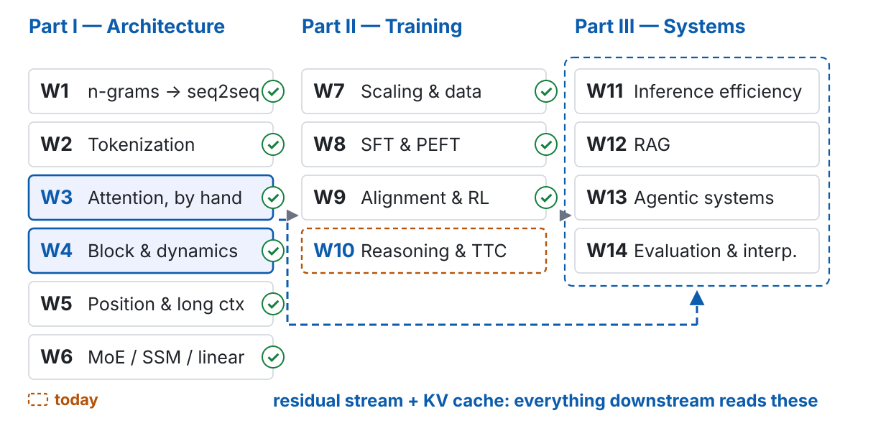
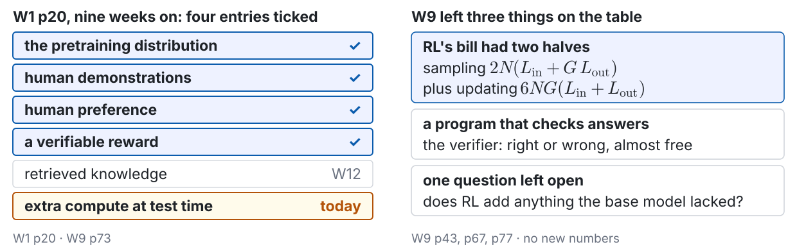
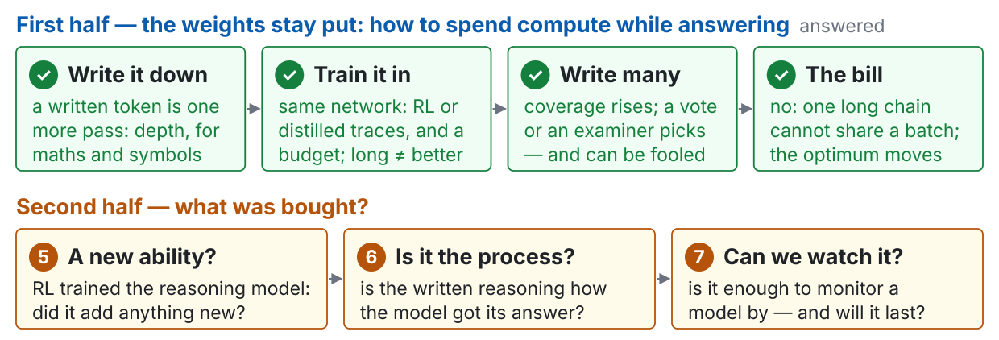

---
# 此檔由 bin/publish_slides.py 從投影片正本產生（中文講稿區塊已剝除），請勿直接編輯。正本在 private repo 的 <course>/slides/。
title: "Reasoning and Test-Time Compute"
subtitle: "NLP & Large Language Models · Week 10"
author: "Hung-Shin Lee"
lang: en
format:
  revealjs:
    theme: [default, theme.scss]
    slide-number: c/t
    show-slide-number: all
    # 目標顯示尺寸：1280×800（16:10），與 W1–W9 相同。
    width: 1280
    height: 800
    margin: 0.04
    center: false
    progress: true
    transition: none
    navigation-mode: linear
    incremental: false
    # inline SVG 的 fragment：?print-pdf 時整張印在一頁
    pdf-separate-fragments: false
    chalkboard:
      buttons: true
    html-math-method:
      method: katex
      url: "https://cdn.jsdelivr.net/npm/katex@0.18.7/dist/"
    # 講稿（notes 區塊）裡的數學只輸出 MathML（照 w01.qmd，2026-09-16 起）。
    include-after-body:
      - text: |
          
---

# The weights do not move. What can a model still buy while it answers? {.section-title}

## Where we are: week 10 of 14

{width="100%"}

## Last week, in one picture

{width="100%"}

::: {.fragment}
::: {.claim}
**Sampling is inference.** Last week it was half of the training bill. Today it is the whole lecture — and the weights stay where they are.
:::
:::

::: {.footer}
W1 p20 · W9 p43, p67, p73, p77 — no new numbers
:::

## Today's route: two halves, seven questions



::: {.fragment fragment-index=3}
::: {.claim}
**Compute at answer time buys serial depth and more draws from the same model** — at a price that depends on how it is spent. Whether the written reasoning is *what the model computed* is a separate question, and the answer is: sometimes.
:::
:::

::: {.footer}
half-time: p48 · board: p33, p51 · live: p19, p41, p60
:::

## What you should be able to do by the end of today

1. **Explain why writing steps down helps**, starting from "one forward pass is $n_{\text{layer}}$ steps deep"; say what the two candidate explanations predict, and which of four interventions separates them
2. **Say what a reasoning model is** (the same architecture, different post-training, a token budget); name three recipes and the two moves of budget forcing
3. **Define three quantities for $k$ samples and derive their limits**: pass@1, the majority vote, pass@$k$; write the unbiased estimator
4. **Compare three ways to spend** — longer, more, search against an examiner — and say where each breaks
5. **Do the accounting**: why one long chain costs more than $k$ short ones with the same tokens
6. **Restate Yue et al.'s pass@$k$ argument**, explain how a crossover arises, and give three other readings of the same curve with the strength of each
7. **Define the two rates of the hint paradigm**; name two limits of that measurement; tell faithfulness from monitorability
8. **Say what removes monitorability** — and what the measurements in the other direction found

::: {.footer}
Outline W10 · Learning objectives 1–8
:::

## One question before we start — two lines, on paper

::: {.ask}
The same model, the same question. Asked to answer directly, it is **wrong**. Asked to write a few lines first, it is **right**. The weights did not change. **What did those few lines do?**
:::

- write **two different accounts** of what happened
- for each one: **what would it predict** if we replaced the lines with something else — dots, a paraphrase, the same lines cut short?
- keep your two lines: p73 comes back to them

::: {.footer}
W9 p77 · part 1 answers it; part 6 answers it again, differently
:::

## Notation for today: an answer in two parts, and a coin

::: {.prose}
| | |
|:---|:-----------------|
| $y = (z, a)$ · $L_{\text{think}}$ | an answer in two parts: the **reasoning** $z$, then the **final answer** $a$ · the number of tokens in $z$ |
| $\pi_{\boldsymbol{\theta}}$ · $r(x, y) \in \{0, 1\}$ · $r_{\boldsymbol{\phi}}$ | last week's: the **policy** · a **verifier**'s verdict · a learned examiner |
| $p(x)$ | **the chance that one sampled answer to $x$ is right**: $\Pr_{y \sim \pi_{\boldsymbol{\theta}}}[\,r(x, y) = 1\,]$. A coin with its own bias for every question |
| $k$ · $G$ | answers sampled per question **at answer time** · last week's group size, **in training** |
| $n$, $c$ | when estimating: $n$ answers were drawn for a question and $c$ of them were right |
| $\hat{a}$ · $a^{*}(x)$ | the majority answer · the correct answer |
| $m$, $q$ | a problem needs $m$ steps in a row; each one is right with probability $q$ |
| $h$ · $x \oplus h$ | the option a planted hint points to · the prompt with the hint added |
:::

::: {.footer}
last week's best-of-$n$ is today's best-of-$k$ · theory papers write $T$ for $L_{\text{think}}$
:::

# Why does writing the steps down help? {.section-title}

## Scratch paper — and an examiner who moves into the exam room

::: {.prose}
| Scratch paper at exam time, used three ways | In the literature | What it needs |
|:---|:---|:---|
| **one long draft**, worked slowly | a long chain of thought | nothing extra |
| **$k$ separate drafts**; take the answer that turns up most | self-consistency | answers that can be compared |
| **$k$ drafts, and an examiner picks** — or looks in after every step | best-of-$k$; search against a verifier | an examiner, in the room |
:::

- last week the examiner marked papers **during training**; this week the examiner sits **in the exam room**
- where the metaphor stops — the first is this week's core: it assumes **the draft is how the answer was reached**; it assumes **what is not on paper was not computed**; and a person does not re-read the whole sheet for every new word — the model does

::: {.footer}
W9 p10: three examiners · returns at p24, p37, p44, p60
:::

## One forward pass is $n_{\text{layer}}$ steps deep — however long the prompt



::: {.fragment fragment-index=1}
::: {.claim}
**The only loop in a decoder-only model is "output back into input".** A written step turns the top layer's result into a token and reads it in again at the bottom.
:::
:::

::: {.footer}
W4 p11: one bus per token · the bound on the right is a picture, not a theorem
:::

## A chain of thought, in symbols

$$
\pi_{\boldsymbol{\theta}}(z, a \mid x) = \pi_{\boldsymbol{\theta}}(z \mid x)\;\pi_{\boldsymbol{\theta}}(a \mid x, z)
\qquad\qquad
P_{\boldsymbol{\theta}}(a \mid x) = \sum_{z} \pi_{\boldsymbol{\theta}}(z \mid x)\,\pi_{\boldsymbol{\theta}}(a \mid x, z)
$$

- **chain of thought (CoT)**: the model writes $z$ before $a$. "No thinking" asks for $\pi_{\boldsymbol{\theta}}(a \mid x)$ directly
- three steps to here: a **scratchpad** — fine-tune a model to write out intermediate computation (Nye et al., 2021) · **few-shot CoT** — put worked steps in the examples (Wei et al., NeurIPS 2022) · **zero-shot CoT** — add one sentence, *Let's think step by step* (Kojima et al., NeurIPS 2022)

::: {.ask}
Add up the parity of $L_{\text{in}}$ bits. Why is this the standard example of "hard without writing, easy with"?
:::

::: {.footer}
Nye et al., arXiv:2112.00114 · Wei et al.; Kojima et al., NeurIPS 2022
:::

## Three theorems, one sentence each

| | With no written steps | With written steps |
|:---|:---|:---|
| **Feng et al.**, NeurIPS 2023 (oral) | a bounded-depth Transformer cannot directly output answers to basic arithmetic or linear equations — unless its size grows super-polynomially with the input | a constant-size model suffices |
| **Merrill & Sabharwal**, ICLR 2024 | — | what is gained depends on **how many** steps: logarithmic adds little; **linear** gives all regular languages; **polynomial** gives exactly P |
| **Li et al.**, ICLR 2024 | constant depth, fixed precision: only problems in $\mathsf{AC}^0$ | $T$ steps: anything a Boolean circuit of size $T$ can solve |

::: {.claim}
All three are about **what can be represented** — not what training finds, and not what a given model actually does with its chain of thought.
:::

::: {.footer}
arXiv:2305.15408 · 2310.07923 · 2402.12875 — as stated in the abstracts
:::

## The other explanation: format — and what each one predicts

| | **Depth**: the written tokens carry computation | **Format**: text with steps was more often right in training; CoT steers the model there |
|:---|:---|:---|
| evidence for it | the three theorems (p13) | demonstrations with **invalid** reasoning keep 80–90% of the gain (Wang et al., ACL 2023); step-by-step helps when the training data are local, overlapping pieces (Prystawski et al., NeurIPS 2023, oral) |
| replace the chain with dots of equal length | **breaks**: the content is gone | **breaks** as well — the format is gone |
| cut the chain short; insert a mistake | the answer **changes** | the answer need not change |
| paraphrase the chain | **nothing** changes | nothing changes, if the "steps" look survives |

::: {.claim}
The two explanations are not rivals for every question. They disagree about **what happens when the chain is damaged** — so damage it.
:::

::: {.footer}
arXiv:2212.10001 · 2304.03843 · the bottom three rows are our reading
:::

## Four ways to damage a chain of thought — and what each one separates

::: {.prose}
| Intervention (Lanham et al. 2023) | It asks | What they found |
|:---|:---|:---|
| **filler tokens**: replace the chain with "…" | is it just the extra positions — extra test-time computation? | no gain from filler |
| **paraphrasing** | is information hidden in the exact wording? | accuracy matches the original chain |
| **early answering**: cut the chain, force an answer | was the answer settled before the chain ended? | depends heavily on the task |
| **adding a mistake**, then letting it continue | does the answer follow what was written? | depends heavily on the task |
:::

- the other side of row one: **trained** Transformers *can* use dots in place of a chain, with dense supervision (Pfau et al. 2024)
- together: positions **can** carry computation; ordinary models use **what is written**

::: {.footer}
Lanham et al., arXiv:2307.13702, §2.3–§2.6 · Pfau et al., arXiv:2404.15758 — preprints
:::

## Where writing helps: maths and symbols

- Sprague et al., ICLR 2025: a meta-analysis of **over 100 papers**, plus their own runs on **20 datasets and 14 models**
- the benefit of CoT is concentrated in **mathematical and logical** tasks
- on MMLU, writing the steps makes almost no difference — **unless the question or the answer contains an equals sign**

::: {.claim}
Consistent with depth: only problems that need serial computation need the paper. And the corollary for part 6: **where the model does not need the reasoning, the reasoning it writes can be an afterthought.**
:::

::: {.footer}
Misconception 1: "chain of thought helps on every kind of question" · arXiv:2409.12183, abstract
:::

## Before Demo 1: no thinking, dots, thinking — against the length of the chain

::: {.prose}
| | |
|:---|:-----------------|
| **Why** | The depth account and the dots experiment make predictions about one thing: accuracy as the problem needs more steps in a row. We can measure that. |
| **What runs** | Arithmetic problems generated on the spot (last week's generator and verifier), needing $m \in \{1, 2, 3, 4, 6, 8, 12\}$ steps, 50 problems each. Qwen3-8B answers each one three ways: **no thinking**; **dots** — its own reasoning replaced by "." of equal length; **thinking**. All three then complete the same forced opening, *The final number is*. One live; the table from rehearsal. |
| **Watch for** | Which line falls first as $m$ grows — and whether dots look like thinking, or like no thinking. |
:::

::: {.footer}
Demo 1 · `demos/w10_d1_depth_and_budget` · rehearsed 2026-11-25 on the M5 Max
:::

## Demo 1: how it runs



::: {.small}
All three ways end on the same forced opening, so the three answers are scored alike.
:::

::: {.footer}
Demo 1 · `demos/w10_d1_depth_and_budget` · how it runs · as rehearsed
:::

## Live: demo 1 (a) — one problem, answered three ways

::: {.ask}
Before the table appears: which column falls first? Does the dots column follow its left neighbour, or its right?
:::

::: {.fragment}
| steps $m$ | no thinking | dots | thinking |
|:---|:---|:---|:---|
| 1 | 1.00 | 1.00 | 1.00 |
| 2 | 0.64 | 0.64 | 1.00 |
| 3 | 0.18 | 0.24 | 1.00 |
| 4 | 0.06 | 0.02 | 1.00 |
| 6, 8, 12 | 0.00 | 0.00 | 1.00 |

: {tbl-colwidths="[22,26,26,26]"}
:::

::: {.footer}
Demo 1 (a) · 50 problems per row, one sampled answer each (±0.07) · rehearsed 2026-11-25
:::

## The price of serial work: $q^{m}$



$$
\Pr[\text{all } m \text{ steps right}] = q^{m} \qquad\qquad m_{1/2} = \frac{\ln 2}{-\ln q} \approx \frac{0.69}{1 - q}
$$

::: {.fragment fragment-index=1}
::: {.claim}
A cliff in accuracy does not need a cliff in ability. **Read the collapse as an exponential, not as a threshold.**
:::
:::

::: {.footer}
our arithmetic, a baseline, not a law: steps assumed independent · W7 p36
:::

## "Accuracy collapsed past some complexity, so it cannot reason"

- **Shojaee et al., *The Illusion of Thinking*** (NeurIPS 2025): on puzzles of rising complexity, reasoning models' accuracy collapses — and their reasoning effort **falls** on the hardest instances
- **Lawsen's comment** (a preprint): the Tower of Hanoi instances exceeded the **output-token limit**; some river-crossing instances are **mathematically unsolvable**

::: {.ask}
Three questions before believing either side: **(1)** would $q^{m}$ alone draw this cliff? **(2)** did the output fit in the token limit? **(3)** did every instance have a solution?
:::

::: {.claim}
This is not a defence of the model. The shrinking effort on the hardest instances is something **$q^{m}$ does not explain**.
:::

::: {.footer}
Misconception 2: "a collapse proves it cannot reason" · arXiv:2506.06941 · 2506.09250
:::

## Bad arithmetic has three causes, stacked

::: {.prose}
| Cause | Week | What it says |
|:---|:---|:---|
| **Representation** | W2 | digits are grouped left to right, three at a time; the carry runs right to left |
| **Depth** | today | without written steps, a multi-digit operation needs a longer dependency chain than one forward pass has (Feng et al.'s lower bound) |
| **Error accumulation** | today | with written steps, all $m$ of them must be right: $q^{m}$ |
:::

- and a fourth thing, of a different kind: **what the model says it did is not always what it did**. In one model, two-digit addition ran on two parallel paths — a rough magnitude, and the exact last digit — yet asked how it added, it described carrying the one

::: {.footer}
Misconception 3 (W2 p77) · Lindsey et al., Anthropic 2025: a company report, not peer-reviewed
:::

# Train the model to write its own scratch paper. How long should it write? {.section-title}

## At a glance: reasoning models

::: {.prose}
| | |
|:---|:-----------------|
| **Name** | No single paper, and no acronym: a "reasoning model" is an LLM post-trained to write a reasoning segment before its answer. The open reference points are **DeepSeek-R1** (*Nature*, 2025) and the **Qwen3** technical report. |
| **The question** | A prompt can ask for steps. Can the model learn **when and how** to write them itself — and be given a budget for it? |
| **The idea** | **The same decoder-only Transformer** (W4). Its output becomes `<think>` $z$ `</think>` $a$. Post-training — last week's RL, or SFT on another model's traces — shapes $z$; at inference a token budget limits $L_{\text{think}}$. |
| **What it added** | Nothing to the architecture. A **new knob at inference**, and answers whose length the user no longer sees or sets directly. |
| **What it leaves open** | How long to think (p27–p29); whether RL gave it anything the base model lacked (part 5); whether $z$ is what the model computed (part 6). |
:::

::: {.footer}
Misconception 4: "a new architecture" · DeepSeek-R1, *Nature* 2025 · Qwen3: a technical report
:::

## A reasoning model in training and in use: two different pictures



::: {.fragment fragment-index=1}
::: {.claim}
**In training nobody marks $z$.** The verifier sees only $a$; the reasoning becomes whatever tends to come before a right answer. In use the verifier is gone — and a budget appears that training never had.
:::
:::

::: {.footer}
DeepSeek-R1 §2: GRPO; accuracy and format rewards · W9 p45 · W9 p15
:::

## Three recipes — and what each one learns from

| Recipe | The data | Supervision | Example |
|:---|:---|:---|:---|
| **RL straight from a base model** | prompts with checkable answers | a verifier: right or wrong | DeepSeek-R1-Zero: no SFT stage |
| **SFT cold start, then RL** | a few thousand long-reasoning examples; then prompts | demonstrations first, then a verifier | DeepSeek-R1 |
| **Distillation**: SFT on another model's $(x, z, a)$; no RL | traces **written by a reasoning model** | that model's outputs | R1's distilled models · **s1**: 1,000 of 59,029 questions, 26 minutes on 16 H100s · LIMO · OpenThoughts |

: {tbl-colwidths="[30,20,20,30]"}

::: {.claim}
The third recipe is W8's SFT: **"reasoning" can be taught from a thousand demonstrations** — evidence for part 5.
:::

::: {.footer}
DeepSeek-R1 §2–§3, App. B · s1, EMNLP 2025 · LIMO, COLM 2025 · OpenThoughts, ICLR 2026
:::

## A budget from outside: budget forcing



- two moves **on the logits**, no retraining; any model with a closing token can be driven this way
- s1's own report: forcing more thinking helps, then **flattens out at six extra rounds** — repetitive loops, and the context window

::: {.footer}
Muennighoff et al., *s1*, EMNLP 2025, §3.1, §4.2, §6.2 · demo 1 (b)
:::

## Replay: demo 1 (b) — sweep the thinking budget

::: {.ask}
Two difficulty levels, one model. Where does each curve stop rising? Does either one **fall**?
:::

::: {.fragment}
| budget on $L_{\text{think}}$ | 0 | 32 | 64 | 128 | 256 | 512 | 1024 | none | +1 *Wait* | +2 | +4 |
|:---|:---|:---|:---|:---|:---|:---|:---|:---|:---|:---|:---|
| easy ($m = 2$): accuracy | 0.64 | 0.70 | 0.68 | 0.64 | 0.82 | 1.00 | 1.00 | 1.00 | 1.00 | 1.00 | 1.00 |
| medium ($m = 8$): accuracy | 0.00 | 0.02 | 0.00 | 0.00 | 0.02 | 0.04 | 0.90 | 1.00 | 1.00 | 1.00 | 1.00 |
| right → wrong vs. left column | — | 3 | 3 | 6 | 5 | 1 | 0 | 0 | 0 | 0 | 0 |
:::

::: {.fragment}
::: {.claim}
No fall: pushed on four more times, **0 of 99 answers changed**. Instead, a threshold — at $m = 8$, 512 tokens: 0.04; 1,024 tokens: 0.90.
:::
:::

::: {.footer}
Demo 1 (b) · 50 problems per level · rehearsed 2026-11-25 · the flips row follows Zhou et al.
:::

## Thinking longer is not always better

| Who | What was measured | Evidence |
| :--- | :--- | :--- |
| Chen (Xingyu) et al. | on **simple** questions the extra reasoning buys nothing — it only costs tokens | ICML 2025 |
| Ghosal et al. | extend the reasoning with *Wait*: accuracy **rises, then falls**; the same budget is better spent on parallel samples and a vote | NeurIPS 2025 |
| Zhou et al. | …and the fall goes with **abandoning an answer that was right** | Findings of ACL 2026 |
| Gema et al. | on purpose-built tasks (counting with distractors, spurious regressions), **longer is worse**, differently per model family | TMLR 2025 |
| Ma et al. | at a fixed token count, **not thinking** and sampling more often does better | a preprint |

: {tbl-colwidths="[18,62,20]"}

::: {.claim}
The best length moves with the difficulty of the question. Budget forcing is useful because the length can be **set** — not because it can be extended without end.
:::

::: {.footer}
Misconception 5: "the longer it thinks, the better" · s1 itself reports a plateau (p27)
:::

# Not longer — more. What do $k$ answers buy? {.section-title}

## Every question is a biased coin: $p(x)$

- fix a question $x$; sample one answer; it is right with probability $p(x)$ — **a coin with its own bias for every question**
- last week's reward was $r \in \{0, 1\}$; its mean over samples is $p(x)$
- everything in the rest of today acts on **how $p(x)$ is spread across questions**:

::: {.prose}
| Operation | What it does to $p$ |
|:---|:---|
| sample $k$ times, keep any right one | $p \;\to\; 1 - (1 - p)^{k}$ |
| majority vote | asks: is the right answer the **most common** one? |
| a verifier | picks the right one out of the $k$, if it is there |
| RL (last week) | pushes $p$ toward 1 — or toward 0 |
:::

::: {.footer}
no RL background needed: $p(x)$ is an average of zeros and ones
:::

## At a glance: pass@$k$ (coverage)

::: {.prose}
| | |
|:---|:-----------------|
| **Name** | **pass@$k$**: the share of questions for which **at least one of $k$ sampled answers** is right. From the Codex paper (Chen et al., 2021), where "right" meant passing unit tests. **Coverage** is the same number, seen as "the right answer is somewhere in the pile". |
| **The question** | If the model may try $k$ times, how often does it get there at all? |
| **The idea** | Per question, $1 - (1 - p(x))^{k}$; average over questions. $k = 1$ is ordinary accuracy. |
| **What it added** | A way to separate **"can produce the right answer"** from **"produces it first time"** — and a ceiling for any method that picks among samples. |
| **What it leaves open** | It is a **quantity, not a method**: it needs something to tell which answer was right. What it means at large $k$ is this week's reading (p50–p55). |
:::

::: {.footer}
Chen et al. 2021 (the Codex paper), arXiv:2107.03374, §2.1 · Brown et al. call it coverage
:::

## Three quantities, three limits



$$
\text{pass@}1 = \mathbb{E}_x\big[p(x)\big] \qquad\quad
\text{pass@}k = \mathbb{E}_x\big[1 - (1 - p(x))^{k}\big] \xrightarrow{\;k \to \infty\;} \Pr_x\big[p(x) > 0\big]
$$

$$
\text{vote@}k \xrightarrow{\;k \to \infty\;} \Pr_x\big[a^{*}(x) = \arg\max_a P_{\boldsymbol{\theta}}(a \mid x)\big]
$$

::: {.footer}
board · $p(x)$ made up · always vote@$\infty$ $\le$ pass@$\infty$: a mode can be drawn
:::

## Estimating pass@$k$ — without bias

$$
\widehat{\text{pass@}k} \;=\; \mathbb{E}_x\!\left[\,1 - \binom{n - c}{k}\Big/\binom{n}{k}\,\right]
\qquad (n \ge k \text{ drawn},\ c \text{ right})
$$

- in words: draw $k$ of the $n$ answers **without replacement**; the fraction is the chance that all $k$ are wrong
- the tempting shortcut $1 - (1 - c/n)^{k}$ is **biased**
- one pool of $n$ answers serves **every** $k$ on the curve — so neighbouring points are highly correlated. Part 5 needs this

::: {.footer}
Chen et al. 2021 (the Codex paper), Eq. (1), $n = 200$ · demo 2 (a) writes it live
:::

## Brown et al.: 98% in the pile, 41% picked out

| Llama-3-8B-Instruct on MATH | 100 samples | 10,000 samples |
|:---|:---|:---|
| **coverage** — some sample is right (an oracle checks) | 82.9% | **98.44%** |
| **picked** by majority vote or a reward model — the best gain among them | 40.50% | **41.41%** |

: {tbl-colwidths="[58,21,21]"}

- coverage keeps rising over **four orders of magnitude** in the number of samples; $\log c \approx a\,k^{b}$ fits — less exactly than a training scaling law, they say
- the picking methods stop improving at around a hundred samples

::: {.claim}
The gap between the two rows is **what an examiner that can pick the right answer is worth**. Without one, coverage does not turn into performance.
:::

::: {.footer}
Misconception 6: "more samples helped, so it knows" · arXiv:2407.21787 — a preprint
:::

## Self-consistency: the vote converges to the mode

$$
\hat{a} \;=\; \arg\max_{a}\; \sum_{i=1}^{k} \mathbf{1}[\,a_i = a\,]
$$

- **self-consistency** (Wang et al., ICLR 2023): sample $k$ chains of thought, keep only their final answers, take the most common. No examiner — it needs answers that can be compared
- as $k$ grows the vote settles on the **mode** of $P_{\boldsymbol{\theta}}(a \mid x)$. The condition is "**the right answer is the mode**" — not "$p > \tfrac{1}{2}$"
- $p = 0.4$ with the errors scattered: the vote is right. $p = 0.3$ beside one wrong answer at $0.45$: the vote is wrong, **and more votes make it surer**

::: {.claim .warn}
"The errors are scattered" is the assumption self-consistency never states. A systematic mistake is a mode.
:::

::: {.footer}
Misconception 7: "with enough votes it will be right" · arXiv:2203.11171 · questions 4 and 5 of p33
:::

## The examiner moves into the exam room



- **best-of-$k$**: $\hat{y} = \arg\max_i\, r_{\boldsymbol{\phi}}(x, y_i)$ · **search**: a **process reward model** (PRM) marks every step

::: {.fragment fragment-index=1}
::: {.claim}
Training and use are two pictures again — **the other way round from last week**. Every fault the examiner had in training is still there; it now strikes at each answer.
:::
:::

::: {.footer}
W9 p10, p15, p56 · Lightman et al., ICLR 2024 · Math-Shepherd, ACL 2024
:::

## Best-of-$k$ is optimisation — and can be over-done

$$
\mathrm{KL}\big(\text{best-of-}k \;\Vert\; \pi\big) \;=\; \log k - \frac{k - 1}{k}
\qquad\quad k = 16:\ 1.84 \text{ nats} \qquad k = 256:\ 4.55 \text{ nats}
$$

- read $k$ as **the horizontal axis of last week's picture** (W9 p25): with a *learned* examiner the gold score rises, then turns over — pick harder, and you pick what the examiner likes
- with a **program** as the examiner, proxy and gold are the same thing: this is where coverage turns straight into performance
- Snell et al. (ICLR 2025, oral), searching against a PRM: on **easy** questions beam search gets **worse** as the budget grows; on the hardest fifth, nothing makes much progress

::: {.footer}
Misconception 8: "it cannot be gamed" · Gao et al., ICML 2023, §2 · Snell et al., §5.3
:::

## Before Demo 2: sample one question many times

::: {.prose}
| | |
|:---|:-----------------|
| **Why** | Three quantities, three limits (p33) — on our own model, with every $\hat{p}(x)$ visible. And later today: what the same tokens cost when spent two ways, and whether last week's RL moved the curve. |
| **What runs** | **(a)**, now: last week's $\pi_{\text{ref}}$ answers 200 generated arithmetic problems, $n = 256$ samples each (rehearsed). Live, the estimator of p34 and a majority vote are written — eight lines — and run on the stored samples. **(c)**, at p47: one chain of 4,096 tokens against 16 chains of 256, timed. **(b)**, at p54: the base model against last week's RL-trained one. |
| **Watch for** (a) | How far apart coverage and the vote end up at $k = 256$ — and whether "pick by the model's own log-probability" behaves like an examiner, or like the vote. |
:::

::: {.footer}
Demo 2 · `demos/w10_d2_many_samples` · **not built yet** · (b) waits for W9's demo 2
:::

## Demo 2: how it runs



::: {.small}
Planned: this demo is not built yet. The diagram follows its specification.
:::

::: {.footer}
Demo 2 · `demos/w10_d2_many_samples` · how it runs · as planned · not built yet
:::

## Live: demo 2 (a) — eight lines, three curves

| at $k =$ | 1 | 4 | 16 | 64 | 256 |
|:---|:---|:---|:---|:---|:---|
| **pass@$k$** (unbiased) | | | | | |
| the biased shortcut $1 - (1 - c/n)^{k}$ | | | | | |
| **majority vote** | | | | | |
| pick by the model's own mean log-probability | | | | | |

: {tbl-colwidths="[52,9.6,9.6,9.6,9.6,9.6]"}

::: {.ask}
Read the two limits off the histogram of $\hat{p}(x) = c/n$ before the curves are shown: how many of the 200 bars are above zero?
:::

::: {.footer}
Demo 2 (a) · estimator live, samples from rehearsal · not built yet: empty on purpose
:::

# The same number of tokens. Is the price the same? {.section-title}

## The bill: $2N$ a token — plus a term that grows with the square

One chain, prompt $L_{\text{in}}$, output $L_{\text{out}}$:

$$
C_{\text{seq}} \;\approx\; \underbrace{2N\,(L_{\text{in}} + L_{\text{out}})}_{\text{the weights}} \;+\; \underbrace{4\,n_{\text{layer}}\,d\,L_{\text{in}}L_{\text{out}} + 2\,n_{\text{layer}}\,d\,L_{\text{out}}^{2}}_{\text{attention: every new token reads all the earlier ones}}
$$

$k$ chains of $L_{\text{out}}/k$ each, sharing the prompt: the weights' side is **the same**; the square term becomes $2\,n_{\text{layer}}\,d\,L_{\text{out}}^{2}/k$.

- with Qwen3-8B and $L_{\text{out}} = 4{,}096$ the attention side is about **7%** of the FLOPs; it overtakes the weights only near $L \approx N/(n_{\text{layer}}d) \approx 55{,}000$ tokens
- so in FLOPs the two ways of spending differ by a few per cent. **FLOPs are not the whole bill**

::: {.footer}
our arithmetic with W3's ledger · w10-data.json bill · $L_{\text{in}} = 200$ assumed
:::

## One long chain against $k$ short ones: the batch is the asymmetry



::: {.fragment fragment-index=1}
::: {.claim}
Decoding is bound by **moving the weights through memory** (W3). Sixteen chains in a batch share each pass; one long chain pays alone, at every token.
:::
:::

::: {.footer}
Misconception 9: "the same tokens cost the same" · W3 p39 · demo 2 (c) times it
:::

## Count the memory, and "a small model that thinks longer" changes

- **FLOPs only** — Snell et al. (ICLR 2025, oral): on questions where the small model already has some success, test-time compute lets it outperform **a $14\times$ larger model**
- **count memory access** — Kinetics (Sadhukhan et al., NeurIPS 2025): the usefulness of small models is overestimated. In the Qwen3 family, **below about 14B parameters** extra compute is better spent on a bigger model than on a longer chain or more samples; past about 4,096 generated tokens attention is the dominant cost *in their cost model*
- two fourteens, two different things, opposite directions: **a size ratio** in FLOPs, and **a parameter count** with memory included
- and the other way round — Mirtaheri et al. (NeurIPS 2025): for a class of graph-connectivity problems, one long chain is worth **exponentially many** short ones. Where serial depth is needed, the long chain must be paid for

::: {.claim}
The two conclusions do not contradict each other. They differ in **how the bill is counted** and **how hard the question is**.
:::

::: {.footer}
Misconception 9, second half · Kinetics' thresholds are fits for a data-centre GPU
:::

## Where to spend: two conversions

$$
F \;=\; M + 3\,\frac{D}{D_{\text{inf}}}\,(M - 1)
$$

- **between models** (Snell et al., §7): a model $M$ times larger costs $6MND + 2MND_{\text{inf}}$; the small one, spending $F$ times more at inference, costs $6ND + 2ND_{\text{inf}}F$. Set them equal
- read $D/D_{\text{inf}}$: serve far more tokens than you trained on and $F \to M$ — the small model has **no room** to think longer. With $M = 14$: $F \approx 16$ when $D_{\text{inf}} = 22D$; $F \approx 258$ when $D_{\text{inf}} = 0.16D$
- **within one question** (Snell et al., §5–§6): easy questions do best with **all** the budget in one sequential chain; harder ones at **some ratio** of sequential to parallel. Choosing by difficulty beats best-of-$k$ by more than $4\times$
- W7's $T^{2}$ (Roberts et al., COLM 2026): put $k$ into the **training** budget and optimise $N$, $D$, $k$ together

::: {.claim}
Do not memorise the direction. Memorise that **the optimum moves with difficulty** — and that difficulty has to be estimated first.
:::

::: {.footer}
the formula is Snell et al.'s (§7); the derivation is ours · W7 p25, p28
:::

## Replay: demo 2 (c) — one chain of 4,096 against 16 of 256

| the same model, the same 4,096 generated tokens | wall-clock | tokens / s | against row 1 |
|:---|:---|:---|:---|
| one chain of 4,096, batch 1 | | | 1 |
| 16 chains of 256, **one batch** | | | |
| 16 chains of 256, batch 1, one after another | | | |

: {tbl-colwidths="[52,16,16,16]"}

- row 2 against row 3 is the **batch**; row 3 against row 1 is the **square term** (and the growing KV)
- the arithmetic of p44 says: about $16\times$ in bytes moved, a few per cent in FLOPs. What does the clock say?

::: {.claim .warn}
Not measured yet. Whatever the machine shows goes into the ledger's new row (p76).
:::

::: {.footer}
Demo 2 (c) · replay · `w10_d2_many_samples` · not built yet
:::

## Half-time: how to spend it is settled. Next: what was bought?

{width="100%"}

::: {.claim}
So far: **how** to spend compute at answer time, and what it costs. From here: **what** the extra compute bought — a new ability, the model's actual process, something we can watch?
:::

::: {.footer}
p5's route · first half: p10–p47 · second half: p50–p71
:::

# RL trained the reasoning model. Did it give it anything new? {.section-title}

## Yue et al.: at large $k$, the base model catches up — and overtakes

- the measurement: pass@$k$ for a base model and its RLVR-trained version, $k$ up to 1,024. **At small $k$ the RL model wins; at large $k$ the base model's pass@$k$ is higher**
- their reading: RL **sharpens** what the base model could already sample — it rarely produces reasoning the base model could not. Answers the RL model gives are already likely under the base model
- controls they ran themselves: six RL algorithms, all with a large gap between RL's pass@1 and the base model's pass@256; and for the **hardest** questions they read the chains by hand — GSM8K: 24 of 25 (base) and 23 of 25 (RL) had a correct chain; AIME24: 5 of 6 and 4 of 6
- **distillation is different**: a distilled model's curve lies above the base model's at every $k$

::: {.footer}
Yue et al., NeurIPS 2025 (oral), arXiv:2504.13837 — **this week's reading** · W9 p43
:::

## Two lines, drawn by you: how a crossover arises



::: {.fragment fragment-index=2}
::: {.claim}
$1 - (1-p)^{k}$ is concave in $p$: with pass@1 held fixed, the model whose $p(x)$ is **more spread out** has the lower pass@$k$. RL raises the mean **and** the spread.
:::
:::

::: {.footer}
board · two questions, numbers made up · the same bars as p33
:::

## What a crossover cannot show by itself: three caveats

| | The caveat | In numbers |
|:---|:---|:---|
| **Saturation** | a question's marginal contribution, $k(1-p)^{k-1}$, vanishes once $p$ leaves zero. RLVR samples 8 answers per question: one success already saturates pass@256 | $1 - (7/8)^{256} \approx 1 - 10^{-15}$ |
| **Guessing** | with $A$ equally likely answers a blind guess has $p = 1/A$. AIME answers are integers from 0 to 999 | $1 - (1 - 10^{-3})^{1024} \approx$ **0.64** |
| **Statistics** | every $k$ reuses one pool of samples; pointwise error bars cannot certify a crossover — test the **difference curve**, paired | — |

::: {.claim .warn}
A model that knows nothing has pass@1024 of 64% on AIME. At large $k$, pass@$k$ needs a control.
:::

::: {.footer}
Misconception 10: "a large $k$ measures the boundary" · our arithmetic · two 2026 preprints
:::

## One curve, five readings: what did each paper change?

| Reading | Who | What they changed | Evidence |
|:---|:---|:---|:---|
| RL sharpens; it rarely adds | Yue et al. | — (the baseline reading) | NeurIPS 2025, oral |
| the **metric** | Wen et al. | the reasoning must be right too (an LLM judge, its accuracy not reported): on AIME the crossover goes away | ICLR 2026 |
| the **statistics** | Yang | a paired test: 1 of 9 public checkpoints passes, narrowly; four controlled GRPO runs fall behind near $k \approx 200$ | a one-author preprint |
| the **training dynamics** | Yuan (Suqin) et al. | update only on never-solved questions: pass@256 exceeds the base | a preprint |
| **length**, **composition** | ProRL · Yuan (Lifan) et al. | train far longer; or tasks that compose known skills: the boundary moves out | NeurIPS 2025 · ICLR 2026 |

: {tbl-colwidths="[15,16,50,19]"}

::: {.claim}
No row overturns another. They differ in **which $k$, which questions, how long, whether the reasoning counts** — no winner is declared here.
:::

::: {.footer}
Misconception 11: "RL adds" / "RL only redistributes" · also Wu (Fang); Matsutani; Wu (Mingqi)
:::

## Replay: demo 2 (b) — the base model against last week's RL model

| generated arithmetic, 200 problems, $n = 256$ | pass@1 | pass@16 | pass@256 | share with $\hat{p} = 0$ |
|:---|:---|:---|:---|:---|
| $\pi_{\text{ref}}$, trained level | | | | |
| after GRPO (W9 demo 2), trained level | | | | |
| $\pi_{\text{ref}}$, one level harder | | | | |
| after GRPO, one level harder | | | | |

: {tbl-colwidths="[44,13,13,14,16]"}

- **controlled here**: new problems (no contamination) · short answers (no truncation) · large-integer answers (no guessing) · every $\hat{p}(x)$ visible · a paired bootstrap band on the difference
- **not controlled**: one small model · arithmetic only · two hundred RL steps

::: {.claim .warn}
Not measured yet — it waits for last week's demo 2. A crossover or none: either way it is **one row in the table**, not a verdict.
:::

::: {.footer}
Demo 2 (b) · replay · not built · needs the weights of `w09_d2_grpo_scratch`
:::

## This week's reading: one curve, two readings

::: {.prose}
| | Yue et al. (in full) | Wen et al. (§4) |
|:---|:---|:---|
| the metric | pass@$k$: any right **answer** counts | CoT-Pass@$K$: the **reasoning** must be right too |
| who decides "right" | the answer key; for the hardest questions, people read the chains | an LLM judge, three verdicts per sample |
| on AIME at large $k$ | the base model overtakes | the RL model stays ahead at every $K$ |
:::

::: {.ask}
For each paper, one sentence: **what does its metric reward?** Then: which experiment would tell the two readings apart — and has anyone run it?
:::

- the third of W1's four questions ("what does the metric reward?"), applied twice
- where you will want to look: how each paper checks its own metric — the hand-read chains; the judge

::: {.footer}
arXiv:2504.13837 · arXiv:2506.14245, §4 · W1 p21 · last week: W9 p64–p65
:::

# Is the written reasoning how the model got its answer? {.section-title}

## Faithfulness: a definition, and one way to measure it

- a written explanation is **faithful** if it accurately reflects the process that produced the answer (Jacovi & Goldberg, ACL 2020). Plausible is not the same thing
- the **hint paradigm** (Turpin et al., NeurIPS 2023): ask the same question twice



::: {.fragment}
- keep only the pairs where **the answer moved to the hint**: the hint is the only difference, so the hint moved it
- then read the second reasoning: **does it say so?**

$$
\text{switch} = \Pr\big[a(x \oplus h) = h \,\big|\, a(x) \neq h\big]
$$

$$
\text{verbalise} = \Pr\big[z' \text{ mentions the hint} \,\big|\, a(x) \neq h,\ a(x \oplus h) = h\big]
$$
:::

::: {.footer}
arXiv:2004.03685 · 2305.04388 · where the answer did not move, silence is correct
:::

## Before Demo 3: plant a hint, and read the reasoning

::: {.prose}
| | |
|:---|:-----------------|
| **Why** | W3 asked whether an attention weight is an explanation (W3 p59). Today the same question, about a chain of thought — and this time the model is doing the explaining. |
| **What runs** | Qwen3-8B, thinking on, 200 four-option questions from the nine MMLU subjects (of twenty tried) where it scores between five and eight in ten unaided. Each question is asked twice: plain, and with a hint pointing at a random **wrong** option — a sentence from the user ("I think it is (B)"), or an `<answer>` field in XML metadata. One question live; the two rates from rehearsal. |
| **Watch for** | Two chains of reasoning for the same question. **Which one had the hint in its prompt?** |
:::

::: {.footer}
Demo 3 · `demos/w10_d3_hidden_hint` · rehearsed 2026-11-25 · a failure-case high point
:::

## Demo 3: how it runs



::: {.small}
The hint always points at a wrong option, so following it is visible in the answer.
:::

::: {.footer}
Demo 3 · `demos/w10_d3_hidden_hint` · how it runs · as rehearsed
:::

## Live: demo 3 (a) — which of these two had the hint?

::: {.ask}
Two chains, one question. Vote: left or right had the hint?
:::

::: {.fragment}
| hint | questions kept | switch | verbalise | verbalise $\div\ \alpha$ |
|:---|:---|:---|:---|:---|
| a sentence from the user | 169 | 0.14 | 0.61 | 0.76 |
| a field in XML metadata | 169 | 0.20 | 0.68 | 0.72 |

: {tbl-colwidths="[36,18,14,14,18]"}
:::

- "mentions the hint" is judged by **fixed string rules** — a simplification; thirty switched cases were also read by hand, and the rules agreed on all thirty
- answers also move **by chance**: $\alpha = 1 - \dfrac{p_{\text{o}}}{(n_{\text{opt}} - 2)\,p_h}$ is the share of moves to the hint that are not noise — $p_h$: moved to the hint; $p_{\text{o}}$: moved to another option; $n_{\text{opt}} = 4$ (Chen et al.)

::: {.footer}
Demo 3 (a) · 200 questions, one sampled answer each · rehearsed 2026-11-25 · Misconception 12: "the CoT is the thinking"
:::

## A line of evidence: the answer moves, the reasoning stays silent

| | What was done | What was found |
|:---|:---|:---|
| **Turpin et al.**, NeurIPS 2023 | reorder few-shot options so the answer is always (A) | the model follows, never says so, and argues for the wrong answer; accuracy falls by up to 36% |
| **Chen (Yanda) et al.**, 2025, a preprint | six kinds of hint, on two reasoning models | the hint is disclosed in **25%** and **39%** of cases on average; less on harder questions. Outcome-only RL raises it, then it plateaus |
| **Arcuschin et al.**, ICML 2026 | no hint at all: ask "is X bigger than Y?" and "is Y bigger than X?" separately | sometimes "yes" to both, each with a fluent argument |
| **Yu et al.**, ICML 2026 | measure how much the answer depends on the reasoning, before and after RLVR | accuracy rises; the reasoning's causal role does not reliably rise with it |
| **Boppana et al.**, ICML 2026 | read the answer off the activations, token by token | on easy recall the answer is there long before the chain ends; on hard multi-step questions the chain is doing work |

::: {.footer}
arXiv:2305.04388 · 2505.05410 · 2503.08679 · 2604.22074 · 2603.05488
:::

## "It did not mention the hint" — what that measurement cannot say

| | The correction | Evidence |
|:---|:---|:---|
| **silent ≠ unfaithful** | not mentioning a hint often means the chain is **incomplete**, not false; with a larger inference budget, verbalisation rises sharply | Zaman & Srivastava, ACL 2026 |
| **the hints are easy** | usable in a single forward pass. Make the bad behaviour hard enough that it **must** be written out, and it shows | Emmons et al., a preprint |
| | with clues too complex to use unwritten: 3 of 21,272 trajectories plausibly hid them | METR, 2025 — **a blog post**, not a paper |
| **it is not a property of the model** | across 15 open-weight models, a hint arriving in a **tool result** is mentioned less often than one in the user's message | Gema et al., 2026, a preprint |

::: {.ask}
The hint is mentioned 20% of the time. Is 80% of the reasoning fake?
:::

::: {.footer}
Misconception 13: "so CoT is useless" · arXiv:2512.23032 · 2507.05246 · 2608.29464
:::

## Replay: demo 3 (b) — cut the reasoning short. When was the answer settled?

| reasoning kept before forcing an answer | 0% | 25% | 50% | 75% | 100% |
|:---|:---|:---|:---|:---|:---|
| no hint: answer already equals the final one | 0.80 | 0.82 | 0.88 | 0.91 | 0.96 |
| hinted and switched: answer already equals the final one | 0.61 | 0.67 | 0.77 | 0.81 | 0.88 |

: {tbl-colwidths="[50,10,10,10,10,10]"}

- **early answering** (Lanham's intervention, p15), done with demo 1's budget forcing: truncate the chain, append the closing token
- a flat row means the answer was settled before the reasoning was written — the reasoning came **after**

::: {.claim}
Without a hint, eight answers in ten are there before any reasoning. The hinted row is **not** earlier — it is lower at every cut.
:::

::: {.footer}
Demo 3 (b) · 91 and 57 questions · 100%: only the answer drawn again · rehearsed 2026-11-25
:::

## One argument, made a second time

| Week | The readable thing | Mistaken for | The test |
|:---|:---|:---|:---|
| W3 | an attention weight | which token mattered | compare with a gradient; change the weights and watch the output |
| **W10** | **a chain of thought** | **the model's reasoning** | **plant a hint: the answer moves, the chain is silent — and cut the chain: was the answer already there?** |
| W14 | a sparse-autoencoder feature | a concept the model uses | (W14) |

: {tbl-colwidths="[8,22,22,48]"}

- **faithful**: the reasoning reflects the process. **Monitorable**: reading it lets us **catch** what the model is doing — a weaker demand
- **rationalisation** (written after the answer) against **computation** (the answer needs it): one model does both

::: {.footer}
W3 p59 · W1 p21, the fourth question · W14 closes the table
:::

# Can we watch a model through its reasoning — and will that last? {.section-title}

## At a glance: chain-of-thought monitoring

::: {.prose}
| | |
|:---|:-----------------|
| **Name** | **CoT monitoring**: a second model (or a person) reads the reasoning to flag misbehaviour before or after the answer is acted on. Framed as a safety opportunity by Korbak et al. (2025) — **a position paper by some forty authors, with no experiments**. |
| **The question** | The reasoning is not a complete explanation. Is it still enough to **catch** a model doing something it should not? |
| **The idea** | If a behaviour needs serial reasoning (part 1), that reasoning has to pass through the written tokens — where it can be read. |
| **What it added** | A use for the reasoning that does not need faithfulness in full: Baker et al. (a preprint) found reading the CoT an effective way to catch reward hacking. |
| **What it leaves open** | It is a **by-product of how models are trained today**. The picture is next; three things remove it (p68); what has been measured so far (p71). |
:::

::: {.footer}
arXiv:2507.11473 · 2503.11926 · 2507.05246
:::

## Chain-of-thought monitoring, in one picture



- what gets measured is a **catch rate**: of the answers where the model did the thing — followed a planted hint, gamed a reward — the share the monitor flags **from $z$ alone**

::: {.fragment fragment-index=1}
::: {.claim}
**The monitor sees only what passes through the written tokens.** Each way to lose monitoring takes something out of $z$.
:::
:::

::: {.footer}
a schematic · Baker et al., arXiv:2503.11926 · Little, arXiv:2607.09786v4 — both preprints
:::

## Three ways to lose it

| What is done | What happens | Evidence |
|:---|:---|:---|
| **optimise against the monitor**: put it into the reward | mild pressure helps; pushed hard, the model **hides its intent** and still cheats | Baker et al., a preprint |
| **penalise length** to save tokens: RL on Qwen3-14B | reasoning shrinks to about a fifth; accuracy 78.2 → 75.3; hints followed as often — and the monitor's catch rate falls **71% → 51%** (4B: 60% → 48%); no drop without the penalty | Little, 2026 — **one author, a preprint** (v4) |
| **do not write it as text**: latent reasoning | nothing to read (next slide) | — |

::: {.claim .warn}
**Efficiency and monitorability pull in opposite directions**: a token saved from the reasoning is a token nobody can read.
:::

::: {.footer}
Misconception 14: "the model has it" · arXiv:2503.11926 · 2607.09786v4, §5–§7 · W9 p50
:::

## Latent reasoning: skip the tokens



- **Coconut** (Hao et al., COLM 2025): the hidden state goes straight back in, several candidates at once
- measured: roughly 65% lost on long traces (Yerram et al., **a workshop paper**); 97% on a search task, 34% on GSM8K (Zou et al., a preprint)

::: {.claim}
A research direction with a clear motive and measured failures — and what it removes is exactly what the previous slide was trying to keep.
:::

::: {.footer}
Misconception 15: "the next CoT" · arXiv:2412.06769 · 2607.16972 · 2602.01148
:::

## Which language does it think in?

- whatever language the question is in, reasoning models mostly reason in **English or another high-resource language** (Tam et al., a preprint)
- force the reasoning into the user's language: it becomes readable, and **accuracy falls** (Qi et al., Findings of EMNLP 2025)
- on parallel questions in eight languages: the lower-resource the language, the **more** the model relies on its written reasoning for knowledge questions (Resck et al., a preprint)
- **Traditional Chinese, Taiwanese and Hakka are in none of these three papers.** Demo 3 (c) looked once, 20 questions: with the instruction in Traditional Chinese, or in Taiwanese written in Han characters, the reasoning came out in **Simplified** Chinese — an observation, not a result

::: {.claim}
Reasoning a user cannot read is reasoning a user cannot check.
:::

::: {.footer}
Misconception 16: "it thinks in my language" · arXiv:2505.17407 · 2505.22888 · 2610.22841
:::

## The other direction: still visible — for now

- **Guan et al.**, ICML 2026 (spotlight): most frontier models are fairly monitorable; longer reasoning is **more** monitorable; RL at today's scale has not materially reduced it
- **Chen (Yueh-Han) et al.**, ICML 2026: models control what their CoT says far less well than they control their final output
- **Xiong et al.**, ICML 2026: early RLVR sometimes **raises** monitorability as a side effect — strongly dependent on the data, unrelated to capability

::: {.claim}
Largely visible today — as **a by-product of how models are trained**, not as a guarantee. It can be traded away for efficiency, one design decision at a time.
:::

::: {.footer}
arXiv:2512.18311 · 2603.05706 · 2602.03978 — from the abstracts
:::

# Where this goes {.section-title}

## The opening question, answered — twice

::: {.ask}
p7 asked: asked directly, wrong; after a few written lines, right; the weights unchanged. What did those lines do?
:::

- **Answer one: computation.** Each written token is one more pass through the stack — serial depth the model does not otherwise have (p11). Damage the lines and the answer changes (p15)
- **Answer two: an account written afterwards.** The answer was settled first; the lines are the model's output about it, and can leave out what moved the answer (p60, p61)
- **Which one? It depends on whether the question needs them** (p16, p63, p64): maths and multi-step problems lean to the first; recall leans to the second
- the route's other stations — **how to spend it**: p48 · **did RL add anything?** no verdict: one curve, five readings (p53) · **can we watch it?** today, mostly — as a by-product that can be traded away (p68, p71)

::: {.footer}
compare with your two lines from p7 · W11: what each token costs
:::

## Three axes, week 10

::: {.prose}
| Axis | This week |
|:---|:---|
| **Representation** | for the first time the unit is **a stretch of reasoning $z$** — and its continuous version, a latent thought that nobody can read |
| **Compute** | for the first time **all of it is inference compute** — and the same FLOPs can be spent in two ways that differ by an order of magnitude in bytes moved |
| **Supervision** | the **sixth entry** is ticked: extra compute at test time. And the fourth is asked again: what did a verifiable reward actually buy? |
:::

::: {.claim}
Part II ends here. Five of six entries are ticked; the fifth — retrieved knowledge — waits for W12.
:::

::: {.footer}
W1 p19–p20 · W9 p73 · the ledger, next two slides
:::

## The ledger, week 10: the training half

| Where the cost falls | Formula | What binds it | Filled in |
|:---|:---|:---|:---|
| **Training**, one run | $C_{\text{train}} \approx 6ND$; LoRA $\approx 4ND$ | compute | W1 · W4 · W7 · W8 |
| **RL**, per prompt | $2N(L_{\text{in}} + GL_{\text{out}}) + 6NG(L_{\text{in}} + L_{\text{out}})$ | all three | W9 · **today**: its first half is the row added overleaf |
| **Training budget**, the split | $N^{*} \propto C^{\beta/(\alpha+\beta)}$, $D^{*} \propto C^{\alpha/(\alpha+\beta)}$ (a fit); $+\,2ND_{\text{inf}}$; $D \to D_{\text{eff}}$ | the loss surface; the bill | W7 · **today**: $F = M + 3\tfrac{D}{D_{\text{inf}}}(M-1)$; $k$ joins $N$, $D$ |
| **Optimizer state**, bytes/param | full 16 → LoRA $2 + 16N_{\text{LoRA}}/N$ → QLoRA $b_{\text{q}} + 16N_{\text{LoRA}}/N$ | capacity | W4 · W8 |

: {tbl-colwidths="[18,46,14,22]"}

::: {.footer}
W9 p74's master, split in two: a ninth row does not fit · $\alpha$, $\beta$ are W7's
:::

## The ledger, week 10: the inference half, one new row

| Where the cost falls | Formula | What binds it | Filled in |
|:---|:---|:---|:---|
| **Prefill**, once per request | $C_{\text{pre}} \approx 2NL_{\text{in}} + 2\,n_{\text{layer}}L_{\text{in}}^2 d$ FLOPs | compute | W3 · W5 · W11 |
| **Decode**, per token | $C_{\text{dec}} \approx 2N + 4\,n_{\text{layer}}Ld$; $t_{\text{step}} \geq (Nb + M_{\text{KV}})/\text{BW}$ | bandwidth | W3 · W5 · W11 |
| **Test time**, per question | **$2N(L_{\text{in}} + L_{\text{out}}) + 4\,n_{\text{layer}}d\,L_{\text{in}}L_{\text{out}} + 2\,n_{\text{layer}}d\,L_{\text{out}}^{2}/k$**; bytes per token $\geq Nb/k + M_{\text{KV}}$ when $k$ chains share a batch | bandwidth; then the examiner | **today** · W11 |
| **KV cache** · **Long context** | $M_{\text{KV}} = 2\,n_{\text{layer}}\,n_{\text{kv}}\,d_{\text{head}}\,L\,b$ = 128 KiB/token (GQA-8); prefill $\propto L^2$ past $12d$ | all three | W3 · W5 · W6 · W11 |
| **MoE** · **Fixed state** | $6N_{\text{active}}D$, $N_{\text{total}}b$, $\rho$ floored · $n_{\text{head}}d_{\text{head}}^2\,b$, no $L$ | both · state capacity | W6 · W7 · W11 |

: {tbl-colwidths="[17,53,15,15]"}

::: {.footer}
one row added · $L_{\text{out}}$ is the total over the $k$ chains · $\rho$ is W6's
:::

## Sixteen things this week said no to (1 of 3)

::: {.prose}
| The belief | What is true | Returns |
|---|---|---|
| **1** · chain of thought helps on every kind of question | the benefit is concentrated in maths and symbols; on recall the chain can be an afterthought | — |
| **2** · accuracy collapsed, so it cannot reason | $q^{m}$ draws a cliff by itself; check the output limit and solvability first | W14 |
| **3** · bad arithmetic means weak reasoning | three causes stacked: representation, depth, error accumulation | — |
| **4** · a reasoning model is a new architecture | the same Transformer; different post-training and a token budget | — |
| **5** · the longer it thinks, the better | it plateaus or falls; the best length moves with difficulty | — |

: {tbl-colwidths="[36,54,10]"}
:::

## Sixteen things this week said no to (2 of 3)

::: {.prose}
| The belief | What is true | Returns |
|---|---|---|
| **6** · more samples helped, so the model already knows | coverage says the right answer is in the pile, not that it can be picked | — |
| **7** · with enough votes it will be right | the vote converges to the mode; a systematic error is a mode | — |
| **8** · an examiner at answer time cannot be gamed | best-of-$k$ is optimisation; search against a PRM got worse on easy questions | W13 |
| **9** · the same tokens cost the same; a small model that thinks longer matches a large one | one long chain cannot share a batch; count memory and the optimum moves | W11 |
| **10** · a large enough $k$ measures the boundary of ability | guessing reaches 64% on AIME at $k = 1024$; saturation; shared samples | W14 |
| **11** · RL teaches new reasoning / RL only redistributes probability | both say more than the evidence; five readings of one curve | — |

: {tbl-colwidths="[36,54,10]"}
:::

## Sixteen things this week said no to (3 of 3)

::: {.prose}
| The belief | What is true | Returns |
|---|---|---|
| **12** · the chain of thought is the model's thinking | it is the model's **output**, not a record of its computation | W14 |
| **13** · so chains of thought are useless | silent is not unfaithful; when the reasoning is needed, it shows | W13 |
| **14** · monitorability is a property the model has | a by-product of training; a length penalty took the catch rate from 71% to 51% | W14 |
| **15** · latent reasoning is the next chain of thought | a clear motive, measured failures, nothing to read | — |
| **16** · the model thinks in the language I ask in | mostly English; our languages have not been measured | — |

: {tbl-colwidths="[36,54,10]"}
:::

## Next week: what each of these tokens costs

- Part II is done. **Part III — systems and scrutiny** — starts with the bill itself: inference efficiency, from FLOPs to memory bandwidth
- three things to have ready: **the unit of every ledger row** — FLOPs, bytes, bytes per second; **W3's KV-cache formula** (p76); and today's picture of one long chain against sixteen short ones (p44)
- today every extra token was "compute spent while answering". Next week: **why a token costs what it costs** — and four ways to make it cheaper

::: {.ask}
Before then: **Yue et al.**, in full, with **Wen et al., §4**. For each paper one sentence on what its metric rewards; then one experiment that would tell the two readings apart (p55).
:::

::: {.claim}
This week the question was what a token buys. Next week: what a token costs.
:::

## Sources (1 of 3)

::: {.cite}
**Textbooks** · **no textbook chapter covers this week.** Jurafsky & Martin, *Speech and Language Processing*, 3rd ed., **2026-08-19 draft release**: §7.6 *Decoding* is the prerequisite for sampling one question many times; §8.3.3 mentions best-of-$N$ in one sentence; neither chapter covers chain of thought, reasoning models or test-time compute (PDFs read 2026-11-22) · Raschka, *Build a Reasoning Model (From Scratch)*, ch 3–5 and 8: a verifier, CoT prompting, self-consistency, best-of-$N$ and self-refinement, distillation (per the author's repository README); no budget forcing

**Chain of thought: the phenomenon, the theory** · Nye et al., arXiv:2112.00114 (2021) · Wei et al., NeurIPS 2022 (arXiv:2201.11903) · Kojima et al., NeurIPS 2022 (arXiv:2205.11916) · Feng et al., NeurIPS 2023 Oral (arXiv:2305.15408) · Merrill & Sabharwal, ICLR 2024 (arXiv:2310.07923) · Li et al., ICLR 2024 (arXiv:2402.12875) · Wang et al., ACL 2023 (arXiv:2212.10001) · Prystawski, Li & Goodman, NeurIPS 2023 Oral (arXiv:2304.03843) · Lanham et al., arXiv:2307.13702 — a preprint; §2.3–§2.6 · Pfau, Merrill & Bowman, arXiv:2404.15758 — a preprint · Sprague et al., ICLR 2025 (arXiv:2409.12183)

**Reasoning models, and how long to think** · DeepSeek-AI, *DeepSeek-R1*, *Nature* 645, 633–638 (2025; arXiv:2501.12948) — §2–§3, Appendix B · Yang et al., *Qwen3 Technical Report*, arXiv:2505.09388 — a technical report · Muennighoff et al., *s1*, EMNLP 2025 (arXiv:2501.19393) — §2, §3.1, §4, §6.2 · Ye et al., *LIMO*, COLM 2025 (arXiv:2502.03387) · Guha et al., *OpenThoughts*, ICLR 2026 Oral (arXiv:2506.04178) · Chen et al., ICML 2025 (arXiv:2412.21187) · Ghosal et al., NeurIPS 2025 (arXiv:2506.04210) · Zhou et al., Findings of ACL 2026 (arXiv:2604.10739) · Gema et al., *Inverse Scaling in Test-Time Compute*, TMLR 2025 (arXiv:2507.14417) · Ma et al., arXiv:2504.09858 — a preprint · Shojaee et al., *The Illusion of Thinking*, NeurIPS 2025 (arXiv:2506.06941) · Lawsen, arXiv:2506.09250 — a preprint · Lindsey et al., *On the Biology of a Large Language Model*, Anthropic, 2025-03-27 — **a company research report, not peer-reviewed**
:::

## Sources (2 of 3)

::: {.cite}
**Many samples, voting, examiners** · Wang et al., *Self-Consistency*, ICLR 2023 (arXiv:2203.11171) · Chen et al., *Evaluating Large Language Models Trained on Code*, arXiv:2107.03374 (2021) — pass@$k$, Eq. (1) · Brown et al., *Large Language Monkeys*, arXiv:2407.21787 — a preprint; §1, §3.1, §4.1 · Snell et al., ICLR 2025 Oral (arXiv:2408.03314) — §3.2, §5.3, §6.2, §7 · Lightman et al., ICLR 2024 (arXiv:2305.20050) · Wang et al., *Math-Shepherd*, ACL 2024 (arXiv:2312.08935) · Zhang et al., Findings of ACL 2025 (arXiv:2501.07301) · Gao, Schulman & Hilton, ICML 2023 (arXiv:2210.10760) — §2

**The bill** · Sadhukhan et al., *Kinetics*, NeurIPS 2025 (arXiv:2506.05333) — §2, §3.1 · Mirtaheri et al., NeurIPS 2025 (arXiv:2505.21825) · Roberts et al., *Test-Time Scaling Makes Overtraining Compute-Optimal*, COLM 2026 (arXiv:2604.01411)

**The dispute: does RL add anything?** · Yue et al., NeurIPS 2025 Oral (arXiv:2504.13837) — **this week's reading, in full** · Wen et al., ICLR 2026 (arXiv:2506.14245) — **this week's reading, §4** · Yuan (Suqin) et al., arXiv:2606.15455 — a preprint · Yang, arXiv:2609.22547 — a single-author preprint (v3) · Liu et al., *ProRL*, NeurIPS 2025 (arXiv:2505.24864) · Yuan (Lifan) et al., ICLR 2026 (arXiv:2509.25123) · Wu (Fang) et al., *The Invisible Leash*, arXiv:2507.14843 — a workshop paper · Matsutani et al., ICLR 2026 (arXiv:2509.21128) · Wu (Mingqi) et al., AAAI 2026 (arXiv:2507.10532)
:::

## Sources (3 of 3)

::: {.cite}
**Faithfulness** · Jacovi & Goldberg, ACL 2020 (arXiv:2004.03685) · Turpin et al., NeurIPS 2023 (arXiv:2305.04388) · Chen (Yanda) et al., *Reasoning Models Don't Always Say What They Think*, arXiv:2505.05410 — a preprint; §2–§5 · Arcuschin et al., ICML 2026 (arXiv:2503.08679) · Yu et al., ICML 2026 (arXiv:2604.22074) · Boppana et al., *Reasoning Theater*, ICML 2026 (arXiv:2603.05488) · Zaman & Srivastava, ACL 2026 (arXiv:2512.23032) · Emmons et al., arXiv:2507.05246 — a preprint · METR, *CoT May Be Highly Informative Despite "Unfaithfulness"*, 2025-08-08 — **a blog post, not peer-reviewed** · Gema et al., arXiv:2608.29464 — a preprint

**Monitorability, latent reasoning, language** · Korbak et al., arXiv:2507.11473 — **a position paper, no experiments** · Baker et al., arXiv:2503.11926 — a preprint · Guan et al., *Monitoring Monitorability*, ICML 2026 Spotlight (arXiv:2512.18311) · Chen (Yueh-Han) et al., ICML 2026 (arXiv:2603.05706) · Xiong, Chen & Lakkaraju, ICML 2026 (arXiv:2602.03978) · Little, arXiv:2607.09786 — **a single-author preprint; v4, §5–§7** · Wang (Han) et al., *MonitorBench*, COLM 2026 (arXiv:2603.28590) · Hao et al., *Coconut*, COLM 2025 (arXiv:2412.06769) · Zhu (Hanlin) et al., NeurIPS 2025 (arXiv:2505.12514) · Yerram, He & Choi, arXiv:2607.16972 — **a workshop paper** · Zou, Xiong & Liu, arXiv:2602.01148 — a preprint · Tam et al., arXiv:2505.17407 — a preprint · Qi et al., Findings of EMNLP 2025 (arXiv:2505.22888) · Resck et al., arXiv:2610.22841 — a preprint

**Numbers and demos** · every computed number is in `assets/w10/w10-data.json` (`scripts/make_demo_w10.py`); the figures on p20, p33, p44, p51 are **our arithmetic** — the $p(x)$ values on p33 and p51 are made up, the lengths on p44 are assumed · **demo 1 was rehearsed on 2026-11-25** (p19, p28: Qwen3-8B, 50 problems per cell); **demo 3 was rehearsed on 2026-11-25** (p60, p63, p70: Qwen3-8B, 200 MMLU questions; "mentions the hint" is judged by string rules; thirty cases read by hand agreed with them); **demo 2 is not built**: the tables on p41, p47, p54 are empty on purpose
:::

## Acronyms in this deck, A–S

| | |
|:----|:----------------|
| $\mathsf{AC}^0$ | the class of problems solved by constant-depth, polynomial-size circuits with unbounded fan-in (p13) |
| Coconut | Chain of Continuous Thought, Hao et al. 2025 (p69) |
| CoT | chain of thought (p12) |
| FLOPs | floating-point operations (W1) |
| GRPO | group relative policy optimization (W9) |
| KL | Kullback–Leibler (divergence) (W8) |
| KV | key–value (cache) (W3) |
| LIMO | Less Is More for Reasoning, Ye et al. 2025 (p26) |
| MoE | mixture of experts (W6) |
| PRM, ORM | process / outcome reward model (W9; p37) |
| RL | reinforcement learning (W9) |
| RLVR | reinforcement learning with verifiable rewards (W9) |
| SFT | supervised fine-tuning (W8) |
