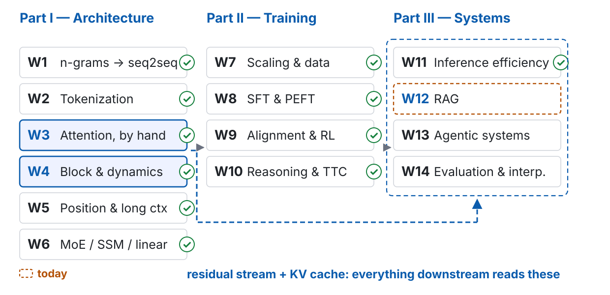
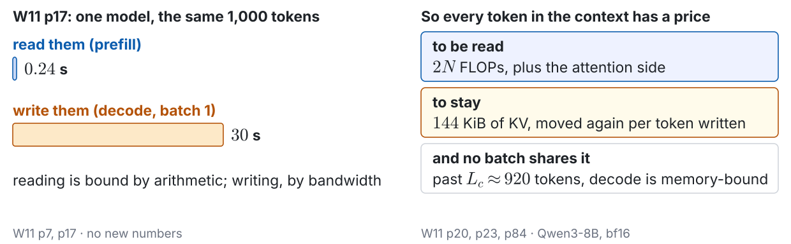
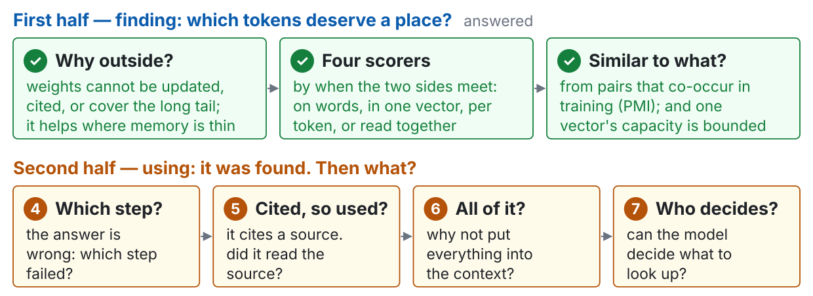

---
# 此檔由 bin/publish_slides.py 從投影片正本產生（中文講稿區塊已剝除），請勿直接編輯。正本在 private repo 的 <course>/slides/。
title: "RAG and Context Engineering"
subtitle: "NLP & Large Language Models · Week 12"
author: "Hung-Shin Lee"
lang: en
format:
  revealjs:
    theme: [default, theme.scss]
    slide-number: c/t
    show-slide-number: all
    # 目標顯示尺寸：1280×800（16:10），與 W1–W11 相同。
    width: 1280
    height: 800
    margin: 0.04
    center: false
    progress: true
    transition: none
    navigation-mode: linear
    incremental: false
    # inline SVG 的 fragment：?print-pdf 時整張印在一頁
    pdf-separate-fragments: false
    chalkboard:
      buttons: true
    html-math-method:
      method: katex
      url: "https://cdn.jsdelivr.net/npm/katex@0.18.7/dist/"
    # 講稿（notes 區塊）裡的數學只輸出 MathML（照 w01.qmd，2026-09-16 起）。
    include-after-body:
      - text: |
          
---

# A number sits on the course website, and in no model's weights. How does it reach an answer? {.section-title}

## Where we are: week 12 of 14

{width="100%"}

## Last week, in one picture

{width="100%"}

::: {.fragment}
::: {.claim}
**The context is the one place where what a model "knows" can change without touching a weight** — and since last week, every token placed there has a price.
:::
:::

::: {.footer}
W11 p7, p17, p20, p23 · Qwen3-8B, bf16, measured 2026-11-27 · no new numbers
:::

## Today's route: two halves, seven questions



::: {.fragment fragment-index=3}
::: {.claim}
**For each answer: which tokens go into the context, who chooses them — and when the answer is wrong, which step failed?**
:::
:::

::: {.footer}
half-time: p49 · board: p20, p36, p41, p51, p54, p77 · live: p24, p39, p61, p70
:::

## What you should be able to do by the end of today

1. **Name three structural limits of facts stored in weights**; judge with $a_{+} > a_{0}$ whether retrieval will help
2. **Write BM25 and say what each of its three parts repairs**; compare four scorers by *when the two sides meet*
3. **Derive that InfoNCE's optimal score is a probability ratio** (in-batch: a PMI); say what the negatives do
4. **Derive the lower bound on the dimension of single-vector retrieval**; describe LIMIT and its two explanations
5. **Write $P(C) = r\,a_{+} + (1-r)\,a_{0}$** and read off the value of better retrieval, the optimum of top-$k$, and $r^{m}$
6. **Tell citation correctness from citation faithfulness**; design an intervention that measures the second
7. **Estimate, for this machine, "everything in the context" against "1,000 retrieved tokens"**; say why a prefix's KV can be reused and stitched passages' cannot
8. **Say what agentic retrieval adds and how it is trained**; define context engineering; say why retrieved text is an attack surface

::: {.footer}
Outline W12 · Learning objectives 1–8
:::

## One question before we start — a number that is in no model's weights

::: {.ask}
Last week this machine's **effective memory bandwidth** was measured, and the number went onto the course website on 27 November. Now ask Qwen3-8B, with nothing else in the context: *"What effective memory bandwidth did the course measure on its M5 Max?"* **What does it say?**
:::

- write down one of three: **(a)** it says it does not know · **(b)** it gives a number, and the number is wrong · **(c)** it gives the right number
- then a second guess: paste the slide that states the number into the context and ask again. Does the answer change — and **how would you know it read the slide?**

::: {.footer}
the number: W11 p17 · asked live, closed book — demo 2, not built yet (2026-11-29)
:::

## Notation for today: questions, passages, and three probabilities

::: {.prose}
| | |
|:---|:-----------------|
| $x$ · $z$ · $y$ | a **question** · one **passage** (a chunk of a document) · the **answer** |
| $n$ · $k$ | passages in the corpus · passages retrieved: **today's $k$ is top-$k$** |
| $s(x, z)$ | the **score** a retriever gives to a (question, passage) pair |
| $\mathbf{e}_x$, $\mathbf{e}_z$ · $d_{\text{e}}$ · $\tau$ | embeddings of a question and of a passage · their dimension · a temperature |
| $\mathrm{tf}$ · $\mathrm{df}$ · $k_1$, $b$ | times a term occurs in a passage · passages containing the term · BM25's two constants |
| $c$ · $o$ · $\ell$ | tokens in a chunk · tokens two neighbouring chunks share · tokens in the span that holds the answer |
| $r$ · $a_{+}$ · $a_{0}$ | P(the evidence is in the context) · P(correct, given that it is) · P(correct, given that it is not) |
| $\gamma$ | in part 3 only: a **margin** between scores |
:::

::: {.footer}
$d$ stays the model's width · $z$, $k$, $c$, $\gamma$, $r$ meant other things in W8–W11
:::

# The model has read most of the web. Why keep any knowledge outside it — and when not to? {.section-title}

## Three things a fact stored in weights cannot do

::: {.prose}
| | a fact in the **weights** | a fact in a **passage** |
|:---|:---|:---|
| **be updated** | retrain: new facts are learned slowly, and learning them raises hallucination (W8 p20) | replace one entry of the index |
| **point to its source** | no pointer: the fact is spread over the parameters | the passage is the pointer — *can* be shown |
| **cover the long tail** | accuracy follows how often the fact was seen in pre-training | one copy is enough |

: {tbl-colwidths="[20,46,34]"}
:::

::: {.fragment}
::: {.claim}
W1 called a language model a **compressor of a distribution**. Retrieval is the decision *not* to compress some of it: **keep the text, and look it up.**
:::
:::

::: {.footer}
W1 p25–p27, p42 · the middle row says "can", not "will": part 5
:::

## The long tail, measured — and the other end of it

- **Kandpal et al. (ICML 2023)**: link the entities in a model's pre-training data; accuracy on a factual question tracks **how many training documents mention the question's entity together with the answer's**. Closing the tail by scale alone: many orders of magnitude
- **Mallen et al. (ACL 2023), PopQA**: on the least popular entities a large model answers **19%** correctly; a small model **with retrieval** beats models orders of magnitude larger
- **and on popular entities**: the unassisted model is already competitive — and retrieval can turn a right answer into a wrong one

::: {.fragment}
::: {.claim}
So retrieval is **not a gain in every case**. It helps where the model's own memory is thin, and can hurt where it is not. Part 4 turns this into one inequality.
:::
:::

::: {.footer}
Kandpal et al., ICML 2023 (abstract) · Mallen et al., ACL 2023 (GPT-3 davinci-003)
:::

## An open-book exam: one picture for the whole week



::: {.footer}
a metaphor for today · where it fails: p86, p58, p88, p36
:::

## kNN-LM: the same data, compressed or kept outside, is not the same thing

$$p(y_t \mid \cdot) \;=\; \lambda\, p_{\text{kNN}}(y_t \mid \cdot) \;+\; (1 - \lambda)\, p_{\text{LM}}(y_t \mid \cdot)$$

- train a language model as usual. Then run it once over **its own training text**, and store every (hidden state, next token) pair: a **datastore**
- at each step, look up the stored states **nearest to the current one**; their next tokens form $p_{\text{kNN}}$; interpolate
- **no further training** — and perplexity on Wikitext-103 falls by 2.9 points

::: {.claim}
The datastore holds nothing the model was not trained on. **It still helps** — most on rare patterns. Keeping the text is not redundant with compressing it.
:::

::: {.footer}
Khandelwal et al., ICLR 2020 (arXiv:1911.00172): the abstract's number · $k$NN: $k$ nearest neighbours
:::

## RAG, as first written: the passage is a latent variable

$$p(y \mid x) \;\approx\; \sum_{z \,\in\, \text{top-}k} \underbrace{p_{\eta}(z \mid x)}_{\text{retriever}}\;\underbrace{p_{\boldsymbol{\theta}}(y \mid x, z)}_{\text{generator}}, \qquad p_{\eta}(z \mid x) \propto \exp s(x, z)$$



::: {.footer}
Lewis et al., NeurIPS 2020: the source of the name · in between: Fusion-in-Decoder, EACL 2021
:::

## At a glance: retrieval-augmented generation (RAG)

::: {.prose}
| | |
|:---|:-----------------|
| **Name** | **Retrieval-augmented generation**: Lewis et al., NeurIPS 2020. Today the name covers any system that retrieves text and places it in the context of a generator. |
| **The question** | How can a model answer from facts that are not in its weights — and have those facts changed without retraining it? |
| **The idea** | Two phases. **Index** the corpus once: cut it into chunks, give each an entry. **Answer** each question: score the chunks, put the best $k$ in the prompt, generate. |
| **What it added** | A source of knowledge that can be edited, and — in principle — shown. **Not one weight of the generator changes.** |
| **What it leaves open** | How to score (p20–p48); which step failed when the answer is wrong (p51); whether a cited passage was used (p65); whether to retrieve at all (p77); who decides (p84). |
:::

::: {.footer}
Lewis et al., NeurIPS 2020 (arXiv:2005.11401) · the card is also the route for the rest of today
:::

## A RAG pipeline: indexing and answering are two different pictures



::: {.footer}
our drawing of the common pipeline · scoring: part 2 · cutting: p54
:::

## "RAG or fine-tuning: pick one" — or "RAG for knowledge, fine-tuning for style"

- the two act on **different layers**. RAG changes the **context**; fine-tuning changes the **policy** — what the model does with a context
- fine-tuning can teach the *behaviour* of retrieval: **when to search, what to ask, how to use what comes back** (p85)
- and retrieval can supply *style*: examples placed in the context are demonstrations (W8)

::: {.claim}
W8's result closes here. Forcing new facts into weights is slow and raises hallucination: **new knowledge goes through the context; how to use a context is what is worth training.**
:::

::: {.footer}
Misconception 1 · W8 p20 · Self-RAG, Search-R1: p85
:::

## "Add retrieval, and hallucination is solved"

- retrieval lowers **"does not know"**. It does not, by itself, lower **"answers wrongly"**
- **Joren et al. (ICLR 2025)**: when the context is *not* sufficient, models mostly **answer anyway — wrongly — instead of abstaining**
- **CRAG (NeurIPS 2024)**: most advanced LLMs alone: at most **34%** accurate; with retrieval added in the straightforward way: **44%**
- W1's floor (Kalai & Vempala) is the price of **learning the distribution well**. Retrieval moves some facts outside; it does not remove that mechanism

::: {.claim}
A system with retrieval can be wrong in **more** ways than one without: the page can be wrong, unread, or misread. Part 4 counts them.
:::

::: {.footer}
Misconception 2 · Joren et al., arXiv:2411.06037 · Yang et al., arXiv:2406.04744 (abstract) · W1 p42
:::

# Ten million passages, room for a handful. How is one (question, passage) pair given a score? {.section-title}

## On the board: BM25 — one formula, three parts

$$s_{\text{BM25}}(x, z) = \sum_{t \in x} \underbrace{\ln\!\Big(1 + \frac{n - \mathrm{df}(t) + 0.5}{\mathrm{df}(t) + 0.5}\Big)}_{\text{IDF}} \cdot \frac{\mathrm{tf}(t, z)\,(k_1 + 1)}{\mathrm{tf}(t, z) + k_1\Big(1 - b + b\,\dfrac{\lvert z\rvert}{\overline{\lvert z\rvert}}\Big)}$$

::: {.fragment}
- **IDF** — a term found in few passages tells passages apart; a term found in every passage tells nothing
- **saturation** — the score is not linear in $\mathrm{tf}$: the first occurrence is worth the most, and the total has a ceiling
- **length normalisation** — a long passage repeats every term more; $b$ sets how much of that is discounted
:::

::: {.fragment}
::: {.claim}
**What it lacks: any relation between two different terms.** "car" and "vehicle" are unrelated dimensions — its weakness, and the reason look-alikes do not fool it.
:::
:::

::: {.footer}
Robertson & Zaragoza 2009 · common defaults $k_1 = 1.2$, $b = 0.75$ · BM: “best match”
:::

## Saturation: a hundred occurrences are worth a little over two



::: {.fragment fragment-index=2}
::: {.claim}
Remove the saturation and BM25 falls back to TF-IDF: **a long document climbs the ranking by repeating one word.**
:::
:::

::: {.footer}
our arithmetic: $\mathrm{tf}\,(k_1 + 1)/(\mathrm{tf} + k_1)$ at $k_1 = 1.2$, a passage of average length
:::

## Before Demo 1: four scorers, the same questions

::: {.prose}
| | |
|:---|:-----------------|
| **Why** | A formula on a board is easy to believe. Does it rank the way we said — and where do four different scorers disagree on one corpus? |
| **What runs** | **(a)** BM25 written live, about ten lines, five tests. **(b)** Four scorers on this course's own public slides, asked in English, Mandarin and Taiwanese. **(c)** Six hand-picked pairs, ranked three ways. **(d)** Vectors optimised directly, with no language model. Details on the next slide. |
| **Watch for** | In (a): the three numbers of the last slide. In (b): which combination of scorer and language falls to zero. (c) and (d) come back in part 3. |
:::

::: {.footer}
Demo 1 · `demos/w12_d1_four_scorers` · not built yet (2026-11-29)
:::

## Demo 1: how it runs



::: {.small}
The red boxes are what the demo is for. Nothing in them is known yet.
:::

::: {.footer}
Demo 1 · `demos/w12_d1_four_scorers` · drawn from the specification; not built yet (2026-11-29)
:::

## Live: demo 1 (a) — ten lines, five tests

::: {.ask}
Before test 2 runs: the same term occurs 1, 10 and 100 times. What are the three scores, as a ratio?
:::

::: {.fragment}
| test | what it checks | expect | got |
|:---|:---|:---|:---|
| 1 | no term of the question occurs in the passage | 0 | |
| 2 | **saturation**: $\mathrm{tf} = 1, 10, 100$ | $1 : 1.96 : 2.17$ | |
| 3 | **length**: same $\mathrm{tf}$, a passage twice as long | lower; equal when $b = 0$ | |
| 4 | **IDF**: a term in one passage against a term in every passage | the rare term wins | |
| 5 | the top 10 over the whole corpus, against a reference implementation | the same ten | |

: {tbl-colwidths="[8,50,26,16]"}
:::

::: {.footer}
Demo 1 (a) · not built yet (2026-11-29): the "got" column is filled in class
:::

## The bi-encoder: one vector per side, one inner product

$$s(x, z) \;=\; \langle \mathbf{e}_x,\ \mathbf{e}_z \rangle, \qquad \mathbf{e}_x = f_{\boldsymbol{\phi}}(x) \in \mathbb{R}^{d_{\text{e}}}, \quad \mathbf{e}_z = g_{\boldsymbol{\psi}}(z) \in \mathbb{R}^{d_{\text{e}}}$$

- an encoder reads the **question alone** and returns one vector; an encoder reads the **passage alone** and returns one vector
- the two sides meet **once**, in an inner product — so every $\mathbf{e}_z$ can be computed **in advance** and stored in an index
- at query time: one forward pass for the question, then a nearest-neighbour search. Exact search reads all $n$ vectors; **approximate** search (ANN) trades a little recall for speed
- what it can do that BM25 cannot: put two passages **that share no word** next to each other

::: {.claim}
Also called **dense retrieval**. "Similar" is no longer "shares words". It is whatever the encoders were trained to bring together: part 3.
:::

::: {.footer}
Karpukhin et al., DPR, EMNLP 2020 · ANN indexes: HNSW, IVF-PQ
:::

## Late interaction: one vector per token — and the bill

$$s(x, z) \;=\; \sum_{i \in x}\ \max_{j \in z}\ \big\langle \mathbf{e}_{x,i},\ \mathbf{e}_{z,j} \big\rangle$$

- keep **one vector for every token** on both sides. Each token of the question looks for its best match among the passage's tokens; add up the matches
- the passage side can **still be precomputed** — but the index now stores a vector per token

| MS MARCO, 8.8 million passages | what is stored | index |
|:---|:---|---:|
| one 768-dimensional float32 vector per passage | $8.8 \times 10^{6} \times 768 \times 4$ bytes | **27 GB** |
| ColBERT: one 128-dimensional vector per token, 2 bytes each | Table 4 of the paper | **154 GiB** |

::: {.claim}
Six times the storage, for meeting later. **This bill is why late interaction did not become the default** — and it is W6's bill: a state that grows with length.
:::

::: {.footer}
Khattab & Zaharia, ColBERT, SIGIR 2020, Table 4 · the 27 GB row: our arithmetic
:::

## The cross-encoder: read both together — and what that costs

$$s(x, z) \;=\; f_{\boldsymbol{\phi}}\big([x;\ z]\big)$$

- concatenate the question and the passage; one model reads the pair with **full attention between every pair of tokens**; it outputs one score
- the most accurate of the four — and **nothing can be precomputed**: the passage has to be re-read for every question
- so it cannot search ten million passages. It **re-ranks** the candidates a cheaper method has already found

::: {.fragment}
$$100 \text{ candidates} \times 300 \text{ tokens} \times 2 \times 0.6 \times 10^{9} \;\approx\; 3.6 \times 10^{13}\ \text{FLOPs} \;\approx\; 0.5\ \text{s on this machine}$$

::: {.claim}
About what it costs the 8B model to read **2,200 more tokens**. Re-ranking is not free: it buys fewer wrong passages in the context.
:::
:::

::: {.footer}
Nogueira & Cho 2019 — a preprint · our arithmetic at W11's $F_{\max}$; to be measured
:::

## Four scorers, by when the question and the passage meet



::: {.footer}
left to right: the two sides meet earlier — and less can be computed in advance
:::

## The table of the week — and it is W6's table

::: {.prose}
| | precomputed? | stored per passage | model calls | where it breaks |
|:---|:---|:---|:---|:---|
| **BM25** | yes: inverted index | term counts | 0 | a paraphrase; in Chinese, what is a "term"? |
| **bi-encoder** | yes: ANN index | one vector: $d_{\text{e}}$ numbers | 1 per question | "similar" is set by training; limited capacity |
| **late interaction** | yes, but large | one vector per token | 1 per question | an index an order of magnitude larger |
| **cross-encoder** | **no** | — | one per candidate | can only re-rank |

: {tbl-colwidths="[15,19,20,14,32]"}
:::

::: {.fragment}
::: {.claim}
A fixed-size state against a state that grows with length (W6). W6's conclusion was a hybrid. Here it reads: **retrieve with BM25 and a dense model, then re-rank.**
:::
:::

::: {.footer}
Outline W12, the four-scorer table · W6 p34, p57–p58
:::

## Hybrid: fuse by rank, then re-rank

$$s_{\text{RRF}}(z) \;=\; \sum_{i}\ \frac{1}{60 + \mathrm{rank}_i(z)}$$

- BM25's score has no upper bound; a cosine lies in $[-1, 1]$. **They cannot be added.** Reciprocal rank fusion uses only each retriever's **ranking**; 60 is the paper's constant
- **BEIR (NeurIPS 2021)**, zero-shot on 18 datasets: on the data they were trained on, neural models beat BM25 by 7–18 points; elsewhere, dense models often **lose to BM25**; BM25 followed by a cross-encoder wins on 16 of 18
- those are **models of 2021**. Embedding models are far stronger now. One property has not changed: **BM25 is not trained, so it has no training distribution to drift from**

::: {.claim}
The default of 2026: **BM25 and a dense retriever, fused, then a re-ranker.** Each stage covers a failure of the one before.
:::

::: {.footer}
Cormack et al., SIGIR 2009 · Thakur et al., BEIR, NeurIPS 2021 D&B · E5: a preprint
:::

## Replay: demo 1 (b) — four scorers, four ways of asking

::: {.ask}
The corpus is in English. The same question is asked in English, in Mandarin, and in Taiwanese written two ways. **Which scorer loses the most — and is any cell zero?**
:::

::: {.fragment}
| recall@5 | English | Mandarin | Taiwanese, Han characters | Taiwanese, romanised |
|:---|---:|---:|---:|---:|
| BM25 | | | | |
| dense (bi-encoder) | | | | |
| BM25 + dense, fused (RRF) | | | | |
| fused, then re-ranked | | | | |

: {tbl-colwidths="[32,14,14,22,18]"}
:::

::: {.footer}
Demo 1 (b) · not built yet (2026-11-29): the table is empty on purpose
:::

## "Dense retrieval beats BM25 across the board"

- **BM25 breaks on paraphrase.** LIMIT (p43), reworded with synonyms: BM25's recall drops by nearly 90%
- **dense breaks on exact strings and on unfamiliar domains.** The same LIMIT, before rewording: BM25 nearly perfect, single-vector models below 20%
- **the two break in different places** — which is the argument for the hybrid, not for a winner
- and whether vectors are needed at all depends on the setting: inside an agent's loop, one 2026 preprint (116 questions) finds literal search mostly matches vector retrieval

::: {.claim}
A vector database is not the definition of RAG.
:::

::: {.footer}
Misconception 3 · Weller et al., ICLR 2026, §5 · Sen et al. 2026 — a preprint
:::

# The dense score is learned. Learned from what — and how much can one vector hold? {.section-title}

## At a glance: the dense retriever

::: {.prose}
| | |
|:---|:-----------------|
| **Name** | A **dense retriever**, or bi-encoder. The reference point is **DPR**, *Dense Passage Retrieval*: Karpukhin et al., EMNLP 2020. |
| **The question** | Can a model learn to place a question next to the passage that answers it — even when the two share no word? |
| **The idea** | Train on (question, positive passage) pairs with a **contrastive loss**: score your own passage above everyone else's. The two sides touch only in an inner product. |
| **What it added** | Matching by meaning, at the price of one forward pass per question. Since 2024 the encoder is usually an LLM, and it reads a task instruction. |
| **What it leaves open** | What the learned score measures (p36); what the negatives do (p38); how much one vector can hold (p41–p44); what a leaderboard says (p47). |
:::

::: {.footer}
Karpukhin et al., EMNLP 2020 · LLM backbones: E5-Mistral, Qwen3-Embedding (a report)
:::

## A dense retriever: training and use are two different pictures



::: {.footer}
our drawing, after DPR · in-batch negatives: the other questions' positives
:::

## On the board: InfoNCE's optimum is a probability ratio

$$\mathcal{L} = -\,\mathbb{E}\left[\log \frac{\exp\!\big(s(x, z^{+})/\tau\big)}{\sum_{j=1}^{B} \exp\!\big(s(x, z_j)/\tau\big)}\right], \qquad z^{+} \sim p(z \mid x), \quad \text{the other } B - 1:\ z_j \sim p_{\text{neg}}(z)$$

::: {.fragment}
$$\frac{s^{\star}(x, z)}{\tau} \;=\; \log \frac{p(z \mid x)}{p_{\text{neg}}(z)} \;+\; c(x)$$
:::

::: {.fragment}
- **the key step**: this is a classification — *which of the $B$ is the positive?* The Bayes-optimal classifier needs only the ratio $p(z \mid x)/p_{\text{neg}}(z)$
- $c(x)$: anything that depends on the question alone cancels inside the softmax
- the inner product has rank at most $d_{\text{e}}$: the model fits a whole (question $\times$ passage) table with $d_{\text{e}}$ dimensions
:::

::: {.footer}
van den Oord et al. 2018, §2.3 — a preprint · the reading of $c(x)$ is ours
:::

## Read it off (1): with in-batch negatives, the score is a PMI

$$p_{\text{neg}}(z) = p(z) \quad\Longrightarrow\quad \frac{s^{\star}(x, z)}{\tau} \;=\; \log \frac{p(z \mid x)}{p(z)} + c(x) \;=\; \mathrm{PMI}(x, z) + c(x)$$

- in-batch negatives are other questions' positives: passages drawn roughly from $p(z)$. The optimum is the **pointwise mutual information** of question and passage **in the training pairs**
- **W1, in other units**: SGNS's inner product was the PMI of a word and its context, minus a constant. There, antonyms scored high. Here, the stakes are a retrieval result
- **$c(x)$**: scores are comparable **only under the same question**. "Cosine above 0.8 means relevant" is a threshold across questions, and nothing in the objective backs it

::: {.claim}
A high cosine says: **in the training data, questions like this were paired with passages like this.** Not "these mean the same", and not "this passage answers this question".
:::

::: {.footer}
W1 p51 (SGNS and PMI), p53 (antonyms) · the consequence drawn from $c(x)$ is our reading
:::

## Read it off (2): hard negatives change the denominator — and bring unlabelled positives

- **hard negatives**: draw the negatives from passages the current retriever ranks high but that are **not labelled positive**. Then $p_{\text{neg}}$ is *that* distribution
- the optimum now measures: **how much more like a positive than the look-alikes?** The model learns finer distinctions
- **but a passage not labelled positive is not a negative.** MS MARCO: 8.8 million passages; on average **1.1** labelled positives per question
- **RocketQA (NAACL 2021)** checked by hand the top-ranked passages that were *not* labelled positive: **70% were in fact positives**

::: {.claim}
Train on those as negatives and the model is taught to **push correct passages away**. How the negatives are drawn decides what the model will call dissimilar.
:::

::: {.footer}
Qu et al., RocketQA, NAACL 2021, introduction · ANCE (ICLR 2021): mined negatives
:::

## Live: demo 1 (c) — six pairs, three rankings

::: {.ask}
For each row: which of the two passages will **BM25** put first? Which will the **dense** model put first? Write both down before the screen shows them.
:::

::: {.fragment}
| | the question, and two passages | BM25 | dense | re-ranker |
|:---|:---|:---:|:---:|:---:|
| 1 | a sentence, and **its negation** | | | |
| 2 | high word overlap, **unrelated meaning** | | | |
| 3 | no shared word, **the same meaning** | | | |
| 4 | a question in **Mandarin**, the passage in English | | | |
| 5 | `arXiv:2309.06180`, and a number **one digit off** | | | |
| 6 | a **function name** | | | |

: {tbl-colwidths="[5,53,14,14,14]"}
:::

::: {.footer}
Demo 1 (c) · not built yet (2026-11-29): filled in class · each cell: which passage ranks first
:::

## "Cosine similarity of embeddings is semantic similarity"

- it is similarity **as defined by the training pairs and the negatives**: under InfoNCE, a PMI (p37)
- W1's antonyms were the same fact. In retrieval the consequence is heavier: a sentence and **its negation** sit almost on top of each other
- even "use cosine" is a choice. **Steck et al. (2024)**: in linear models, the regularisation alone can make cosine similarities **arbitrary**
- and a score is comparable **only under one question**: a threshold across questions has no basis

::: {.claim}
Ask of any embedding model: **trained on which pairs, against which negatives?** That, and nothing more general, is what its "similar" means.
:::

::: {.footer}
Misconception 4 · Steck et al., WWW 2024: a short paper, linear models · W1 p53–p54
:::

## On the board: how many top-$k$ sets can one vector space tell apart?



::: {.fragment fragment-index=3}
$$\binom{n}{k} \;\le\; \Big(1 + \frac{1}{\gamma}\Big)^{d_{\text{e}}} \quad\Longrightarrow\quad d_{\text{e}} \;\ge\; \frac{\log\binom{n}{k}}{\log(1 + 1/\gamma)}$$
:::

::: {.footer}
Weller et al., ICLR 2026, Theorem 1 · unit vectors; “realised” with margin $2\gamma$
:::

## The bound in numbers — and why it is loose

| $\gamma = 0.1$ | $k = 10$ | $k = 100$ |
|:---|---:|---:|
| $n = 10^{6}$ passages | $d_{\text{e}} \ge 52$ | $d_{\text{e}} \ge 425$ |
| $n = 10^{9}$ passages | | $d_{\text{e}} \ge 713$ |

: {tbl-colwidths="[40,30,30]"}

- **a lower bound, and a loose one**: it counts balls. It does not ask that the vectors come out of a model that has to *read text*
- **optimise the vectors directly** (§4): no language model; question and passage vectors are free parameters, fitted to the test relevance table by gradient descent, $k = 2$
- each dimension then has a **critical $n$**, beyond which not every pair can be fitted. Extrapolated: about **500 thousand** documents at 512 dimensions, **4 million** at 1,024, **250 million** at 4,096

::: {.claim}
Even with every freedom a real model does not have, a given dimension runs out. **The question is how far below that a real model sits.**
:::

::: {.footer}
Weller et al., Table 1 and §4 (a cubic fit, extrapolated) · recomputed: w12-data.json
:::

## LIMIT: 46 documents, 4,096 dimensions

::: {.ask}
Documents: *"Jon likes quokkas and apples."* Questions: *"Who likes quokkas?"* Each question has exactly two relevant documents. **46 documents in all; a 4,096-dimensional embedding model. What is its recall@2?**
:::

::: {.fragment}
| LIMIT, small version (46 documents, 1,000 questions) | recall@2 |
|:---|---:|
| BM25 | 97.8 |
| GTE-ModernColBERT — multi-vector | 83.5 |
| Promptriever (Llama 3 8B), 4,096 dimensions — the best single-vector model | 54.3 |
| Qwen3-Embedding, 4,096 dimensions | 19.0 |
| all 46 documents and the questions placed in Gemini 2.5 Pro's context | all correct |

: {tbl-colwidths="[78,22]"}
:::

::: {.fragment}
::: {.small}
Full version, 50,000 documents: single-vector models reach **under 20% recall@100**. And on the same data: the bound asks for 3 dimensions; free vectors need 12.
:::
:::

::: {.footer}
Weller et al., §5, Table 4 · $\binom{46}{2} = 1{,}035$ · 3 dimensions: $\log 1{,}035/\log 11$, ours
:::

## Two readings of the same numbers — and which experiment separates them

::: {.prose}
| | **Dimension** (Weller et al., ICLR 2026) | **Mismatch** (Archish et al., a preprint, 2026-11) |
|:---|:---|:---|
| **claim** | more combinations than one vector can separate: a limit of the single-vector *form* | $2k + 1$ dimensions suffice in principle; the cause is a mismatch between embedding similarity and this task's relevance, plus domain shift |
| **evidence** | the bound; the critical $n$; LIMIT | fine-tuning lifts single-vector recall on LIMIT — at the cost of over half of MS MARCO Recall@10; multi-vector models forget far less |
| **reply** | $2k + 1$ needs infinite precision (Appendix D says so) | 4,096 real dimensions fail where 12 free ones succeed |

: {tbl-colwidths="[12,40,48]"}
:::

::: {.fragment}
::: {.ask}
Fix the dimension, change only the training data. Fix the training data, change only the dimension. **What does each side predict?**
:::
:::

::: {.footer}
Archish et al., arXiv v2 (2026-11-19) — a preprint · both agree: BM25, multi-vector do better
:::

## Replay: demo 1 (d) — vectors with every freedom, and our own 46 documents

| free vectors, $k = 2$: every pair must be retrieved | $d_{\text{e}} = 4$ | 6 | 8 | 10 | 12 | 16 |
|:---|---:|---:|---:|---:|---:|---:|
| the largest $n$ that can still be fitted | | | | | | |

: {tbl-colwidths="[46,9,9,9,9,9,9]"}

| our own 46 documents, built as in §5.2 with our own names and items | recall@2 |
|:---|---:|
| BM25 (the ten lines from p24) | |
| Qwen3-Embedding-0.6B, 1,024 dimensions | |

: {tbl-colwidths="[78,22]"}

::: {.footer}
Demo 1 (d) · not built yet (2026-11-29): both tables are empty on purpose · not the paper's dataset
:::

## "A bigger embedding model, with more dimensions, will fix retrieval"

- on 46 documents, the best 4,096-dimensional model reaches **54%** recall@2. The bound asks for **3** dimensions; free vectors need **12**. **The gap is not in the number of dimensions**
- whether to call it a limit of the single-vector form, or a mismatch between learned similarity and the task's relevance: **open at the end of 2026**
- what both sides accept: letting the question and the passage **meet later** — multi-vector, re-ranking — does far better on such questions
- a second place embeddings alone do badly: questions where **reasoning** is needed to see which passage is relevant (BRIGHT, ICLR 2025)

::: {.claim}
More dimensions buy capacity the model is not using. **What to change is when the two sides meet** — the table on p29.
:::

::: {.footer}
Misconception 5 · Su et al., BRIGHT, ICLR 2025 Spotlight (arXiv:2407.12883), abstract
:::

## Leaderboards are optimised against, too: from MTEB to RTEB

- **MTEB** (EACL 2023): the standard leaderboard for text embeddings. Every test set is **public**
- when the training data overlaps a public test set, the score rises and the ranking stops meaning what it says (W7: contamination)
- **RTEB** (NeurIPS 2026): 48 retrieval datasets, **28 of them kept private**; 20 models evaluated
- rank correlation between RTEB and the public benchmarks (BEIR, MTEB): **$\rho = 0.38$**
- and models specialised for one domain did not beat strong general models **on any domain**

::: {.claim}
State this the first time any leaderboard is named. For Traditional Chinese: **MMTEB**, the tasks in your own language — not the overall score.
:::

::: {.footer}
Misconception 6 · Verma et al., RTEB, NeurIPS 2026 (poster abstract) · MMTEB: ICLR 2025
:::

## This week's reading (1): Weller et al., in full

- **what to read**: *On the Theoretical Limitations of Embedding-Based Retrieval*, the **ICLR 2026 version (arXiv v2)** — its theory differs from v1
- **§3** the theorem you saw on the board · **§4** free vectors and the critical $n$ · **§5** LIMIT · **Appendix D** the sign-rank argument, and its caveat
- with W1's four questions, write one sentence each:
  1. **who is the baseline**, and was it given the same chance? (BM25, multi-vector, the single-vector models: what was tuned for whom?)
  2. **what was held fixed** when the dimension was varied — and what moved with it?
- then read **the abstract** of Archish et al. and write: which of your two sentences does it attack?

::: {.claim}
The paper is good. The exercise is to say exactly what its experiment licenses, and what it does not.
:::

::: {.footer}
Weller et al., arXiv:2508.21038v2 · Archish et al., arXiv:2603.29519v2 · W1 p21
:::

## Half-time: what to retrieve with is settled. Next, what happens after

{width="100%"}

::: {.claim}
So far: **why** knowledge is kept outside, **four ways** to score a passage, and **what a learned score measures**. From here: a passage has been found — **was it the right one, was it used, and how would we know?**
:::

::: {.footer}
p5's route · first half: p10–p48 · second half: p51–p88
:::

# A RAG system gave a wrong answer. Which step failed? {.section-title}

## On the board: one accuracy, three terms

$$P(C) \;=\; r\,a_{+} \;+\; (1 - r)\,a_{0}$$

::: {.prose}
| | what it is | who decides it |
|:---|:---|:---|
| $r = P(R)$ | the evidence the question needs **is in the context** | the retriever, the chunking, $k$ |
| $a_{+} = P(C \mid R)$ | correct, **given that it is there** | how the LLM reads a context: position, distractors, conflicts |
| $a_{0} = P(C \mid \neg R)$ | correct, **given that it is not** | what the LLM remembers (closed-book accuracy approximates it) |

: {tbl-colwidths="[22,36,42]"}
:::

::: {.fragment}
::: {.claim}
$r = 0.9,\ a_{+} = 0.6$ and $r = 0.6,\ a_{+} = 0.9$ give the same $P(C) = 0.54$ (with $a_{0} = 0$). **One number cannot say which to repair. Three can.**
:::
:::

::: {.footer}
ours: the law of total probability · $R$: the evidence is in the context · $C$: correct
:::

## Read it off (1): when retrieval helps — and when better retrieval makes things worse

$$\frac{\partial P(C)}{\partial r} \;=\; a_{+} - a_{0}$$

- **retrieval helps exactly when $a_{+} > a_{0}$**
- **rare facts**: $a_{0} \approx 0$. Every point of $r$ is worth $a_{+}$ points of accuracy
- **popular facts**: $a_{0}$ is already high, so the gain is small. And if distractors push $a_{+}$ **below** $a_{0}$ …

::: {.fragment}
| $a_{0} = 0.8,\ a_{+} = 0.7$ | $r = 0.2$ | $r = 0.9$ |
|:---|---:|---:|
| $P(C)$ | 0.78 | 0.71 |

: {tbl-colwidths="[50,25,25]"}

::: {.claim}
**… the better the retriever, the worse the answers.** This is Mallen et al.'s "retrieve only when needed", in one line.
:::
:::

::: {.footer}
Misconception 7 begins here · our arithmetic, made-up inputs · Mallen et al., ACL 2023: p11
:::

## Read it off (2): top-$k$ has an interior optimum — and several pieces of evidence multiply



::: {.fragment fragment-index=3}
::: {.claim}
A question that needs $m$ passages, each found with probability $r_1$: $r \approx r_1^{m}$. With $r_1 = 0.9$ and $m = 3$: **0.73**.
:::
:::

::: {.footer}
Misconception 8 · Jin et al., ICLR 2025: the inverted U · these curves are made up
:::

## On the board: the chance a chunk boundary cuts the answer



$$P(\text{no chunk contains the whole span}) \;=\; \max\!\Big(0,\ \frac{\ell - 1 - o}{c - o}\Big)$$

::: {.fragment fragment-index=2}
::: {.small}
$c = 200$, $\ell = 30$, no overlap: **14.5%**. With $o = 29$: never cut, and the index is $1.17\times$ as large. If the answer is one name or one number ($\ell \approx 5$): **2%** without any overlap.
:::
:::

::: {.footer}
our arithmetic · W2 p6: the tokenizer is the model's retina — a chunk is retrieval's
:::

## "There is a best chunk size"

- there are **three forces** — cutting the answer (p54); how much **one vector has to stand for** (p41); and what a large chunk **costs in the context** (p77)
- a second way to break a chunk: **a reference left behind**. "It grew 3% in the fourth quarter" — *it* was named in the previous chunk
- the repairs put context back: **late chunking** (embed the document, then pool per chunk — a preprint); **contextual retrieval** (an LLM writes one sentence of context per chunk — a company post); **propositions** as the unit (Dense X Retrieval, EMNLP 2024)

::: {.fragment}
| three controlled comparisons of 2026 | conclude |
|:---|:---|
| Bennani & Moslonka — a three-page preprint; one sparse retriever, Natural Questions | overlap brings no measurable benefit; split by sentence |
| Shaukat et al. — a preprint; 36 methods, 6 domains, 5 embedding models | content-aware chunking clearly beats fixed length |
| Śmigielski et al. — KES 2026 | the newer methods' advantage does not hold across settings |

: {tbl-colwidths="[58,42]"}
:::

::: {.footer}
Misconception 9 · contextual retrieval: a company post · the first gap of two: p96
:::

## After it is read: position, and competition

- **position** (W5): evidence placed in the middle of a long context is used less than evidence at either end
- **related, but without the answer**: passages a retriever ranks high that do *not* contain the answer **hurt** generation; random documents did not — in that study they even helped (Cuconasu et al., SIGIR 2024)
- **the stronger the retriever, the more its wrong passages look right** (Jin et al., ICLR 2025)
- **the 2026 restatement**: filler up to 32k tokens costs nothing; sentences **in the same format as the evidence** cut accuracy to 0.16–0.33 (Liu — a single-author preprint, models of 0.5B–3B)

::: {.claim}
What lowers $a_{+}$ is **competition, not length**: text that resembles the evidence takes its share of the attention.
:::

::: {.footer}
W5 p41–p45 · Cuconasu et al., SIGIR 2024 · Liu 2026 — a preprint · again on p80
:::

## Not enough evidence: answer, abstain, or hallucinate

| | **correct** | **abstain** | **hallucinate** |
|:---|:---:|:---:|:---:|
| the context is **sufficient** ($R$) | the goal | a miss | a reading error |
| the context is **insufficient** ($\neg R$) | from memory — and it does not say so | **the right behaviour** | the common outcome |

: {tbl-colwidths="[40,20,20,20]"}

- **Joren et al. (ICLR 2025)**: with insufficient context, models are still correct **35–62%** of the time — from their weights
- and **with RAG, models hallucinate more than they abstain**
- $P(C)$ alone merges two different failures: **misreading** a sufficient context, and **not abstaining** on an insufficient one

::: {.claim}
Retrieval lowers "does not know". It does not, by itself, lower "answers wrongly". **A high $a_{0}$ is not a virtue: it is answering from memory without saying so.**
:::

::: {.footer}
Joren et al., ICLR 2025: their categories; the $2 \times 3$ layout is ours
:::

## When the passage and the memory disagree

- the examinee does not keep "what I remember" apart from "what is on the desk": both enter **one forward pass**
- **Xie et al. (ICLR 2024)**, finding 1: given external evidence that is **coherent and convincing**, models follow it readily — **even against their own memory**
- finding 2: given evidence **for and against** their memory at once, they lean towards the side that **agrees with memory**
- the two point in opposite directions. Which one you get depends on **how the passage is written**

::: {.claim}
And that can be used: **PoisonedRAG** (USENIX Security 2025) — place a few texts in the knowledge base, and a chosen question receives a chosen answer.
:::

::: {.footer}
Xie et al., ICLR 2024 · Zou et al., USENIX Security 2025 · the edit of p67: Longpre et al. 2021
:::

## Before Demo 2: one number first, then three

::: {.prose}
| | |
|:---|:-----------------|
| **Why** | The decomposition is only useful if the three terms can be measured apart — on one model, one corpus, one set of questions. |
| **What runs** | Qwen3-8B on this course's public slides. Each question three times: **closed book**; with **the labelled slide** in the context; with **the top $k$ retrieved**. Four kinds of question — details on the next slide. |
| **Watch for** | First, one end-to-end number. Decide: **improve the retriever, or change the model?** Then the three terms appear — and see whether your decision survives. |
:::

::: {.footer}
Demo 2 · `demos/w12_d2_three_terms` · not built yet (2026-11-29) · the core demo of the week
:::

## Demo 2: how it runs



::: {.small}
The red boxes are what the demo is for. Nothing in them is known yet.
:::

::: {.footer}
Demo 2 · `demos/w12_d2_three_terms` · drawn from the specification; not built yet (2026-11-29)
:::

## Replay + live: demo 2 (a) — one number, then three

::: {.ask}
End to end, this system answers **the share now on the screen** of its questions correctly. To improve it, what do you change first: **the retriever, or the model?**
:::

::: {.fragment}
| | closed book: $a_{0}$ | oracle slide: $a_{+}$ | retrieved, top $k$: $r$ | end to end: $P(C)$ |
|:---|---:|---:|---:|---:|
| **A** — only in this course's slides | | | | |
| **B** — general facts | | | | |
| **C** — needs two slides | | | | |
| **D** — no answer in the corpus | | | | |

: {tbl-colwidths="[36,16,16,16,16]"}
:::

::: {.footer}
Demo 2 (a) · not built yet (2026-11-29): the number and the table are empty on purpose
:::

## Replay: demo 2 (b), (c) — sweep $k$, and three failures made on purpose

| (b) top-$k$ | $k = 1$ | 3 | 5 | 10 | 20 | 50 |
|:---|---:|---:|---:|---:|---:|---:|
| $r(k)$ | | | | | | |
| $a_{+}(k)$ | | | | | | |
| $P(C)$ | | | | | | |

: {tbl-colwidths="[28,12,12,12,12,12,12]"}

| (c) a failure made on purpose | what is varied | the term it should move | measured |
|:---|:---|:---|:---|
| **cut** | fixed-length chunks, $c = 64 \dots 512$, overlap 0 and 32, against one slide per chunk | $r$ — compare with p54 | |
| **crowded** | the right passage at the start, middle, end, among 20–50 others: top-ranked wrong ones, or random ones | $a_{+}$ | |
| **no evidence** | class D, and class A with the evidence withheld | the $2 \times 3$ table of p57 | |

: {tbl-colwidths="[16,46,24,14]"}

::: {.footer}
Demo 2 (b), (c) · not built yet (2026-11-29): the tables are empty on purpose
:::

## "If the relevant document was retrieved, the answer will be right"

- that is $r$. The answer also needs $a_{+}$ — and many failures live there: the passage sat **in the middle**; a **look-alike** took the attention; it **contradicted** what the model remembered
- **relevant is not the same as answering**: a related passage without the answer does more harm than a random one (p56)
- and when $r$ fails, a high $a_{0}$ hides it: the answer is right, and **not because of the system you built**

::: {.claim}
The most common misattribution in RAG: a wrong answer is blamed on the retriever, **without looking at whether the evidence was on the desk.** Measure the three terms before changing anything.
:::

::: {.footer}
Misconception 7 · the decomposition: p51 · stage-by-stage evaluation: p74
:::

# The answers that were right: were they right *because* the model read the passage? {.section-title}

## "It cites a source, so the answer is grounded"

::: {.ask}
Four commercial generative search engines; people check every sentence against its own citations. **What share of sentences is fully supported by the citations attached to it?**
:::

::: {.fragment}
| Liu, Zhang & Liang (Findings of EMNLP 2023): a human audit | on average |
|:---|---:|
| sentences **fully supported** by their citations | **51.5%** |
| citations that **support** the sentence they are attached to | **74.5%** |

: {tbl-colwidths="[76,24]"}

::: {.claim}
And the answers read fluently and looked informative. **The reader cannot tell from the text which half they are in** — today's failure case.
:::
:::

::: {.footer}
Misconception 10 · Liu et al., arXiv:2304.09848 · systems of early 2023
:::

## Correct is not faithful: two properties of one citation



::: {.fragment fragment-index=3}
::: {.prose}
| | the claim | how it is checked |
|:---|:---|:---|
| **correctness** | the cited passage $z^{\star}$ **supports** the sentence | compare two texts |
| **faithfulness** | the sentence was written **because of** $z^{\star}$ | a causal claim: **not readable off the output** |

: {tbl-colwidths="[18,44,38]"}
:::
:::

::: {.footer}
Wallat et al., ICTIR 2025: the distinction · the sentence: W11's number, as an illustration
:::

## Two interventions: delete the passage, or edit it

::: {.prose}
| | what is done | if the answer … | what that shows |
|:---|:---|:---|:---|
| **delete** | remove $z^{\star}$ from the context; generate again | **does not change** | $z^{\star}$ was not necessary — from memory, **or another passage says the same** |
| **edit** | replace the fact in $z^{\star}$ by a counterfactual value: a date, a number, a name | **follows the edit** | the model is reading $z^{\star}$ |
| | | **stays, and still cites $z^{\star}$** | **post-rationalisation** |

: {tbl-colwidths="[9,35,24,32]"}
:::

::: {.fragment}
::: {.claim}
Post-rationalisation needs a question the model can answer without looking: **a high $a_{0}$ is where it grows. The better known the fact, the less a citation tells you.**
:::
:::

::: {.footer}
our framing · the move of W10 demo 3 (plant a hint); W3 demo 3 asked the gradient
:::

## Before Demo 3: every answer cites. Is it reading?

::: {.prose}
| | |
|:---|:-----------------|
| **Why** | Correctness can be checked by a reader. Faithfulness cannot. This demo measures the second, on this model and this corpus. |
| **What runs** | Qwen3-8B answers from retrieved slides and must end every sentence with `[n]`. For each cited answer: is the citation correct? Then **delete** the cited passage and regenerate; then **edit** the fact in it and regenerate. Two classes of question. |
| **Watch for** | A class-B answer that is right, with a citation that is correct. **Is it reading the passage?** Decide before the edit is run. |
:::

::: {.footer}
Demo 3 · `demos/w12_d3_cited_not_used` · not built yet · not a reproduction of Wallat et al.
:::

## Demo 3: how it runs



::: {.small}
The red boxes are what the demo is for. Nothing in them is known yet. The edited values are made up for the experiment: they are not facts.
:::

::: {.footer}
Demo 3 · `demos/w12_d3_cited_not_used` · drawn from the specification; not built yet (2026-11-29)
:::

## Live: demo 3 — right answer, correct citation. Did it read?

::: {.ask}
A class-B question. The answer is right. It cites passage `[n]`, and passage `[n]` does state the answer. **Now the value in passage `[n]` is changed. What happens to the answer — and to the citation?**
:::

::: {.fragment}
| the same question, live | the answer | cites |
|:---|:---|:---|
| as retrieved | | |
| the cited passage **deleted** | | |
| the fact in the cited passage **edited** | | |
| a class-A question, the fact **edited** | | |

: {tbl-colwidths="[46,34,20]"}
:::

::: {.footer}
Demo 3, live · not built yet (2026-11-29): filled in class · statistics: next slide
:::

## Replay: demo 3 — four measurements, two classes

| of the answers that carry a citation | class **A** — cannot be answered from memory | class **B** — can |
|:---|---:|---:|
| (1) the cited passage **contains** the answer — *correctness* | | |
| (2) cited passage **deleted**: the answer changes | | |
| (3) fact **edited**: the answer **follows** the edit | | |
| (3′) fact edited: the answer **stays**, the citation **stays** | | |

: {tbl-colwidths="[52,26,22]"}

::: {.claim}
Row (1) is what a reader can check. **Row (3′) is post-rationalisation — and row (1) cannot see it.**
:::

::: {.footer}
Demo 3 · not built yet (2026-11-29) · this model, this corpus: not a general rate
:::

## Three lines of evidence: an experiment, a mechanism, a reproduction

- **Wallat et al. (ICTIR 2025)**: an experiment built to expose post-rationalisation finds **up to 57%** of citations unfaithful — *up to*: one model, under deliberately constructed conditions
- **van Dort & Heuss (ECIR 2026)**: activation patching on Llama-3.1-8B finds the attention heads and MLPs that decide **whether a citation is attached**. Adjusting only those restores over 90% of missing citations and removes about 70% of superfluous ones — **with answer accuracy unchanged**
- **Khan & Bhuyan (a preprint of September 2026)**: a reproduction with an added control: about **one citation in seven** unfaithful on Wikipedia-style questions — and **search agents trained by RL with a verifiable reward do no better**

::: {.claim}
Attaching a citation and producing the answer can be moved separately. And a reward that looks only at the answer buys only the answer (W9).
:::

::: {.footer}
Wallat et al., ICTIR 2025 · van Dort & Heuss, ECIR 2026 · Khan & Bhuyan — a preprint
:::

## One argument, made a third time

::: {.prose}
| | readable | taken to be | the check | what it showed |
|:---|:---|:---|:---|:---|
| **W3** | attention weights | which tokens mattered | demo 3: rank the tokens two other ways (gradient $\times$ input, rollout) | the three rankings disagree |
| **W10** | chain-of-thought | how the answer was reached | demo 3: plant a hint | the answer moves; the reasoning often stays silent |
| **W12** | a citation | the evidence that was used | demo 3: edit the cited passage | (p71) |

: {tbl-colwidths="[8,17,21,31,23]"}
:::

::: {.fragment}
::: {.claim}
**A readable intermediate product is not the mechanism.** To know whether it was used, intervene. The line keeps its three stations — W3, W10, W14; today is an example between the last two.
:::
:::

::: {.footer}
W3 p55–p59 · W10 p60–p64 · W14 closes the line with SAE features
:::

## Evaluating RAG: a judge that is an LLM, or the pipeline taken apart

- end-to-end metrics for RAG are mostly **an LLM acting as judge** (Ragas, ARES): they inherit the judge's biases (W14)
- evaluating on **LLM-written questions** is not evaluating on real ones: the two follow different distributions (Kucia & Gawlik, CIKM 2026, a short paper)
- **at the end of 2026 there is still no RAG metric that everyone reports**
- what has moved: measuring **stage by stage** — RAGChecker (NeurIPS 2024) diagnoses retrieval and generation separately; **RAT** (EMNLP 2026) puts retrieval success, abstention and correctness in one model: across 27 configurations, systems that look equal on marginal metrics behave very differently

::: {.claim}
That is the three-term decomposition, made into a method. **The second gap to state plainly: RAG evaluation has no agreed standard.**
:::

::: {.footer}
Misconception 11 · Ragas, EACL 2024 · ARES, NAACL 2024 · RAGChecker · RAT, EMNLP 2026
:::

## This week's reading (2): Wallat et al., §4–§5

- **what to read**: *Correctness is not Faithfulness in RAG Attributions*, ICTIR 2025 — **§4 and §5**: the experiment and its result
- with W1's four questions, the third and fourth:
  3. **what does the metric reward?** Write one sentence: *citation correctness rewards …* — and one thing a system could do to raise it without becoming more faithful
  4. **which experiment would separate** "the model read the passage" from "the model knew, and found a passage that agrees"? Compare your design with theirs, and with demo 3's
- then return to Weller et al.: both papers ask what a number **licenses you to say**

::: {.claim}
Reading (1): a retrieval score — what does it measure? Reading (2): a citation — what does it show? **The same question, asked at the two ends of the pipeline.**
:::

::: {.footer}
Wallat et al., arXiv:2412.18004 · reading (1): p48 · W1 p21
:::

# Finding can fail, and using can fail. Why not put everything in the context? {.section-title}

## On the board: the bill on this machine

$$t_{\text{read}}(L) \ge \frac{L\,\big(2N + 2\,n_{\text{layer}}\,L\,d\big)}{F_{\max}}, \quad M_{\text{KV}}(L) = 147{,}456\,L\ \text{bytes}, \quad t_{\text{token}}(L) \ge \frac{N b_{\text{w}} + M_{\text{KV}}(L)}{\text{BW}}$$

| what is in the context | to read it | its KV | each token written after |
|:---|---:|---:|---:|
| **1,000** retrieved tokens | 0.24 s | 0.15 GB | 30 ms |
| **30,000** tokens — one deck's worth | 11 s | 4.4 GB | 38 ms |
| **100,000** tokens — past the native window | 67 s | 14.7 GB | 57 ms |

: {tbl-colwidths="[46,18,18,18]"}

::: {.fragment}
::: {.claim}
**Thirty times the tokens, forty-five times the time**: the extra is attention's $L^{2}$ term, which overtakes the weights' side past $L = 12d \approx 49{,}000$. All three columns are lower bounds.
:::
:::

::: {.footer}
our arithmetic at W11's measured roofs · window: 32,768 tokens; 131,072 with YaRN
:::

## $L_c$ returns: what retrieval buys a server

- W11: past **$L_c \approx 920$ tokens** of context, decode is memory-bound **at any batch size**. A sequence's KV is its own: no batch shares it
- a thousand retrieved tokens sit **right at that line**. Thirty thousand: every sequence in the batch carries **4.4 GB** that nobody else can use
- so on a serving machine, "is retrieval still needed?" is decided **in this column** — not by accuracy

::: {.claim}
"Long context is expensive because attention is $O(L^{2})$" names the wrong term. $L^{2}$ is paid once, when reading. **What is paid for every token written is $M_{\text{KV}}(L)$: linear in $L$, and never shared.** Half of what retrieval is worth is keeping each sequence near $L_c$.
:::

::: {.footer}
Misconception 14 · W11 p23 ($L_c$), p87 (misconception 4, returned here) · W3 p42–p45
:::

## "With a million tokens of context, RAG is no longer needed"

- **half of it is true.** Li et al. (EMNLP 2024, industry track): given enough resources, **long context answers better on average** than retrieval — and costs far more
- the two approaches give **the same answer on over 60%** of questions
- **Self-Route**: retrieve first; let the model judge whether what it got suffices; send only the rest — a fraction $\rho$ — to the long context. Expected cost $\approx c_{\text{RAG}} + \rho\,c_{\text{LC}}$. Reported: **65%** of the cost saved on Gemini-1.5-Pro, **39%** on GPT-4o, at comparable quality
- **LaRA** (ICML 2025), 2,326 cases, eleven models: **no universal winner** — it depends on the model, the task, and the chunks retrieved

::: {.claim}
What does not go away with a longer window: **cost** (p77), **updates** (change one passage, and every KV entry after it is void), and **sources**. The sensible design **routes**.
:::

::: {.footer}
Misconception 12 · Li et al., EMNLP 2024 · LaRA, ICML 2025 · planted on W5 p63
:::

## Long context's own failure: competition, not length

- **Liu (a preprint of November 2026)**: neutral filler up to 32k tokens costs nothing. Sentences **in the same format as the evidence** cut accuracy to 0.16–0.33
- **Gollapudi et al. (NeurIPS 2026)**: use the context itself as the retriever over a whole corpus. As the corpus grows, irrelevant documents fill **the denominator of the softmax** — *attention dilution*
- the term in circulation is **"context rot"**: from a 2025 report by a vector-database company — **not peer-reviewed, and the authors have an interest**

::: {.claim}
"The more you put in the context, the more the model knows" confuses a warehouse with a budget. **Putting it in is not the same as using it** — W5's finding, restated: the cost of a token is also the attention it takes from the others.
:::

::: {.footer}
Misconception 13 · Liu — a preprint · Gollapudi et al., NeurIPS 2026 · Chroma — a company report
:::

## A prefix can be reused. Passages cannot be stitched



::: {.fragment fragment-index=2}
::: {.claim}
**The KV cache is a function of the prefix.** Put what never changes first and what changes last — a rule that sometimes collides with W5's "put what matters at the start or the end".
:::
:::

::: {.footer}
Misconception 15 · W11 p73, p89 · CAG, WWW 2025 · TurboRAG, EMNLP 2025 · CacheBlend
:::

## Replay: demo 2 (d) — one deck in the context, against retrieval

| the same questions about one deck | accuracy | wait for the first token | peak memory | the lower bound of p77 |
|:---|---:|---:|---:|---:|
| **retrieved**: the top $k$ slides, about 1,000 tokens | | | | 0.24 s |
| **everything**: the whole deck in the context | | | | (from its token count) |

: {tbl-colwidths="[40,13,17,14,16]"}

::: {.footer}
Demo 2 (d) · not built yet (2026-11-29): empty on purpose · Qwen3-8B, 4-bit
:::

# Someone has to decide what each question needs. Can the model decide? {.section-title}

## At a glance: a model that decides what to look up

::: {.prose}
| | |
|:---|:-----------------|
| **Name** | **Agentic retrieval** (also: iterative or active retrieval). Two reference points: **Self-RAG** (Asai et al., ICLR 2024) and **Search-R1** (Jin et al., COLM 2025). |
| **The question** | One retrieval, then one generation: what if the first search was the wrong one — or the question needs a fact that only the first answer reveals? |
| **The idea** | A loop. The model reasons, decides **whether to search and what to ask**, reads what comes back, and repeats until it decides to answer. |
| **What it added** | Multi-hop questions, which one-shot retrieval cannot do by construction. And the query is now **written by the model**, not by the user. |
| **What it leaves open** | How the behaviour is trained (p85); questions that no passage answers (p86); what else competes for the window (p87); and what the model will do with text it retrieved (p88). |
:::

::: {.footer}
Asai et al., ICLR 2024 · Jin et al., COLM 2025 · earlier: FLARE, IRCoT (2023)
:::

## The loop — and two ways to train it



::: {.footer}
Self-RAG: ICLR 2024 · Search-R1: COLM 2025, +41% relative for one of two models (§1)
:::

## What one page cannot answer: aggregation, absence — and plain search

- the open-book metaphor assumes **the answer is in the book, on one page**. Two kinds of question break that:
- **aggregation** — "how many ICLR papers does this course cite?" No single passage says so. **GraphRAG** (a preprint): an LLM first turns the corpus into a graph with summaries at several levels
- **absence** — "the corpus never mentions X" is not the content of any passage. Retrieval cannot find it
- **when the graph is not worth it**: on real tasks GraphRAG often does worse than plain RAG (Xiang et al., ICLR 2026)
- **and literal search is back**: inside an agent's loop, a 2026 preprint finds grep-style search mostly matches vector retrieval, and the harness matters more than the retriever

::: {.claim}
Once the model writes the queries, it can **try again**. A weak retriever inside a loop is a different thing from the same retriever used once.
:::

::: {.footer}
GraphRAG — a preprint · Xiang et al., ICLR 2026 · Sen et al. — a preprint, 116 questions
:::

## Context engineering: the window is a budget



::: {.fragment fragment-index=3}
::: {.claim}
**Context engineering: before every call, deciding which tokens go into the window, in what order, and what stays outside until needed.** Retrieval is its special case for knowledge.
:::
:::

::: {.footer}
Misconception 17 · a term of mid-2025: company posts and one survey (a preprint)
:::

## Retrieved text is an attack surface

- the model reads **one sequence of tokens**. Nothing in it is marked "this part is data"
- **Greshake et al. (AISec 2023)**: hide instructions in content that will be retrieved, and the application's behaviour is changed from outside — *indirect prompt injection*
- **PoisonedRAG (USENIX Security 2025)**: add a few texts to the knowledge base; a chosen question receives a chosen answer
- the open-book metaphor's third failure: **the book can lie — and it can give orders**

::: {.claim}
Today a poisoned passage produces a **wrong answer**. Next week the model acts on what it retrieves, and the same passage produces a **wrong action**.
:::

::: {.footer}
Misconception 16 · Greshake et al., AISec 2023 · Zou et al., USENIX Security 2025
:::

# Where this goes {.section-title}

## The opening questions, answered

::: {.ask}
p7 asked: a number measured on this machine went onto the course website last week. Asked closed book, what does Qwen3-8B say — and with the slide pasted in, how would you know it read the slide?
:::

- **the number is in no weights** — it is a class-A question: $a_{0} \approx 0$. What the model does then is the second row of p57's table: abstain, or answer anyway
- **paste the slide in**, and the evidence is on the desk: $r = 1$, and the answer depends on $a_{+}$ alone — position, look-alikes, conflicts (p56–p58)
- **"how would you know it read it?"** Not from the answer, and not from a citation: **change the number on the slide, and see whether the answer follows** (p67)
- **and the seven stations**: keep text outside · score by when the two sides meet · a learned score is a PMI of training pairs · three terms · correct is not faithful · route, do not choose · the window is a budget

::: {.footer}
compare with your two guesses from p7 · the first three stations: p49
:::

## Three axes, week 12

::: {.prose}
| Axis | This week |
|:---|:---|
| **Representation** | the unit is **a retrieved chunk**: who cut it, and what does a cut in the wrong place cost downstream (p54)? And one vector per passage, or one per token (p29) |
| **Compute** | no new formula: W11's two roofs priced every token of context — and decided "retrieve, or put it all in" (p77–p78) |
| **Supervision** | the **fifth entry** is ticked: retrieved knowledge. **All six are now filled** |

: {tbl-colwidths="[20,80]"}
:::

::: {.claim}
Six places a capability can come from — and for the last one, the open question is not whether the knowledge arrived, but **whether it was used**.
:::

::: {.footer}
W1 p19–p20 · W10 p74 · W11 p86 · the criticism line: p73
:::

## The ledger, week 12: one new row

| Where the cost falls | counted in | the quantity | what binds it |
|:---|:---|:---|:---|
| **Prefill**, per request | FLOPs | $2NL_{\text{in}} + 2\,n_{\text{layer}}L_{\text{in}}^{2}d$ | compute |
| **Decode**, per step | bytes, then seconds | $N b_{\text{w}} + B\,M_{\text{KV}}$ moved; $\div\ \text{BW}$ | bandwidth — always, past $L_c$ |
| **KV cache**, per sequence | bytes | $M_{\text{KV}} = 2\,n_{\text{layer}}\,n_{\text{kv}}\,d_{\text{head}}\,L\,b_{\text{kv}}$ | capacity, and bandwidth |
| **Retrieval** — new today: reading | FLOPs | $L_r$ retrieved tokens: $\approx 2N L_r\,(1 + L_r/12d)$ | compute |
| **Retrieval**: re-ranking | FLOPs | $k'$ candidates: $\approx 2N_{r}\,k'\,(\lvert x\rvert + \lvert z\rvert)$ | compute |
| **Retrieval**: the index | bytes | $n \cdot d_{\text{e}}$ numbers — or one vector per token | capacity |

: {tbl-colwidths="[24,14,42,20]"}

::: {.claim}
Everything in, against retrieval: reading time $\approx \frac{L_{\text{all}}}{L_r}\big(1 + \frac{L_{\text{all}}}{12d}\big)$ times; KV $\frac{L_{\text{all}}}{L_r}$ times, per sequence. **Retrieval keeps each sequence near $L_c$.**
:::

::: {.footer}
W11 p84's rows; training rows unchanged, not repeated · $N_r$, $k'$: the re-ranker's
:::

## Seventeen things this week said no to (1 of 3)

::: {.prose}
| The belief | What is true | Returns |
|---|---|---|
| **1** · RAG or fine-tuning: pick one | different layers: one changes the context, the other the policy | — |
| **2** · add retrieval, and hallucination is solved | it lowers "does not know", not "answers wrongly" | W14 |
| **3** · dense retrieval beats BM25 across the board | they break in different places: hence the hybrid | — |
| **4** · cosine similarity is semantic similarity | it is a PMI of the training pairs, comparable under one question only | — |
| **5** · a bigger embedding model fixes retrieval | 4,096 dimensions fail where 12 free ones succeed | — |
| **6** · a high MTEB rank means good retrieval | with private test data, rank correlation is 0.38 | W14 |

: {tbl-colwidths="[38,52,10]"}
:::

## Seventeen things this week said no to (2 of 3)

::: {.prose}
| The belief | What is true | Returns |
|---|---|---|
| **7** · if the relevant document was retrieved, the answer will be right | that is $r$; the answer also needs $a_{+}$ | — |
| **8** · a larger top-$k$ is safer | $r$ rises, $a_{+}$ falls: an interior optimum | — |
| **9** · there is a best chunk size | three forces; three studies that disagree: measure $r$ on your data | — |
| **10** · it cites a source, so the answer is grounded | correct is not faithful: edit the passage and see | W14 |
| **11** · automatic RAG metrics can serve as ground truth | the judge is an LLM; no agreed standard yet | W14 |
| **12** · with a million tokens of context, RAG is unnecessary | better on average, far dearer; the same answer on 60%: route | — |

: {tbl-colwidths="[38,52,10]"}
:::

## Seventeen things this week said no to (3 of 3)

::: {.prose}
| The belief | What is true | Returns |
|---|---|---|
| **13** · the more in the context, the more the model knows | what hurts is competition, not length: a budget, not a warehouse | — |
| **14** · long context is expensive because of $O(L^{2})$ | written tokens pay $M_{\text{KV}}(L)$: linear, and never shared | — |
| **15** · each passage's KV can be cached and stitched | the KV is a function of the prefix: positions, and what came before | — |
| **16** · retrieved text is data, not instructions | the model reads one sequence of tokens | W13 |
| **17** · context engineering has known best practices | a framing from 2025: few controlled comparisons | W13 |

: {tbl-colwidths="[38,52,10]"}
:::

## Two gaps to state plainly

- **chunking and query rewriting: controlled studies exist; a consensus does not.** The three chunking comparisons of 2026 reach conclusions that do not agree, each tied to one retriever and one kind of corpus (p55). For queries: HyDE (ACL 2023), query rewriting (EMNLP 2023) — methods, not a settled recipe
- **the evaluation of RAG has no agreed standard.** No single metric has succeeded Ragas. What has moved goes two ways: keep part of the test data private (RTEB); measure the pipeline stage by stage (RAGChecker, RAT) (p74)

::: {.claim}
For the first: measure on your own corpus. For the second: report the three terms, not one number. **Saying so is more useful than pretending a standard exists.**
:::

::: {.footer}
as of November 2026 · Gao et al., HyDE, arXiv:2212.10496 · Ma et al., arXiv:2305.14283
:::

## Next week: the model decides not only what to look up, but what to do

- **W13 — agentic systems: tools, planning, failure and safety.** Today the loop could search. Next week it can act
- three things to have ready from today: **every step of an agent is one assembly of a context** (p87); the loop is expensive **in writing, not in reading** (p85); **text that comes back from a tool is read like any other text** (p88)
- and one from W9: a reward that looks only at the outcome buys only the outcome

::: {.ask}
Before then: **Weller et al.**, in full, with **Wallat et al., §4–§5**. Write the four sentences of p48 and p75; then read the abstract of Archish et al.
:::

::: {.claim}
This week: which tokens are worth a place in the window. Next week: who filled the window — and whether they were a friend.
:::

::: {.footer}
reading (1): p48 · reading (2): p75
:::

## Sources (1 of 3)

::: {.cite}
**Textbooks** · Jurafsky & Martin, *Speech and Language Processing*, 3rd ed., **2026-08-19 draft release**, Vol. II ch. 11 *Information Retrieval and RAG* (the chapter title was checked; the sections were not checked one by one) · Alammar & Grootendorst, *Hands-On Large Language Models*, ch. 8 *Semantic Search and RAG*. **Neither book covers the second half of today.**

**Why keep knowledge outside the weights** · Lewis et al., *Retrieval-Augmented Generation for Knowledge-Intensive NLP Tasks*, NeurIPS 2020 (arXiv:2005.11401) · Khandelwal et al., *kNN-LM*, ICLR 2020 (arXiv:1911.00172) · Izacard & Grave, *Fusion-in-Decoder*, EACL 2021 (arXiv:2007.01282) · Kandpal et al., ICML 2023 (arXiv:2211.08411) · Mallen et al., ACL 2023 (arXiv:2212.10511) · Kalai & Vempala, STOC 2024 (arXiv:2311.14648)

**Four ways of scoring** · Robertson & Zaragoza, *The Probabilistic Relevance Framework: BM25 and Beyond*, *Foundations and Trends in Information Retrieval* 3(4), 2009 — §3.4 · Karpukhin et al., *DPR*, EMNLP 2020 (arXiv:2004.04906) · Khattab & Zaharia, *ColBERT*, SIGIR 2020 (arXiv:2004.12832) — Table 4 · Santhanam et al., *ColBERTv2*, NAACL 2022 (arXiv:2112.01488) · Nogueira & Cho, arXiv:1901.04085 — a preprint · Formal et al., *SPLADE*, SIGIR 2021 short paper (arXiv:2107.05720) · Thakur et al., *BEIR*, NeurIPS 2021 Datasets and Benchmarks (arXiv:2104.08663) — §5 · Cormack, Clarke & Büttcher, *Reciprocal Rank Fusion*, SIGIR 2009, pp. 758–759 · Malkov & Yashunin, *HNSW*, *IEEE TPAMI* 42(4), 2020 (arXiv:1603.09320) · Douze et al., *The Faiss library*, arXiv:2401.08281 — a preprint · Chen et al., *BGE-M3*, Findings of ACL 2024 (arXiv:2402.03216)

**Who defines "similar"** · van den Oord, Li & Vinyals, *Contrastive Predictive Coding*, arXiv:1807.03748 — a preprint; §2.3 · Wang & Isola, ICML 2020 (arXiv:2005.10242) · Xiong et al., *ANCE*, ICLR 2021 (arXiv:2007.00808) · Qu et al., *RocketQA*, NAACL 2021 (arXiv:2010.08191) — introduction · Steck, Ekanadham & Kallus, WWW 2024 Companion, pp. 887–890 (arXiv:2403.05440) · Ethayarajh, EMNLP 2019 (arXiv:1909.00512) · **Weller et al., *On the Theoretical Limitations of Embedding-Based Retrieval*, ICLR 2026 (arXiv:2508.21038, v2) — this week's reading, in full**; §3–§5, Appendix D, Table 4 · Archish et al., arXiv:2603.29519 (v2, 2026-11) — a preprint · Reimers & Gurevych, ACL 2021 (arXiv:2012.14210) · Kusupati et al., *Matryoshka*, NeurIPS 2022 (arXiv:2205.13147) · Wang et al., *E5*, arXiv:2212.03533 — a preprint · Wang et al., ACL 2024 (arXiv:2401.00368) · Zhang et al., *Qwen3 Embedding*, arXiv:2506.05176 — a technical report · Weller et al., *FollowIR*, NAACL 2025 (arXiv:2403.15246) · Su et al., *BRIGHT*, ICLR 2025 Spotlight (arXiv:2407.12883)
:::

## Sources (2 of 3)

::: {.cite}
**Evaluating embeddings** · Muennighoff et al., *MTEB*, EACL 2023 (arXiv:2210.07316) · Enevoldsen et al., *MMTEB*, ICLR 2025 (arXiv:2502.13595) · Verma et al., *RTEB: An Overfitting-Resistant Benchmark for Embedding Model Evaluation*, NeurIPS 2026 Evaluations and Datasets Track (neurips.cc/virtual/2026/poster/139103) — the poster abstract

**Which step failed** · Barnett et al., *Seven Failure Points*, CAIN 2024 (arXiv:2401.05856) — **an experience report, not a controlled study** · Chen et al., *RGB*, AAAI 2024 (arXiv:2309.01431) · Liu et al., *Lost in the Middle*, *TACL* 2023 (arXiv:2307.03172) · Cuconasu et al., *The Power of Noise*, SIGIR 2024 (arXiv:2401.14887) · Yoran et al., ICLR 2024 (arXiv:2310.01558) · Jin et al., *Long-Context LLMs Meet RAG*, ICLR 2025 (arXiv:2410.05983) · Joren et al., *Sufficient Context*, ICLR 2025 (arXiv:2411.06037) — §1, §4 · Longpre et al., EMNLP 2021 (arXiv:2109.05052) · Xie et al., ICLR 2024 Spotlight (arXiv:2305.13300) · Yang et al., *CRAG*, NeurIPS 2024 Datasets and Benchmarks (arXiv:2406.04744)

**Chunking and query formulation** · Chen et al., *Dense X Retrieval*, EMNLP 2024 (arXiv:2312.06648) · Günther et al., *Late Chunking*, arXiv:2409.04701 — a preprint · Anthropic, *Introducing Contextual Retrieval*, 2024-09-19 — **a company post, not peer-reviewed** · Bennani & Moslonka, arXiv:2601.14123 — a three-page preprint · Shaukat, Adnan & Kuhn, arXiv:2603.06976 — a preprint · Śmigielski et al., KES 2026 (arXiv:2606.00881) · Gao et al., *HyDE*, ACL 2023 (arXiv:2212.10496) · Ma et al., *Query Rewriting*, EMNLP 2023 (arXiv:2305.14283)

**A citation is not evidence of use** · Liu, Zhang & Liang, *Evaluating Verifiability in Generative Search Engines*, Findings of EMNLP 2023 (arXiv:2304.09848) · Gao et al., *ALCE*, EMNLP 2023 (arXiv:2305.14627) · **Wallat et al., *Correctness is not Faithfulness in RAG Attributions*, ICTIR 2025, pp. 22–32 (arXiv:2412.18004) — this week's reading, §4–§5** · van Dort & Heuss, *How Do LLMs Cite?*, ECIR 2026, LNCS 16485, pp. 458–473 (arXiv:2606.28358) · Khan & Bhuyan, arXiv:2609.23053 — a preprint

**Evaluating RAG** · Es et al., *Ragas*, EACL 2024 System Demonstrations (arXiv:2309.15217) · Saad-Falcon et al., *ARES*, NAACL 2024 (arXiv:2311.09476) · Ru et al., *RAGChecker*, NeurIPS 2024 Datasets and Benchmarks (arXiv:2408.08067) · von Däniken et al., *The RAT: A Unified Bayesian Model for RAG Evaluation*, EMNLP 2026, pp. 15295–15310 (aclanthology.org/2026.emnlp-main.664) · Kucia & Gawlik, CIKM 2026 short paper (arXiv:2609.14579)
:::

## Sources (3 of 3)

::: {.cite}
**Everything in the context, or retrieval** · Li et al., *Retrieval Augmented Generation or Long-Context LLMs? A Comprehensive Study and Hybrid Approach*, EMNLP 2024 industry track (arXiv:2407.16833) — introduction · Xu et al., ICLR 2024 (arXiv:2310.03025) · Li et al., *LaRA*, ICML 2025 (arXiv:2502.09977) · Gollapudi et al., NeurIPS 2026 (arXiv:2607.01538) · Liu, *Length Is Cheap, Competition Is Not*, arXiv:2611.04169 — **a single-author preprint** · Banerjee et al., arXiv:2610.26951 — a preprint · Hong, Troynikov & Huber, *Context Rot*, Chroma, 2025-07 — **a report from a vector-database company: not peer-reviewed, and the authors have an interest** · Chan et al., *Cache-Augmented Generation*, WWW 2025 short paper (arXiv:2412.15605) · Lu et al., *TurboRAG*, EMNLP 2025 (arXiv:2410.07590) · Yao et al., *CacheBlend*, EuroSys 2025 (arXiv:2405.16444)

**Who decides what to look up** · Asai et al., *Self-RAG*, ICLR 2024 oral (arXiv:2310.11511) — §1, §3 · Jiang et al., *FLARE*, EMNLP 2023 (arXiv:2305.06983) · Trivedi et al., *IRCoT*, ACL 2023 (arXiv:2212.10509) · Jin et al., *Search-R1*, COLM 2025 (arXiv:2503.09516) — §1, §3 · Li et al., *Search-o1*, EMNLP 2025 (arXiv:2501.05366) · Edge et al., *GraphRAG*, arXiv:2404.16130 — a preprint · Xiang et al., ICLR 2026 (arXiv:2506.05690) · Sarthi et al., *RAPTOR*, ICLR 2024 (arXiv:2401.18059) · Sen et al., *Is Grep All You Need?*, arXiv:2605.15184 — a preprint

**Context engineering, and the attack surface** · Mei et al., *A Survey of Context Engineering for Large Language Models*, arXiv:2507.13334 — a preprint · Anthropic Applied AI team, *Effective context engineering for AI agents*, 2025-09-29 — **a company engineering post** · Zhang et al., *Agentic Context Engineering*, ICLR 2026 (arXiv:2510.04618) · Zhang, Kraska & Khattab, *Recursive Language Models*, NeurIPS 2026 (arXiv:2512.24601) · Greshake et al., AISec 2023 (arXiv:2302.12173) · Zou et al., *PoisonedRAG*, USENIX Security 2025 (arXiv:2402.07867) · Deng et al., Findings of ACL 2026, pp. 1570–1588 — a survey · Lin et al., ROCLING 2025 (arXiv:2511.07445)

**Numbers and demos** · every computed number is in `assets/w12/w12-data.json` (`scripts/make_demo_w12.py`): **our arithmetic** on p21, p26, p27, p42 (recomputed), p51–p54, p77 — the last from the two roofs measured in W11's demo 1 (Qwen3-8B bf16, 2026-11-27). **The curves on p53 are made-up functions**, for the shape only. Qwen3-8B's window (32,768 tokens; 131,072 with YaRN): its model card. **Demos 1–3 are not built yet (2026-11-29): the tables on p24, p31, p39, p45, p61, p62, p70, p71 and p82 are empty on purpose.**
:::

## Acronyms in this deck, A–F

| | |
|:----|:----------------|
| ANCE | Approximate nearest neighbor Negative Contrastive Estimation, Xiong et al. 2021 (named p38) |
| ANN | approximate nearest neighbour (search) (p25) |
| ARES | Automated RAG Evaluation System, Saad-Falcon et al. 2024 (named p74) |
| BEIR | Benchmarking-IR, Thakur et al. 2021: a zero-shot retrieval benchmark (p30) |
| BM25 | "best match" 25: a ranking function of the Okapi system (p20) |
| BRIGHT | a benchmark for reasoning-intensive retrieval, Su et al. 2025 (p46) |
| CAG | cache-augmented generation (p81) |
| ColBERT | Contextualized Late interaction over BERT (p26) |
| CRAG | Comprehensive RAG Benchmark, Yang et al. 2024 (p18) |
| DPR | Dense Passage Retrieval, Karpukhin et al. 2020 (p34) |
| E5 | EmbEddings from bidirEctional Encoder rEpresentations, Wang et al. 2022 (named p30) |
| bf16 | bfloat16, a 16-bit floating-point format (W8) |
| FLOPs | floating-point operations (W1) |

## Acronyms in this deck, G–P

| | |
|:----|:----------------|
| HNSW | hierarchical navigable small world (graphs): an ANN index (named p25) |
| HyDE | Hypothetical Document Embeddings, Gao et al. 2023 (p96) |
| IDF | inverse document frequency (p20) |
| InfoNCE | a contrastive loss; NCE: noise-contrastive estimation (p36) |
| IVF-PQ | inverted file with product quantization: an ANN index (named p25) |
| kNN-LM | $k$-nearest-neighbour language model (p13) |
| KV | key–value (cache) (W3) |
| LIMIT | the dataset of Weller et al. 2026; a name, not an acronym (p43) |
| LLM | large language model (W1) |
| MLP | multi-layer perceptron: the feed-forward half of a block (W4) |
| MMTEB | Massive Multilingual Text Embedding Benchmark (p47) |
| MTEB | Massive Text Embedding Benchmark (p47) |
| PMI | pointwise mutual information (W1; p37) |

## Acronyms in this deck, R–Y

| | |
|:----|:----------------|
| RAG | retrieval-augmented generation (p15) |
| RAT | the evaluation model of von Däniken et al. 2026: a name from the paper's title (named p74) |
| RL | reinforcement learning (W9) |
| RoPE | rotary position embedding (W5) |
| RRF | reciprocal rank fusion (p30) |
| RTEB | the retrieval benchmark of Verma et al. 2026; its abstract does not expand the name (p47) |
| SAE | sparse autoencoder (W14; named p73) |
| SFT | supervised fine-tuning (W8) |
| SGNS | skip-gram with negative sampling (W1) |
| TF-IDF | term frequency $\times$ inverse document frequency (p21) |
| TTFT | time to first token (W11) |
| YaRN | Yet another RoPE extensioN, Peng et al. 2024 (W5) |
